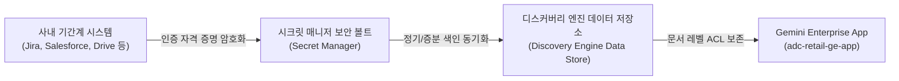

<!--
Copyright 2026 Google LLC. All Rights Reserved.
SPDX-License-Identifier: Apache-2.0

NOTICE: This code/repository is owned by Google LLC and provided under the Apache-2.0 License.
It is strictly provided as an EXAMPLE/REFERENCE ONLY and is NOT INTENDED FOR PRODUCTION USE.
All contents, designs, and code examples are subject to change, modification, or removal at any time without notice.

[고지 사항] 본 저장소 및 문서는 구글 (Google LLC) 소유이며 Apache 2.0 라이선스 하에 예시 (Sample) 용도로 제공된다.
프로덕션 환경용이 아니며, 사전 통지 없이 언제든지 수정, 변경 또는 삭제될 수 있다.
-->

> [!IMPORTANT]
> **구글 (Google LLC) 참조용 샘플 고지 사항**:
> 본 프로젝트의 모든 소스 코드와 문서는 Google LLC의 소유이며, Apache-2.0 라이선스에 따라 오직 **참조용 샘플 (Sample / Reference Only)** 목적으로만 제공된다. 프로덕션 환경에 그대로 사용할 수 없으며, 사전 통지 없이 언제든 내용이 수정, 변경 또는 삭제될 수 있다.

# Gemini Enterprise 데이터 커넥터 스캐폴더 (gemini-enterprise-copilot-connector)

사내 클라우드 아키텍트 및 데이터 엔지니어가 지라(Jira), 컨플루언스(Confluence), 세일즈포스(Salesforce), 서비스나우(ServiceNow), 셰어포인트(SharePoint), 구글 드라이브(Google Drive), 빅쿼리(BigQuery) 등 다양한 사내 기간계 시스템의 데이터를 제미나이 엔터프라이즈 앱(Gemini Enterprise app)에 안전하게 연결할 수 있도록 데이터 저장소(Data Store) 구성 매니페스트와 시크릿 매니저(Secret Manager) 보안 볼트 연동 설정을 대화형으로 자율 생성해 주는 사내 커넥터 스캐폴더 엔지니어링 도구다. (As of 2026-10-17)

**Audience**: `#Architect`, `#Developer`, `#SecOps`  
**Concern**: `#Architecture`, `#Compliance`, `#Security`  
**Service**: `#AgentPlatform`, `#BigQuery`, `#CloudStorage`  

---

## 1. 문제 증상 및 도입 배경 체크리스트

사내 엔터프라이즈 에이전트 도입 후 다음과 같은 실무적 한계나 연동 난관이 발생하고 있다면 본 솔루션 도입이 필요하다:

- [ ] **기간계 데이터 파편화**: 사내 주요 지식이 지라, 컨플루언스, 세일즈포스, 셰어포인트 등 여러 SaaS에 분산되어 있어 AI 검색을 위한 단일 뷰 구성이 어려운 경우
- [ ] **인증 프로토콜 복잡성**: 각 데이터 소스마다 OAuth 2.0, API Token, JWT 등 인증 방식이 제각각이어서 커넥터 매니페스트 작성에 많은 시간이 소모되는 경우
- [ ] **문서 레벨 권한(ACL) 유실 우려**: 원본 SaaS의 사용자별 열람 권한이 동기화되지 않아 권한 없는 사용자에게 기밀 정보가 노출될 위험이 있는 경우
- [ ] **동기화 주기 및 증분 색인 미흡**: 변경 데이터가 실시간 또는 정기적으로 반영되지 않아 AI 에이전트가 과거 정보를 바탕으로 잘못된 답변을 생성하는 경우

---

## 2. 처리 아키텍처 (Activity Diagram)

본 도구는 현업의 요구사항이나 8대 데이터 소스 칩을 수신하여 Discovery Engine Data Store 구성 매니페스트를 합성하고, Secret Manager 보안 볼트 연동 및 Gemini Enterprise app 바인딩 설정을 일괄 도출하는 3단계 파이프라인으로 동작한다.



---

## 3. 필요 IAM 권한 및 역할

본 도구를 실행하고 실제 리소스를 배포하기 위해 필요한 최소 IAM 역할은 다음과 같다:

| 역할 (Role) | 권한 및 용도 |
| :--- | :--- |
| `roles/discoveryengine.admin` | Discovery Engine Data Store 생성, 스케줄 설정 및 엔진 바인딩 |
| `roles/secretmanager.admin` (또는 `secretAccessor`) | 커넥터 인증 토큰 보관용 보안 볼트 시크릿 생성 및 접근 |
| `roles/iam.serviceAccountUser` | 커넥터 실행 대행 서비스 계정 가장 실행 |

---

## 4. 원클릭 실행법 및 사용 가이드

### 4.1. 가상 실행 모드 (--dry-run)
실제 GCP 호출 없이 모의 환경에서 커넥터 매니페스트 및 보안 볼트 설정을 안전하게 검증한다:
```bash
python diagnose.py --dry-run
```

### 4.2. 특정 데이터 커넥터 칩 지정 실행
8대 기간계 데이터 소스 중 원하는 커넥터를 번호로 지정하여 매니페스트를 도출한다:
```bash
# 1번 Jira Cloud 커넥터 (이슈 및 티켓 동기화)
python diagnose.py --dry-run --chip 1

# 2번 Confluence Cloud 커넥터 (사내 위키 및 기술 문서)
python diagnose.py --dry-run --chip 2

# 3번 Salesforce CRM 커넥터 (고객 및 영업 기회)
python diagnose.py --dry-run --chip 3

# 5번 SharePoint Online 커넥터 (M365 팀 사이트 문서)
python diagnose.py --dry-run --chip 5

# 6번 Google Drive 커넥터 (전사 공유 드라이브)
python diagnose.py --dry-run --chip 6

# 사용자 맞춤형 시스템 연동 요구사항 입력
python diagnose.py --dry-run --prompt "사내 ERP 구매 발주 데이터베이스"
```

### 4.3. 대화형 번호 선택기 가동 (--interactive)
터미널 대화형 환경에서 8대 커넥터 목록을 확인하고 번호로 선택하여 실행한다:
```bash
python diagnose.py --interactive
```

### 4.4. 사내 GE App에 커넥터 스캐폴더 1클릭 프로비저닝 (--deploy-engine)
본 미니 프로젝트의 커넥터 스캐폴더 에이전트를 사내 GCP 프로젝트의 **Agent Engine**으로 프로비저닝하고 사내 **Gemini Enterprise app(`/r/agents`)** 전사 갤러리에 직결 등록한다:

```bash
# 1. 가상 실행으로 배포 명세 사전 검증
python diagnose.py --dry-run --deploy-engine

# 2. 실제 사내 환경 원클릭 배포 집행
python diagnose.py --deploy-engine
```

성공 시 사내 아키텍트 및 데이터 엔지니어가 GE app 챗창에서 커넥터 스캐폴더와 대화하며 Jira, Confluence, Salesforce, Drive 등 기간계 저장소의 ACL 및 Data Store 연동 스펙을 자율 생성할 수 있다.

---

## 5. 사내 거버넌스 4대 필수 표준 라벨링

데이터 커넥터 인프라 및 보안 볼트 리소스(Secret Manager 시크릿, Discovery Engine Data Store 등) 생성 시 4대 표준 라벨을 반드시 적용한다:
- `managed-by`: `google-cloud-0-to-1`
- `scenario`: `gemini-enterprise-copilot-connector`
- `env`: `sample` (또는 `poc`)
- `created-by`: `customer-engineer`

---

## 6. 콘솔 링크 조치 가이드

- **Discovery Engine 데이터 저장소 콘솔**: ( https://console.cloud.google.com/gen-app-builder/data-stores )
- **Gemini Enterprise App 관리 콘솔**: ( https://console.cloud.google.com/gen-app-builder/engines )
- **Secret Manager 보안 볼트 콘솔**: ( https://console.cloud.google.com/security/secret-manager )
- **IAM 및 서비스 계정 콘솔**: ( https://console.cloud.google.com/iam-admin/iam )

---

## 7. 자원 정리 안내 (Teardown)

본 도구로 생성된 테스트 데이터 저장소나 Secret Manager 보안 볼트를 정리하고자 할 경우 아래 명령어를 순차적으로 실행한다:

```bash
# 1. Gemini Enterprise app에서 Data Store 바인딩 해제
curl -X POST \
    -H "Authorization: Bearer $(gcloud auth print-access-token)" \
    -H "Content-Type: application/json" \
    "https://discoveryengine.googleapis.com/v1alpha/projects/${PROJECT_ID}/locations/${LOCATION}/collections/default_collection/engines/${GE_APP_ID}:unbindDataStore" \
    -d '{"dataStoreId": "'${DATA_STORE_ID}'"}'

# 2. Discovery Engine Data Store 삭제
gcloud beta discovery-engine data-stores delete "${DATA_STORE_ID}" \
    --project="${PROJECT_ID}" \
    --location="${LOCATION}" --quiet

# 3. Secret Manager 시크릿 정리
gcloud secrets delete "${SECRET_ID}" --project="${PROJECT_ID}" --quiet
```
