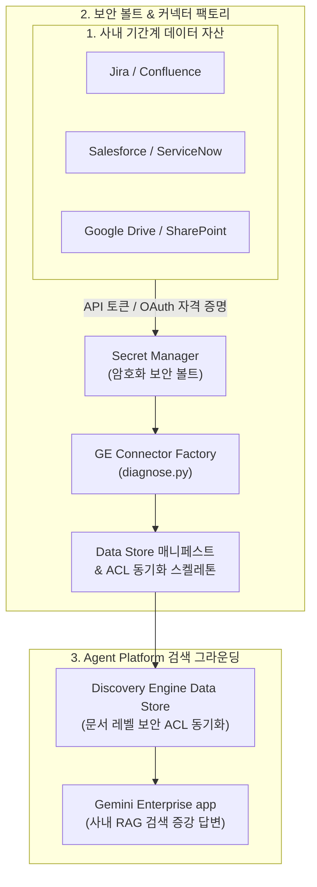

<!--
Copyright 2026 Google LLC. All Rights Reserved.
SPDX-License-Identifier: Apache-2.0

NOTICE: This code/repository is owned by Google LLC and provided under the Apache-2.0 License.
It is strictly provided as an EXAMPLE/REFERENCE ONLY and is NOT INTENDED FOR PRODUCTION USE.
All contents, designs, and code examples are subject to change, modification, or removal at any time without notice.

[고지 사항] 본 저장소 및 문서는 구글 (Google LLC) 소유이며 Apache 2.0 라이선스 하에 예시 (Sample) 용도로 제공된다.
프로덕션 환경용이 아니며, 사전 통지 없이 언제든지 수정, 변경 또는 삭제될 수 있다.
-->

> [!IMPORTANT]
> **구글 (Google LLC) 참조용 샘플 고지 사항**:
> 본 프로젝트의 모든 소스 코드와 문서는 Google LLC의 소유이며, Apache-2.0 라이선스에 따라 오직 **참조용 샘플 (Sample / Reference Only)** 목적으로만 제공된다. 프로덕션 환경에 그대로 사용할 수 없으며, 사전 통지 없이 언제든 내용이 수정, 변경 또는 삭제될 수 있다.

# Gemini Enterprise 데이터 커넥터 스캐폴더 (gemini-enterprise-copilot-connector)

사내 클라우드 아키텍트 및 데이터 엔지니어가 지라(Jira), 컨플루언스(Confluence), 세일즈포스(Salesforce), 서비스나우(ServiceNow), 셰어포인트(SharePoint), 구글 드라이브(Google Drive), 빅쿼리(BigQuery) 등 다양한 사내 기간계 시스템의 데이터를 제미나이 엔터프라이즈 앱(Gemini Enterprise app)에 안전하게 연결할 수 있도록 데이터 저장소(Data Store) 구성 매니페스트와 시크릿 매니저(Secret Manager) 보안 볼트 연동 설정을 대화형으로 자율 생성해 주는 사내 커넥터 스캐폴더 엔지니어링 도구다. (As of 2026-10-17)

---

## 1. 발생 증상 및 진단 대상 체크리스트

사내 또는 고객사 환경에서 아래 증상이 발생한다면 즉시 진단 대상이다:
사내 엔터프라이즈 에이전트 도입 후 다음과 같은 실무적 한계나 연동 난관이 발생하고 있다면 본 솔루션 도입이 필요하다:
- [ ] **기간계 데이터 파편화**: 사내 주요 지식이 지라, 컨플루언스, 세일즈포스, 셰어포인트 등 여러 SaaS에 분산되어 있어 AI 검색을 위한 단일 뷰 구성이 어려운 경우
- [ ] **인증 프로토콜 복잡성**: 각 데이터 소스마다 OAuth 2.0, API Token, JWT 등 인증 방식이 제각각이어서 커넥터 매니페스트 작성에 많은 시간이 소모되는 경우
- [ ] **문서 레벨 권한(ACL) 유실 우려**: 원본 SaaS의 사용자별 열람 권한이 동기화되지 않아 권한 없는 사용자에게 기밀 정보가 노출될 위험이 있는 경우
- [ ] **동기화 주기 및 증분 색인 미흡**: 변경 데이터가 실시간 또는 정기적으로 반영되지 않아 AI 에이전트가 과거 정보를 바탕으로 잘못된 답변을 생성하는 경우

---

## 2. 빠른 시작 (Quickstart)

> [!TIP]
> Cloud Shell 접속 환경 구성 및 저장소 클론(`git clone`) 방법은 루트의 [메인 README](../../README.md)를 참고한다.

### 1) 모의 데이터 가상 실행 (Dry-Run)
GCP API 호출 없이 내장된 가상 인프라 데이터로 정상 동작 여부를 즉시 검증한다:
```bash
python diagnose.py --dry-run
```

**터미널 진단 출력 미리보기:**
```text
===========================================================================
  Gemini Enterprise 데이터 커넥터 스캐폴더 (gemini-enterprise-copilot-connector)
===========================================================================
[*] 사내 활성 Gemini Enterprise App 자동 감지: sample-ge-app-id
[*] 활성 프로젝트    : sample-project-id
[*] 배포 리전        : global
[*] 대상 GE App ID   : sample-ge-app-id
[*] 실행 서비스 계정 : ge-connector-sa@sample-project-id.iam.gserviceaccount.com
[*] 실행 모드        : 가상 실행 (--dry-run)

[진행] 사내 데이터 커넥터 스캐폴더(붕어빵 틀) 프로비저닝 파이프라인 가동...

===========================================================================
  [원클릭 배포] GE Connector Scaffolder 배포 파이프라인
===========================================================================
[*] 대상 프로젝트 : sample-project-id
[*] Agent Engine  : us-central1
[*] GE App ID     : sample-ge-app-id (위치: global)
[*] 필수 4대 라벨 : {'managed-by': 'google-cloud-0-to-1', 'scenario': 'gemini-enterprise-copilot-connector', 'env': 'sample', 'created-by': 'customer-engineer'}

--> [가상 실행 모드 (--dry-run)] 실제 배포 없이 프로비저닝 명세를 시뮬레이션합니다.
  [1] Agent Engine 프로비저닝 시뮬레이션: projects/sample-project-id/locations/us-central1/reasoningEngines/1449671171728474112
  [2] GE App 사내 갤러리(/r/agents) 전사 공유(ALL_USERS) 등록 명세 검증 완료

[성공] 마크다운 진단 보고서가 저장되었습니다: /path/to/samples/gemini-enterprise-copilot-connector/report.md

===========================================================================
  데이터 커넥터 스캐폴더 배포 및 등록 완료 (모든 점검 통과)
===========================================================================
```

### 2) 실제 사내 인프라 실시간 진단
```bash
cp .env.example .env
python diagnose.py
```
> [!NOTE]
> `.env` 설정값을 비워두면 gcloud 활성 설정 및 사내 리소스를 자동으로 감지하여 진단한다.

---

## 3. 기간계 데이터 커넥터 아키텍처 및 동기화 흐름



---

## 4. 조치 가이드 및 권장 설정

- **Discovery Engine 데이터 저장소 콘솔**: ( https://console.cloud.google.com/gen-app-builder/data-stores )
- **Gemini Enterprise App 관리 콘솔**: ( https://console.cloud.google.com/gen-app-builder/engines )
- **Secret Manager 보안 볼트 콘솔**: ( https://console.cloud.google.com/security/secret-manager )
- **IAM 및 서비스 계정 콘솔**: ( https://console.cloud.google.com/iam-admin/iam )

---
## 5. 사전 준비 사항 (필요 IAM 권한)

본 도구를 실행하려면 최소 아래의 IAM 권한이 필요하다:

본 도구를 실행하고 실제 리소스를 배포하기 위해 필요한 최소 IAM 역할은 다음과 같다:

| 역할 (Role) | 권한 및 용도 |
| :--- | :--- |
| `roles/discoveryengine.admin` | Discovery Engine Data Store 생성, 스케줄 설정 및 엔진 바인딩 |
| `roles/secretmanager.admin` (또는 `secretAccessor`) | 커넥터 인증 토큰 보관용 보안 볼트 시크릿 생성 및 접근 |
| `roles/iam.serviceAccountUser` | 커넥터 실행 대행 서비스 계정 가장 실행 |

---

## 6. 기술적 배경 및 아키텍처 원리 (Deep Dive)

### 관련 상세 설계 및 요구 사항 명세
- [비즈니스 요구 사항 명세서 (BRD)](docs/BRD.md): 비즈니스 배경, 성공 지표 및 요구 사항(BR-01~) 명세
- [기술 상세 설계서 (TDD)](docs/TDD.md): 시스템 아키텍처, 기능(FR-01~) 및 비기능(NFR-01~) 설계 명세

데이터 커넥터 인프라 및 보안 볼트 리소스(Secret Manager 시크릿, Discovery Engine Data Store 등) 생성 시 4대 표준 라벨을 반드시 적용한다:
- `managed-by`: `google-cloud-0-to-1`
- `scenario`: `gemini-enterprise-copilot-connector`
- `env`: `sample` (또는 `poc`)
- `created-by`: `customer-engineer`

---
## 7. 리소스 정리 (Teardown) 안내

본 도구로 생성된 테스트 데이터 저장소나 Secret Manager 보안 볼트를 정리하고자 할 경우 아래 명령어를 순차적으로 실행한다:

```bash
# 1. Gemini Enterprise app에서 Data Store 바인딩 해제
curl -X POST \
    -H "Authorization: Bearer $(gcloud auth print-access-token)" \
    -H "Content-Type: application/json" \
    "https://discoveryengine.googleapis.com/v1alpha/projects/${PROJECT_ID}/locations/${LOCATION}/collections/default_collection/engines/${GE_APP_ID}:unbindDataStore" \
    -d '{"dataStoreId": "'${DATA_STORE_ID}'"}'

# 2. Discovery Engine Data Store 삭제
gcloud beta discovery-engine data-stores delete "${DATA_STORE_ID}" \
    --project="${PROJECT_ID}" \
    --location="${LOCATION}" --quiet

# 3. Secret Manager 시크릿 정리
gcloud secrets delete "${SECRET_ID}" --project="${PROJECT_ID}" --quiet
```
