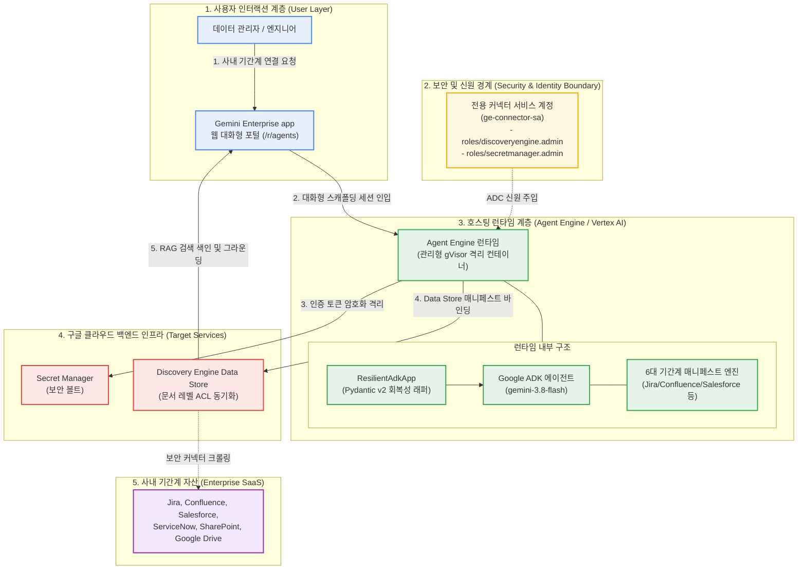

<!--
Copyright 2026 Google LLC. All Rights Reserved.
SPDX-License-Identifier: Apache-2.0

NOTICE: This code/repository is owned by Google LLC and provided under the Apache-2.0 License.
It is strictly provided as an EXAMPLE/REFERENCE ONLY and is NOT INTENDED FOR PRODUCTION USE.
All contents, designs, and code examples are subject to change, modification, or removal at any time without notice.

[고지 사항] 본 저장소 및 문서는 구글 (Google LLC) 소유이며 Apache 2.0 라이선스 하에 예시 (Sample) 용도로 제공된다.
프로덕션 환경용이 아니며, 사전 통지 없이 언제든지 수정, 변경 또는 삭제될 수 있다.
-->

> [!IMPORTANT]
> **구글 (Google LLC) 참조용 샘플 고지 사항**:
> 본 프로젝트의 모든 소스 코드와 문서는 Google LLC의 소유이며, Apache-2.0 라이선스에 따라 오직 **참조용 샘플 (Sample / Reference Only)** 목적으로만 제공된다. 프로덕션 환경에 그대로 사용할 수 없으며, 사전 통지 없이 언제든 내용이 수정, 변경 또는 삭제될 수 있다.

# Gemini Enterprise 데이터 커넥터 스캐폴더 (gemini-enterprise-copilot-connector)

구글 드라이브나 빅쿼리 같은 1P 자산은 콘솔에서 손쉽게 연결되나, 실제 기업 환경의 핵심 병목인 지라(Jira), 컨플루언스(Confluence), 세일즈포스(Salesforce), 서비스나우(ServiceNow), 셰어포인트(SharePoint), 워크데이(Workday), SAP 등 14대 엔터프라이즈 3P SaaS 시스템의 데이터를 제미나이 엔터프라이즈 앱(Gemini Enterprise app)에 안전하게 연결할 수 있도록 데이터 저장소(Data Store) 구성 매니페스트와 시크릿 매니저(Secret Manager) 보안 볼트 연동 설정을 대화형으로 자율 생성해 주는 사내 커넥터 스캐폴더 엔지니어링 도구다. (As of 2026-10-17)

---

## 1. 발생 증상 및 진단 대상 체크리스트

사내 또는 고객사 환경에서 아래 증상이 발생한다면 즉시 진단 대상이다:
사내 엔터프라이즈 에이전트 도입 후 다음과 같은 실무적 한계나 연동 난관이 발생하고 있다면 본 솔루션 도입이 필요하다:
- [ ] **기간계 데이터 파편화**: 사내 주요 지식이 지라, 컨플루언스, 세일즈포스, 셰어포인트 등 여러 SaaS에 분산되어 있어 AI 검색을 위한 단일 뷰 구성이 어려운 경우
- [ ] **인증 프로토콜 복잡성**: 각 데이터 소스마다 OAuth 2.0, API Token, JWT 등 인증 방식이 제각각이어서 커넥터 매니페스트 작성에 많은 시간이 소모되는 경우
- [ ] **문서 레벨 권한(ACL) 유실 우려**: 원본 SaaS의 사용자별 열람 권한이 동기화되지 않아 권한 없는 사용자에게 기밀 정보가 노출될 위험이 있는 경우
- [ ] **동기화 주기 및 증분 색인 미흡**: 변경 데이터가 실시간 또는 정기적으로 반영되지 않아 AI 에이전트가 과거 정보를 바탕으로 잘못된 답변을 생성하는 경우


### 1.1 도구의 본질 및 비즈니스 해결 과제 (What & Why)
- **대상 사용자 (Target)**: 엔터프라이즈 데이터 엔지니어, 사내 기간계 시스템 관리자, 솔루션 아키텍트 및 보안팀
- **해결하는 핵심 문제 (Core Pain Points)**:
  1. Jira, Confluence, Salesforce, ServiceNow 등 사내 기간계 저장소를 Gemini Enterprise app에 연결하기 위한 데이터스토어 구성이 복잡한 문제
  2. 기간계 시스템 API 인증 토큰을 안전하게 보호하지 못해 소스 코드에 키가 하드코딩되거나 자격 증명이 유출되는 보안 위험
  3. 원본 시스템의 문서 레벨 접근 권한(ACL)과 Cloud Identity 사용자 매핑 정책이 누락되어 비인가자가 대외비 문서를 조회하는 현상
- **본 솔루션의 해결 방식 (Solution)**:
  - 대화형 추천 칩을 통해 대상 시스템(Jira, Confluence, GDrive 등)을 선택하면 문서 레벨 ACL 동기화 설정, Secret Manager 보안 볼트 연동 및 Discovery Engine Data Store 프로비저닝 명세를 자동 생성하고 사내 갤러리에 바인딩한다.

### 1.2 최종 산출물 3종 세트 미리보기 (Deliverables & Visual Preview)
본 도구를 실행(`python diagnose.py`)하면 다음 3가지 구체적인 엔터프라이즈 자산이 생성된다:

| 산출물 구분 | 산출물 형태 및 명칭 | 주요 포함 내용 및 실무 활용 방안 |
| :--- | :--- | :--- |
| **① 터미널 콘솔 요약** | Visual CLI Table | 선택된 시스템 커넥터 유형, Secret Manager 볼트 바인딩 상태, 데이터 저장소 생성 매니페스트 및 등록 결과 |
| **② 정규 진단 보고서** | 마크다운 파일 (`report.md`) | 데이터 커넥터 아키텍처 보고서, Secret Manager 시크릿 저장 가이드, Discovery Engine Data Store 구성 매니페스트 및 동기화 스케줄 |
| **③ 후속 조치 및 배포 자산** | Actionable Asset Specs | • **데이터스토어 프로비저닝 매니페스트**: 기간계 시스템별 증분 색인 및 ACL 매핑 JSON<br/>• **Secret Manager 연동 템플릿**: API 토큰과 OAuth 자격 증명을 안전하게 관리하는 볼트 구성<br/>• **사내 검색 엔진 원클릭 바인딩**: 생성된 데이터스토어를 Gemini Enterprise app에 연결하는 API 명세 |

---

## 2. 빠른 시작 (Quickstart)

> [!TIP]
> Cloud Shell 접속 환경 구성 및 저장소 클론(`git clone`) 방법은 루트의 [메인 README](../../README.md)를 참고한다.

### 1) 모의 데이터 가상 실행 (Dry-Run)
GCP API 호출 없이 내장된 가상 인프라 데이터로 정상 동작 여부를 즉시 검증한다:
```bash
# 기본 팩토리(붕어빵 틀) 가상 배포 시뮬레이션
python diagnose.py --dry-run

# 14대 엔터프라이즈 3P SaaS 커넥터 매니페스트 합성 가상 검증 (1번: Confluence 커넥터)
python diagnose.py --scaffold --chip 1 --dry-run

# 자유 프롬프트 기반 맞춤형 시스템 커넥터 합성 가상 검증
python diagnose.py --scaffold --prompt "사내 하둡 HDFS 데이터 레이크 커넥터" --dry-run
```

**터미널 진단 출력 미리보기:**
```text
===========================================================================
  Gemini Enterprise 데이터 커넥터 스캐폴더 (gemini-enterprise-copilot-connector)
===========================================================================
[*] 활성 프로젝트    : sample-project-id
[*] 배포 리전        : global
[*] 대상 GE App ID   : sample-ge-app-id
[*] 실행 서비스 계정 : ge-connector-sa@sample-project-id.iam.gserviceaccount.com
[*] 실행 모드        : 가상 실행 (--dry-run)

[안내] 로컬 단일 커넥터 매니페스트 합성 보조 모드 가동

[단계 1/3] 커넥터 칩 스펙 컴파일 중...
  - 커넥터 명칭 : Confluence Cloud 사내 지식 베이스 커넥터 (슬러그: collab-confluence-wiki)
  - 시스템 분류 : 협업 도구 및 기술 문서
  - 인증 방식   : OAUTH2_CLIENT_CREDENTIALS
  - ACL 동기화  : SPACE_AND_PAGE_RESTRICTIONS

[단계 2/3] Discovery Engine 매니페스트 및 보안 볼트 연동 스펙 합성 중...
  - 생성된 Data Store ID : ds-collab-confluence-wiki-sample-p
  - Secret Manager 볼트 : connector-secret-collab-confluence-wiki

[단계 3/3] 서비스 계정 IAM 권한 및 Gemini Enterprise app 바인딩 진단 중...
  - 상태: PASS (Simulated) | 가상 실행 검증 완료

[성공] 마크다운 진단 보고서가 저장되었습니다: report.md

===========================================================================
  데이터 커넥터 스펙 컴파일 및 진단 완료
===========================================================================
```


### 2) 사내 환경 대화형 설정 (Config Wizard, 선택 사항)
사내 활성 프로젝트, 리전 및 실시간 Gemini Enterprise App 목록을 감지하여 `.env`에 자동 저장한다:
```bash
python diagnose.py --config
```


### 3) 실제 사내 인프라 실시간 진단 및 팩토리 프로비저닝
```bash
# 팩토리 메타 에이전트 프로비저닝 및 사내 갤러리(/r/agents) 전사 등록
python diagnose.py

# 또는 외부 선언적 카탈로그를 지정하여 대화형 선택기 가동
python diagnose.py --scaffold --catalog catalog.yaml --interactive
```
> [!NOTE]
> 앞서 `python diagnose.py --config`로 환경 설정을 저장했거나 gcloud 활성 설정을 그대로 활용할 경우 별도의 `.env` 생성 없이 즉시 실행할 수 있다. (환경 변수를 텍스트 에디터로 직접 수동 편집하고자 할 때만 `cp -n .env.example .env` 실행 후 수정)

---

## 3. 솔루션 아키텍처 및 런타임 서비스 흐름



---

## 4. 조치 가이드 및 권장 설정

- **Discovery Engine 데이터 저장소 콘솔**: ( https://console.cloud.google.com/gen-app-builder/data-stores )
- **Gemini Enterprise App 관리 콘솔**: ( https://console.cloud.google.com/gemini-enterprise/locations/global/engines )
- **Secret Manager 보안 볼트 콘솔**: ( https://console.cloud.google.com/security/secret-manager )
- **IAM 및 서비스 계정 콘솔**: ( https://console.cloud.google.com/iam-admin/iam )

---
## 5. 사전 준비 사항 (필요 IAM 권한)

본 도구를 실행하려면 최소 아래의 IAM 권한이 필요하다:

본 도구를 실행하고 실제 리소스를 배포하기 위해 필요한 최소 IAM 역할은 다음과 같다:

| 역할 (Role) | 권한 및 용도 |
| :--- | :--- |
| `roles/discoveryengine.admin` | Discovery Engine Data Store 생성, 스케줄 설정 및 엔진 바인딩 |
| `roles/secretmanager.admin` (또는 `secretAccessor`) | 커넥터 인증 토큰 보관용 보안 볼트 시크릿 생성 및 접근 |
| `roles/iam.serviceAccountUser` | 커넥터 실행 대행 서비스 계정 가장 실행 |

---

## 6. 기술적 배경 및 아키텍처 원리 (Deep Dive)

### 관련 상세 설계 및 요구 사항 명세
- [비즈니스 요구 사항 명세서 (BRD)](docs/BRD.md): 비즈니스 배경, 성공 지표 및 요구 사항(BR-01~) 명세
- [기술 상세 설계서 (TDD)](docs/TDD.md): 시스템 아키텍처, 기능(FR-01~) 및 비기능(NFR-01~) 설계 명세

데이터 커넥터 인프라 및 보안 볼트 리소스(Secret Manager 시크릿, Discovery Engine Data Store 등) 생성 시 4대 표준 라벨을 반드시 적용한다:
- `managed-by`: `google-cloud-0-to-1`
- `scenario`: `gemini-enterprise-copilot-connector`
- `env`: `sample` (또는 `poc`)
- `created-by`: `customer-engineer`

---
## 7. 리소스 정리 (Teardown) 안내

본 도구로 생성된 테스트 데이터 저장소나 Secret Manager 보안 볼트를 정리하고자 할 경우 아래 명령어를 순차적으로 실행한다:

```bash
# 1. Gemini Enterprise app에서 Data Store 바인딩 해제
curl -X POST \
    -H "Authorization: Bearer $(gcloud auth print-access-token)" \
    -H "Content-Type: application/json" \
    "https://discoveryengine.googleapis.com/v1alpha/projects/${PROJECT_ID}/locations/${LOCATION}/collections/default_collection/engines/${GE_APP_ID}:unbindDataStore" \
    -d '{"dataStoreId": "'${DATA_STORE_ID}'"}'

# 2. Discovery Engine Data Store 삭제
gcloud beta discovery-engine data-stores delete "${DATA_STORE_ID}" \
    --project="${PROJECT_ID}" \
    --location="${LOCATION}" --quiet

# 3. Secret Manager 시크릿 정리
gcloud secrets delete "${SECRET_ID}" --project="${PROJECT_ID}" --quiet
```
