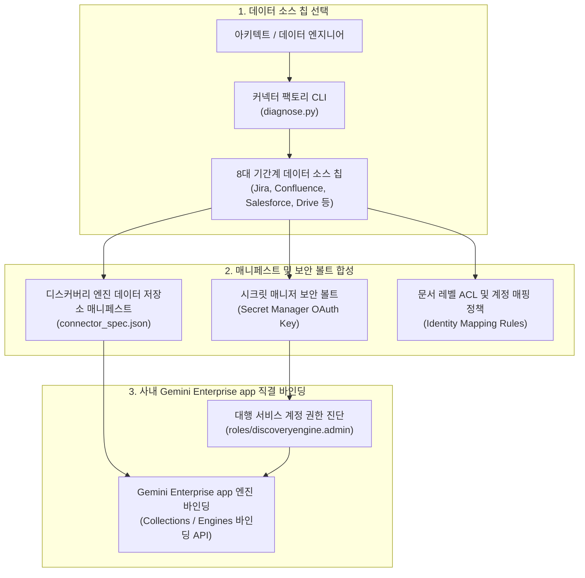

<!--
Copyright 2026 Google LLC. All Rights Reserved.
SPDX-License-Identifier: Apache-2.0

NOTICE: This code/repository is owned by Google LLC and provided under the Apache-2.0 License.
It is strictly provided as an EXAMPLE/REFERENCE ONLY and is NOT INTENDED FOR PRODUCTION USE.
All contents, designs, and code examples are subject to change, modification, or removal at any time without notice.

[고지 사항] 본 저장소 및 문서는 구글 (Google LLC) 소유이며 Apache 2.0 라이선스 하에 예시 (Sample) 용도로 제공된다.
프로덕션 환경용이 아니며, 사전 통지 없이 언제든지 수정, 변경 또는 삭제될 수 있다.
-->

# Gemini Enterprise 데이터 커넥터 팩토리 기술 상세 설계서 (TDD)

본 문서는 사내 기간계 데이터 저장소를 제미나이 엔터프라이즈 앱(Gemini Enterprise app)의 데이터 저장소(Data Store)로 연결하기 위한 데이터 커넥터 팩토리 도구의 시스템 아키텍처, 기술 상세 설계, 인터페이스 규격 및 진단 로직을 정의한다.

---

## 1. 시스템 아키텍처 및 처리 흐름

본 도구는 크게 **데이터 소스 칩 선택 및 스펙 컴파일**, **보안 볼트 및 ACL 동기화 매니페스트 합성**, **IAM 권한 및 Gemini Enterprise app 바인딩 진단**의 3단계 파이프라인으로 구성된다.

---

## 2. 요구 사항 추적성 매핑 (Traceability Matrix)

| 비즈니스 요구 사항 (BRD) | 기능적 기술 요구 사항 (FR) | 비기능적 기술 요구 사항 (NFR) | 구현 파일 및 모듈 |
| :--- | :--- | :--- | :--- |
| **BR-01** (대화형 데이터 소스 칩 선택) | **FR-01** (8대 데이터 소스 카탈로그 및 CLI 파서) | **NFR-01** (무의존성 단일 파이썬 실행) | `diagnose.py` |
| **BR-02** (보안 볼트 기반 자격 증명 연동) | **FR-02** (Secret Manager 보안 볼트 연동 빌더) | **NFR-02** (최소 권한 보안 격리) | `diagnose.py` |
| **BR-03** (문서 레벨 ACL 및 사용자 매핑) | **FR-03** (문서 레벨 ACL 정책 컴파일러) | **NFR-02** (데이터 거버넌스 준수) | `diagnose.py` |
| **BR-04** (동기화 주기 및 증분 색인) | **FR-04** (Discovery Engine Data Store 매니페스트 생성) | **NFR-01**, **NFR-03** | `diagnose.py` |
| **BR-05** (Gemini Enterprise app 직결 바인딩) | **FR-05** (엔진 바인딩 API 및 CLI 명세 합성) | **NFR-03** (결정론적 가상 실행 보장) | `diagnose.py` |
| **BR-06** (엔터프라이즈 보안 및 4대 라벨) | **FR-06** (IAM 권한 진단 및 report.md 생성) | **NFR-02**, **NFR-03** | `diagnose.py`, `report.md` |

---

## 3. 기능 기술 요구 사항 명세 (Functional Requirements)

### FR-01: 8대 기간계 데이터 소스 카탈로그 및 파서
- 지라(Jira), 컨플루언스(Confluence), 세일즈포스(Salesforce), 서비스나우(ServiceNow), 셰어포인트(SharePoint), 구글 드라이브(Google Drive), 빅쿼리(BigQuery), 웹 크롤링(Web Crawl) 8개 표준 데이터 소스 칩을 내장한다.
- 사용자가 CLI 인자(`--chip`, `--prompt`) 또는 대화형 환경에서 번호로 선택할 수 있도록 지원한다.

### FR-02: Secret Manager 보안 볼트 연동 빌더
- 각 데이터 소스별 필요 자격 증명(OAuth 2.0 Client ID/Secret, API 토큰, 서비스 계정 키)을 시크릿 매니저(Secret Manager)에 보관하기 위한 시크릿 URI를 자동 합성한다.
- 대행 서비스 계정에 `roles/secretmanager.secretAccessor` 역할을 최소 권한으로 바인딩하는 지침을 생성한다.

### FR-03: 문서 레벨 접근 제어(ACL) 및 계정 매핑 컴파일러
- 원본 SaaS 사용자의 이메일과 사내 구글 워크스페이스(Google Workspace) / Cloud Identity 계정 간의 일치 여부를 매핑하는 사용자 식별 정책(Identity Mapping)을 명세한다.
- 공개 문서(PUBLIC), 부서 제한(GROUP_RESTRICTED), 개인 문서(USER_RESTRICTED)의 3단계 접근 격리 규칙을 매니페스트에 주입한다.

### FR-04: Discovery Engine Data Store 구성 매니페스트 자동 생성
- 구글 클라우드 공식 Discovery Engine Data Store v1alpha/v1 규격에 맞추어 `dataStoreId`, `displayName`, `contentConfig`, `solutionTypes` 매니페스트 JSON을 합성한다.
- 1시간 정기 증분 동기화(Schedule) 및 에러 발생 시 알림 정책을 포함한다.

### FR-05: Gemini Enterprise app 엔진 직결 바인딩
- 생성된 데이터 저장소를 사내 Gemini Enterprise app의 `default_collection/engines/${GE_APP_ID}`에 즉시 바인딩할 수 있는 Discovery Engine API 요청 페이로드 및 `gcloud` CLI 명령어를 생성한다.

### FR-06: 서비스 계정 IAM 권한 진단 및 표준 리포트 자동 생성
- 커넥터 실행 서비스 계정의 필수 역할(`roles/discoveryengine.admin`, `roles/secretmanager.secretAccessor`) 바인딩 상태를 점검한다.
- 실행 완료 시 연동 매니페스트, 보안 설정, 콘솔 조치 가이드를 담은 `report.md`를 자동 생성 및 덮어쓴다.

---

## 4. 비기능 기술 요구 사항 명세 (Non-Functional Requirements)

### NFR-01: 무의존성 및 순수 파이썬 단일 실행 원칙
- 외부 쉘 스크립트에 의존하지 않고 크로스 플랫폼(Linux, macOS, Windows)에서 `python diagnose.py` 직접 실행만으로 동작한다.

### NFR-02: 보안 및 4대 필수 라벨 준수
- 모든 생성 매니페스트 및 리소스에 4대 필수 라벨(`managed-by=google-cloud-0-to-1`, `scenario=gemini-enterprise-copilot-connector`, `env=sample`, `created-by=customer-engineer`)을 강제한다.
- 실제 자격 증명이나 개인 식별 정보(PII)의 평문 노출을 전면 차단한다.

### NFR-03: 결정론적 가상 실행(--dry-run) 지원
- GCP 환경 연결 없이도 모의 데이터를 통해 전체 파이프라인의 문법 무결성 및 매니페스트 구조를 100% 검증할 수 있도록 지원한다.
