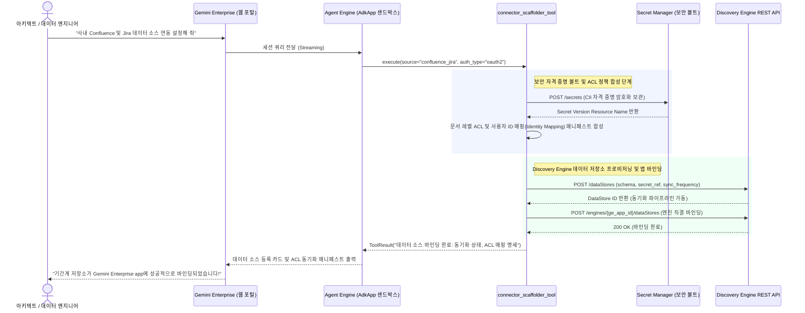

<!--
Copyright 2026 Google LLC. All Rights Reserved.
SPDX-License-Identifier: Apache-2.0

NOTICE: This code/repository is owned by Google LLC and provided under the Apache-2.0 License.
It is strictly provided as an EXAMPLE/REFERENCE ONLY and is NOT INTENDED FOR PRODUCTION USE.
All contents, designs, and code examples are subject to change, modification, or removal at any time without notice.

[고지 사항] 본 저장소 및 문서는 구글 (Google LLC) 소유이며 Apache 2.0 라이선스 하에 예시 (Sample) 용도로 제공된다.
프로덕션 환경용이 아니며, 사전 통지 없이 언제든지 수정, 변경 또는 삭제될 수 있다.
-->

# Gemini Enterprise 데이터 커넥터 스캐폴더 기술 상세 설계서 (TDD)

본 문서는 사내 기간계 데이터 저장소를 제미나이 엔터프라이즈 앱(Gemini Enterprise app)의 데이터 저장소(Data Store)로 연결하기 위한 데이터 커넥터 스캐폴더 도구의 시스템 아키텍처, 기술 상세 설계, 인터페이스 규격 및 진단 로직을 정의한다.

---

## 1. 시스템 아키텍처 및 런타임 상호작용 시퀀스

본 도구의 런타임 제어 및 데이터 상호작용 흐름은 아래 시퀀스 다이어그램과 같다. 아키텍트 또는 데이터 엔지니어가 제미나이 엔터프라이즈 앱(Gemini Enterprise app) 대화창에서 8대 기간계 데이터 소스(Jira, Confluence, Salesforce, Google Drive 등) 연결 요청을 입력하면, 에이전트 엔진(Agent Engine) 런타임이 시크릿 매니저(Secret Manager) 보안 볼트와 문서 레벨 ACL 매핑을 합성하고 디스커버리 엔진(Discovery Engine) 데이터 저장소(Data Store)를 사내 앱에 안전하게 직결 바인딩한다.

---

## 2. 요구 사항 추적성 매핑 (Traceability Matrix)

| 비즈니스 요구 사항 (BRD) | 기능적 기술 요구 사항 (FR) | 비기능적 기술 요구 사항 (NFR) | 구현 파일 및 모듈 |
| :--- | :--- | :--- | :--- |
| **BR-01** (엔터프라이즈 커넥터 및 자유 프롬프팅) | **FR-01** (엔터프라이즈 커넥터 카탈로그 및 선택기) | **NFR-01** (무의존성 단일 파이썬 실행) | `catalog.yaml`, `diagnose.py` |
| **BR-02** (보안 볼트 기반 자격 증명 연동) | **FR-02** (Secret Manager 보안 볼트 연동 빌더) | **NFR-02** (최소 권한 보안 격리) | `diagnose.py` |
| **BR-03** (문서 레벨 ACL 및 사용자 매핑) | **FR-03** (문서 레벨 ACL 정책 컴파일러) | **NFR-02** (데이터 거버넌스 준수) | `diagnose.py` |
| **BR-04** (동기화 주기 및 증분 색인) | **FR-04** (Discovery Engine Data Store 매니페스트 생성) | **NFR-01**, **NFR-03** | `diagnose.py` |
| **BR-05** (Gemini Enterprise app 직결 바인딩) | **FR-05** (엔진 바인딩 API 및 CLI 명세 합성) | **NFR-03** (결정론적 가상 실행 보장) | `diagnose.py` |
| **BR-06** (엔터프라이즈 보안 및 4대 라벨) | **FR-06** (IAM 권한 진단 및 report.md 생성) | **NFR-02**, **NFR-03** | `diagnose.py`, `report.md` |
| **BR-07** (선언적 레시피 및 케밥 케이스) | **FR-07** (4단계 캐스케이드 카탈로그 로더 및 검증기) | **NFR-05** (에어갭 무중단 회복 탄력성) | `catalog.yaml`, `diagnose.py` |
| **BR-08** (에어갭 오프라인 회복 탄력성) | **FR-07** (4단계 캐스케이드 카탈로그 로더 및 검증기) | **NFR-05** (에어갭 무중단 회복 탄력성) | `diagnose.py` |
| **BR-09** (사전 슬러그 및 명칭 중복 검증) | **FR-08** (사전 슬러그 및 명칭 중복 검증 인터셉터) | **NFR-03** (결정론적 가상 실행 보장) | `diagnose.py` |

---

## 3. 기능 기술 요구 사항 명세 (Functional Requirements)

### FR-01: 엔터프라이즈 커넥터 카탈로그 및 파서
- 그룹웨어 전자결재, Confluence, Jira, Salesforce, ServiceNow, SharePoint, Google Drive, BigQuery, SAP ERP, Workday, Slack, PostgreSQL/MySQL, 인트라넷 웹, GitHub, Cloud Storage 등 기업 실무에 대표적인 15대 표준 기간계 데이터 소스 프리셋을 제공한다.
- 사용자가 CLI 인자(`--chip`, `--prompt`, `--catalog`) 또는 대화형 환경에서 번호로 선택할 수 있도록 지원하며, `0`번 선택 시 자유 프롬프트 직접 입력을 지원한다.

### FR-02: Secret Manager 보안 볼트 연동 빌더
- 각 데이터 소스별 필요 자격 증명(OAuth 2.0 Client ID/Secret, API 토큰, 서비스 계정 키)을 시크릿 매니저(Secret Manager)에 보관하기 위한 시크릿 URI를 자동 합성한다.
- 대행 서비스 계정에 `roles/secretmanager.secretAccessor` 역할을 최소 권한으로 바인딩하는 지침을 생성한다.

### FR-03: 문서 레벨 접근 제어(ACL) 및 계정 매핑 컴파일러
- 원본 SaaS 사용자의 이메일과 사내 구글 워크스페이스(Google Workspace) / Cloud Identity 계정 간의 일치 여부를 매핑하는 사용자 식별 정책(Identity Mapping)을 명세한다.
- 공개 문서(PUBLIC), 부서 제한(GROUP_RESTRICTED), 개인 문서(USER_RESTRICTED)의 3단계 접근 격리 규칙을 매니페스트에 주입한다.

### FR-04: Discovery Engine Data Store 구성 매니페스트 자동 생성
- 구글 클라우드 공식 Discovery Engine Data Store v1alpha/v1 규격에 맞추어 `dataStoreId`, `displayName`, `contentConfig`, `solutionTypes` 매니페스트 JSON을 합성한다.
- 1시간 정기 증분 동기화(Schedule) 및 에러 발생 시 알림 정책을 포함한다.

### FR-05: Gemini Enterprise app 엔진 직결 바인딩
- 생성된 데이터 저장소를 사내 Gemini Enterprise app의 `default_collection/engines/${GE_APP_ID}`에 즉시 바인딩할 수 있는 Discovery Engine API 요청 페이로드 및 `gcloud` CLI 명령어를 생성한다.

### FR-06: 서비스 계정 IAM 권한 진단 및 표준 리포트 자동 생성
- 커넥터 실행 서비스 계정의 필수 역할(`roles/discoveryengine.admin`, `roles/secretmanager.secretAccessor`) 바인딩 상태를 점검한다.
- 실행 완료 시 연동 매니페스트, 보안 설정, 콘솔 조치 가이드를 담은 `report.md`를 자동 생성 및 덮어쓴다.

### FR-07: 4단계 캐스케이드 카탈로그 로더 및 케밥 케이스 슬러그 검증
- 외부 선언적 카탈로그 파일(`catalog.yaml`)을 파싱하여 동적으로 커넥터 목록을 적재한다.
- 4단계 캐스케이드 로딩 순서를 보장한다:
  1. CLI 인자(`--catalog <path>`)
  2. 로컬 작업 디렉터리 파일(`samples/gemini-enterprise-copilot-connector/catalog.yaml`)
  3. 사내 원격 URL(네트워크 통신 시 소켓 타임아웃 2.0초 강제)
  4. 내장 결정론적 하드코딩 폴백 시드(무인터넷 환경 대응)
- 적재된 모든 커넥터의 슬러그가 정규식 `^[a-z0-9]+(-[a-z0-9]+)*$`을 충족하는 3단계 소문자 케밥 케이스(kebab-case)인지 엄격히 검증한다.

### FR-08: 사전 슬러그 및 명칭 중복 검증 인터셉터
- 신규 커넥터 매니페스트 생성 요청 시 기존 카탈로그와의 충돌을 사전에 가로채어 검증한다:
  1. 슬러그 중복(`slug`)
  2. 커넥터 디스플레이 이름 중복(`name`)
  3. 데이터 소스 식별자 중복(`source_type`)
- 중복 발견 시 즉시 작업을 중단하고 에러 원인 및 기존 커넥터 정보를 터미널과 리포트에 명확히 보고한다.

---

## 4. 비기능 기술 요구 사항 명세 (Non-Functional Requirements)

### NFR-01: 무의존성 및 순수 파이썬 단일 실행 원칙
- 외부 쉘 스크립트에 의존하지 않고 크로스 플랫폼(Linux, macOS, Windows)에서 `python diagnose.py` 직접 실행만으로 동작한다.

### NFR-02: 보안 및 4대 필수 라벨 준수
- 모든 생성 매니페스트 및 리소스에 4대 필수 라벨(`managed-by=google-cloud-0-to-1`, `scenario=gemini-enterprise-copilot-connector`, `env=sample`, `created-by=customer-engineer`)을 강제한다.
- 실제 자격 증명이나 개인 식별 정보(PII)의 평문 노출을 전면 차단한다.

### NFR-03: 결정론적 가상 실행(--dry-run) 지원
- GCP 환경 연결 없이도 모의 데이터를 통해 전체 파이프라인의 문법 무결성 및 매니페스트 구조를 100% 검증할 수 있도록 지원한다.

### NFR-04: 초경량 패키징 및 단일 디렉터리 완결성
- 외부 무거운 SDK 프레임워크 의존성을 배제하고, 수십 KB 수준의 선언적 카탈로그와 순수 파이썬 표준 라이브러리로 전체 프로젝트를 경량화한다.

### NFR-05: 에어갭 무중단 회복 탄력성 및 타임아웃 보장
- 인터넷이 차단된 폐쇄망 환경에서도 소켓 타임아웃 2.0초 제한을 통해 행(Hang) 상태를 원천 방지하고 내장 시드로 결정론적 폴백을 보장한다.
