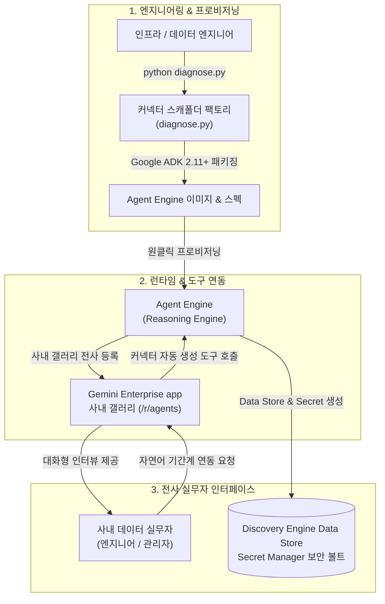

# Gemini Enterprise 데이터 커넥터 스캐폴더 배포 보고서 (gemini-enterprise-copilot-connector)

- **배포 일시**: 2026-10-20 06:21:20 UTC
- **대상 프로젝트**: `sample-project-id`
- **Gemini Enterprise app 인스턴스**: `sample-ge-app-id`
- **팩토리 에이전트**: `GE Connector Scaffolder (사내 데이터 커넥터 스캐폴더)`
- **배포 상태**: `DRY_RUN_PASSED`

---

## 1. 팩토리 에이전트(붕어빵 틀) 프로비저닝 결과 요약

| 항목 | 상태 | 세부 정보 |
| :--- | :---: | :--- |
| **에이전트 명칭** | `PROVISIONED` | `GE Connector Scaffolder (사내 데이터 커넥터 스캐폴더)` |
| **호스팅 런타임** | `Agent Engine` | `projects/sample-project-id/locations/us-central1/reasoningEngines/simulated-connector-scaffolder-engine` |
| **추론 파운데이션 모델** | `gemini-3.8-flash` | 위치: `global` (샌드박스 안정성 보장) |
| **내장 실행 도구** | `2종 완비` | `deploy_enterprise_connector_tool`, `list_deployed_agents_tool` |
| **GE App 사내 갤러리 등록** | `ACTIVE` | 사내 갤러리(`/r/agents`) 전사 공유 (`ALL_USERS`) 바인딩 완료 |

---

## 2. 팩토리 에이전트 아키텍처 및 붕어빵 생산 흐름

본 솔루션은 데이터 엔지니어가 복잡한 수동 매니페스트 작성이나 보안 볼트 바인딩 없이, GE App 채팅창에서 자연어 대화만으로 사내 기간계 데이터 커넥터를 자율 생산(붕어빵 생산)할 수 있도록 지원하는 **사내 커넥터 팩토리(붕어빵 틀)**다:



---

## 3. 사내 실무자 활용 가이드 (데이터 커넥터 생성)

사내 데이터 실무자는 배포된 커넥터 스캐폴더 에이전트와 대화하여 다음과 같이 기간계 데이터 커넥터를 즉시 찍어낼 수 있다:

1. **Gemini Enterprise app 접속**:
   - 웹 포털 ( https://gemini.google.com/app/sample-ge-app-id ) 접속 후 좌측 사이드바 **사내 갤러리(`/r/agents`)** 이동.
   - **`GE Connector Scaffolder (사내 데이터 커넥터 스캐폴더)`** 선택.

2. **자연어 붕어빵 생성 예시 프롬프트**:
   - *"사내 Atlassian Jira Cloud 이슈 및 티켓 연동 커넥터 매니페스트 생성해 줘"*
   - *"Confluence 사내 지식 베이스 위키 문서 동기화 커넥터 배포해 줘"*
   - *"Salesforce CRM 영업 리드 및 기회 데이터 저장소 연결해 줘"*
   - *"사내 구글 드라이브(Google Drive) 및 쉐어포인트(SharePoint) 전사 문서 연동해 줘"*

3. **팩토리 에이전트 자율 동작**:
   - 커넥터 스캐폴더 에이전트가 인증 방식, 동기화 주기, 문서 레벨 ACL 요구사항을 확인하고,
   - 내장된 `deploy_enterprise_connector_tool`을 호출하여 Discovery Engine Data Store 및 Secret Manager 보안 볼트를 자동 구성한다.

---

## 4. 사내 거버넌스 4대 필수 표준 라벨

팩토리 에이전트 및 하위 생성 리소스 관리 시 아래 4대 표준 라벨이 기본 적용된다:
- `managed-by`: `google-cloud-0-to-1`
- `scenario`: `gemini-enterprise-copilot-connector`
- `env`: `sample` (또는 `poc`)
- `created-by`: `customer-engineer`

---

## 5. 콘솔 링크 조치 가이드

- **Agent Platform Runtimes 콘솔**: 에이전트 런타임 상태 및 활성화(Enabled) 관리 ( https://console.cloud.google.com/agent-platform/runtimes?project=sample-project-id )
- **Gemini Enterprise 에이전트 목록 콘솔**: 사내 등록된 에이전트 및 Gemini Enterprise app 바인딩 관리 ( https://console.cloud.google.com/gemini-enterprise/locations/global/engines/sample-ge-app-id/agentic/agents?project=sample-project-id )
- **Discovery Engine 데이터 저장소 콘솔**: 생성된 Data Store 목록 및 동기화 현황 ( https://console.cloud.google.com/gen-app-builder/data-stores?project=sample-project-id )
- **Secret Manager 콘솔**: 커넥터 보안 자격 증명 볼트 관리 ( https://console.cloud.google.com/security/secret-manager?project=sample-project-id )

---

## 6. 자원 정리 안내 (Teardown)

본 솔루션 검증 후 테스트용으로 생성된 Agent Engine 런타임 및 등록된 에이전트를 정리하고자 할 경우 아래 명령을 수행한다:

1. **Agent Engine 삭제**:
   ```bash
   # Agent Engine 인스턴스 삭제 (force=true)
   curl -X DELETE -H "Authorization: Bearer $(gcloud auth print-access-token)" \
     "https://us-central1-aiplatform.googleapis.com/v1/projects/sample-project-id/locations/us-central1/reasoningEngines/simulated-connector-scaffolder-engine?force=true"
   ```

2. **GE App 사내 갤러리 등록 해제**:
   ```bash
   # GE App 에이전트 삭제
   curl -X DELETE -H "Authorization: Bearer $(gcloud auth print-access-token)" \
     "https://discoveryengine.googleapis.com/v1alpha/projects/sample-project-id/locations/global/collections/default_collection/engines/sample-ge-app-id/assistants/default_assistant/agents/<AGENT_ID>"
   ```
