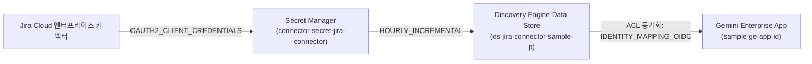

# Gemini Enterprise 데이터 커넥터 팩토리 보고서 (gemini-enterprise-copilot-connector)

- **실행 일시**: 2026-10-17 05:36:29 UTC
- **대상 프로젝트**: `sample-project-id`
- **배포 리전**: `global`
- **Gemini Enterprise App 인스턴스**: `sample-ge-app-id`
- **선택 커넥터**: `jira_connector` (Jira Cloud 엔터프라이즈 커넥터)
- **카테고리**: Atlassian SaaS
- **진단 상태**: `PASS (Simulated)`

---

## 1. 아키텍처 개요 및 핵심 연동 스펙



| 항목 | 상세 설정 내용 |
| :--- | :--- |
| **데이터 소스 유형** | `JIRA` |
| **인증 방식** | `OAUTH2_CLIENT_CREDENTIALS` |
| **보안 볼트 참조** | `projects/sample-project-id/secrets/connector-secret-jira-connector` |
| **동기화 주기** | `HOURLY_INCREMENTAL` |
| **ACL 및 권한 모델** | `IDENTITY_MAPPING_OIDC` (문서 레벨 보안 보장) |
| **수집 대상 콘텐츠** | `issues, comments, attachments` |

---

## 2. Discovery Engine Data Store 구성 매니페스트 (`connector_manifest.json`)

```json
{
  "name": "projects/sample-project-id/locations/global/collections/default_collection/dataStores/ds-jira-connector-sample-p",
  "displayName": "Jira Cloud 엔터프라이즈 커넥터",
  "industryVertical": "GENERIC",
  "solutionTypes": [
    "SOLUTION_TYPE_SEARCH",
    "SOLUTION_TYPE_CHAT"
  ],
  "contentConfig": "CONTENT_REQUIRED",
  "connectorConfig": {
    "sourceType": "JIRA",
    "authentication": {
      "authType": "OAUTH2_CLIENT_CREDENTIALS",
      "secretManagerSecretRef": "projects/sample-project-id/secrets/connector-secret-jira-connector/versions/latest",
      "serviceAccount": "ge-connector-sa@sample-project-id.iam.gserviceaccount.com"
    },
    "syncSchedule": {
      "cronSchedule": "0 * * * *",
      "refreshInterval": "3600s"
    },
    "accessControl": {
      "aclMode": "IDENTITY_MAPPING_OIDC",
      "identityMappingEnabled": true
    },
    "contentFilter": {
      "includedTypes": [
        "issues",
        "comments",
        "attachments"
      ]
    }
  },
  "labels": {
    "managed-by": "google-cloud-0-to-1",
    "scenario": "gemini-enterprise-copilot-connector",
    "env": "sample",
    "created-by": "customer-engineer"
  }
}
```

---

## 3. Gemini Enterprise app 엔진 바인딩 페이로드

```json
{
  "dataStoreIds": [
    "ds-jira-connector-sample-p"
  ],
  "servingConfig": {
    "displayName": "Serving config for ds-jira-connector-sample-p",
    "solutionType": "SOLUTION_TYPE_SEARCH"
  }
}
```

---

## 4. 원클릭 프로비저닝 실행 가이드

```bash
#!/usr/bin/env bash
# Copyright 2026 Google LLC. All Rights Reserved.
# SPDX-License-Identifier: Apache-2.0
# Jira Cloud 엔터프라이즈 커넥터 자동 프로비저닝 및 Gemini Enterprise app 바인딩 스크립트

set -euo pipefail

PROJECT_ID="sample-project-id"
LOCATION="global"
DATA_STORE_ID="ds-jira-connector-sample-p"
GE_APP_ID="sample-ge-app-id"
SECRET_ID="connector-secret-jira-connector"
SA_EMAIL="ge-connector-sa@sample-project-id.iam.gserviceaccount.com"

echo "[1/4] Secret Manager 보안 볼트에 커넥터 자격 증명 생성 중..."
gcloud secrets create "${SECRET_ID}" \
    --project="${PROJECT_ID}" \
    --replication-policy="automatic" \
    --labels="managed-by=google-cloud-0-to-1,scenario=gemini-enterprise-copilot-connector,env=sample,created-by=customer-engineer" || true

echo "[2/4] 커넥터 서비스 계정에 최소 권한(Secret Accessor) 바인딩 중..."
gcloud secrets add-iam-policy-binding "${SECRET_ID}" \
    --project="${PROJECT_ID}" \
    --member="serviceAccount:${SA_EMAIL}" \
    --role="roles/secretmanager.secretAccessor"

echo "[3/4] Discovery Engine Data Store 생성 중..."
curl -X POST \
    -H "Authorization: Bearer $(gcloud auth print-access-token)" \
    -H "Content-Type: application/json; charset=utf-8" \
    -H "X-Goog-User-Project: ${PROJECT_ID}" \
    -d @connector_manifest.json \
    "https://discoveryengine.googleapis.com/v1alpha/projects/${PROJECT_ID}/locations/${LOCATION}/collections/default_collection/dataStores?dataStoreId=${DATA_STORE_ID}"

echo "[4/4] Gemini Enterprise app 엔진에 Data Store 바인딩 중..."
curl -X POST \
    -H "Authorization: Bearer $(gcloud auth print-access-token)" \
    -H "Content-Type: application/json; charset=utf-8" \
    -H "X-Goog-User-Project: ${PROJECT_ID}" \
    -d '{"dataStoreIds": ["'${DATA_STORE_ID}'"]}' \
    "https://discoveryengine.googleapis.com/v1alpha/projects/${PROJECT_ID}/locations/${LOCATION}/collections/default_collection/engines/${GE_APP_ID}:bindDataStore"

echo "=================================================="
echo "데이터 커넥터 바인딩이 성공적으로 등록되었습니다."
echo "=================================================="

```

---

## 5. IAM 권한 및 연결성 진단 결과

- **실행 서비스 계정**: `ge-connector-sa@sample-project-id.iam.gserviceaccount.com`
- **필수 역할 바인딩**:
  - `roles/discoveryengine.admin`: Data Store 생성 및 동기화 제어
  - `roles/secretmanager.secretAccessor`: 보안 볼트 토큰 복호화
- **진단 상세**: 가상 실행 검증: ge-connector-sa@sample-project-id.iam.gserviceaccount.com에 roles/discoveryengine.admin, roles/secretmanager.secretAccessor 역할 바인딩 시뮬레이션 완료

---

## 6. 콘솔 링크 조치 가이드

- **Discovery Engine 데이터 저장소 콘솔**: ( https://console.cloud.google.com/gen-app-builder/data-stores )
- **Gemini Enterprise App 관리 콘솔**: ( https://console.cloud.google.com/gen-app-builder/engines )
- **Secret Manager 보안 볼트 콘솔**: ( https://console.cloud.google.com/security/secret-manager )
- **IAM 및 서비스 계정 콘솔**: ( https://console.cloud.google.com/iam-admin/iam )

---

## 7. 자원 정리 안내 (Teardown)

본 테스트 검증 완료 후 생성된 리소스를 정리하려면 아래 명령어를 수행한다:

```bash
# 1. Gemini Enterprise app에서 Data Store 바인딩 해제
curl -X POST \
    -H "Authorization: Bearer $(gcloud auth print-access-token)" \
    -H "Content-Type: application/json" \
    "https://discoveryengine.googleapis.com/v1alpha/projects/sample-project-id/locations/global/collections/default_collection/engines/sample-ge-app-id:unbindDataStore" \
    -d '{"dataStoreId": "ds-jira-connector-sample-p"}'

# 2. Data Store 삭제
gcloud beta discovery-engine data-stores delete "ds-jira-connector-sample-p" \
    --project="sample-project-id" \
    --location="global" --quiet

# 3. Secret Manager 시크릿 정리
gcloud secrets delete "connector-secret-jira-connector" --project="sample-project-id" --quiet
```
