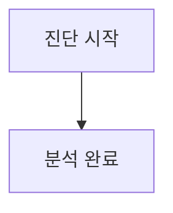

<!--
Copyright 2026 Google LLC. All Rights Reserved.
SPDX-License-Identifier: Apache-2.0

NOTICE: This code/repository is owned by Google LLC and provided under the Apache-2.0 License.
It is strictly provided as an EXAMPLE/REFERENCE ONLY and is NOT INTENDED FOR PRODUCTION USE.
All contents, designs, and code examples are subject to change, modification, or removal at any time without notice.

[고지 사항] 본 저장소 및 문서는 구글 (Google LLC) 소유이며 Apache 2.0 라이선스 하에 예시 (Sample) 용도로 제공된다.
프로덕션 환경용이 아니며, 사전 통지 없이 언제든지 수정, 변경 또는 삭제될 수 있다.
-->

> [!IMPORTANT]
> **구글 (Google LLC) 참조용 샘플 고지 사항**:
> 본 프로젝트의 모든 소스 코드와 문서는 Google LLC의 소유이며, Apache-2.0 라이선스에 따라 오직 **참조용 샘플 (Sample / Reference Only)** 목적으로만 제공된다. 프로덕션 환경에 그대로 사용할 수 없으며, 사전 통지 없이 언제든 내용이 수정, 변경 또는 삭제될 수 있다.

# Gemini Enterprise 커스텀 에이전트 팩토리 (gemini-enterprise-copilot-custom)

클라우드 아키텍트 및 백엔드 엔지니어가 사내 빅쿼리(BigQuery), ERP, 모니터링 시스템 등 복잡한 기업 기간계 자산을 결합한 High-code 커스텀 에이전트를 Agent Engine으로 원클릭 스캐폴딩하고, GitHub 저장소 URL 입력만으로 제미나이 엔터프라이즈 앱(Gemini Enterprise app)에 에이전트를 자동 배포 및 사내 갤러리에 직결 등록할 수 있도록 지원하는 사내 커스텀 에이전트 팩토리 도구다. (As of 2026-10-19)

---

## 1. 3단계 핵심 요약 (Input -> Detect -> Fix)

| 단계 | 실행 및 동작 | 기대 산출물 및 해결 과제 |
| :--- | :--- | :--- |
| **1. 실행 (Input)** | `python diagnose.py (또는 --dry-run)` | 활성 프로젝트 및 사내 리소스 자동 감지 |
| **2. 판정 (Detect)** | 텔레메트리 실시간 분석 | BigQuery 및 기간계 결합 High-code 에이전트의 Agent Engine 호환성 및 패키징 상태 진단 |
| **3. 처방 (Fix)** | 복붙용 조치 가이드 제공 | Agent Platform / Agent Engine 올인원 스캐폴딩 및 GitOps 자동 배포 스크립트 도출 |

---

## 2. 발생 증상 및 진단 대상 체크리스트

사내 또는 고객사 환경에서 아래 증상이 발생한다면 즉시 진단 대상이다:
사내 엔터프라이즈 환경에서 커스텀 에이전트 개발 및 배포 시 다음과 같은 어려움이 발생하고 있다면 본 솔루션 도입이 필요하다:
- [ ] **단순 프롬프트 에이전트의 한계**: 노코드 에이전트로는 사내 BigQuery 대용량 쿼리 실행, ERP 결재 승인, MCP 멀티툴 호출 등 복잡한 비즈니스 로직 처리가 불가능한 경우
- [ ] **반복적인 에이전트 런타임 보일러플레이트 작성 부담**: 에이전트를 하나 만들 때마다 Google ADK 연동, Agent Engine 패키징 코드, 도구 함수, 배포 스크립트를 수작업 코딩하는 경우
- [ ] **Gemini Enterprise app 사내 갤러리 등록 병목**: 배포된 에이전트를 전사 임직원이 쓰는 Gemini Enterprise app 카탈로그에 등록하는 매니페스트 구성 및 IAM 권한 검증에 실패하는 경우
- [ ] **보안 및 서비스 계정 최소 권한 통제 부재**: 에이전트 실행 환경에 과도한 관리자 권한을 부여하여 보안 감사에 지적받거나 VPC-SC 경계 격리에 실패하는 경우

---

## 3. 빠른 시작 (Quickstart)

### 1) 모의 데이터 가상 실행 (Dry-Run)
GCP API 호출 없이 내장된 가상 인프라 데이터로 정상 동작 여부를 즉시 검증한다:
```bash
python diagnose.py --dry-run
```

**터미널 진단 출력 미리보기:**
```text
===========================================================================
  Gemini Enterprise 커스텀 에이전트 팩토리 (gemini-enterprise-copilot-custom)
===========================================================================
[*] 활성 프로젝트    : sample-project-id
[*] 대상 리전        : us-central1
[*] 대상 Gemini Enterprise App ID   : sample-ge-app-id
[*] 실행 서비스 계정 : custom-agent-sa@sample-project-id.iam.gserviceaccount.com
[*] 실행 모드        : 가상 실행 (--dry-run)
[단계 1/3] 아키텍처 칩 컴파일 중...
  - 타이틀    : 사내 BigQuery 데이터 웨어하우스 SQL 분석 및 지표 탐지 에이전트
```

### 2) 실제 사내 인프라 실시간 진단
```bash
cp .env.example .env
python diagnose.py
```
> [!NOTE]
> `.env` 설정값을 비워두면 gcloud 활성 설정 및 사내 리소스를 자동으로 감지하여 진단한다.

---

## 4. 진단 및 해결 흐름



---

## 5. 조치 가이드 및 권장 설정

- **Agent Engine 콘솔**: 프로비저닝된 에이전트 엔진 런타임 상태 및 인스턴스 모니터링 ( https://console.cloud.google.com/vertex-ai/agents/agent-engines )
- **Agent Platform 콘솔**: 사내 등록된 에이전트 및 Gemini Enterprise app 바인딩 관리 ( https://console.cloud.google.com/gen-app-builder/engines )
- **IAM 및 관리자 콘솔**: 서비스 계정(`custom-agent-sa`) 권한 확인 ( https://console.cloud.google.com/iam-admin/iam )

---
## 6. 사전 준비 사항 (필요 IAM 권한)

본 도구를 실행하려면 최소 아래의 IAM 권한이 필요하다:

커스텀 에이전트 서빙 및 Gemini Enterprise app 연동을 위해 필요한 최소 권한(Least Privilege) 구성은 다음과 같다:

| 역할 (Role) | 부여 대상 | 용도 및 최소 권한 세부 사항 |
| : | : | : |
| `roles/aiplatform.user` | 개발자 / 에이전트 실행 SA | Agent Engine 프로비저닝 및 Gemini 파운데이션 모델 추론 권한 |
| `roles/discoveryengine.editor` | 관리자 계정 | Gemini Enterprise app 카탈로그에 에이전트 등록 및 메타데이터 바인딩 |
| `roles/bigquery.dataViewer` | BigQuery 연동 에이전트 SA | 대상 사내 데이터셋 테이블 읽기 및 스키마 조회 권한 |
| `roles/bigquery.jobUser` | BigQuery 연동 에이전트 SA | 사내 데이터셋에 대한 SQL 쿼리 작업 실행 권한 |

---

## 7. 기술적 배경 및 아키텍처 원리 (Deep Dive)

커스텀 에이전트 인프라 및 관리 리소스(Agent Engine, 서비스 계정 등) 생성 시 4대 표준 라벨을 반드시 적용한다:
- `managed-by`: `google-cloud-0-to-1`
- `scenario`: `gemini-enterprise-copilot-custom`
- `env`: `sample` (또는 `poc`)
- `created-by`: `customer-engineer`

---
## 8. 리소스 정리 (Teardown) 안내

본 솔루션 검증 후 테스트용으로 생성된 Agent Engine 런타임 및 등록된 에이전트를 정리하고자 할 경우 아래 가이드를 수행한다:

1. **Agent Engine 삭제**:
   ```python
   import vertexai
   from vertexai import agent_engines

   vertexai.init(project="PROJECT_ID", location="us-central1")
   # agent_engines.delete(resource_name="projects/PROJECT_ID/locations/us-central1/reasoningEngines/<ENGINE_ID>")
   ```
2. **서비스 계정 삭제**:
   ```bash
   gcloud iam service-accounts delete custom-agent-sa@${PROJECT_ID}.iam.gserviceaccount.com --quiet
   ```
