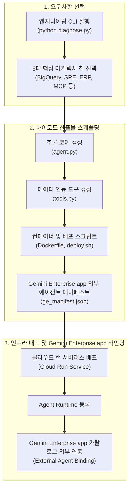

<!--
Copyright 2026 Google LLC. All Rights Reserved.
SPDX-License-Identifier: Apache-2.0

NOTICE: This code/repository is owned by Google LLC and provided under the Apache-2.0 License.
It is strictly provided as an EXAMPLE/REFERENCE ONLY and is NOT INTENDED FOR PRODUCTION USE.
All contents, designs, and code examples are subject to change, modification, or removal at any time without notice.

[고지 사항] 본 저장소 및 문서는 구글 (Google LLC) 소유이며 Apache 2.0 라이선스 하에 예시 (Sample) 용도로 제공된다.
프로덕션 환경용이 아니며, 사전 통지 없이 언제든지 수정, 변경 또는 삭제될 수 있다.
-->

> [!IMPORTANT]
> **구글 (Google LLC) 참조용 샘플 고지 사항**:
> 본 프로젝트의 모든 소스 코드와 문서는 Google LLC의 소유이며, Apache-2.0 라이선스에 따라 오직 **참조용 샘플 (Sample / Reference Only)** 목적으로만 제공된다. 프로덕션 환경에 그대로 사용할 수 없으며, 사전 통지 없이 언제든 내용이 수정, 변경 또는 삭제될 수 있다.

# Gemini Enterprise 커스텀 에이전트 스캐폴더 (gemini-enterprise-copilot-custom)

클라우드 아키텍트 및 백엔드 엔지니어가 사내 빅쿼리(BigQuery), ERP, 모니터링 시스템 등 복잡한 기업 기간계 자산을 결합한 High-code 커스텀 에이전트(Agent Runtime / Cloud Run)를 원클릭으로 스캐폴딩하고, GitHub 레포 URL 입력만으로 제미나이 엔터프라이즈 앱(Gemini Enterprise app)에 에이전트를 자동 배포 및 사내 갤러리에 직결 등록할 수 있도록 지원하는 엔지니어링 개발 도구다. (As of 2026-10-17)

**Audience**: `#Architect`, `#Developer`  
**Concern**: `#Architecture`, `#Performance`, `#Security`  
**Service**: `#AgentPlatform`, `#CloudRun`, `#VertexAI`  

---

## 1. 문제 증상 및 도입 배경 체크리스트

사내 엔터프라이즈 환경에서 커스텀 에이전트 개발 및 배포 시 다음과 같은 어려움이 발생하고 있다면 본 솔루션 도입이 필요하다:

- [ ] **단순 프롬프트 에이전트의 한계**: 노코드 에이전트로는 사내 BigQuery 대용량 쿼리 실행, ERP 결재 승인, MCP 멀티툴 호출 등 복잡한 비즈니스 로직 처리가 불가능한 경우
- [ ] **반복적인 인프라 보일러플레이트 작성 부담**: 에이전트를 하나 만들 때마다 FastAPI 서빙 코드, Pydantic 검증 모델, Dockerfile, Cloud Run 배포 스크립트를 며칠씩 수작업 코딩하는 경우
- [ ] **Gemini Enterprise app 외부 에이전트 연동 병목**: 백엔드에 배포된 에이전트를 전사 임직원이 쓰는 Gemini Enterprise app 카탈로그에 '외부 에이전트(External Agent)'로 등록하는 JSON 매니페스트 구성 및 IAM 권한 검증에 실패하는 경우
- [ ] **보안 및 서비스 계정 최소 권한 통제 부재**: 에이전트 실행 컨테이너에 과도한 관리자 권한을 부여하여 보안 감사에 지적받거나 VPC-SC 경계 격리에 실패하는 경우

---

## 2. 처리 아키텍처 (Activity Diagram)

본 도구는 개발자의 요구사항을 받아 백엔드 소스 코드를 생성하고, Cloud Run에 배포한 후 Gemini Enterprise app에 외부 에이전트로 직결 연동하는 3단계 파이프라인으로 동작한다.



---

## 3. 필요 IAM 역할 및 권한

커스텀 에이전트 백엔드 서빙 및 Gemini Enterprise app 외부 연동을 위해 필요한 최소 권한(Least Privilege) 구성은 다음과 같다:

| 역할 (Role) | 부여 대상 | 용도 및 최소 권한 세부 사항 |
| :--- | :--- | :--- |
| `roles/run.admin` | 개발자 / 배포 파이프라인 | Cloud Run 서비스 생성, 컨테이너 빌드 및 트래픽 라우팅 |
| `roles/run.invoker` | Gemini Enterprise app 호출 서비스 계정 | Gemini Enterprise app 엔드포인트에서 Cloud Run 서비스 호출 (OIDC 토큰 인가) |
| `roles/aiplatform.user` | 커스텀 에이전트 실행 SA | Vertex AI 기반 Gemini 파운데이션 모델 추론 권한 |
| `roles/bigquery.dataViewer` | BigQuery 연동 에이전트 SA | 대상 사내 데이터셋 테이블 읽기 및 스키마 조회 권한 |
| `roles/discoveryengine.editor` | 관리자 계정 | Gemini Enterprise app 카탈로그에 외부 에이전트 등록 및 메타데이터 바인딩 |

---

## 4. 원클릭 스캐폴딩 및 진단 실행 가이드

### 4.1. 환경 변수 준비 (선택 사항)
본 도구는 `gcloud` 활성 설정 및 사내 리소스를 자동으로 탐지하므로 설정 파일 없이도 즉시 실행할 수 있다. 필요시 `.env.example`을 복사하여 `.env`를 생성한다:
```bash
cp .env.example .env
```

### 4.2. 가상 실행 및 스모크 테스트 (--dry-run)
실제 GCP 리소스 생성 없이, 6대 아키텍처 칩에 대한 소스 코드 무결성, IAM 권한 및 Gemini Enterprise app 연동 매니페스트를 0.5초 만에 검증한다:
```bash
python diagnose.py --dry-run
```

특정 아키텍처 칩(예: 5번 MCP 게이트웨이 에이전트) 또는 커스텀 프롬프트를 지정하여 가상 실행할 수 있다:
```bash
# 5번 아키텍처(MCP 멀티툴 게이트웨이) 지정 검증
python diagnose.py --dry-run --chip 5

# 사용자 직접 정의 시스템 연동 요구사항 검증
python diagnose.py --dry-run --prompt "SAP 전표 승인 및 슬랙 긴급 알림 봇"
```

### 4.3. 실제 소스 코드 파일 디스크 추출 (--write-files)
배포 가능한 완성형 소스 코드 5종을 로컬 디렉터리(`scaffold/`)에 즉시 추출한다:
```bash
python diagnose.py --write-files
```
생성되는 파일:
- `scaffold/agent.py`: FastAPI + Vertex AI Gemini SDK 서빙 코드
- `scaffold/tools.py`: BigQuery 및 시스템 연동 도구 함수
- `scaffold/Dockerfile`: 비루트 보안 컨테이너 빌드 파일
- `scaffold/deploy.sh`: Cloud Run 배포 쉘 스크립트
- `scaffold/ge_agent_manifest.json`: Gemini Enterprise app 외부 연동 등록 JSON

### 4.4. 사내 GE App에 자율 배포형 스캐폴더 1클릭 프로비저닝 (--deploy-engine)
본 미니 프로젝트의 스캐폴더 에이전트(ChatOps 도구 내장형)를 고객사 GCP 프로젝트의 **Agent Engine**으로 프로비저닝하고 사내 **Gemini Enterprise app(`/r/agents`)** 전사 갤러리에 1클릭으로 직결 등록한다:

```bash
# 1. 가상 실행으로 배포 명세 및 연동 매니페스트 사전 검증
python diagnose.py --dry-run --deploy-engine

# 2. 실제 사내 환경 원클릭 배포 집행
python diagnose.py --deploy-engine
```

성공 시 에이전트가 사내 갤러리에 전사 공개(`ALL_USERS`)로 등록되며, 배포된 에이전트에는 실제 클라우드 배포 도구(`deploy_enterprise_agent_tool`, `list_deployed_agents_tool`)와 **5대 원클릭 추천 칩**이 내장된다.

### 4.5. 엔드 투 엔드 고객 UX 여정 (2단계 무인 배포)

고객사 개발팀과 현업 실무자의 업무 효율을 극대화하기 위해 설계된 표준 도입 UX 흐름은 다음과 같다:

1. **1단계: 개발팀의 깃 클론 및 최초 1회 스캐폴더 배포**:
   - 개발팀이 레포지토리를 복제(`git clone`)한 후, 본 디렉터리에서 `python diagnose.py --deploy-engine` 명령을 1회 실행하여 `GE Custom Agent Scaffolder`를 사내 GE App 전사 갤러리(`/r/agents`)에 등록한다.
2. **2단계: GE App 챗창 진입 및 5대 칩 기반 무인 자동 배포 (ChatOps to GitOps)**:
   - 더 이상 터미널이나 로컬 개발 환경을 다룰 필요 없이, 사내 임직원이나 관리자가 웹 브라우저로 **Gemini Enterprise app**에 접속한다.
   - 사내 갤러리에서 **`GE Custom Agent Scaffolder (커스텀 에이전트 스캐폴더)`** 대화창을 열면 화면에 표시되는 **5대 원클릭 추천 칩**을 마우스로 클릭하거나 사내 GitHub 레포 주소를 입력한다:
     - `[칩 1]` **GE Admin Copilot (사내 어드민 코파일럿) 배포해 줘**
     - `[칩 2]` **GE Agent Factory (사내 노코드 에이전트 팩토리) 배포해 줘**
     - `[칩 3]` **GE Connector Factory (사내 데이터 커넥터 팩토리) 배포해 줘**
     - `[칩 4]` **GE Skill Factory (사내 스킬 팩토리) 배포해 줘**
     - `[칩 5]` **GitHub 레포 주소(https://github.com/...) 기반 배포해 줘**
     - *(단독 배포 원칙)*: 전체 일괄 배포로 인한 부하 및 리소스 낭비를 방지하기 위해 한 번에 하나의 에이전트씩 독립적으로 의사 결정하여 배포한다.
   - 스캐폴더 에이전트가 내장 도구(`deploy_enterprise_agent_tool`)를 즉시 실행하여, Agent Engine 프로비저닝부터 GE App 사내 갤러리 등록까지 전 과정을 100% 무인 자동 완료한다.

---

## 5. 사내 거버넌스 4대 필수 표준 라벨링

커스텀 에이전트 인프라 및 관리 리소스(Cloud Run 서비스, 서비스 계정, Artifact Registry 등) 생성 시 4대 표준 라벨을 반드시 적용한다:
- `managed-by`: `google-cloud-0-to-1`
- `scenario`: `gemini-enterprise-copilot-custom`
- `env`: `sample` (또는 `poc`)
- `created-by`: `customer-engineer`

---

## 6. 콘솔 링크 조치 가이드

- **Cloud Run 콘솔**: 배포된 백엔드 컨테이너 서비스 상태 및 인스턴스 모니터링 ( https://console.cloud.google.com/run )
- **Agent 콘솔**: 사내 등록된 외부 에이전트(External Agents) 및 Agent Engine 바인딩 관리 ( https://console.cloud.google.com/vertex-ai/agents/ )
- **IAM 및 관리자 콘솔**: 서비스 계정(`custom-agent-sa`) 권한 및 인보커 바인딩 확인 ( https://console.cloud.google.com/iam-admin/iam )

---

## 7. 자원 정리 안내 (Teardown)

본 솔루션 검증 후 테스트용으로 생성된 Cloud Run 서비스 및 서비스 계정을 정리하고자 할 경우 아래 명령을 수행한다:

1. **Cloud Run 서비스 삭제**:
   ```bash
   gcloud run services delete bq-analytics-agent --region=${REGION:-asia-northeast3} --quiet
   ```
2. **서비스 계정 삭제**:
   ```bash
   gcloud iam service-accounts delete custom-agent-sa@${PROJECT_ID}.iam.gserviceaccount.com --quiet
   ```
