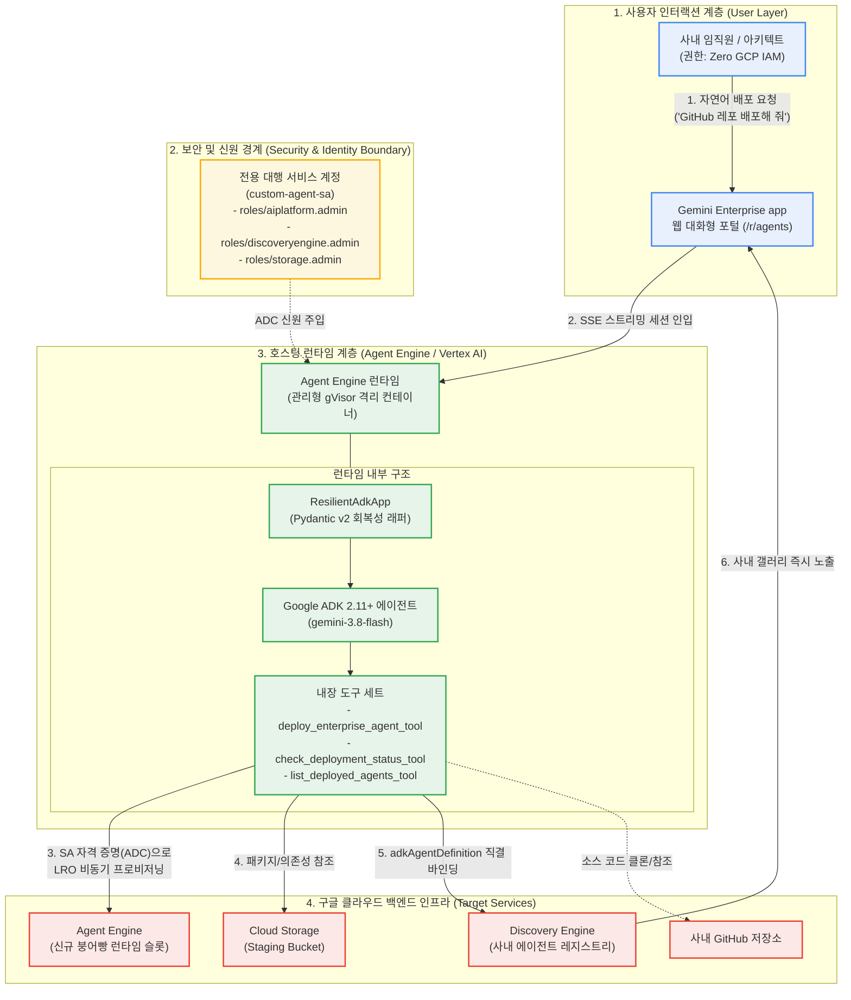

<!--
Copyright 2026 Google LLC. All Rights Reserved.
SPDX-License-Identifier: Apache-2.0

NOTICE: This code/repository is owned by Google LLC and provided under the Apache-2.0 License.
It is strictly provided as an EXAMPLE/REFERENCE ONLY and is NOT INTENDED FOR PRODUCTION USE.
All contents, designs, and code examples are subject to change, modification, or removal at any time without notice.

[고지 사항] 본 저장소 및 문서는 구글 (Google LLC) 소유이며 Apache 2.0 라이선스 하에 예시 (Sample) 용도로 제공된다.
프로덕션 환경용이 아니며, 사전 통지 없이 언제든지 수정, 변경 또는 삭제될 수 있다.
-->

> [!IMPORTANT]
> **구글 (Google LLC) 참조용 샘플 고지 사항**:
> 본 프로젝트의 모든 소스 코드와 문서는 Google LLC의 소유이며, Apache-2.0 라이선스에 따라 오직 **참조용 샘플 (Sample / Reference Only)** 목적으로만 제공된다. 프로덕션 환경에 그대로 사용할 수 없으며, 사전 통지 없이 언제든 내용이 수정, 변경 또는 삭제될 수 있다.

# Gemini Enterprise 커스텀 에이전트 팩토리 (gemini-enterprise-copilot-custom)

클라우드 아키텍트 및 백엔드 엔지니어가 사내 데이터베이스(BigQuery) 및 클라우드 자산 등 엔터프라이즈 환경을 결합한 High-code 커스텀 에이전트를 Agent Engine으로 원클릭 구축하고, GitHub 저장소 URL 입력만으로 제미나이 엔터프라이즈 앱(Gemini Enterprise app)에 에이전트를 자동 배포 및 사내 갤러리에 직결 등록할 수 있도록 지원하는 사내 커스텀 에이전트 팩토리 도구다. (As of 2026-10-19)

---

## 1. 발생 증상 및 진단 대상 체크리스트

사내 엔터프라이즈 환경에서 커스텀 에이전트 개발 및 배포 시 다음과 같은 어려움이 발생하고 있다면 본 솔루션 도입이 필요하다:
- [ ] **단순 프롬프트 에이전트의 한계**: 노코드 에이전트로는 사내 BigQuery 대용량 쿼리 실행, 복합 비즈니스 로직 처리, MCP 멀티툴 호출 등 엔터프라이즈 기능 구현이 불가능한 경우
- [ ] **반복적인 에이전트 런타임 보일러플레이트 작성 부담**: 에이전트를 하나 만들 때마다 Google ADK 연동, Agent Engine 패키징 코드, 도구 함수, 배포 스크립트를 수작업 코딩하는 경우
- [ ] **Gemini Enterprise app 사내 갤러리 등록 병목**: 배포된 에이전트를 전사 임직원이 쓰는 Gemini Enterprise app 카탈로그에 등록하는 매니페스트 구성 및 IAM 권한 검증에 실패하는 경우
- [ ] **보안 및 서비스 계정 최소 권한 통제 부재**: 에이전트 실행 환경에 과도한 관리자 권한을 부여하여 보안 감사에 지적받거나 VPC-SC 경계 격리에 실패하는 경우

---

## 2. 빠른 시작 (Quickstart)

> [!TIP]
> Cloud Shell 접속 환경 구성 및 저장소 클론(`git clone`) 방법은 루트의 [메인 README](../../README.md)를 참고한다.

### 0) 사내 환경 대화형 설정 (Config Wizard, 선택 사항)
사내 활성 프로젝트, 리전 및 실시간 Gemini Enterprise App 목록을 감지하여 `.env`에 자동 저장한다:
```bash
python diagnose.py --config
```

### 1) 모의 데이터 가상 실행 (Dry-Run)
GCP API 호출 없이 내장된 가상 인프라 데이터로 정상 동작 여부를 즉시 검증한다:
```bash
# 기본 팩토리(붕어빵 틀) 가상 실행
python diagnose.py --dry-run

# GitHub 저장소 URL 기반 커스텀 스캐폴딩 가상 검증
python diagnose.py --scaffold --dry-run --repo https://github.com/my-org/my-agent.git

# 검증된 3대 핵심 커스텀 아키텍처 칩 가상 검증 (1: 사내 커스텀 레포, 2: 어드민 코파일럿, 3: 노코드 팩토리)
python diagnose.py --scaffold --dry-run --chip 2
```

**터미널 진단 출력 미리보기:**
```text
===========================================================================
  Gemini Enterprise 커스텀 에이전트 팩토리 (gemini-enterprise-copilot-custom)
===========================================================================
[*] 활성 프로젝트    : sample-project-id
[*] 대상 리전        : us-central1
[*] 대상 GE App ID   : sample-ge-app-id
[*] 실행 서비스 계정 : custom-agent-sa@sample-project-id.iam.gserviceaccount.com
[*] 실행 모드        : 가상 실행 (--dry-run)

[진행] 사내 커스텀 에이전트 팩토리(붕어빵 틀) 프로비저닝 파이프라인 가동...

--> [가상 실행 모드 (--dry-run)] 실제 배포 없이 프로비저닝 명세를 시뮬레이션합니다.
  [1] Agent Engine 프로비저닝 시뮬레이션: projects/sample-project-id/locations/us-central1/reasoningEngines/simulated-custom-factory-engine
  [2] 장착 도구: deploy_enterprise_agent_tool, list_deployed_agents_tool
  [3] GE App 사내 갤러리(/r/agents) 전사 공유(ALL_USERS) 등록 명세 검증 완료

[성공] 마크다운 진단 보고서가 저장되었습니다: report.md
```

### 2) 실제 사내 인프라 실시간 진단 및 배포
```bash
python diagnose.py
```
> [!NOTE]
> 앞서 `python diagnose.py --config`로 환경 설정을 저장했거나 gcloud 활성 설정을 그대로 활용할 경우 별도의 `.env` 생성 없이 즉시 실행할 수 있다. (환경 변수를 텍스트 에디터로 직접 수동 편집하고자 할 때만 `cp -n .env.example .env` 실행 후 수정)

### 3) 최신 Google ADK 2.11+ CLI 활용법 (선택 사항)
스캐폴딩된 에이전트 소스(`scaffold/`)는 구글 공식 Google ADK 2.11+ 표준 CLI 도구(`adk`)를 활용하여 로컬 실행 및 배포를 수행할 수 있다:

```bash
# 1. 스캐폴딩 디렉터리 추출
python diagnose.py --write-files

# 2. 로컬 터미널 대화형 디버깅 (adk run)
cd scaffold
adk run .

# 3. 로컬 브라우저 대화형 플레이그라운드 구동 (adk web)
adk web .

# 4. Agent Engine 원클릭 배포 (adk deploy agent_engine)
adk deploy agent_engine . \
  --project="${PROJECT_ID}" \
  --region="us-central1" \
  --display_name="사내 커스텀 에이전트"
```

---

## 3. 솔루션 아키텍처 및 런타임 서비스 흐름



---

## 4. 조치 가이드 및 권장 설정

### 사내 갤러리 전사 활성화 및 배포 확인 가이드
- **사내 갤러리 즉시 노출**: 본 팩토리 에이전트를 통해 생성된 신규 에이전트는 엔터프라이즈 정규 규격(`adkAgentDefinition`)으로 프로비저닝되어, 별도의 수동 승인 절차 없이 **즉시 활성화(`state: ENABLED`) 및 전사 사내 갤러리(`ALL_USERS`)**에 자동 바인딩된다.
- **등록된 에이전트 목록 확인 및 관리**: 배포된 에이전트의 상태, 프롬프트, 도구 설정은 **Gemini Enterprise 에이전트 목록 콘솔 ( https://console.cloud.google.com/gemini-enterprise/locations/global/engines )**에서 확인 및 관리한다.

### 주요 콘솔 링크
- **Gemini Enterprise 웹 포털**: 사내 임직원 전용 대화형 포털 접속 및 에이전트 대화 ( https://gemini.google.com )
- **Gemini Enterprise 에이전트 목록 콘솔**: 사내 등록된 에이전트 및 Gemini Enterprise app 바인딩 관리 ( https://console.cloud.google.com/gemini-enterprise/locations/global/engines )
- **IAM 및 관리자 콘솔**: 서비스 계정(`custom-agent-sa`) 권한 확인 ( https://console.cloud.google.com/iam-admin/iam )

---
## 5. 사전 준비 사항 (필요 IAM 권한)

본 도구를 실행하려면 최소 아래의 IAM 권한이 필요하다:

커스텀 에이전트 서빙 및 Gemini Enterprise app 연동을 위해 필요한 최소 권한(Least Privilege) 구성은 다음과 같다:

| 역할 (Role) | 부여 대상 | 용도 및 최소 권한 세부 사항 |
| :--- | :--- | :--- |
| `roles/aiplatform.admin` | Reasoning Engine 서비스 에이전트(P4SA) | 팩토리 에이전트가 자식 Reasoning Engine 런타임을 자율 프로비저닝하기 위한 필수 권한 (`diagnose.py` 사전 실행 시 자동 보강) |
| `roles/storage.admin` | Reasoning Engine 서비스 에이전트(P4SA) | 자식 에이전트 패키지 아티팩트(`.pkl`, `requirements.txt`) GCS 읽기 및 빌드 권한 (`diagnose.py` 사전 실행 시 자동 보강) |
| `roles/aiplatform.user` | 개발자 / 에이전트 실행 SA | Agent Engine 프로비저닝 및 Gemini 파운데이션 모델 추론 권한 |
| `roles/discoveryengine.editor` | 관리자 계정 | Gemini Enterprise app 카탈로그에 에이전트 등록 및 메타데이터 바인딩 |
| `roles/bigquery.dataViewer` | BigQuery 연동 에이전트 SA | 대상 사내 데이터셋 테이블 읽기 및 스키마 조회 권한 |
| `roles/bigquery.jobUser` | BigQuery 연동 에이전트 SA | 사내 데이터셋에 대한 SQL 쿼리 작업 실행 권한 |

---

## 6. 기술적 배경 및 아키텍처 원리 (Deep Dive)

### 3대 핵심 커스텀 아키텍처 칩 카탈로그
본 솔루션은 비현실적인 자유 텍스트 프롬프트 대신, 실제 검증된 소스 코드가 존재하는 GitHub 저장소 URL 기반의 저장소 연동 자동 배포 아키텍처를 기본 표준으로 채택한다:

| 번호 | 아키텍처 칩 명칭 | 대상 GitHub 저장소 | 기술 스택 및 도구 체계 |
| :---: | :--- | :--- | :--- |
| **1** | **사내 커스텀 GitHub 저장소 직접 입력 (Custom Repo) [기본값]** | 사용자 직접 입력 (`--repo <URL>`) | Agent Engine (ADK 2.11+) + GitHub 저장소 연동 |
| **2** | **GE Admin Copilot (사내 어드민 코파일럿) 실물 레포** | [어드민 코파일럿 저장소 ( https://github.com/jiangjun-forge/google-cloud-0-to-1/tree/main/samples/gemini-enterprise-copilot-admin )] | Agent Engine (ADK 2.11+) + BigQuery + Cloud Logging |
| **3** | **GE Agent Factory (사내 노코드 에이전트 팩토리) 실물 레포** | [에이전트 팩토리 저장소 ( https://github.com/jiangjun-forge/google-cloud-0-to-1/tree/main/samples/gemini-enterprise-copilot-agent )] | Agent Engine (ADK 2.11+) + Gemini 3.8 Flash |

### Pydantic v2 직렬화 호환성 및 세션 안정화 (ResilientAdkApp)
Google ADK 2.11+ 및 Agent Engine 런타임 환경에서 Pydantic v2 기반 `LlmAgent`가 클라우드 피클링(`cloudpickle`) 및 언피클링될 때, 비공개 속성 슬롯(`__pydantic_private__`)이 `None`으로 역직렬화되어 `canonical_model` 조회 시 `TypeError: 'NoneType' object is not subscriptable` 에러가 발생하고 웹 프론트엔드 응답이 중단되는 현상이 발생할 수 있다.

본 솔루션은 `ResilientAdkApp` 래퍼를 적용하여:
1. `set_up()`, `streaming_agent_run_with_events()`, `async_stream_query()` 진입 시점에 `__pydantic_private__` 슬롯의 유효성을 점검하고 필요한 경우 기본 딕셔너리로 초기화한다.
2. 에이전트 인스턴스 및 런타임 러너(`Runner`)에 바인딩된 `root_agent`를 탐색하여 모델 해석 상태를 사전에 확인한다.
3. 이를 통해 Gemini Enterprise app 웹 UI에서 스타터 칩 클릭 또는 자연어 대화 요청 시 스트리밍 응답이 정상적으로 전달되도록 돕는다.

### 관련 상세 설계 및 요구 사항 명세
- [비즈니스 요구 사항 명세서 (BRD)](docs/BRD.md): 비즈니스 배경, 성공 지표 및 요구 사항(BR-01~) 명세
- [기술 상세 설계서 (TDD)](docs/TDD.md): 시스템 아키텍처, 기능(FR-01~) 및 비기능(NFR-01~) 설계 명세

커스텀 에이전트 인프라 및 관리 리소스(Agent Engine, 서비스 계정 등) 생성 시 4대 표준 라벨을 반드시 적용한다:
- `managed-by`: `google-cloud-0-to-1`
- `scenario`: `gemini-enterprise-copilot-custom`
- `env`: `sample` (또는 `poc`)
- `created-by`: `customer-engineer`

---
## 7. 리소스 정리 (Teardown) 안내

본 솔루션 검증 후 테스트용으로 생성된 Agent Engine 런타임 및 등록된 에이전트를 정리하고자 할 경우 아래 가이드를 수행한다:

1. **Agent Engine 삭제**:
   ```bash
   # Agent Engine 인스턴스 삭제 (force=true)
   curl -X DELETE -H "Authorization: Bearer $(gcloud auth print-access-token)" \
     "https://us-central1-aiplatform.googleapis.com/v1/projects/${PROJECT_ID}/locations/us-central1/reasoningEngines/<ENGINE_ID>?force=true"
   ```
2. **GE App 사내 갤러리 등록 해제**:
   ```bash
   # GE App 에이전트 삭제
   curl -X DELETE -H "Authorization: Bearer $(gcloud auth print-access-token)" \
     "https://discoveryengine.googleapis.com/v1alpha/projects/${PROJECT_ID}/locations/global/collections/default_collection/engines/${GE_APP_ID}/assistants/default_assistant/agents/<AGENT_ID>"
   ```
3. **서비스 계정 삭제**:
   ```bash
   gcloud iam service-accounts delete custom-agent-sa@${PROJECT_ID}.iam.gserviceaccount.com --quiet
   ```
