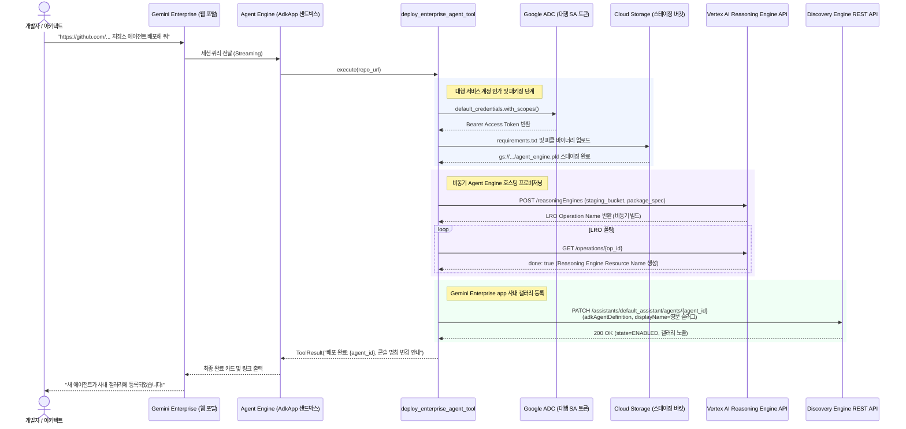

<!--
Copyright 2026 Google LLC. All Rights Reserved.
SPDX-License-Identifier: Apache-2.0

NOTICE: This code/repository is owned by Google LLC and provided under the Apache-2.0 License.
It is strictly provided as an EXAMPLE/REFERENCE ONLY and is NOT INTENDED FOR PRODUCTION USE.
All contents, designs, and code examples are subject to change, modification, or removal at any time without notice.

[고지 사항] 본 저장소 및 문서는 구글 (Google LLC) 소유이며 Apache 2.0 라이선스 하에 예시 (Sample) 용도로 제공된다.
프로덕션 환경용이 아니며, 사전 통지 없이 언제든지 수정, 변경 또는 삭제될 수 있다.
-->

# Gemini Enterprise 커스텀 에이전트 팩토리 및 Gemini Enterprise app 연동기 기술 상세 설계서 (TDD)

본 문서는 사내 엔지니어링 환경에서 구동하는 하이코드(High-code) 커스텀 에이전트 팩토리 및 제미나이 엔터프라이즈 앱(Gemini Enterprise app) 사내 갤러리 연동 도구의 시스템 아키텍처, 기술 상세 설계, 인터페이스 명세 및 검증 계획을 정의한다.

---

## 1. 시스템 아키텍처 및 런타임 상호작용 시퀀스

본 도구의 런타임 제어 및 데이터 상호작용 흐름은 아래 시퀀스 다이어그램과 같다. 개발자 또는 클라우드 아키텍트가 제미나이 엔터프라이즈 앱(Gemini Enterprise app) 대화창에서 추천 칩 또는 깃 저장소 URL을 입력하면, 에이전트 엔진(Agent Engine) 런타임 내의 도구가 대행 서비스 계정의 인가 토큰을 활용하여 비동기 프로비저닝 및 사내 갤러리 등록을 무인 수행한다.

---

## 2. 요구 사항 추적성 매핑 (Traceability Matrix)

| 비즈니스 요구 사항 (BRD) | 기능적 기술 요구 사항 (FR) | 비기능적 기술 요구 사항 (NFR) | 구현 파일 및 모듈 |
| :--- | :--- | :--- | :--- |
| **BR-01** (하이코드 에이전트 자동 구축 및 코드 생성) | **FR-01** (에이전트 코어 코드 생성기) | **NFR-01** (무의존성 및 단일 파이썬 실행) | `diagnose.py` |
| **BR-02** (엔터프라이즈 데이터 및 도구 템플릿) | **FR-02** (BigQuery 및 시스템 도구 조립) | **NFR-02** (표준 소프트웨어 스택 준수) | `diagnose.py` 템플릿 모듈 |
| **BR-03** (에이전트 엔진 런타임 배포 자동화) | **FR-03** (deploy.py 및 의존성 도출) | **NFR-01**, **NFR-02** | `diagnose.py` 배포 빌더 |
| **BR-04** (GitHub 저장소 직결 무인 배포) | **FR-04** (저장소 연동 파이프라인 컴파일러) | **NFR-01**, **NFR-02** | `diagnose.py` 저장소 연동 모듈 |
| **BR-05** (Gemini Enterprise app 사내 갤러리 연동) | **FR-05** (ADK 에이전트 바인딩 매니페스트) | **NFR-03** (결정론적 가상 실행 지원) | `diagnose.py` 연동 모듈 |
| **BR-06** (엔터프라이즈 보안 및 격리 준수) | **FR-06** (IAM 권한 진단 및 마크다운 리포트) | **NFR-03** (가명 마스킹 및 보안 준수) | `diagnose.py`, `report.md` |
| **BR-07** (표준 리소스 라벨링) | **FR-03**, **FR-06** (라벨링 자동 주입) | **NFR-04** (4대 표준 라벨링 준수) | `diagnose.py`, `deploy.py` |
| **BR-08** (2단계 무인 고객 온보딩 여정) | **FR-06** (Agent Engine ChatOps 런타임) | **NFR-05** (단독 배포 및 자원 격리성) | `diagnose.py` |
| **BR-09** (3대 핵심 커스텀 추천 칩 및 단독 배포) | **FR-07** (3대 핵심 커스텀 칩 및 단독 배포 도구) | **NFR-05** (단독 배포 및 자원 격리성) | `diagnose.py`, GE App |
| **BR-10** (IT 관리자 전용 및 보안 거버넌스) | **FR-05**, **FR-06** (고지문 및 시스템 지침 주입) | **NFR-06** (공격 표면 최소화 및 Teardown) | `diagnose.py`, `README.md`, `report.md` |

---

## 3. 기능 기술 요구 사항 명세 (Functional Requirements)

### FR-01: 하이코드 에이전트 코어 코드(`agent.py`) 자동 생성
- Google ADK 및 `google-genai` 통일 SDK를 기반으로 다단계 추론(Multi-step Reasoning)과 도구 호출(Function Calling)이 내장된 완성형 파이썬 코드를 생성한다.
- 입력된 도메인(예: 금융 이상 거래 탐지, 스마트팩토리 설비 진단, SRE 장애 역추적)에 맞추어 시스템 지침, 도구 바인딩 및 AdkApp 래퍼 로직을 포함한다.

### FR-02: 엔터프라이즈 데이터 및 도구 명세(`tools.py`) 생성
- 빅쿼리(BigQuery) 데이터셋 SQL 질의 도구, 사내 REST API 호출 도구, 또는 구글 워크스페이스(Google Workspace) 연동 도구의 파이썬 함수와 타입 힌트를 생성한다.
- 도구 함수 내부의 인증 처리는 하드코딩을 배제하고 애플리케이션 기본 자격 증명(ADC) 및 Secret Manager 환경 변수를 참조하도록 구성한다.

### FR-03: 에이전트 엔진 런타임 배포 스펙(`deploy.py`, `requirements.txt`) 도출
- 생성된 파이썬 코드를 즉시 패키징하여 Agent Engine에 프로비저닝하고 GE App에 자동 등록하는 `deploy.py` 및 `requirements.txt`를 도출한다.

### FR-04: Gemini Enterprise app ADK 에이전트 바인딩 매니페스트 생성 및 연동 진단
- 배포된 Agent Engine 리소스를 제미나이 엔터프라이즈 앱(Gemini Enterprise app)에 `adkAgentDefinition`으로 등록하기 위한 JSON 페이로드를 생성한다.
- Gemini Enterprise app과 백엔드 프로젝트 간의 서비스 계정 호출 권한 및 도메인 제한 공유(Domain Restricted Sharing) 조직 정책 준수 여부를 사전 진단한다.

### FR-05: IAM 권한 진단 및 표준 마크다운 리포트 자동 생성
- 개발자 계정 및 실행 서비스 계정의 필수 IAM 권한(`roles/aiplatform.user`, `roles/discoveryengine.editor`)을 사전 점검한다.
- 진단 및 에이전트 생성 완료 시 생성된 파일 목록, 소스 코드 미리보기, 배포 가이드, Gemini Enterprise app 연동 매니페스트를 포함하는 `report.md`를 자동으로 생성 및 덮어쓴다.

### FR-06: Agent Engine 프로비저닝 및 ChatOps 실행 도구 체계
- `python diagnose.py` 실행으로 Agent Engine에 ADK 기반 `GE Custom Agent Factory`를 프로비저닝하고 GE App에 `adkAgentDefinition`으로 바인딩한다.
- 런타임 내에 `deploy_enterprise_agent_tool`과 `list_deployed_agents_tool` 파이썬 실행 도구를 장착하여, GE app 웹 챗창에서 들어오는 배포 명령을 Discovery Engine REST API로 직접 중계한다.

### FR-07: 3대 핵심 커스텀 추천 질문 칩 (Starter Prompts) 주입 및 단독 배포 파이프라인
- GE App 매니페스트에 3대 원클릭 추천 질문 칩을 순서(1: GitHub 저장소 주소 기반 커스텀 에이전트 배포 -> 2: GE Admin Copilot -> 3: GE Agent Factory) 및 에이전트 목록 조회 칩으로 정렬 배치한다.
- 전체 일괄 배포를 배제하고 한 번에 하나의 에이전트씩 개별 의사 결정을 거쳐 독립 프로비저닝하는 거버넌스 로직을 강제한다.

---

## 4. 비기능 기술 요구 사항 명세 (Non-Functional Requirements)

### NFR-01: 무의존성 및 순수 파이썬 단일 실행 원칙
- 외부 쉘 스크립트나 별도 패키징 툴 없이 `python diagnose.py` 직접 실행만으로 에이전트 생성과 진단을 완결한다.
- 생성되는 하이코드 산출물 역시 표준 파이썬 라이브러리 기반으로 자립 실행이 가능해야 한다.

### NFR-02: 표준 소프트웨어 스택 준수
- AI SDK: `google-genai v2.0+`, `google-adk 2.11+`
- 에이전트 런타임: `Agent Engine`
- 배포 체계: 순수 파이썬 스크립트 기반 원클릭 배포

### NFR-03: 결정론적 가상 실행(--dry-run) 및 사내 식별 정보 마스킹
- `--dry-run` 모드 실행 시 실제 GCP API 호출 및 소스 파일 오버라이트 없이도 메모리 상에서 완벽한 코드 및 매니페스트 무결성을 스모크 테스트한다.
- 가상 실행 시 사내 프로젝트 ID나 실제 환경 정보의 유출을 방지하기 위해 가명(`sample-project-id`, `sample-ge-app-id`)을 철저히 적용한다.

### NFR-04: 사내 거버넌스 4대 필수 표준 라벨링 준수
- 사내 거버넌스, FinOps 비용 배분 및 미정리 자원 자동 추적을 위해, 생성되는 Agent Engine 런타임, 서비스 계정 및 에이전트 매니페스트에 4대 표준 라벨(`managed-by=google-cloud-0-to-1`, `scenario=gemini-enterprise-copilot-custom`, `env=sample`, `created-by=customer-engineer`)을 필수로 주입한다.

### NFR-05: 단독 배포 장애 격리성 및 멱등성 (Isolated Idempotent Deployment)
- 각 에이전트는 독립된 스펙으로 개별 프로비저닝되어 특정 에이전트 배포 실패 시에도 타 에이전트에 장애가 전파되지 않도록 완벽히 격리되어야 한다.
- 이미 등록된 에이전트가 존재할 경우 중복 생성을 방지하고 기존 에이전트를 안전하게 패치(`updateMask`)하는 멱등성(Idempotence)을 보장해야 한다.

### NFR-06: 엔터프라이즈 보안 거버넌스 및 라이프사이클 격리 (Deploy-then-Teardown)
- 대상 사용자 제약: 본 팩토리 에이전트는 일반 사용자나 임의의 개발팀에 상시 개방되지 않으며, 사내 IT 관리자 및 클라우드 인프라 엔지니어 전용 관리 도구로 한정된다.
- 소스 코드 보안 검증 연동: GitHub 저장소 배포 전 사내 CI/CD 단계에서 취약점 정적 분석(Codemender, SAST 등) 및 비즈니스 목적 적법성에 대한 인간 개입 승인(HITL)을 거치도록 가이드라인을 강제한다.
- 라이프사이클 Teardown 원칙: 필요한 사내 공식 에이전트들의 배포와 갤러리 등록이 완료된 즉시 팩토리 자체를 Agent Engine 및 사내 갤러리에서 정리(Teardown)하여 공격 표면(Attack Surface) 노출을 영구 차단한다.
