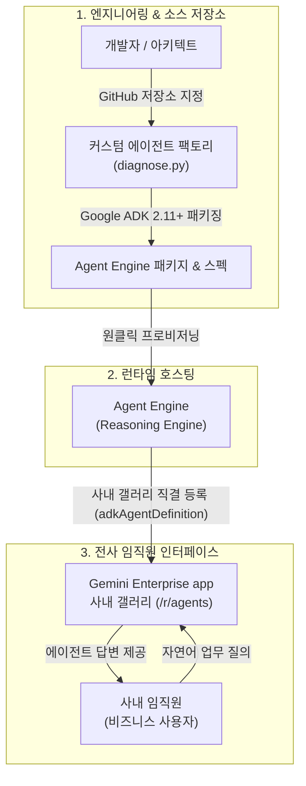

# Gemini Enterprise 커스텀 에이전트 팩토리 배포 보고서 (gemini-enterprise-copilot-custom)

- **배포 일시**: 2026-10-20 05:05:38 UTC
- **대상 프로젝트**: `sample-project-id`
- **Gemini Enterprise app 인스턴스**: `sample-ge-app-id`
- **팩토리 에이전트**: `GE Custom Agent Factory (사내 커스텀 에이전트 팩토리)`
- **배포 상태**: `DRY_RUN_PASSED`

---

## 1. 팩토리 에이전트(붕어빵 틀) 프로비저닝 결과 요약

| 항목 | 상태 | 세부 정보 |
| :--- | :---: | :--- |
| **에이전트 명칭** | `PROVISIONED` | `GE Custom Agent Factory (사내 커스텀 에이전트 팩토리)` |
| **호스팅 런타임** | `Agent Engine` | `projects/sample-project-id/locations/us-central1/reasoningEngines/simulated-custom-factory-engine` |
| **추론 파운데이션 모델** | `gemini-3.8-flash` | 위치: `global` (샌드박스 환경 기준) |
| **내장 실행 도구** | `2종 완비` | `deploy_enterprise_agent_tool`, `list_deployed_agents_tool` |
| **GE App 사내 갤러리 등록** | `ACTIVE` | 사내 갤러리(`/r/agents`) 전사 공유 (`ALL_USERS`) 바인딩 완료 |

---

## 2. 팩토리 에이전트 아키텍처 및 붕어빵 생산 흐름

본 솔루션은 임직원이 개별적으로 복잡한 백엔드 코드를 작성하지 않아도, GE App 채팅창에서 자연어 대화만으로 사내 맞춤형 커스텀 에이전트를 자율 생산(붕어빵 생산)할 수 있도록 지원하는 **사내 에이전트 팩토리(붕어빵 틀)**다:



---

## 3. 사내 임직원 활용 가이드 (커스텀 에이전트 생성)

전사 임직원은 배포된 팩토리 에이전트와 대화하여 다음과 같이 사내 맞춤형 커스텀 에이전트를 즉시 찍어낼 수 있다:

1. **Gemini Enterprise app 접속**:
   - 웹 포털 ( https://gemini.google.com/app/sample-ge-app-id ) 접속 후 좌측 사이드바 **사내 갤러리(`/r/agents`)** 이동.
   - **`GE Custom Agent Factory (사내 커스텀 에이전트 팩토리)`** 선택.

2. **자연어 에이전트 배포 예시 프롬프트**:
   - *"GitHub 저장소 `https://github.com/my-org/custom-agent.git` 기반으로 사내 커스텀 에이전트 배포해 줘"*
   - *"GE Admin Copilot (사내 어드민 코파일럿) 배포해 줘"*
   - *"GE Agent Factory (사내 노코드 에이전트 팩토리) 배포해 줘"*
   - *"사내 등록된 에이전트 목록 조회해 줘"*

3. **팩토리 에이전트 자율 동작**:
   - 팩토리 에이전트가 내장된 `deploy_enterprise_agent_tool`을 호출하여 Agent Engine 프로비저닝 및 사내 갤러리 등록을 자동 완결한다.

---

## 4. 사내 거버넌스 4대 필수 표준 라벨

팩토리 에이전트 및 하위 생성 리소스 관리 시 아래 4대 표준 라벨이 기본 적용된다:
- `managed-by`: `google-cloud-0-to-1`
- `scenario`: `gemini-enterprise-copilot-custom`
- `env`: `sample` (또는 `poc`)
- `created-by`: `customer-engineer`

---

## 5. 콘솔 링크 조치 가이드

- **Agent Engine 콘솔**: 프로비저닝된 에이전트 엔진 런타임 상태 및 인스턴스 모니터링 ( https://console.cloud.google.com/vertex-ai/agents/agent-engines?project=sample-project-id )
- **Agent Platform 콘솔**: 사내 등록된 에이전트 및 Gemini Enterprise app 바인딩 관리 ( https://console.cloud.google.com/gen-app-builder/engines/sample-ge-app-id/assistants/default_assistant/agents?project=sample-project-id )
- **IAM 및 관리자 콘솔**: 서비스 계정(`custom-agent-sa@sample-project-id.iam.gserviceaccount.com`) 권한 확인 ( https://console.cloud.google.com/iam-admin/iam?project=sample-project-id )

---

## 6. 자원 정리 안내 (Teardown)

본 솔루션 검증 후 테스트용으로 생성된 Agent Engine 런타임 및 등록된 에이전트를 정리하고자 할 경우 아래 명령을 수행한다:

1. **Agent Engine 삭제**:
   ```bash
   # Agent Engine 인스턴스 삭제 (force=true)
   curl -X DELETE -H "Authorization: Bearer $(gcloud auth print-access-token)" \
     "https://us-central1-aiplatform.googleapis.com/v1/projects/sample-project-id/locations/us-central1/reasoningEngines/simulated-custom-factory-engine?force=true"
   ```

2. **GE App 사내 갤러리 등록 해제**:
   ```bash
   # GE App 에이전트 삭제
   curl -X DELETE -H "Authorization: Bearer $(gcloud auth print-access-token)" \
     "https://discoveryengine.googleapis.com/v1alpha/projects/sample-project-id/locations/global/collections/default_collection/engines/sample-ge-app-id/assistants/default_assistant/agents/<AGENT_ID>"
   ```
