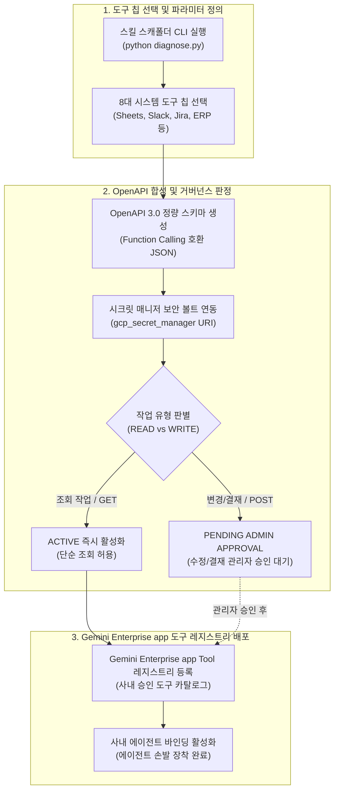

<!--
Copyright 2026 Google LLC. All Rights Reserved.
SPDX-License-Identifier: Apache-2.0

NOTICE: This code/repository is owned by Google LLC and provided under the Apache-2.0 License.
It is strictly provided as an EXAMPLE/REFERENCE ONLY and is NOT INTENDED FOR PRODUCTION USE.
All contents, designs, and code examples are subject to change, modification, or removal at any time without notice.

[고지 사항] 본 저장소 및 문서는 구글 (Google LLC) 소유이며 Apache 2.0 라이선스 하에 예시 (Sample) 용도로 제공된다.
프로덕션 환경용이 아니며, 사전 통지 없이 언제든지 수정, 변경 또는 삭제될 수 있다.
-->

> [!IMPORTANT]
> **구글 (Google LLC) 참조용 샘플 고지 사항**:
> 본 프로젝트의 모든 소스 코드와 문서는 Google LLC의 소유이며, Apache-2.0 라이선스에 따라 오직 **참조용 샘플 (Sample / Reference Only)** 목적으로만 제공된다. 프로덕션 환경에 그대로 사용할 수 없으며, 사전 통지 없이 언제든 내용이 수정, 변경 또는 삭제될 수 있다.

# Gemini Enterprise 자율형 사내 스킬 스캐폴더 (gemini-enterprise-copilot-skill)

제미나이 엔터프라이즈 앱(Gemini Enterprise app) 환경에서 에이전트가 손발처럼 호출하여 구글 시트(Google Sheets), 슬랙(Slack), 지라(Jira), ERP 등 사내 시스템을 제어할 수 있는 도구 및 확장 기능(Tools / Extensions / Action Skills)을 비개발자가 대화형으로 자율 생성하고, 시크릿 매니저(Secret Manager) 보안 볼트와 거버넌스 승인을 거쳐 안전하게 등록할 수 있도록 지원하는 사내 스킬 스캐폴더 솔루션이다. (As of 2026-10-17)

**Audience**: `#Architect`, `#Developer`, `#SecOps`  
**Concern**: `#Architecture`, `#Compliance`, `#Security`  
**Service**: `#AgentPlatform`, `#CloudFunctions`, `#GeminiAPI`  

---

## 1. 문제 증상 및 도입 배경 체크리스트

사내 엔터프라이즈 에이전트 도입 후 다음과 같은 실무적 한계나 고민이 발생하고 있다면 본 솔루션 도입이 필요하다:

- [ ] **에이전트의 단순 대화 한계**: 텍스트 질의응답을 넘어 구글 시트 행 추가, 슬랙 장애 알림 발송, 지라 티켓 발행 등 사내 시스템을 직접 조작하는 실무 액션(Action)이 필요한 경우
- [ ] **비개발자 임직원의 OpenAPI 작성 불가**: 일반 직원이 사내 API를 에이전트 도구로 붙이고 싶어도 OpenAPI 3.0 스키마(JSON/YAML) 및 파라미터 규격을 작성할 줄 몰라 확장이 중단된 경우
- [ ] **API 토큰 및 자격 증명 평문 노출 위험**: 임직원이 시스템 연동을 위해 웹훅 URL이나 API 키를 프롬프트에 평문으로 하드코딩하여 보안 사고 위험이 발생하는 경우
- [ ] **조회와 변경 작업의 무분별한 실행 위험**: 단순 데이터 조회와 데이터베이스 수정/결재 승인 작업을 동일한 권한으로 처리하여 비인가 결재나 데이터 오염이 우려되는 경우

---

## 2. 처리 아키텍처 (Activity Diagram)

본 솔루션은 현업 임직원의 요구사항이나 시스템 칩을 받아 OpenAPI 3.0 스키마를 합성하고, 보안 볼트 연동 및 거버넌스 승인 절차를 거쳐 Gemini Enterprise app 도구 레지스트리에 배포하는 3단계 파이프라인으로 동작한다.



---

## 3. 필요 IAM 역할 및 권한

스킬 매니페스트 배포 및 에이전트 런타임 보안을 위해 필요한 최소 권한(Least Privilege) 구성은 다음과 같다:

| 역할 (Role) | 부여 대상 | 용도 및 최소 권한 세부 사항 |
| :--- | :--- | :--- |
| `roles/secretmanager.secretAccessor` | 스킬 실행 대행 SA (`ge-skill-invoker-sa`) | 런타임 시 사내 API 토큰 및 웹훅 URL 복호화 권한 |
| `roles/discoveryengine.editor` | 관리자 실행 계정 | Gemini Enterprise app 도구 레지스트리에 신규 Tool 등록 및 메타데이터 관리 |
| 권한 불필요 (Zero IAM) | 일반 현업 임직원 | Gemini Enterprise app 웹 포털 로그인 계정 외에 GCP 콘솔 권한 일절 불필요 |

---

## 4. 원클릭 스킬 생성 및 진단 가이드

### 4.1. 환경 변수 준비 (선택 사항)
본 도구는 `gcloud` 활성 설정 및 사내 리소스를 자동으로 탐지하므로 설정 파일 없이도 즉시 실행할 수 있다. 필요시 `.env.example`을 복사하여 `.env`를 생성한다:
```bash
cp .env.example .env
```

### 4.2. 가상 실행 및 스모크 테스트 (--dry-run)
실제 GCP API 호출 없이, 8대 시스템 도구 칩에 대한 OpenAPI 3.0 스키마 정합성, Secret Manager 보안 볼트 연동, 거버넌스 승인 상태를 0.5초 만에 안전하게 검증한다:
```bash
python diagnose.py --dry-run
```

특정 도구 칩(예: 3번 Slack 웹훅 발송 스킬) 또는 커스텀 API를 지정하여 가상 실행할 수 있다:
```bash
# 3번 Slack 웹훅 발송 스킬 (WRITE 작업, 승인 대기 플래그 검증)
python diagnose.py --dry-run --chip 3

# 4번 Jira 버그 티켓 자동 발행 스킬 검증
python diagnose.py --dry-run --chip 4

# 사용자 직접 정의 시스템 연동 요구사항 검증
python diagnose.py --dry-run --prompt "사내 사원증 발급 승인 시스템 REST API"
```

### 4.3. 사내 GE App에 스킬 스캐폴더 1클릭 프로비저닝 (--deploy-engine)
본 미니 프로젝트의 스킬 스캐폴더 에이전트를 사내 GCP 프로젝트의 **Agent Engine**으로 프로비저닝하고 사내 **Gemini Enterprise app(`/r/agents`)** 전사 갤러리에 직결 등록한다:

```bash
# 1. 가상 실행으로 배포 명세 사전 검증
python diagnose.py --dry-run --deploy-engine

# 2. 실제 사내 환경 원클릭 배포 집행
python diagnose.py --deploy-engine
```

성공 시 사내 임직원이 GE app 챗창에서 스킬 스캐폴더와 대화하며 Google Sheets, Slack, Jira 등 기간계 도구 연동 명세를 자율 생성할 수 있다.

### 4.4. 실제 사내 Gemini Enterprise app 도구 등록 (--publish)
사내 Gemini Enterprise app 도구 레지스트리에 개별 시스템 스킬을 공식 배포하여 사내 에이전트들이 장착할 수 있도록 등록한다:
```bash
python diagnose.py --publish --chip 1
```

### 4.4. 최신 Model Context Protocol (MCP) 및 Agents CLI 연동 (대안)
최신 구글 공식 **Agents CLI (`google-agents-cli`)** 및 ADK 2.11+의 `McpToolset`을 활용하여 사내 엔터프라이즈 도구를 현대적 표준 프로토콜로 직접 연동할 수 있다:
```bash
# Agent Runtime 환경 변수에 최신 MCP 프로토콜 활성화
ADK_ENABLE_MCP_MODERN_PROTOCOL=1

# Agents CLI를 통한 도구 바인딩 배포
agents-cli deploy --project=${PROJECT_ID} --region=us-central1
```

---

## 5. 사내 거버넌스 4대 필수 표준 라벨링

사내 스킬 인프라 및 보안 볼트 리소스(Secret Manager 시크릿, 대행 서비스 계정 등) 생성 시 4대 표준 라벨을 반드시 적용한다:
- `managed-by`: `google-cloud-0-to-1`
- `scenario`: `gemini-enterprise-copilot-skill`
- `env`: `sample` (또는 `poc`)
- `created-by`: `customer-engineer`

---

## 6. 콘솔 링크 조치 가이드

- **Agent 콘솔**: 사내 등록된 도구(Tools) 및 확장 기능 관리 ( https://console.cloud.google.com/vertex-ai/agents/ )
- **Secret Manager 콘솔**: 사내 API 토큰 및 웹훅 URL 보안 볼트 관리 ( https://console.cloud.google.com/security/secret-manager )
- **IAM 및 관리자 콘솔**: 스킬 대행 서비스 계정(`ge-skill-invoker-sa`) 역할 및 바인딩 상태 확인 ( https://console.cloud.google.com/iam-admin/iam )

---

## 7. 자원 정리 안내 (Teardown)

본 솔루션 검증 후 테스트용으로 등록된 도구 매니페스트나 서비스 계정을 정리하고자 할 경우 아래 절차를 수행한다:

1. **대행 서비스 계정 삭제**:
   ```bash
   gcloud iam service-accounts delete ge-skill-invoker-sa@${PROJECT_ID}.iam.gserviceaccount.com --quiet
   ```
2. **Secret Manager 테스트 시크릿 정리**:
   ```bash
   gcloud secrets delete workspace-service-account-key --quiet
   ```
