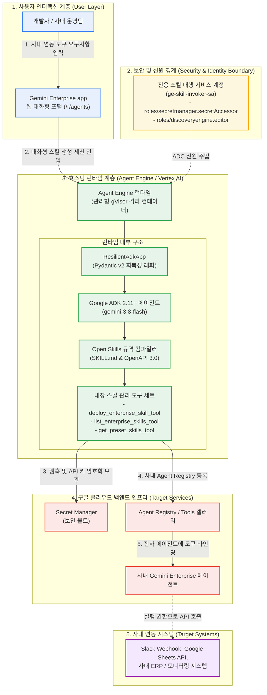

<!--
Copyright 2026 Google LLC. All Rights Reserved.
SPDX-License-Identifier: Apache-2.0

NOTICE: This code/repository is owned by Google LLC and provided under the Apache-2.0 License.
It is strictly provided as an EXAMPLE/REFERENCE ONLY and is NOT INTENDED FOR PRODUCTION USE.
All contents, designs, and code examples are subject to change, modification, or removal at any time without notice.

[고지 사항] 본 저장소 및 문서는 구글 (Google LLC) 소유이며 Apache 2.0 라이선스 하에 예시 (Sample) 용도로 제공된다.
프로덕션 환경용이 아니며, 사전 통지 없이 언제든지 수정, 변경 또는 삭제될 수 있다.
-->

> [!IMPORTANT]
> **구글 (Google LLC) 참조용 샘플 고지 사항**:
> 본 프로젝트의 모든 소스 코드와 문서는 Google LLC의 소유이며, Apache-2.0 라이선스에 따라 오직 **참조용 샘플 (Sample / Reference Only)** 목적으로만 제공된다. 프로덕션 환경에 그대로 사용할 수 없으며, 사전 통지 없이 언제든 내용이 수정, 변경 또는 삭제될 수 있다.

# Gemini Enterprise 자율형 사내 스킬 팩토리 (gemini-enterprise-copilot-skill)

제미나이 엔터프라이즈 앱(Gemini Enterprise app) 환경에서 에이전트가 손발처럼 호출하여 구글 시트(Google Sheets), 슬랙(Slack), 지라(Jira), ERP 등 사내 시스템을 제어할 수 있는 도구 및 맞춤 업무 스킬(Open Skills / SKILL.md)을 비개발자가 대화형으로 자율 생성하고, Gemini Enterprise app Skills 목록에 원클릭으로 직접 자동 프로비저닝 및 전사 배포할 수 있도록 지원하는 사내 스킬 팩토리 솔루션이다. (As of 2026-10-19)

---

## 1. 발생 증상 및 진단 대상 체크리스트

사내 또는 고객사 환경에서 아래 증상이 발생한다면 즉시 진단 대상이다:
사내 엔터프라이즈 에이전트 도입 후 다음과 같은 실무적 한계나 고민이 발생하고 있다면 본 솔루션 도입이 필요하다:
- [ ] **에이전트의 단순 대화 한계**: 텍스트 질의응답을 넘어 구글 시트 행 추가, 슬랙 장애 알림 발송, 지라 티켓 발행 등 사내 시스템을 직접 조작하는 실무 액션(Action)이 필요한 경우
- [ ] **비개발자 임직원의 OpenAPI 작성 불가**: 일반 직원이 사내 API를 에이전트 도구로 붙이고 싶어도 OpenAPI 3.0 스키마(JSON/YAML) 및 파라미터 규격을 작성할 줄 몰라 확장이 중단된 경우
- [ ] **API 토큰 및 자격 증명 평문 노출 위험**: 임직원이 시스템 연동을 위해 웹훅 URL이나 API 키를 프롬프트에 평문으로 하드코딩하여 보안 사고 위험이 발생하는 경우
- [ ] **조회와 변경 작업의 무분별한 실행 위험**: 단순 데이터 조회와 데이터베이스 수정/결재 승인 작업을 동일한 권한으로 처리하여 비인가 결재나 데이터 오염이 우려되는 경우

---

## 2. 빠른 시작 (Quickstart)

> [!TIP]
> Cloud Shell 접속 환경 구성 및 저장소 클론(`git clone`) 방법은 루트의 [메인 README](../../README.md)를 참고한다.

### 0) 사내 환경 대화형 설정 (Config Wizard, 선택 사항)
사내 활성 프로젝트, 리전 및 실시간 Gemini Enterprise App 목록을 감지하여 `.env`에 자동 저장한다:
```bash
python diagnose.py --config
```

### 1) 모의 데이터 가상 실행 (Dry-Run)
GCP API 호출 없이 내장된 가상 인프라 데이터로 정상 동작 여부를 즉시 검증한다:
```bash
python diagnose.py --dry-run
```

**터미널 진단 출력 미리보기:**
```text
===========================================================================
  Gemini Enterprise 사내 스킬 팩토리 (gemini-enterprise-copilot-skill)
===========================================================================
[*] 사내 활성 Gemini Enterprise App 자동 감지: sample-ge-app-id
[*] 활성 프로젝트    : sample-project-id
[*] 대상 리전        : global
[*] 대상 Gemini Enterprise App ID   : sample-ge-app-id
[*] 실행 서비스 계정 : ge-skill-invoker-sa@sample-project-id.iam.gserviceaccount.com
[*] 실행 모드        : 가상 실행 (--dry-run)

[진행] 사내 스킬 팩토리(붕어빵 틀) 프로비저닝 파이프라인 가동...

--> [가상 실행 모드 (--dry-run)] 실제 배포 없이 프로비저닝 명세를 시뮬레이션합니다.
  [1] Agent Engine 프로비저닝 시뮬레이션: projects/sample-project-id/locations/us-central1/reasoningEngines/simulated-skill-factory-engine
  [2] GE App 사내 갤러리(/r/agents) 전사 공유(ALL_USERS) 등록 명세 검증 완료

[성공] 마크다운 진단 보고서가 저장되었습니다: /path/to/samples/gemini-enterprise-copilot-skill/report.md

===========================================================================
  사내 스킬 팩토리 배포 및 등록 완료 (모든 점검 통과)
===========================================================================
```

### 2) 실제 사내 인프라 실시간 진단
```bash
python diagnose.py
```
> [!NOTE]
> 앞서 `python diagnose.py --config`로 환경 설정을 저장했거나 gcloud 활성 설정을 그대로 활용할 경우 별도의 `.env` 생성 없이 즉시 실행할 수 있다. (환경 변수를 텍스트 에디터로 직접 수동 편집하고자 할 때만 `cp -n .env.example .env` 실행 후 수정)

---

## 3. 솔루션 아키텍처 및 런타임 서비스 흐름



---

## 4. 조치 가이드 및 권장 설정

- **Agent Platform Runtimes 콘솔**: ( https://console.cloud.google.com/agent-platform/runtimes )
- **Gemini Enterprise 관리자 콘솔**: 사내 등록된 도구(Tools) 및 에이전트 관리 ( https://console.cloud.google.com/gemini-enterprise/locations/global/engines )
- **Secret Manager 콘솔**: 사내 API 토큰 및 웹훅 URL 보안 볼트 관리 ( https://console.cloud.google.com/security/secret-manager )
- **IAM 및 관리자 콘솔**: 스킬 대행 서비스 계정(`ge-skill-invoker-sa`) 역할 및 바인딩 상태 확인 ( https://console.cloud.google.com/iam-admin/iam )

---
## 5. 사전 준비 사항 (필요 IAM 권한)

본 도구를 실행하려면 최소 아래의 IAM 권한이 필요하다:

스킬 매니페스트 배포 및 에이전트 런타임 보안을 위해 필요한 최소 권한(Least Privilege) 구성은 다음과 같다:

| 역할 (Role) | 부여 대상 | 용도 및 최소 권한 세부 사항 |
| :--- | :--- | :--- |
| `roles/secretmanager.secretAccessor` | 스킬 실행 대행 SA (`ge-skill-invoker-sa`) | 런타임 시 사내 API 토큰 및 웹훅 URL 복호화 권한 |
| `roles/discoveryengine.editor` | 관리자 실행 계정 | Gemini Enterprise app 도구 레지스트리에 신규 Tool 등록 및 메타데이터 관리 |
| 권한 불필요 (Zero IAM) | 일반 현업 임직원 | Gemini Enterprise app 웹 포털 로그인 계정 외에 GCP 콘솔 권한 일절 불필요 |

---

## 6. 기술적 배경 및 아키텍처 원리 (Deep Dive)

### 관련 상세 설계 및 요구 사항 명세
- [비즈니스 요구 사항 명세서 (BRD)](docs/BRD.md): 비즈니스 배경, 성공 지표 및 요구 사항(BR-01~) 명세
- [기술 상세 설계서 (TDD)](docs/TDD.md): 시스템 아키텍처, 기능(FR-01~) 및 비기능(NFR-01~) 설계 명세

사내 스킬 인프라 및 보안 볼트 리소스(Secret Manager 시크릿, 대행 서비스 계정 등) 생성 시 4대 표준 라벨을 반드시 적용한다:
- `managed-by`: `google-cloud-0-to-1`
- `scenario`: `gemini-enterprise-copilot-skill`
- `env`: `sample` (또는 `poc`)
- `created-by`: `customer-engineer`

---
## 7. 리소스 정리 (Teardown) 안내

본 솔루션 검증 후 테스트용으로 등록된 도구 매니페스트나 서비스 계정을 정리하고자 할 경우 아래 절차를 수행한다:

1. **대행 서비스 계정 삭제**:
   ```bash
   gcloud iam service-accounts delete ge-skill-invoker-sa@${PROJECT_ID}.iam.gserviceaccount.com --quiet
   ```
2. **Secret Manager 테스트 시크릿 정리**:
   ```bash
   gcloud secrets delete workspace-service-account-key --quiet
   ```
