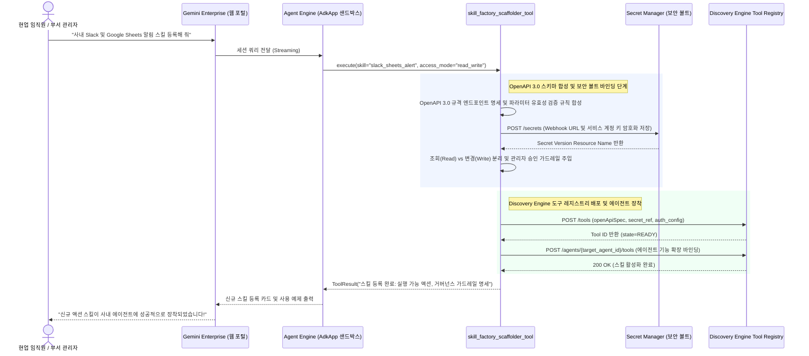

<!--
Copyright 2026 Google LLC. All Rights Reserved.
SPDX-License-Identifier: Apache-2.0

NOTICE: This code/repository is owned by Google LLC and provided under the Apache-2.0 License.
It is strictly provided as an EXAMPLE/REFERENCE ONLY and is NOT INTENDED FOR PRODUCTION USE.
All contents, designs, and code examples are subject to change, modification, or removal at any time without notice.

[고지 사항] 본 저장소 및 문서는 구글 (Google LLC) 소유이며 Apache 2.0 라이선스 하에 예시 (Sample) 용도로 제공된다.
프로덕션 환경용이 아니며, 사전 통지 없이 언제든지 수정, 변경 또는 삭제될 수 있다.
-->

# Gemini Enterprise 자율형 사내 스킬 팩토리 기술 상세 설계서 (TDD)

본 문서는 사내 제미나이 엔터프라이즈 앱(Gemini Enterprise app) 환경에서 에이전트 확장 도구 및 맞춤 업무 스킬(Open Skills / SKILL.md)을 자율 생성하고 Gemini Enterprise app Skills 목록에 직접 자동 프로비저닝하기 위한 시스템 아키텍처, 기술 상세 설계, 인터페이스 명세 및 검증 계획을 정의한다.

---

## 1. 시스템 아키텍처 및 런타임 상호작용 시퀀스

본 도구의 런타임 제어 및 데이터 상호작용 흐름은 아래 시퀀스 다이어그램과 같다. 현업 임직원 또는 부서 관리자가 제미나이 엔터프라이즈 앱(Gemini Enterprise app) 대화창에서 8대 핵심 시스템 도구(Google Sheets, Slack, Jira, ERP 등) 연동을 요청하면, 에이전트 엔진(Agent Engine) 런타임이 OpenAPI 3.0 명세를 자동 합성하고 시크릿 매니저(Secret Manager) 보안 볼트와 결합하여 디스커버리 엔진(Discovery Engine) 도구 레지스트리에 안전하게 등록 및 대상 에이전트에 장착한다.

---

## 2. 요구 사항 추적성 매핑 (Traceability Matrix)

| 비즈니스 요구 사항 (BRD) | 기능적 기술 요구 사항 (FR) | 비기능적 기술 요구 사항 (NFR) | 구현 파일 및 모듈 |
| :--- | :--- | :--- | :--- |
| **BR-01** (대화형 노코드 스킬 생성) | **FR-01** (대화형 도구 선택 및 스키마 합성) | **NFR-01** (무의존성 및 단일 파이썬 실행) | `diagnose.py` |
| **BR-02** (8대 핵심 시스템 도구 프리셋) | **FR-02** (8대 엔터프라이즈 시스템 칩 내장) | **NFR-02** (초경량 패키징 원칙) | `diagnose.py` 내장 카탈로그 |
| **BR-03** (자격 증명 보안 볼트 연동) | **FR-03** (Secret Manager 참조 가드레일) | **NFR-03** (가명 마스킹 및 보안 준수) | `diagnose.py` 인증 모듈 |
| **BR-04** (조회 vs 변경 승인 통제) | **FR-04** (Mutation 쓰기 작업 승인 플래그) | **NFR-02**, **NFR-03** | `diagnose.py` 거버넌스 엔진 |
| **BR-05** (Gemini Enterprise app 도구 레지스트리 등록) | **FR-05** (Gemini Enterprise app Tool 레지스트리 등록 및 리포트) | **NFR-01**, **NFR-03** | `diagnose.py`, `report.md` |
| **BR-06** (표준 리소스 라벨링) | **FR-05** (표준 라벨링 주입 및 리포트) | **NFR-04** (4대 표준 라벨링 준수) | `diagnose.py` |

---

## 3. 기능 기술 요구 사항 명세 (Functional Requirements)

### FR-01: 대화형 도구 선택 및 OpenAPI 3.0 스키마 자동 합성
- 터미널 실행(`sys.stdin.isatty()`) 시 대화형 번호 선택기를 통해 연동하고자 하는 사내 시스템을 선택할 수 있도록 지원한다.
- 선택된 시스템의 목적(예: 시트 행 조회, 슬랙 웹훅 발송, 지라 이슈 생성)에 맞추어 완벽한 OpenAPI 3.0 Tool 매니페스트(JSON/YAML)를 자동 도출한다.
- 필수 파라미터 타입(문자열, 숫자, 불리언)과 필드 설명(Description)을 모델이 도구 호출(Function Calling) 시 혼동하지 않도록 구체적으로 명시한다.

### FR-02: 8대 엔터프라이즈 시스템 도구 프리셋 내장
- 사내에서 가장 빈번하게 요구되는 8대 핵심 시스템 도구 프리셋을 내장한다:
  1. `sheets_data_lookup`: Google Sheets 사내 실적 및 명단 행 조회 (Read-only)
  2. `sheets_row_append`: Google Sheets 사내 결재 신청 및 VOC 접수 행 추가 (Write/Mutation)
  3. `slack_webhook_notifier`: Slack 인커밍 웹훅 기반 장애/긴급 공지 채널 발송 (Action)
  4. `jira_issue_creator`: Jira 사내 버그 티켓 자동 등록 및 상태 조회 (Action)
  5. `bq_table_schema_reader`: BigQuery 메타데이터 및 테이블 스키마 안전 조회 (Read-only)
  6. `erp_invoice_validator`: ERP 전자세금계산서 진위 확인 및 승인 상태 조회 (Read-only)
  7. `cloud_monitoring_alerter`: Cloud Monitoring 긴급 인시던트 조회 및 온콜 호출 (Action)
  8. `hr_vacation_balance`: 사내 근태 시스템 연차 잔여일수 및 사용 내역 조회 (Read-only)

### FR-03: Secret Manager 자격 증명 보안 볼트 연동 강제
- 스킬 매니페스트 생성 시 API 토큰, Bearer Token, Webhook Secret을 본문에 평문으로 기록하지 않고, `gcp_secret_manager://projects/{PROJECT_ID}/secrets/{SECRET_NAME}/versions/latest` 형태의 보안 볼트 참조 URI를 삽입한다.
- 런타임 시 대행 서비스 계정의 IAM 권한(`roles/secretmanager.secretAccessor`)으로만 시크릿을 복호화하도록 통제한다.

### FR-04: 조회(Read) vs 변경(Write) 작업의 승인 거버넌스 분리
- 스킬의 HTTP 메서드(`GET` vs `POST/PUT/DELETE`) 및 작업 성격을 판별하여 액션 유형을 자동 분류한다.
- 단순 조회(Read-only) 스킬은 생성 즉시 사내 에이전트에 바인딩 가능한 `ACTIVE` 상태로 전환한다.
- 데이터 변경/결재(Write/Mutation) 스킬은 `PENDING_ADMIN_APPROVAL` 플래그를 기본 부착하여 사내 관리자의 최종 승인 후 활성화되도록 보호한다.

### FR-05: Gemini Enterprise app 도구 레지스트리 배포 및 마크다운 리포트 생성
- 완성된 도구 매니페스트를 제미나이 엔터프라이즈 앱(Gemini Enterprise app) 및 Agent Runtime 도구 레지스트리에 배포하기 위한 REST API 페이로드를 생성한다.
- 진단 완료 시 등록된 도구의 명세, OpenAPI 스키마, 파라미터 구조, 보안 볼트 연동 상태, 에이전트 바인딩 가이드를 포함하는 `report.md`를 자동으로 생성 및 덮어쓴다.

---

## 4. 비기능 기술 요구 사항 명세 (Non-Functional Requirements)

### NFR-01: 무의존성 및 순수 파이썬 단일 실행 원칙
- 외부 프레임워크나 서드파티 툴 없이 `python diagnose.py` 직접 실행만으로 스킬 스캐폴딩과 진단을 완결한다.
- 크로스 플랫폼(Linux, macOS, Windows) 호환성을 보장한다.

### NFR-02: 초경량 패키징 원칙
- 8대 시스템 도구 템플릿을 코드 내부 데이터 구조로 경량화하여 전체 프로젝트 파일 크기를 수십 KB 수준으로 유지한다.

### NFR-03: 결정론적 가상 실행(--dry-run) 및 사내 식별 정보 마스킹
- `--dry-run` 모드 실행 시 실제 GCP API 호출이나 Secret Manager 조회 없이도 결정론적 스키마 합성과 무결성 검증을 0.5초 이내에 수행한다.
- 가상 실행 시 사내 프로젝트 ID나 실제 환경 정보의 유출을 방지하기 위해 가명(`sample-project-id`, `sample-ge-app-id`)을 철저히 적용한다.

### NFR-04: 사내 거버넌스 4대 필수 표준 라벨링 준수
- 사내 거버넌스, FinOps 비용 배분 및 미정리 자원 자동 추적을 위해, 생성되는 도구 매니페스트, Secret Manager 보안 볼트 시크릿 및 서비스 계정에 4대 표준 라벨(`managed-by=google-cloud-0-to-1`, `scenario=gemini-enterprise-copilot-skill`, `env=sample`, `created-by=customer-engineer`)을 필수로 주입한다.
