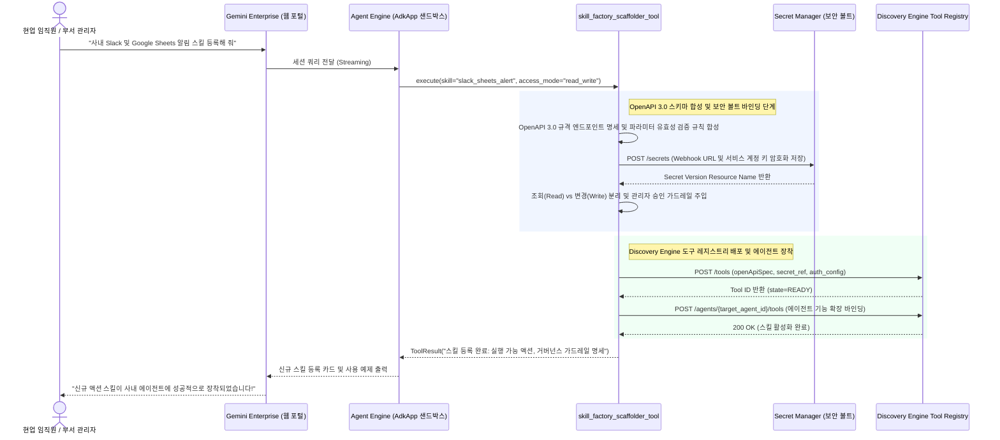

<!--
Copyright 2026 Google LLC. All Rights Reserved.
SPDX-License-Identifier: Apache-2.0

NOTICE: This code/repository is owned by Google LLC and provided under the Apache-2.0 License.
It is strictly provided as an EXAMPLE/REFERENCE ONLY and is NOT INTENDED FOR PRODUCTION USE.
All contents, designs, and code examples are subject to change, modification, or removal at any time without notice.

[고지 사항] 본 저장소 및 문서는 구글 (Google LLC) 소유이며 Apache 2.0 라이선스 하에 예시 (Sample) 용도로 제공된다.
프로덕션 환경용이 아니며, 사전 통지 없이 언제든지 수정, 변경 또는 삭제될 수 있다.
-->

# Gemini Enterprise 자율형 사내 스킬 팩토리 기술 상세 설계서 (TDD)

본 문서는 사내 제미나이 엔터프라이즈 앱(Gemini Enterprise app) 환경에서 에이전트 확장 도구 및 맞춤 업무 스킬(Open Skills / SKILL.md)을 자율 생성하고 Gemini Enterprise app Skills 목록에 직접 자동 프로비저닝하기 위한 시스템 아키텍처, 기술 상세 설계, 인터페이스 명세 및 검증 계획을 정의한다.

---

## 1. 시스템 아키텍처 및 런타임 상호작용 시퀀스

본 도구의 런타임 제어 및 데이터 상호작용 흐름은 아래 시퀀스 다이어그램과 같다. 현업 임직원 또는 부서 관리자가 제미나이 엔터프라이즈 앱(Gemini Enterprise app) 대화창에서 8대 핵심 시스템 도구(Google Sheets, Slack, Jira, ERP 등) 연동을 요청하면, 에이전트 엔진(Agent Engine) 런타임이 OpenAPI 3.0 명세를 자동 합성하고 시크릿 매니저(Secret Manager) 보안 볼트와 결합하여 디스커버리 엔진(Discovery Engine) 도구 레지스트리에 안전하게 등록 및 대상 에이전트에 장착한다.

---

## 2. 요구 사항 추적성 매핑 (Traceability Matrix)

| 비즈니스 요구 사항 (BRD) | 기능적 기술 요구 사항 (FR) | 비기능적 기술 요구 사항 (NFR) | 구현 파일 및 모듈 |
| :--- | :--- | :--- | :--- |
| **BR-01** (대화형 노코드 스킬 생성) | **FR-01** (대화형 도구 선택 및 스키마 합성) | **NFR-01** (무의존성 및 단일 파이썬 실행) | `diagnose.py` |
| **BR-02** (24대 엔터프라이즈 업무 도구 카탈로그) | **FR-02** (8대 도메인 24종 엔터프라이즈 스킬 칩 내장) | **NFR-02** (초경량 패키징 원칙) | `catalog.yaml`, `diagnose.py` |
| **BR-03** (자격 증명 보안 볼트 연동) | **FR-03** (Secret Manager 참조 가드레일) | **NFR-03** (가명 마스킹 및 보안 준수) | `diagnose.py` 인증 모듈 |
| **BR-04** (조회 vs 변경 승인 통제) | **FR-04** (Mutation 쓰기 작업 승인 플래그) | **NFR-02**, **NFR-03** | `diagnose.py` 거버넌스 엔진 |
| **BR-05** (Gemini Enterprise app 도구 레지스트리 등록) | **FR-05** (Gemini Enterprise app Tool 레지스트리 등록 및 리포트) | **NFR-01**, **NFR-03** | `diagnose.py`, `report.md` |
| **BR-06** (표준 리소스 라벨링) | **FR-05** (표준 라벨링 주입 및 리포트) | **NFR-04** (4대 표준 라벨링 준수) | `diagnose.py` |
| **BR-07** (선언적 카탈로그 레시피 및 3계층 케밥 케이스) | **FR-06** (선언적 레시피 로더), **FR-07** (3계층 케밥 케이스 슬러그 검증) | **NFR-01**, **NFR-02** | `catalog.yaml`, `diagnose.py` |
| **BR-08** (사내 방화벽 및 에어갭 환경 회복탄력성) | **FR-06** (4단계 캐스케이드 탐색 및 타임아웃 방어) | **NFR-05** (에어갭 오프라인 격리 실행 보장) | `diagnose.py` 카탈로그 로더 |
| **BR-09** (사전 슬러그/ID 전용 중복 방지 및 스코핑) | **FR-08** (사전 슬러그/ID 전용 중복 점검 인터셉터) | **NFR-03** (가명 마스킹 및 보안 준수) | `diagnose.py` 거버넌스 엔진 |

---

## 3. 기능 기술 요구 사항 명세 (Functional Requirements)

### FR-01: 대화형 도구 선택, 자유 프롬프팅 및 OpenAPI 3.0 스키마 자동 합성
- 터미널 실행(`sys.stdin.isatty()`) 시 대화형 번호 선택기를 통해 연동하고자 하는 사내 시스템을 선택할 수 있도록 지원한다.
- 카탈로그에 존재하지 않는 사내 고유 시스템 연동의 경우, 자연어 자유 프롬프팅(`--prompt "..."` 또는 대화형 `0`번 선택)을 통해 사용자가 입력한 비정형 요구 사항(REST 엔드포인트, 헤더, 페이로드)으로부터 표준 OpenAPI 3.0 Tool 매니페스트(JSON/YAML)를 자동 도출한다.
- 필수 파라미터 타입(문자열, 숫자, 불리언)과 필드 설명(Description)을 모델이 도구 호출(Function Calling) 시 혼동하지 않도록 구체적으로 명시한다.

### FR-02: 8대 도메인 24대 엔터프라이즈 업무 도구(스킬) 카탈로그 내장
- 사내 실무 환경에서 요구되는 핵심 업무 도메인별 시스템 도구 프리셋을 내장한다:
  1. **전자결재 및 품의 (Approval)**:
     - `approval-draft-create`: 전자결재 기안문 초안 작성 (Mutation)
     - `approval-status-check`: 결재선 진행 상태 미결함 조회 (Read-only)
     - `approval-proxy-delegate`: 전결 부재 시 대결자 지정 (Mutation)
  2. **법인카드 및 경비 정산 (Expense)**:
     - `corp-card-reconcile`: 법인카드 영수증 내역 자동 대조 (Mutation)
     - `overtime-transport-claim`: 야근 교통비 식대 정산 신청 (Mutation)
     - `biz-entertain-preapprove`: 접대비 사전 품의서 제출 (Mutation)
     - `tax-invoice-verify`: 홈택스 전자세금계산서 진위 확인 (Read-only)
  3. **근태 및 주 52시간 관리 (HR)**:
     - `hr-vacation-apply`: 연차 반차 경조휴가 신청 (Mutation)
     - `work-hours-monitor`: 주 52시간 잔여 근무 시간 조회 (Read-only)
     - `corp-directory-search`: 사내 조직도 직급 사번 호칭 검색 (Read-only)
     - `welfare-point-check`: 사내 복지포인트 잔액 사용 조회 (Read-only)
  4. **총무 및 시설 자산 관리 (Facilities)**:
     - `room-booking-reserve`: 사내 회의실 화상 장비 예약 (Mutation)
     - `corp-car-dispatch`: 업무용 법인 차량 배차 신청 (Mutation)
     - `it-asset-request`: 업무용 PC 모니터 전산 비품 신청 (Mutation)
     - `sw-license-grant`: 사내 소프트웨어 라이선스 신청 (Mutation)
  5. **사내 정보보안 및 망 분리 (Security)**:
     - `doc-export-approval`: 사내 문서 외부 반출 승인 요청 (Mutation)
     - `firewall-open-request`: 사내망 임시 IP 방화벽 오픈 신청 (Mutation)
     - `pii-access-permit`: 고객 개인정보 열람 사유 결재 (Mutation)
  6. **업무 협업 및 워크스페이스 (Collaboration)**:
     - `slack-notice-broadcast`: 사내 메신저 공지 긴급 알림 배포 (Mutation)
     - `sheets-voc-append`: 사내 VOC 개선 제안 행 추가 (Mutation)
     - `drive-template-find`: 사내 표준 계약서 위임장 양식 검색 (Read-only)
  7. **영업 및 거래처 관리 (Partner)**:
     - `biz-reg-validate`: 국세청 사업자등록 휴폐업 상태 조회 (Read-only)
     - `bank-account-verify`: 거래처 법인 예금주 실명 확인 (Read-only)
     - `crm-lead-register`: 신규 거래처 영업 미팅 일지 등록 (Mutation)
  8. **IT 인프라 및 시스템 (IT)**:
     - `system-outage-alert`: 사내 기간계 시스템 장애 현황 조회 (Read-only)

### FR-03: Secret Manager 자격 증명 보안 볼트 연동 강제
- 스킬 매니페스트 생성 시 API 토큰, Bearer Token, Webhook Secret을 본문에 평문으로 기록하지 않고, `gcp_secret_manager://projects/{PROJECT_ID}/secrets/{SECRET_NAME}/versions/latest` 형태의 보안 볼트 참조 URI를 삽입한다.
- 런타임 시 대행 서비스 계정의 IAM 권한(`roles/secretmanager.secretAccessor`)으로만 시크릿을 복호화하도록 통제한다.

### FR-04: 조회(Read) vs 변경(Write) 작업의 승인 거버넌스 분리
- 스킬의 HTTP 메서드(`GET` vs `POST/PUT/DELETE`) 및 작업 성격을 판별하여 액션 유형을 자동 분류한다.
- 단순 조회(Read-only) 스킬은 생성 즉시 사내 에이전트에 바인딩 가능한 `ACTIVE` 상태로 전환한다.
- 데이터 변경/결재(Write/Mutation) 스킬은 `PENDING_ADMIN_APPROVAL` 플래그를 기본 부착하여 사내 관리자의 최종 승인 후 활성화되도록 보호한다.

### FR-05: Gemini Enterprise app 도구 레지스트리 배포 및 마크다운 리포트 생성
- 완성된 도구 매니페스트를 제미나이 엔터프라이즈 앱(Gemini Enterprise app) 및 Agent Runtime 도구 레지스트리에 배포하기 위한 REST API 페이로드를 생성한다.
- 진단 완료 시 등록된 도구의 명세, OpenAPI 스키마, 파라미터 구조, 보안 볼트 연동 상태, 에이전트 바인딩 가이드를 포함하는 `report.md`를 자동으로 생성 및 덮어쓴다.

### FR-06: catalog.yaml 선언적 레시피 로더 및 4단계 캐스케이드 탐색
- 도구 템플릿을 코드 내부 하드코딩에만 의존하지 않고, 선언적 `catalog.yaml` 파일로부터 동적 로드하는 파서를 제공한다.
- 탐색 캐스케이드 우선순위:
  1. CLI 인자: `--catalog <PATH|URL>`
  2. 환경 변수: `SKILL_CATALOG_PATH`
  3. 로컬 파일: 모듈 루트의 `catalog.yaml` (기본 경로)
  4. 인코드 시드: 로컬 파일 부재 시 비상용 기본 시드 딕셔너리 폴백
- 원격 HTTP/HTTPS URL 입력 시 소켓 연결 및 읽기 타임아웃을 2.0초로 엄격히 제한하여 사내 아웃바운드 차단 환경에서도 프로세스 멈춤(Hang) 없이 즉시 로컬 파일로 폴백한다.

### FR-07: 3계층 케밥 케이스 슬러그 규격 검증 및 슬래시 커맨드 매핑
- 모든 스킬 ID(슬러그)는 3계층 영문 소문자 케밥 케이스(`[domain]-[task]-[action]`, 정규식: `^[a-z0-9]+-[a-z0-9]+-[a-z0-9]+$`) 형식을 엄격히 준수한다.
- Gemini Enterprise app 대화창의 슬래시 커맨드(`/approval-draft-create`) 및 호출 멘션(`@approval-draft-create`)에 즉시 연동될 수 있도록 카탈로그 엔트리별 슬래시 커맨드 및 트리거 메타데이터를 자동 주입한다.

### FR-08: 사전 슬러그/ID 전용 중복 점검(Pre-flight Duplicate Check) 인터셉터 및 네임스페이스 스코핑
- 신규 스킬 프로비저닝 전 대상 도구 레지스트리 및 기존 배포 목록을 스캔하여 동일한 시스템 고유 슬러그(`slug`, 3계층 케밥 케이스 ID) 일치 여부를 사전 점검한다.
- 자연어 도구 명칭의 유사도는 차단하지 않고 허용하며, 오로지 고유 식별자인 영문 슬러그(ID)가 정확히 일치할 때만 중복으로 판정한다.
- 클라우드 대화형 런타임(GE App) 0단계 사전 검증 도구(`check_skill_duplicate_tool(slug: str)`):
  - 사용자가 특정 사내 도구나 스킬 생성을 요청하면 인터뷰를 시작하기 전에 해당 스킬의 고유 슬러그를 도출하여 Discovery Engine API를 선제 호출하여 기등록 스킬 목록의 슬러그 태그(`[Slug: ...]`) 및 명칭을 스캔한다.
  - 기등록 슬러그(중복) 발견 시 1~3단계 기획 인터뷰를 일절 진행하지 않고, 즉시 첫 턴에서 사내 스킬 갤러리(/r/skills) 링크와 함께 이미 등록되어 활성화되어 있음을 알리고 기존 스킬 사용 또는 지침 업데이트 여부를 안내한다.
  - 신규 슬러그일 때만 1단계(연동 대상 시스템 파악) 인터뷰로 진입하여 대화 낭비를 최소화한다.
- 동일 슬러그 발견 시 다음과 같이 분기 처리한다:
  1. 공식 전사 스킬(`scope: ORG`): 신규 생성을 중단하고 기존 스킬 재사용(`REUSE`)을 권고한다.
  2. 부서별 커스텀 스킬(`scope: TEAM`): 부서 식별자 접두사(예: `[dev-team]-sheets-data-lookup`)를 강제 결합하고 공유 범위를 `PRIVATE` 또는 그룹 한정으로 스코핑하여 등록한다.

---

## 4. 비기능 기술 요구 사항 명세 (Non-Functional Requirements)

### NFR-01: 무의존성 및 순수 파이썬 단일 실행 원칙
- 외부 프레임워크나 서드파티 툴 없이 `python diagnose.py` 직접 실행만으로 스킬 스캐폴딩과 진단을 완결한다.
- 크로스 플랫폼(Linux, macOS, Windows) 호환성을 지원한다.

### NFR-02: 초경량 패키징 원칙
- 8대 시스템 도구 템플릿을 코드 내부 데이터 구조로 경량화하여 전체 프로젝트 파일 크기를 수십 KB 수준으로 유지한다.

### NFR-03: 결정론적 가상 실행(--dry-run) 및 사내 식별 정보 마스킹
- `--dry-run` 모드 실행 시 실제 GCP API 호출이나 Secret Manager 조회 없이도 결정론적 스키마 합성과 무결성 검증을 메모리 상에서 신속하게 수행한다.
- 가상 실행 시 사내 프로젝트 ID나 실제 환경 정보의 유출을 방지하기 위해 가명(`sample-project-id`, `sample-ge-app-id`)을 철저히 적용한다.

### NFR-04: 사내 거버넌스 4대 필수 표준 라벨링 준수
- 사내 거버넌스, FinOps 비용 배분 및 미정리 자원 자동 추적을 위해, 생성되는 도구 매니페스트, Secret Manager 보안 볼트 시크릿 및 서비스 계정에 4대 표준 라벨(`managed-by=google-cloud-0-to-1`, `scenario=gemini-enterprise-copilot-skill`, `env=sample`, `created-by=customer-engineer`)을 필수로 주입한다.

### NFR-05: 에어갭(Air-gapped) 오프라인 완전 격리 실행 지원
- 외부 인터넷 또는 사내 외부망 아웃바운드가 전면 차단된 에어갭 환경에서도, 로컬 `catalog.yaml` 및 내장 시드만으로 외부 의존성 없이 정상 구동 및 무결성 검증이 완료되어야 한다.
