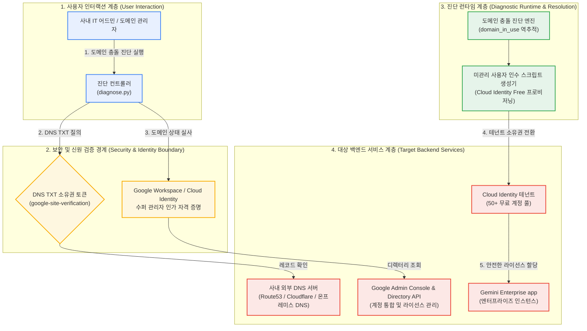

<!--
Copyright 2026 Google LLC. All Rights Reserved.
SPDX-License-Identifier: Apache-2.0

NOTICE: This code/repository is owned by Google LLC and provided under the Apache-2.0 License.
It is strictly provided as an EXAMPLE/REFERENCE ONLY and is NOT INTENDED FOR PRODUCTION USE.
All contents, designs, and code examples are subject to change, modification, or removal at any time without notice.

[고지 사항] 본 저장소 및 문서는 구글 (Google LLC) 소유이며 Apache 2.0 라이선스 하에 예시 (Sample) 용도로 제공된다.
프로덕션 환경용이 아니며, 사전 통지 없이 언제든지 수정, 변경 또는 삭제될 수 있다.
-->

> [!IMPORTANT]
> **구글 (Google LLC) 참조용 샘플 고지 사항**:
> 본 프로젝트의 모든 소스 코드와 문서는 Google LLC의 소유이며, Apache-2.0 라이선스에 따라 오직 **참조용 샘플 (Sample / Reference Only)** 목적으로만 제공된다. 프로덕션 환경에 그대로 사용할 수 없으며, 사전 통지 없이 언제든 내용이 수정, 변경 또는 삭제될 수 있다.

# 제미나이 엔터프라이즈(Gemini Enterprise) 도입을 위한 도메인 충돌(domain_in_use) 진단기

Gemini Enterprise 도입 시 사내 도메인이 기존 비관리 계정에 의해 선점되어 발생하는 도메인 충돌(domain_in_use)을 진단하고, Google Workspace 라이선스 구매 없이 Cloud Identity Free를 활용하여 독립적인 엔터프라이즈 AI 환경을 배포하도록 지원하는 진단 도구다. (As of 2026-10-17)

---

## 1. 발생 증상 및 진단 대상 체크리스트

사내 또는 고객사 환경에서 아래 증상이 발생한다면 즉시 진단 대상이다:
- [ ] 그룹사 산하 계열사에 Gemini Enterprise를 전사 공급하려 할 때, 사내 도메인이 이미 사용 중이라는 에러(`domain_in_use`)로 인해 신규 테넌트 개설이 차단된 경우
- [ ] Gemini Enterprise는 Google Workspace(Gmail, 구글 드라이브(Google Drive), 구글 독스(Google Docs))와는 완전히 별개의 독립 제품이므로, 고가의 Workspace 라이선스 없이 무료 `Cloud Identity Free` 계정만으로 전사 배포하고자 하는 경우
- [ ] 과거 임직원이 회사 이메일 주소로 구글 무료 서비스(Google Workspace Essentials Starter 등)에 개별 가입하여 도메인이 비관리(Unmanaged) 상태로 선점되어 이를 중앙 거버넌스로 편입해야 하는 경우


### 1.1 도구의 본질 및 비즈니스 해결 과제 (What & Why)
- **대상 사용자 (Target)**: Google Workspace 어드민, 클라우드 인프라 팀, 기업 IT 기획자 및 Identity 관리자
- **해결하는 핵심 문제 (Core Pain Points)**:
  1. Gemini Enterprise app 도입 시 이미 타 부서나 개인이 사내 도메인으로 비인가 계정을 생성해 두어 도메인 선점 충돌이 발생하는 문제
  2. 도메인 충돌로 인해 전사 테넌트 생성 단계에서 에러가 발생하여 PoC 및 본 계약 일정이 수주 이상 지연되는 현상
  3. 유료 Google Workspace 라이선스 없이 Gemini Enterprise app 단독 도입을 위한 Cloud Identity Free 계정 구성 절차가 복잡한 문제
- **본 솔루션의 해결 방식 (Solution)**:
  - 사내 도메인의 Cloud Identity 테넌트 점유 상태 및 미관리 계정(Unmanaged Accounts) 충돌 여부를 1분 만에 진단하고, 도메인 소유권 DNS TXT 인증 및 Cloud Identity Free 기반 테넌트 안착 가이드를 처방한다.

### 1.2 최종 산출물 3종 세트 미리보기 (Deliverables & Visual Preview)
본 도구를 실행(`python diagnose.py`)하면 다음 3가지 구체적인 엔터프라이즈 자산이 생성된다:

| 산출물 구분 | 산출물 형태 및 명칭 | 주요 포함 내용 및 실무 활용 방안 |
| :--- | :--- | :--- |
| **① 터미널 콘솔 요약** | Visual CLI Table | 도메인 선점 상태, DNS TXT 레코드 인증 여부, 미관리 계정 수 및 테넌트 배포 준비도 판정 표 |
| **② 정규 진단 보고서** | 마크다운 파일 (`report.md`) | 도메인 충돌 근본 원인 분석서, DNS 레코드 설정 가이드, 미관리 계정 강제 회수/초대 절차 및 Cloud Identity Free 배포 매뉴얼 |
| **③ 후속 조치 및 배포 자산** | Actionable Asset Specs | • **DNS 도메인 소유권 검증 레코드**: 네임서버 등록용 `google-site-verification` TXT 레코드 값<br/>• **미관리 사용자 계정 전환 가이드**: 개인 계정을 사내 관리형 계정으로 흡수하는 단계별 절차서<br/>• **Cloud Identity Free 프로비저닝 링크**: 추가 라이선스 비용 없이 테넌트를 활성화하는 직결 링크 |

---

## 2. 빠른 시작 (Quickstart)

> [!TIP]
> Cloud Shell 접속 환경 구성 및 저장소 클론(`git clone`) 방법은 루트의 [메인 README](../../README.md)를 참고한다.

### 1) 모의 데이터 가상 실행 (Dry-Run)
GCP API 호출 없이 내장된 가상 인프라 데이터로 정상 동작 여부를 즉시 검증한다:
```bash
python diagnose.py --dry-run
```

**터미널 진단 출력 미리보기:**
```text
=====================================================================================
Gemini Enterprise 도입을 위한 도메인 충돌(domain_in_use) 및 Cloud Identity 진단 리포트
진단 모드: 가상 실행 (Dry-run)
점검 대상 도메인: example.com
=====================================================================================
[1단계] 도메인 충돌 상태 및 원인 분석
-------------------------------------------------------------------------------------
* 충돌 증상 코드: domain_in_use
* 원인 분석: 임직원 개별 가입 구글 서비스(Essentials Starter 등)로 인한 비관리(Unmanaged) 테넌트 선점
* 식별된 미관리 사용자 계정 수: 8명
```


### 2) 사내 환경 대화형 설정 (Config Wizard, 선택 사항)
사내 활성 프로젝트 및 환경 설정을 대화형으로 탐색하여 `.env`에 자동 저장한다:
```bash
python diagnose.py --config
```


### 3) 실제 사내 인프라 실시간 진단
```bash
python diagnose.py
```
> [!NOTE]
> 앞서 `python diagnose.py --config`로 환경 설정을 저장했거나 gcloud 활성 설정을 그대로 활용할 경우 별도의 `.env` 생성 없이 즉시 실행할 수 있다. (환경 변수를 텍스트 에디터로 직접 수동 편집하고자 할 때만 `cp -n .env.example .env` 실행 후 수정)

---

## 3. 솔루션 아키텍처 및 런타임 토폴로지

본 도구는 사내 도메인 선점 충돌(domain_in_use)을 진단하고 Cloud Identity Free 기반 테넌트 인수를 완결하는 4계층 시스템 토폴로지를 제공한다:



---
## 4. 조치 가이드 및 권장 설정

1. **도메인 소유권 확인 및 인수(Takeover)**:
   - Google Admin Console > 계정 > 도메인 > 도메인 관리 ( https://admin.google.com/ac/domains/manage )
   - 도메인 소유권 확인 ( https://support.google.com/a/answer/7126229 )
   - 도메인 충돌(domain_in_use) 해결 가이드 ( https://support.google.com/a/answer/11112794 )
2. **미관리 사용자 계정 통합 및 관리**:
   - 디렉터리 > 사용자 ( https://admin.google.com/ac/users )
3. **Cloud Identity Free 라이선스 발급**:
   - 결제 > 구독 ( https://admin.google.com/ac/billing/subscriptions )
   - Cloud Identity 개요 ( https://cloud.google.com/identity/docs/overview )
   - Cloud Identity 에디션 비교 ( https://cloud.google.com/identity/docs/editions )

---
### GCP 리소스 생성 시 4대 필수 표준 라벨링 준수
- 사내 거버넌스 및 자원 식별, 비용 추적을 위해 관련 클라우드 리소스 생성 시 4대 표준 라벨을 필수로 주입한다:
  - `managed-by`: `google-cloud-0-to-1`
  - `scenario`: `gemini-enterprise-domain-resolver`
  - `env`: `sample`
  - `created-by`: `customer-engineer`
- gcloud CLI 예시: `--labels=managed-by=google-cloud-0-to-1,scenario=gemini-enterprise-domain-resolver,env=sample,created-by=customer-engineer`

---

## 5. 사전 준비 사항 (필요 IAM 권한)

본 도구를 실행하려면 최소 아래의 IAM 권한이 필요하다:

본 조치를 완료하려면 아래의 권한 및 관리 접근 권한이 필요하다:

| 서비스 / 영역 | 필요 역할 또는 권한 | 목적 |
| :--- | :--- | :--- |
| `사내 DNS 관리자` | DNS 레코드(TXT) 추가 및 갱신 권한 | Google 도메인 소유권 확인 토큰 등록 |
| `Google Admin Console` | `슈퍼 관리자(Super Admin)` | 도메인 관리, 소유권 인수, 미관리 사용자 초대 및 라이선스 할당 |

---

## 6. 기술적 배경 및 아키텍처 원리 (Deep Dive)

### 관련 상세 설계 및 요구 사항 명세
- [비즈니스 요구 사항 명세서 (BRD)](docs/BRD.md): 비즈니스 배경, 성공 지표 및 요구 사항(BR-01~) 명세
- [기술 상세 설계서 (TDD)](docs/TDD.md): 시스템 아키텍처, 기능(FR-01~) 및 비기능(NFR-01~) 설계 명세

```text
=====================================================================================
Gemini Enterprise 도입을 위한 도메인 충돌(domain_in_use) 및 Cloud Identity 진단 리포트
진단 모드: 가상 실행 (Dry-run)
점검 대상 도메인: example.com
=====================================================================================

[1단계] 도메인 충돌 상태 및 원인 분석
-------------------------------------------------------------------------------------
* 충돌 증상 코드: domain_in_use
* 원인 분석: 임직원 개별 가입 구글 서비스(Essentials Starter 등)로 인한 비관리(Unmanaged) 테넌트 선점
* 식별된 미관리 사용자 계정 수: 8명
* 대표 미관리 계정 목록: user1@example.com, marketing-lead@example.com, dev-ops@example.com, finance-mgr@example.com
-------------------------------------------------------------------------------------

[2단계] DNS TXT 레코드 기반 도메인 소유권 검증 상태
-------------------------------------------------------------------------------------
* DNS 검증 상태: 미검증 (NOT VERIFIED - 조치 필요)
* 등록 필요 TXT 레코드 값: google-site-verification=AbCdEf1234567890XyZ_mock_token
-------------------------------------------------------------------------------------

[3단계] 라이선스 최적화 및 Gemini Enterprise 배포 전략
-------------------------------------------------------------------------------------
* Cloud Identity Free 지원 여부: 지원 가능 (50+개 무료 라이선스 즉시 제공)
* 비용 최적화 제안: 전사 Google Workspace 유료 라이선스 구매 없이도 Cloud Identity Free 계정에
  Gemini Enterprise 전용 애드온 라이선스만 할당하여 그룹사 분할 배포 가능
-------------------------------------------------------------------------------------

[4단계] 단계별 소유권 인수(Takeover) 및 계정 통합 처방
1. DNS 공급자 콘솔 접속 후 도메인 TXT 레코드 추가:
   호스트: @ | 유형: TXT | 값: google-site-verification=AbCdEf1234567890XyZ_mock_token
2. Google Admin Console에서 도메인 소유권 확인 완료:
   ( https://admin.google.com/ac/domains/manage )
3. 도메인 소유권 확인 후 미관리 사용자 통합 및 계정 충돌 해소:
   - 관리 콘솔 > 디렉터리 > 사용자 > 미관리 사용자 초청 및 소유권 인수
   - 또는 임시 계정(gtempaccount.com)으로의 자동 분리 승인
4. Cloud Identity Free 라이선스를 통한 중앙 ID 거버넌스 수립:
   ( https://admin.google.com/ac/billing/subscriptions )
=====================================================================================
```

---
## 7. 리소스 정리 (Teardown) 안내

본 진단 도구는 도메인 충돌 여부 및 DNS 상태를 조회하는 진단기이므로 별도의 클라우드 인프라 자원을 생성하지 않는다. 테스트 완료 후 불필요한 DNS TXT 레코드는 DNS 공급자 관리 화면에서 삭제한다.
