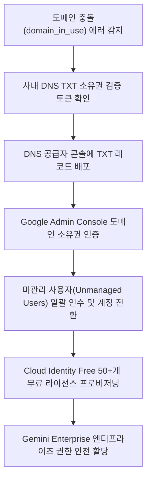

<!--
Copyright 2026 Google LLC. All Rights Reserved.
SPDX-License-Identifier: Apache-2.0

NOTICE: This code/repository is owned by Google LLC and provided under the Apache-2.0 License.
It is strictly provided as an EXAMPLE/REFERENCE ONLY and is NOT INTENDED FOR PRODUCTION USE.
All contents, designs, and code examples are subject to change, modification, or removal at any time without notice.

[고지 사항] 본 저장소 및 문서는 구글 (Google LLC) 소유이며 Apache 2.0 라이선스 하에 예시 (Sample) 용도로 제공된다.
프로덕션 환경용이 아니며, 사전 통지 없이 언제든지 수정, 변경 또는 삭제될 수 있다.
-->

> [!IMPORTANT]
> **구글 (Google LLC) 참조용 샘플 고지 사항**:
> 본 프로젝트의 모든 소스 코드와 문서는 Google LLC의 소유이며, Apache-2.0 라이선스에 따라 오직 **참조용 샘플 (Sample / Reference Only)** 목적으로만 제공된다. 프로덕션 환경에 그대로 사용할 수 없으며, 사전 통지 없이 언제든 내용이 수정, 변경 또는 삭제될 수 있다.

# 제미나이 엔터프라이즈(Gemini Enterprise) 도입을 위한 도메인 충돌(domain_in_use) 진단기

Gemini Enterprise 도입 시 사내 도메인이 기존 비관리 계정에 의해 선점되어 발생하는 도메인 충돌(domain_in_use)을 진단하고, Google Workspace 라이선스 구매 없이 Cloud Identity Free를 활용하여 독립적인 엔터프라이즈 AI 환경을 배포하도록 지원하는 진단 도구다. (As of 2026-10-17)

---

## 1. 발생 증상 및 진단 대상 체크리스트

사내 또는 고객사 환경에서 아래 증상이 발생한다면 즉시 진단 대상이다:
- [ ] 그룹사 산하 계열사에 Gemini Enterprise를 전사 공급하려 할 때, 사내 도메인이 이미 사용 중이라는 에러(`domain_in_use`)로 인해 신규 테넌트 개설이 차단된 경우
- [ ] Gemini Enterprise는 Google Workspace(Gmail, 구글 드라이브(Google Drive), 구글 독스(Google Docs))와는 완전히 별개의 독립 제품이므로, 고가의 Workspace 라이선스 없이 무료 `Cloud Identity Free` 계정만으로 전사 배포하고자 하는 경우
- [ ] 과거 임직원이 회사 이메일 주소로 구글 무료 서비스(Google Workspace Essentials Starter 등)에 개별 가입하여 도메인이 비관리(Unmanaged) 상태로 선점되어 이를 중앙 거버넌스로 편입해야 하는 경우

---

## 2. 빠른 시작 (Quickstart)

### 1) 모의 데이터 가상 실행 (Dry-Run)
GCP API 호출 없이 내장된 가상 인프라 데이터로 정상 동작 여부를 즉시 검증한다:
```bash
python diagnose.py --dry-run
```

**터미널 진단 출력 미리보기:**
```text
=====================================================================================
Gemini Enterprise 도입을 위한 도메인 충돌(domain_in_use) 및 Cloud Identity 진단 리포트
진단 모드: 가상 실행 (Dry-run)
점검 대상 도메인: example.com
=====================================================================================
[1단계] 도메인 충돌 상태 및 원인 분석
-------------------------------------------------------------------------------------
* 충돌 증상 코드: domain_in_use
* 원인 분석: 임직원 개별 가입 구글 서비스(Essentials Starter 등)로 인한 비관리(Unmanaged) 테넌트 선점
* 식별된 미관리 사용자 계정 수: 8명
```

### 2) 실제 사내 인프라 실시간 진단
```bash
cp .env.example .env
python diagnose.py
```
> [!NOTE]
> `.env` 설정값을 비워두면 gcloud 활성 설정 및 사내 리소스를 자동으로 감지하여 진단한다.

---

## 3. 진단 및 해결 흐름



---
## 4. 조치 가이드 및 권장 설정

1. **도메인 소유권 확인 및 인수(Takeover)**:
   - Google Admin Console > 계정 > 도메인 > 도메인 관리 ( https://admin.google.com/ac/domains/manage )
   - 도메인 소유권 확인 ( https://support.google.com/a/answer/7126229 )
   - 도메인 충돌(domain_in_use) 해결 가이드 ( https://support.google.com/a/answer/11112794 )
2. **미관리 사용자 계정 통합 및 관리**:
   - 디렉터리 > 사용자 ( https://admin.google.com/ac/users )
3. **Cloud Identity Free 라이선스 발급**:
   - 결제 > 구독 ( https://admin.google.com/ac/billing/subscriptions )
   - Cloud Identity 개요 ( https://cloud.google.com/identity/docs/overview )
   - Cloud Identity 에디션 비교 ( https://cloud.google.com/identity/docs/editions )

---
## 5. 사전 준비 사항 (필요 IAM 권한)

본 도구를 실행하려면 최소 아래의 IAM 권한이 필요하다:

본 조치를 완료하려면 아래의 권한 및 관리 접근 권한이 필요하다:

| 서비스 / 영역 | 필요 역할 또는 권한 | 목적 |
| : | : | : |
| `사내 DNS 관리자` | DNS 레코드(TXT) 추가 및 갱신 권한 | Google 도메인 소유권 확인 토큰 등록 |
| `Google Admin Console` | `슈퍼 관리자(Super Admin)` | 도메인 관리, 소유권 인수, 미관리 사용자 초대 및 라이선스 할당 |

---

## 6. 기술적 배경 및 아키텍처 원리 (Deep Dive)

```text
=====================================================================================
Gemini Enterprise 도입을 위한 도메인 충돌(domain_in_use) 및 Cloud Identity 진단 리포트
진단 모드: 가상 실행 (Dry-run)
점검 대상 도메인: example.com
=====================================================================================

[1단계] 도메인 충돌 상태 및 원인 분석
-------------------------------------------------------------------------------------
* 충돌 증상 코드: domain_in_use
* 원인 분석: 임직원 개별 가입 구글 서비스(Essentials Starter 등)로 인한 비관리(Unmanaged) 테넌트 선점
* 식별된 미관리 사용자 계정 수: 8명
* 대표 미관리 계정 목록: user1@example.com, marketing-lead@example.com, dev-ops@example.com, finance-mgr@example.com
-------------------------------------------------------------------------------------

[2단계] DNS TXT 레코드 기반 도메인 소유권 검증 상태
-------------------------------------------------------------------------------------
* DNS 검증 상태: 미검증 (NOT VERIFIED - 조치 필요)
* 등록 필요 TXT 레코드 값: google-site-verification=AbCdEf1234567890XyZ_mock_token
-------------------------------------------------------------------------------------

[3단계] 라이선스 최적화 및 Gemini Enterprise 배포 전략
-------------------------------------------------------------------------------------
* Cloud Identity Free 지원 여부: 지원 가능 (50+개 무료 라이선스 즉시 제공)
* 비용 최적화 제안: 전사 Google Workspace 유료 라이선스 구매 없이도 Cloud Identity Free 계정에
  Gemini Enterprise 전용 애드온 라이선스만 할당하여 그룹사 분할 배포 가능
-------------------------------------------------------------------------------------

[4단계] 단계별 소유권 인수(Takeover) 및 계정 통합 처방
1. DNS 공급자 콘솔 접속 후 도메인 TXT 레코드 추가:
   호스트: @ | 유형: TXT | 값: google-site-verification=AbCdEf1234567890XyZ_mock_token
2. Google Admin Console에서 도메인 소유권 확인 완료:
   ( https://admin.google.com/ac/domains/manage )
3. 도메인 소유권 확인 후 미관리 사용자 통합 및 계정 충돌 해소:
   - 관리 콘솔 > 디렉터리 > 사용자 > 미관리 사용자 초청 및 소유권 인수
   - 또는 임시 계정(gtempaccount.com)으로의 자동 분리 승인
4. Cloud Identity Free 라이선스를 통한 중앙 ID 거버넌스 수립:
   ( https://admin.google.com/ac/billing/subscriptions )
=====================================================================================
```

---
## 7. 리소스 정리 (Teardown) 안내

본 진단 도구는 도메인 충돌 여부 및 DNS 상태를 조회하는 진단기이므로 별도의 클라우드 인프라 자원을 생성하지 않는다. 테스트 완료 후 불필요한 DNS TXT 레코드는 DNS 공급자 관리 화면에서 삭제한다.
