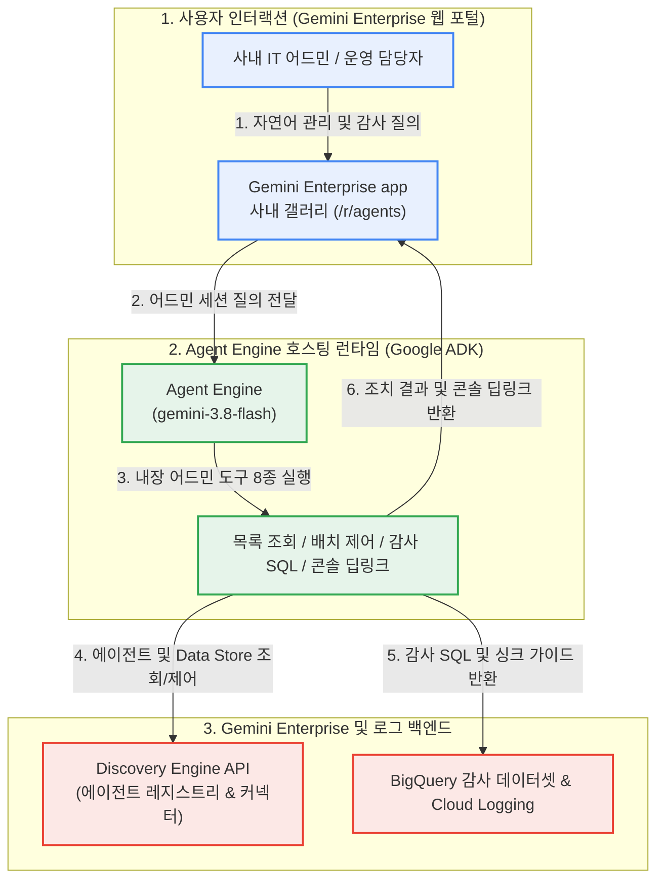

<!--
Copyright 2026 Google LLC. All Rights Reserved.
SPDX-License-Identifier: Apache-2.0

NOTICE: This code/repository is owned by Google LLC and provided under the Apache-2.0 License.
It is strictly provided as an EXAMPLE/REFERENCE ONLY and is NOT INTENDED FOR PRODUCTION USE.
All contents, designs, and code examples are subject to change, modification, or removal at any time without notice.

[고지 사항] 본 저장소 및 문서는 구글 (Google LLC) 소유이며 Apache 2.0 라이선스 하에 예시 (Sample) 용도로 제공된다.
프로덕션 환경용이 아니며, 사전 통지 없이 언제든지 수정, 변경 또는 삭제될 수 있다.
-->

> [!IMPORTANT]
> **구글 (Google LLC) 참조용 샘플 고지 사항**:
> 본 프로젝트의 모든 소스 코드와 문서는 Google LLC의 소유이며, Apache-2.0 라이선스에 따라 오직 **참조용 샘플 (Sample / Reference Only)** 목적으로만 제공된다. 프로덕션 환경에 그대로 사용할 수 없으며, 사전 통지 없이 언제든 내용이 수정, 변경 또는 삭제될 수 있다.

# Gemini Enterprise In-Chat Factory: 어드민 및 거버넌스 모듈 (gemini-enterprise-factory-admin)

사내 IT 어드민과 운영 담당자가 제미나이 엔터프라이즈 앱(Gemini Enterprise app) 채팅창에서 사내 등록 에이전트 및 데이터 저장소(Data Store) 현황 조회, 테스트 에이전트 일괄 상태 변경/공유 범위 조정, BigQuery 감사 로그 분석 쿼리 및 로그 싱크 구성을 자연어로 즉시 처리하는 사내 어드민 전담 에이전트 배포 모듈이다. (As of 2026-11-10)

---

## 1. 발생 증상 및 진단 대상 체크리스트

사내 Gemini Enterprise app 운영 중 다음과 같은 관리 이슈가 발생하고 있다면 본 모듈을 적용한다:
- [ ] **에이전트 및 스킬 스프롤(Sprawl) 정리 필요**: 임직원들이 생성한 다수의 에이전트 및 도구 중 테스트/임시 에이전트, 60일 이상 미호출 좀비 에이전트, 퇴사자 고아 에이전트를 키워드나 상태 조건으로 빠르게 선별해 일괄 비활성화(`DISABLED`)하거나 공유 범위(`ALL_USERS`/`PRIVATE`)를 조정해야 하는 경우
- [ ] **데이터 커넥터 및 에이전트 현황 한눈에 파악**: GE App에 등록된 전체 에이전트, 스킬, 연결된 데이터 저장소(Data Store)와 관리 콘솔 직접 링크를 채팅창에서 바로 확인하고자 하는 경우
- [ ] **사용량 텔레메트리 SQL 및 로그 싱크 부재**: Cloud Logging 필터를 일일이 작성하지 않고 부서별/계정별 토큰 소비량 톱 10, 429 할당량 초과 패턴, 60일 미사용 에이전트를 조회하는 BigQuery 감사 SQL과 로그 라우터 싱크(Log Sink) 구성 가이드를 바로 얻고자 하는 경우
- [ ] **콘솔 메뉴 탐색 부담**: Workspace 또는 클라우드 운영 담당자가 Agent Platform, Discovery Engine, BigQuery, Log Router 관리 페이지 URL을 매번 찾지 않고 딥링크로 바로 이동하고자 하는 경우

---

## 2. 빠른 시작 (Quickstart)

> [!TIP]
> Cloud Shell 접속 환경 구성 및 저장소 클론(`git clone`) 방법은 루트의 [메인 README](../../README.md)를 참고한다.

### 1) 모의 데이터 가상 실행 (Dry-Run)
GCP API 호출 없이 내장된 가상 데이터로 프로비저닝 명세와 보고서 생성 동작을 즉시 검증한다:
```bash
python diagnose.py --dry-run
```

**터미널 진단 출력 미리보기:**
```text
===========================================================================
  Gemini Enterprise 어드민 거버넌스 모듈 (gemini-enterprise-factory-admin)
===========================================================================
[*] 활성 프로젝트    : sample-project-id
[*] 배포 리전        : global
[*] 대상 GE App ID   : sample-ge-app-id
[*] 실행 서비스 계정 : ge-admin-sa@sample-project-id.iam.gserviceaccount.com
[*] 실행 모드        : 가상 실행 (--dry-run)

[진행] 사내 어드민 거버넌스 모듈(붕어빵 틀) 프로비저닝 파이프라인 가동...

--> [가상 실행 모드 (--dry-run)] 실제 배포 없이 프로비저닝 명세를 시뮬레이션합니다.
  [1] Agent Engine 프로비저닝 시뮬레이션: projects/sample-project-id/locations/us-central1/reasoningEngines/simulated-admin-factory-engine
  [2] GE App 사내 갤러리(/r/agents) 전사 공유(ALL_USERS) 등록 명세 검증 완료

[성공] 마크다운 진단 보고서가 저장되었습니다: /path/to/samples/gemini-enterprise-factory-admin/report.md

===========================================================================
  어드민 거버넌스 모듈 배포 및 등록 완료 (모든 점검 통과)
===========================================================================
```


### 2) 사내 환경 대화형 설정 (Config Wizard, 선택 사항)
사내 활성 프로젝트, 리전 및 실시간 Gemini Enterprise App 목록을 감지하여 `.env`에 자동 저장한다:
```bash
python diagnose.py --config
```


### 3) 실제 사내 인프라 실시간 진단
```bash
python diagnose.py
```
> [!NOTE]
> 앞서 `python diagnose.py --config`로 환경 설정을 저장했거나 gcloud 활성 설정을 그대로 활용할 경우 별도의 `.env` 생성 없이 즉시 실행할 수 있다. (환경 변수를 텍스트 에디터로 직접 수동 편집하고자 할 때만 `cp -n .env.example .env` 실행 후 수정)

---

## 3. 솔루션 아키텍처 및 처리 흐름



---

## 4. 조치 가이드 및 권장 설정

- **Agent Platform Runtimes 콘솔**: ( https://console.cloud.google.com/agent-platform/runtimes )
- **Gemini Enterprise 에이전트 목록 콘솔**: ( https://console.cloud.google.com/gemini-enterprise/locations/global/engines )
- **Cloud Logging 로그 라우터 콘솔**: ( https://console.cloud.google.com/logs/router )
- **BigQuery 감사 로그 분석 콘솔**: ( https://console.cloud.google.com/bigquery )

---
## 5. 사전 준비 사항 (필요 IAM 권한)

본 도구를 실행하고 어드민 거버넌스 모듈을 배포 및 운영하기 위해 필요한 최소 IAM 역할은 다음과 같다:

| 역할 (Role) | 권한 및 용도 |
| :--- | :--- |
| `roles/discoveryengine.admin` | Gemini Enterprise app 등록 에이전트, 데이터 저장소 조회 및 배치 상태/공유 제어 |
| `roles/aiplatform.user` | Agent Engine 프로비저닝 및 사내 어드민 에이전트 런타임 실행 |
| `roles/logging.configWriter` | 감사 로그 BigQuery 라우터 싱크(Log Sink) 구성 시 필요 |
| `roles/bigquery.dataViewer` | BigQuery 감사 데이터셋 토큰 소비량 및 미사용 에이전트 SQL 조회 시 필요 |

---

## 6. 기술적 배경 및 아키텍처 원리 (Deep Dive)

### 관련 상세 설계 및 요구 사항 명세
- [비즈니스 요구 사항 명세서 (BRD)](docs/BRD.md): 비즈니스 배경, 성공 지표 및 요구 사항(BR-01~) 명세
- [기술 상세 설계서 (TDD)](docs/TDD.md): 시스템 아키텍처, 기능(FR-01~) 및 비기능(NFR-01~) 설계 명세

에이전트 인프라 및 어드민 관리 리소스(BigQuery 데이터세트, 서비스 계정 등) 생성 시 4대 표준 라벨을 반드시 적용한다:
- `managed-by`: `google-cloud-0-to-1`
- `scenario`: `gemini-enterprise-factory-admin`
- `env`: `sample` (또는 `poc`)
- `created-by`: `customer-engineer`

---
## 7. 리소스 정리 (Teardown) 안내

본 진단 및 배포 검증 완료 후 테스트용 Agent Engine 인스턴스나 등록된 에이전트를 정리하려면 아래 명령을 수행한다:

```bash
# 1. Agent Engine 삭제 (리포트에 출력된 Reasoning Engine 리소스 경로 확인 후 실행)
curl -X DELETE -H "Authorization: Bearer $(gcloud auth print-access-token)" \
  "https://us-central1-aiplatform.googleapis.com/v1/projects/${PROJECT_ID}/locations/us-central1/reasoningEngines/<ENGINE_ID>?force=true"

# 2. Gemini Enterprise app 사내 갤러리 등록 해제
curl -X DELETE -H "Authorization: Bearer $(gcloud auth print-access-token)" \
  "https://discoveryengine.googleapis.com/v1alpha/projects/${PROJECT_ID}/locations/global/collections/default_collection/engines/${GE_APP_ID}/assistants/default_assistant/agents/<AGENT_ID>"
```
