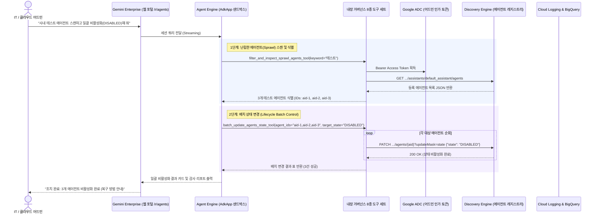

<!--
Copyright 2026 Google LLC. All Rights Reserved.
SPDX-License-Identifier: Apache-2.0

NOTICE: This code/repository is owned by Google LLC and provided under the Apache-2.0 License.
It is strictly provided as an EXAMPLE/REFERENCE ONLY and is NOT INTENDED FOR PRODUCTION USE.
All contents, designs, and code examples are subject to change, modification, or removal at any time without notice.

[고지 사항] 본 저장소 및 문서는 구글 (Google LLC) 소유이며 Apache 2.0 라이선스 하에 예시 (Sample) 용도로 제공된다.
프로덕션 환경용이 아니며, 사전 통지 없이 언제든지 수정, 변경 또는 삭제될 수 있다.
-->

# Gemini Enterprise 어드민 거버넌스 모듈 기술 상세 설계서 (TDD)

본 문서는 사내 IT 어드민 및 클라우드 인프라 팀을 지원하기 위한 제미나이 엔터프라이즈 앱(Gemini Enterprise app) 어드민 거버넌스 모듈의 시스템 아키텍처, 9대 관리 과제(스프롤 거버넌스 3종, 사용량 패턴 분석 3종, GE 앱 운영 및 일괄 제어 3종) 상세 설계, 인터페이스 규격 및 진단 로직을 정의한다.

---

## 1. 시스템 아키텍처 및 런타임 상호작용 시퀀스

본 도구의 런타임 제어 및 데이터 상호작용 흐름은 아래 시퀀스 다이어그램과 같다. 사내 IT 어드민 및 운영 담당자가 제미나이 엔터프라이즈 앱(Gemini Enterprise app) 대화창에서 질의를 입력하면, 에이전트 엔진(Agent Engine) 런타임이 내장 관리 도구 8종을 통해 Discovery Engine 에이전트 레지스트리, 데이터 저장소, BigQuery 감사 SQL 및 콘솔 딥링크를 즉시 반환한다.

---

## 2. 요구 사항 추적성 매핑 (Traceability Matrix)

| 비즈니스 요구 사항 (BRD) | 기능적 기술 요구 사항 (FR) | 비기능적 기술 요구 사항 (NFR) | 구현 파일 및 모듈 |
| :--- | :--- | :--- | :--- |
| **BR-01** (9대 GE 어드민 운영 과제 카탈로그 및 자유 프롬프팅) | **FR-01** (9대 어드민 카탈로그 및 자연어 프롬프트 처리기) | **NFR-01** (무의존성 단일 파이썬 실행) | `diagnose.py`, `catalog.yaml` |
| **BR-02** (에이전트 및 데이터 저장소 현황 조회) | **FR-02** (Discovery Engine 에이전트/Data Store 조회 도구) | **NFR-02** (사내 서비스 계정 실행) | `diagnose.py` |
| **BR-03** (활성 사용자 및 30일 미사용 계정 분석) | **FR-03** (BigQuery 활성도 및 미사용 계정 SQL 생성기) | **NFR-03** (결정론적 가상 실행 보장) | `diagnose.py` |
| **BR-04** (토큰 소비 톱 10 및 429 쓰로틀링 역추적) | **FR-04** (BigQuery 텔레메트리 및 429 에러 추적 SQL) | **NFR-01**, **NFR-03** | `diagnose.py` |
| **BR-05** (에이전트 배치 상태/공유 제어 및 정리) | **FR-05** (배치 상태/공유 변경 및 삭제 도구 3종) | **NFR-02**, **NFR-03** | `diagnose.py` |
| **BR-06** (에이전트 스프롤 관리 헬 감사) | **FR-06** (스프롤 필터링 및 BigQuery 3대 감사 SQL 팩) | **NFR-01**, **NFR-03** | `diagnose.py` |
| **BR-07** (원클릭 로그 싱크 및 콘솔 딥링크) | **FR-07** (Cloud Logging 싱크 빌더 및 콘솔 딥링크) | **NFR-01**, **NFR-02** | `diagnose.py` |
| **BR-08** (추천 후속 질문 및 표준 리포트) | **FR-08** (대화형 칩 선택 및 report.md 생성) | **NFR-01**, **NFR-02** | `diagnose.py`, `report.md` |
| **BR-09** (표준 리소스 라벨링 적용 의무화) | **FR-07** | **NFR-02** (4대 표준 라벨 강제 주입) | `diagnose.py` |
| **BR-10** (선언적 어드민 레시피 아키텍처) | **FR-09** (선언적 YAML 레시피 및 케밥 케이스 슬러그) | **NFR-01** (코드 수정 없는 확장성) | `catalog.yaml`, `diagnose.py` |
| **BR-11** (에어갭 환경 회복 탄력성 보장) | **FR-10** (4계층 캐스케이드 로더 및 타임아웃 방어) | **NFR-04** (2.0초 소켓 타임아웃 및 무중단 폴백) | `diagnose.py` |
| **BR-12** (사전 중복 검증 인터셉터) | **FR-11** (사전 슬러그 및 명칭 중복 검증 인터셉터) | **NFR-01** (설정 충돌 사전 예방) | `diagnose.py` |

---

## 3. 기능 기술 요구 사항 명세 (Functional Requirements)

### FR-01: 9대 엔터프라이즈 어드민 과제 카탈로그 및 자유 프롬프팅
- 사내 대표 9대 관리 과제(스프롤 거버넌스 3종, 사용량 패턴 분석 3종, GE 앱 운영 및 일괄 제어 3종) 프리셋을 제공한다.
- 번호 선택뿐만 아니라 CLI `--prompt` 플래그 및 대화형 `0`번 선택을 통해 비정형 자연어 관리 이슈를 진단하는 파이프라인을 제공한다.

### FR-02: Discovery Engine 에이전트 및 데이터 저장소 현황 조회
- Gemini Enterprise app에 등록된 전체 에이전트, 스킬, 노코드 에이전트 목록을 유형/상태/공유 범위별로 조회한다 (`list_deployed_agents_tool`).
- 대상 GE App에 연결된 기간계 데이터 저장소(Data Store) 목록과 바인딩 상태를 조회한다 (`list_connected_datastores_tool`).

### FR-03: 활성 사용자 및 30일 미사용 계정 분석 SQL
- 전사 Gemini Enterprise app 호출 감사 로그(`cloudaudit_googleapis_com_data_access`)에서 DAU/MAU 활성도를 집계하는 BigQuery SQL을 생성한다.
- 30일 이상 미사용 계정을 식별하여 운영 현황을 점검할 수 있는 쿼리 가이드를 제공한다.

### FR-04: 토큰 소비 톱 10 및 429 쓰로틀링 역추적 SQL
- 부서별/계정별/에이전트별 호출 빈도와 토큰 소비량 상위 10개 대상을 집계하는 BigQuery SQL을 생성한다.
- 429 `RESOURCE_EXHAUSTED` 에러 발생 시간대와 집중 에이전트를 역추적하는 SQL 팩을 제공한다.

### FR-05: 에이전트 배치 상태/공유 범위 제어 및 삭제 도구
- 대상 에이전트 ID 목록을 받아 `ENABLED` / `DISABLED` 상태로 일괄 전환하거나(`batch_update_agents_state_tool`), `ALL_USERS` / `PRIVATE` 공유 범위를 일괄 변경한다(`batch_update_agents_sharing_tool`).
- 테스트/폐기 대상 에이전트를 명시적 확인(`confirm=True`) 하에 일괄 삭제하는 기능을 제공한다(`batch_delete_agents_tool`).

### FR-06: 에이전트 확산(Sprawl) 선별 및 배치 라이프사이클 거버넌스
- 사내에 난립하거나 방치된 에이전트 및 스킬을 키워드, 상태(`ENABLED`/`DISABLED`), 공유 범위(`ALL_USERS`/`PRIVATE`), 유형(`skill`/`custom`/`nocode`)으로 필터링하여 식별한다 (`filter_and_inspect_sprawl_agents_tool`).
- 최근 60일간 미사용 좀비 에이전트, 토큰 과소비 톱 10 에이전트, 429 에러를 적발하는 BigQuery 3대 어드민 감사 SQL 팩을 제공한다 (`get_admin_audit_queries_tool`).

### FR-07: 원클릭 로그 싱크 및 콘솔 딥링크
- Cloud Logging 감사 로그를 BigQuery로 라우팅하는 로그 싱크 배포 명령어를 생성한다.
- Agent Platform, Gemini Enterprise 에이전트 목록, Data Stores, BigQuery, Cloud Logging 콘솔 딥링크를 안내한다 (`get_admin_console_deeplinks_tool`).

### FR-08: 마크다운 추천 후속 질문 및 표준 리포트 생성
- 사용자의 다음 조치를 돕기 위한 마크다운 추천 후속 질문 리스트를 출력한다.
- 실행 완료 시 진단 결과, 복구 스크립트, 콘솔 조치 가이드를 담은 `report.md`를 덮어쓴다.

### FR-09: 선언적 어드민 레시피 아키텍처 및 케밥 케이스 슬러그 규약
- 파이썬 코드 수정 없이 관리 과제를 독립적으로 확장 및 배포할 수 있도록 선언적 `catalog.yaml` 분리 구조를 지원한다.
- 모든 과제 식별자는 `[domain]-[target]-[action]` 형태의 3단계 소문자 케밥 케이스(kebab-case) 표준을 준수한다 (예: `sprawl-ghost-agent-triage`, `telemetry-token-top10-ranking`, `ops-audit-logsink-setup`, `ops-batch-state-cleanup`, `ops-console-deeplink-guide`).

### FR-10: 에어갭 환경 회복 탄력성을 위한 4계층 캐스케이드 로더
- 카탈로그 탐색 시 4단계 우선순위(CLI `--catalog` > 로컬 `./catalog.yaml` > 원격 HTTP 엔드포인트 > 코드 내장 `FALLBACK_ADMIN_CATALOG`)를 엄격히 준수한다.
- 원격 HTTP 요청 시 2.0초 소켓 타임아웃을 강제하여 외부 엔드포인트 지연 시에도 0.01초 내에 내장 시드 레시피로 즉시 폴백한다.

### FR-11: 사전 슬러그 및 명칭 중복 검증 인터셉터
- 신규 관리 과제 등록 또는 스캐폴딩 실행 전, 사내 등록된 기존 과제 카탈로그와의 슬러그 및 디스플레이 이름 충돌 여부를 사전 검증하여 설정 덮어쓰기 사고를 원천 방지한다.

---

## 4. 비기능 기술 요구 사항 명세 (Non-Functional Requirements)

### NFR-01: 무의존성 및 순수 파이썬 단일 실행 원칙
- 외부 도구 없이 `python diagnose.py` 직접 실행만으로 동작한다.

### NFR-02: 사내 보안 및 4대 필수 라벨 준수
- 모든 생성 매니페스트 및 리소스에 4대 필수 라벨(`managed-by=google-cloud-0-to-1`, `scenario=gemini-enterprise-factory-admin`, `env=sample`, `created-by=customer-engineer`)을 강제한다.
- 실제 자격 증명이나 개인 식별 정보(PII)의 평문 노출을 전면 차단한다.

### NFR-03: 결정론적 가상 실행(--dry-run) 지원
- GCP 환경 연결 없이도 모의 데이터를 통해 9대 관리 영역의 진단 로직과 리포트 무결성을 신뢰성 있게 검증할 수 있도록 지원한다.

### NFR-04: 에어갭 환경 회복 탄력성 및 타임아웃 보장
- 원격 카탈로그 조회 실패 또는 에어갭 폐쇄망 환경에서도 2.0초 이내에 내장 시드 레시피로 즉시 전환하여 자율 완결 동작을 유지한다.
