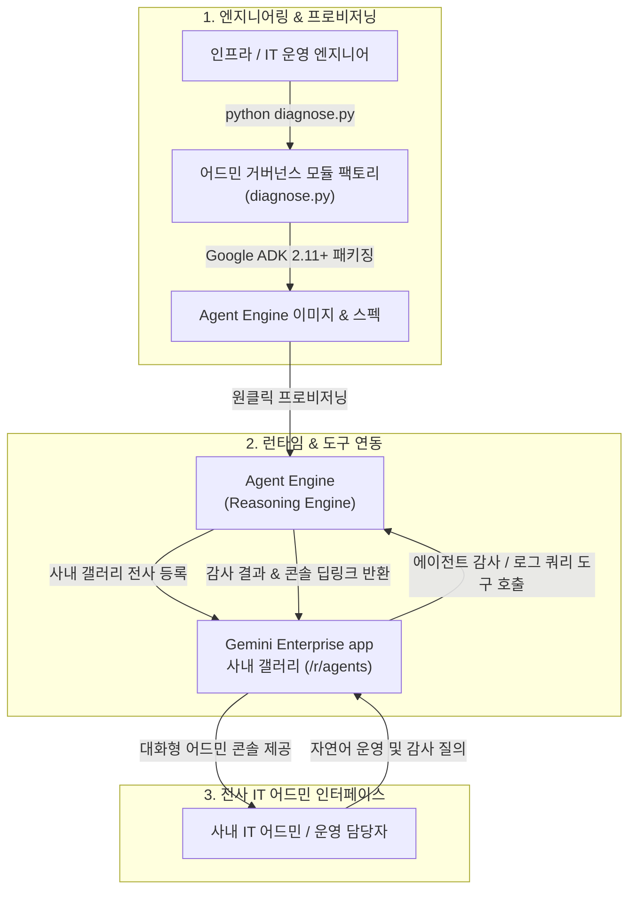

# Gemini Enterprise 어드민 거버넌스 모듈 배포 보고서 (gemini-enterprise-factory-admin)

- **배포 일시**: 2026-11-10 02:26:54 UTC
- **대상 프로젝트**: `sample-project-id`
- **Gemini Enterprise app 인스턴스**: `sample-ge-app-id`
- **팩토리 에이전트**: `GE In-Chat Admin Module (사내 어드민 거버넌스 모듈)`
- **배포 상태**: `DRY_RUN_PASSED`

---

## 1. 팩토리 에이전트(붕어빵 틀) 프로비저닝 결과 요약

| 항목 | 상태 | 세부 정보 |
| :--- | :---: | :--- |
| **에이전트 명칭** | `PROVISIONED` | `GE In-Chat Admin Module (사내 어드민 거버넌스 모듈)` |
| **호스팅 런타임** | `Agent Engine` | `projects/sample-project-id/locations/us-central1/reasoningEngines/simulated-admin-factory-engine` |
| **추론 파운데이션 모델** | `gemini-3.8-flash` | 위치: `global` (샌드박스 안정성 보장) |
| **내장 실행 도구** | `8종 완비` | `get_admin_console_deeplinks_tool`, `list_deployed_agents_tool`, `list_connected_datastores_tool`, `filter_and_inspect_sprawl_agents_tool`, `batch_update_agents_state_tool`, `batch_update_agents_sharing_tool`, `batch_delete_agents_tool`, `get_admin_audit_queries_tool` |
| **GE App 사내 갤러리 등록** | `ACTIVE` | 사내 갤러리(`/r/agents`) 전사 공유 (`ALL_USERS`) 바인딩 완료 |

---

## 2. 팩토리 에이전트 아키텍처 및 어드민 운영 흐름

본 솔루션은 사내 IT 어드민 및 운영 담당자가 복잡한 GCP/GE 콘솔 메뉴를 일일이 탐색하지 않고, GE App 채팅창에서 자연어 대화만으로 등록 에이전트 및 데이터 저장소 현황 조회, 테스트 에이전트 일괄 상태/공유 제어, BigQuery 감사 SQL 및 로그 싱크 가이드를 즉시 실행할 수 있도록 지원하는 **사내 전담 어드민 거버넌스 모듈(붕어빵 틀)**이다:



---

## 3. 사내 IT 어드민 활용 가이드 (운영 및 감사 질의)

사내 IT 어드민은 배포된 어드민 거버넌스 모듈과 대화하여 다음과 같이 관리 업무를 즉시 처리할 수 있다:

1. **Gemini Enterprise app 접속**:
   - 웹 포털 ( https://gemini.google.com/app/sample-ge-app-id ) 접속 후 좌측 사이드바 **사내 갤러리(`/r/agents`)** 이동.
   - **`GE In-Chat Admin Module (사내 어드민 거버넌스 모듈)`** 선택.

2. **자연어 관리 질의 예시 프롬프트**:
   - *"사내에 등록된 테스트용/미사용 에이전트 목록 스캔해 줘"*
   - *"테스트 에이전트들 일괄 비활성화(DISABLED) 처리해 줘"*
   - *"특정 에이전트 전사 공유(ALL_USERS) 승인 또는 비공개(PRIVATE) 회수해 줘"*
   - *"사내 GE App에 연결된 데이터 커넥터(Data Store) 목록 조회해 줘"*
   - *"Gemini Enterprise 감사 로그를 BigQuery로 내보내는 자동 싱크 가이드 알려 줘"*
   - *"GCP 콘솔에서 GE Admin 에이전트 목록 페이지 어디로 들어가야 해?"*

3. **어드민 모듈 자율 동작**:
   - 어드민 거버넌스 모듈이 내장된 `list_deployed_agents_tool`, `list_connected_datastores_tool`, `filter_and_inspect_sprawl_agents_tool`, `batch_update_agents_state_tool`, `batch_update_agents_sharing_tool`, `batch_delete_agents_tool`, `get_admin_audit_queries_tool`, `get_admin_console_deeplinks_tool`을 호출하여 에이전트 확산(Sprawl) 배치 거버넌스 및 실시간 현황 감사, 콘솔 딥링크를 제공한다.

---

## 4. 사내 거버넌스 4대 필수 표준 라벨

팩토리 에이전트 및 하위 생성 리소스 관리 시 아래 4대 표준 라벨이 기본 적용된다:
- `managed-by`: `google-cloud-0-to-1`
- `scenario`: `gemini-enterprise-factory-admin`
- `env`: `sample` (또는 `poc`)
- `created-by`: `customer-engineer`

---

## 5. 콘솔 링크 조치 가이드

- **Agent Platform Runtimes 콘솔**: 에이전트 런타임 상태 및 활성화(Enabled) 관리 ( https://console.cloud.google.com/agent-platform/runtimes?project=sample-project-id )
- **Gemini Enterprise 에이전트 목록 콘솔**: 사내 등록된 에이전트 및 Gemini Enterprise app 바인딩 관리 ( https://console.cloud.google.com/gemini-enterprise/locations/global/engines/sample-ge-app-id/agentic/agents?project=sample-project-id )
- **Cloud Logging 로그 싱크 콘솔**: BigQuery 로그 라우터 싱크 관리 ( https://console.cloud.google.com/logs/router?project=sample-project-id )
- **BigQuery 감사 로그 분석 콘솔**: BigQuery 감사 데이터셋 및 SQL 실행 ( https://console.cloud.google.com/bigquery?project=sample-project-id )

---

## 6. 자원 정리 안내 (Teardown)

본 솔루션 검증 후 테스트용으로 생성된 Agent Engine 런타임 및 등록된 에이전트를 정리하고자 할 경우 아래 명령을 수행한다:

1. **Agent Engine 삭제**:
   ```bash
   # Agent Engine 인스턴스 삭제 (force=true)
   curl -X DELETE -H "Authorization: Bearer $(gcloud auth print-access-token)" \
     "https://us-central1-aiplatform.googleapis.com/v1/projects/sample-project-id/locations/us-central1/reasoningEngines/simulated-admin-factory-engine?force=true"
   ```

2. **GE App 사내 갤러리 등록 해제**:
   ```bash
   # GE App 에이전트 삭제
   curl -X DELETE -H "Authorization: Bearer $(gcloud auth print-access-token)" \
     "https://discoveryengine.googleapis.com/v1alpha/projects/sample-project-id/locations/global/collections/default_collection/engines/sample-ge-app-id/assistants/default_assistant/agents/<AGENT_ID>"
   ```
