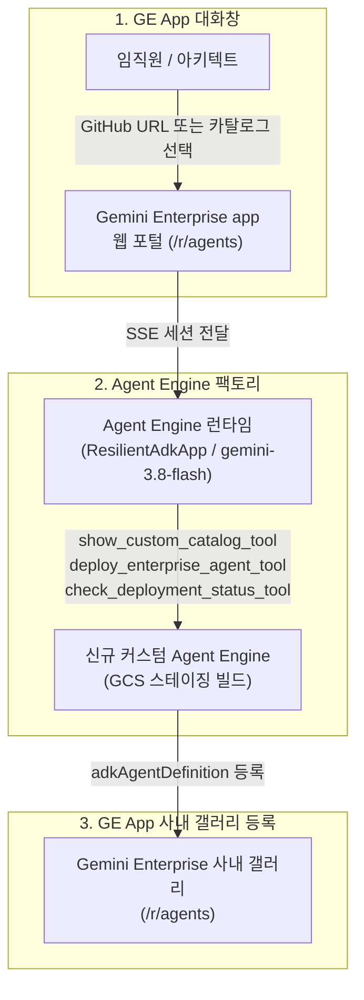

<!--
Copyright 2026 Google LLC. All Rights Reserved.
SPDX-License-Identifier: Apache-2.0

NOTICE: This code/repository is owned by Google LLC and provided under the Apache-2.0 License.
It is strictly provided as an EXAMPLE/REFERENCE ONLY and is NOT INTENDED FOR PRODUCTION USE.
All contents, designs, and code examples are subject to change, modification, or removal at any time without notice.

[고지 사항] 본 저장소 및 문서는 구글 (Google LLC) 소유이며 Apache 2.0 라이선스 하에 예시 (Sample) 용도로 제공된다.
프로덕션 환경용이 아니며, 사전 통지 없이 언제든지 수정, 변경 또는 삭제될 수 있다.
-->

> [!IMPORTANT]
> **구글 (Google LLC) 참조용 샘플 고지 사항**:
> 본 프로젝트의 모든 소스 코드와 문서는 Google LLC의 소유이며, Apache-2.0 라이선스에 따라 오직 **참조용 샘플 (Sample / Reference Only)** 목적으로만 제공된다. 프로덕션 환경에 그대로 사용할 수 없으며, 사전 통지 없이 언제든 내용이 수정, 변경 또는 삭제될 수 있다.

# Gemini Enterprise In-Chat Factory: 하이코드 커스텀 팩토리 모듈 (gemini-enterprise-factory-custom)

`Gemini Enterprise In-Chat Factory`의 5대 핵심 모듈 중 하이코드 커스텀 에이전트 배포를 담당하는 도구다. 사내 BigQuery나 레거시 API가 결합된 커스텀 에이전트 또는 GitHub 저장소 URL을 Gemini Enterprise app 채팅창에 입력하면, Agent Engine 프로비저닝부터 GE App 사내 갤러리(`/r/agents`) 등록까지 대화형으로 일괄 처리한다. (As of 2026-11-10)

---

## 1. 발생 증상 및 진단 대상 체크리스트

사내 Gemini Enterprise app 환경에서 커스텀 에이전트 배포 시 다음과 같은 요구가 있을 때 사용한다:
- [ ] **노코드 에이전트 한계**: 사내 BigQuery 질의, 복합 로직, MCP 연동 등 파이썬 하이코드(High-code) 에이전트가 필요한 경우
- [ ] **반복 패키징 부담**: 새 에이전트마다 ADK 래핑, Agent Engine 빌드, `adkAgentDefinition` 등록을 매번 CLI로 수동 처리하는 경우
- [ ] **GitHub 저장소 기반 원클릭 배포 필요**: 사내 저장소 URL만으로 빌드와 사내 갤러리(`/r/agents`) 등록을 채팅창에서 바로 끝내고 싶은 경우

---

## 2. 빠른 시작 (Quickstart)

> [!TIP]
> Cloud Shell 접속 환경 구성 및 저장소 클론(`git clone`) 방법은 루트의 [메인 README](../../README.md)를 참고한다.

### 1) 모의 데이터 가상 실행 (Dry-Run)
GCP API 호출 없이 내장된 가상 데이터로 동작을 검증한다:
```bash
python diagnose.py --dry-run
```

**터미널 진단 출력 미리보기:**
```text
===========================================================================
  Gemini Enterprise 커스텀 에이전트 팩토리 (gemini-enterprise-factory-custom)
===========================================================================
[*] 활성 프로젝트    : sample-project-id
[*] 대상 리전        : us-central1
[*] 대상 GE App ID   : sample-ge-app-id
[*] 실행 서비스 계정 : custom-agent-sa@sample-project-id.iam.gserviceaccount.com
[*] 실행 모드        : 가상 실행 (--dry-run)

[진행] 사내 커스텀 에이전트 팩토리(붕어빵 틀) 프로비저닝 파이프라인 가동...

--> [가상 실행 모드 (--dry-run)] 실제 배포 없이 프로비저닝 명세를 시뮬레이션합니다.
  [1] Agent Engine 프로비저닝 시뮬레이션: projects/sample-project-id/locations/us-central1/reasoningEngines/simulated-custom-factory-engine
  [2] 장착 도구: deploy_enterprise_agent_tool, check_deployment_status_tool, list_deployed_agents_tool, show_custom_catalog_tool
  [3] GE App 사내 갤러리(/r/agents) 전사 공유(ALL_USERS) 등록 명세 검증 완료

[성공] 마크다운 진단 보고서가 저장되었습니다: report.md
```

### 2) 사내 환경 대화형 설정 (Config Wizard, 선택 사항)
활성 프로젝트, 리전 및 Gemini Enterprise App 목록을 감지하여 `.env`에 저장한다:
```bash
python diagnose.py --config
```

### 3) 실제 사내 인프라 실시간 배포
```bash
python diagnose.py
```
> [!NOTE]
> 앞서 `python diagnose.py --config`로 설정을 저장했거나 gcloud 활성 설정이 준비된 경우 별도의 `.env` 생성 없이 즉시 실행할 수 있다.

---

## 3. 솔루션 아키텍처 및 런타임 서비스 흐름



---

## 4. 조치 가이드 및 권장 설정

- **사내 갤러리 즉시 노출**: 본 팩토리가 생성한 커스텀 에이전트는 `adkAgentDefinition` 규격으로 프로비저닝되어 **즉시 활성화(`ENABLED`) 및 전사 공유(`ALL_USERS`)** 상태로 `/r/agents`에 등록된다.
- **등록된 에이전트 목록 확인 및 관리**: **Gemini Enterprise 에이전트 목록 콘솔 ( https://console.cloud.google.com/gemini-enterprise/locations/global/engines )**에서 상태와 프롬프트를 관리한다.
- **Agent Platform Runtimes 콘솔**: Agent Engine 인스턴스 상태 확인 ( https://console.cloud.google.com/agent-platform/runtimes )
- **Gemini Enterprise 웹 포털**: 사내 갤러리 접속 및 팩토리 에이전트 실행 ( https://gemini.google.com )

---

## 5. 사전 준비 사항 (필요 IAM 권한)

| 역할 (Role) | 부여 대상 | 용도 |
| :--- | :--- | :--- |
| `roles/aiplatform.admin` | Reasoning Engine P4SA | 하위 Agent Engine 런타임 자율 프로비저닝 |
| `roles/storage.admin` | Reasoning Engine P4SA | 패키지 아티팩트(`.pkl`, `requirements.txt`) GCS 스테이징 |
| `roles/aiplatform.user` | 배포 실행 계정 / SA | Agent Engine 프로비저닝 및 Gemini 모델 추론 |
| `roles/discoveryengine.editor` | 배포 실행 계정 / SA | Gemini Enterprise app 사내 갤러리 등록 |

---

## 6. 기술적 배경 및 아키텍처 원리 (Deep Dive)

### 팩토리 카탈로그 및 GitHub 저장소 직결 배포
GE App 대화창에서 아래 프리셋 또는 임의의 GitHub 저장소 URL을 입력하여 개별 에이전트를 배포할 수 있다:
- **0번**: 사내 커스텀 GitHub 저장소 직접 입력 (`https://github.com/...`)
- **1~4번**: GE In-Chat Factory 패밀리 (`admin`, `agent`, `connector`, `skill`) 원클릭 배포

### Pydantic v2 직렬화 호환성 (`ResilientAdkApp`)
Google ADK `LlmAgent`가 클라우드 피클링(`cloudpickle`) 후 역직렬화될 때 `__pydantic_private__` 슬롯이 `None`으로 복원되어 스트리밍 오류가 발생하는 현상을 방지하기 위해 `set_up()`, `streaming_agent_run_with_events()`, `async_stream_query()` 진입 시 슬롯을 자동 초기화한다.

### 관련 상세 설계 및 필수 라벨
- [비즈니스 요구 사항 명세서 (BRD)](docs/BRD.md), [기술 상세 설계서 (TDD)](docs/TDD.md)
- 리소스 생성 시 4대 표준 라벨(`managed-by=google-cloud-0-to-1`, `scenario=gemini-enterprise-factory-custom`, `env=sample`, `created-by=customer-engineer`)을 적용한다.

---

## 7. 리소스 정리 (Teardown) 안내

검증 후 테스트용으로 생성된 Agent Engine 런타임 및 등록된 에이전트를 정리할 때 아래 명령을 수행한다:

1. **Agent Engine 삭제**:
   ```bash
   curl -X DELETE -H "Authorization: Bearer $(gcloud auth print-access-token)" \
     "https://us-central1-aiplatform.googleapis.com/v1/projects/${PROJECT_ID}/locations/us-central1/reasoningEngines/<ENGINE_ID>?force=true"
   ```
2. **GE App 사내 갤러리 등록 해제**:
   ```bash
   curl -X DELETE -H "Authorization: Bearer $(gcloud auth print-access-token)" \
     "https://discoveryengine.googleapis.com/v1alpha/projects/${PROJECT_ID}/locations/global/collections/default_collection/engines/${GE_APP_ID}/assistants/default_assistant/agents/<AGENT_ID>"
   ```
3. **서비스 계정 삭제**:
   ```bash
   gcloud iam service-accounts delete custom-agent-sa@${PROJECT_ID}.iam.gserviceaccount.com --quiet
   ```
