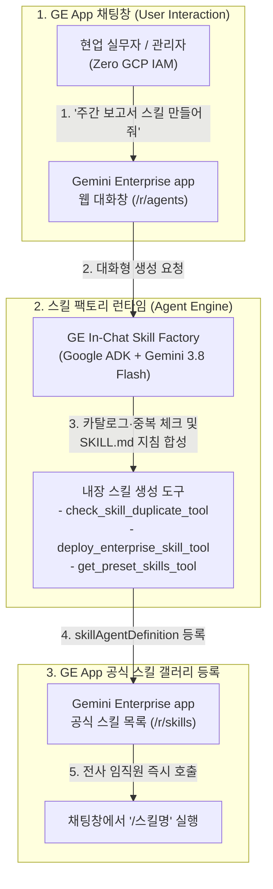

<!--
Copyright 2026 Google LLC. All Rights Reserved.
SPDX-License-Identifier: Apache-2.0

NOTICE: This code/repository is owned by Google LLC and provided under the Apache-2.0 License.
It is strictly provided as an EXAMPLE/REFERENCE ONLY and is NOT INTENDED FOR PRODUCTION USE.
All contents, designs, and code examples are subject to change, modification, or removal at any time without notice.

[고지 사항] 본 저장소 및 문서는 구글 (Google LLC) 소유이며 Apache 2.0 라이선스 하에 예시 (Sample) 용도로 제공된다.
프로덕션 환경용이 아니며, 사전 통지 없이 언제든지 수정, 변경 또는 삭제될 수 있다.
-->

> [!IMPORTANT]
> **구글 (Google LLC) 참조용 샘플 고지 사항**:
> 본 프로젝트의 모든 소스 코드와 문서는 Google LLC의 소유이며, Apache-2.0 라이선스에 따라 오직 **참조용 샘플 (Sample / Reference Only)** 목적으로만 제공된다. 프로덕션 환경에 그대로 사용할 수 없으며, 사전 통지 없이 언제든 내용이 수정, 변경 또는 삭제될 수 있다.

# Gemini Enterprise In-Chat Factory: 사내 스킬 팩토리 모듈 (gemini-enterprise-factory-skill)

`Gemini Enterprise In-Chat Factory`의 5대 핵심 모듈 중 사내 업무 스킬(Skills) 생성을 담당하는 도구로, 제미나이 엔터프라이즈 앱(Gemini Enterprise app) 채팅창에서 현업 임직원이 반복적인 업무 절차, 보고서 양식, 검토 체크리스트를 담은 맞춤 스킬(`SKILL.md` / `skillAgentDefinition`)을 붕어빵 찍어내듯 대화형으로 생성하고 사내 스킬 갤러리(`/r/skills`)에 즉시 등록 및 공유할 수 있도록 지원하는 GE App 전용 스킬 팩토리다. (As of 2026-11-10)

---

## 1. 발생 증상 및 진단 대상 체크리스트

Gemini Enterprise app 도입 후 현업에서 다음과 같은 상황이 발생하고 있다면 본 모듈이 적합하다:
- [ ] **반복 업무 프롬프트 매번 재입력**: 주간 보고서 작성, 회의록 요약, 경비 규정 검토 등 자주 쓰는 업무 절차와 출력 형식을 매번 채팅창에 새로 입력하고 있는 경우
- [ ] **팀 내 검증된 노하우 공유 한계**: 특정 직원이 만든 유용한 업무 프롬프트와 체크리스트를 부서원이나 전사 임직원이 `/스킬명`으로 바로 꺼내 쓰기 어려운 경우
- [ ] **비개발자 임직원의 SKILL.md 작성 부담**: 일반 현업 담당자가 지침 구조, 트리거 조건, 출력 양식을 규격에 맞춰 직접 작성하기 막막해하는 경우
- [ ] **GE App `/r/skills` 카탈로그 빠른 확충 필요**: 초기 데모(Day-1) 이후 고객사 실무(Day-2)에 바로 투입할 24종 이상의 표준 업무 스킬을 단시간 내 GE App에 채워 넣고 싶은 경우

---

## 2. 빠른 시작 (Quickstart)

> [!TIP]
> Cloud Shell 접속 환경 구성 및 저장소 클론(`git clone`) 방법은 루트의 [메인 README](../../README.md)를 참고한다.

### 1) 모의 데이터 가상 실행 (Dry-Run)
GCP API 호출 없이 내장된 가상 인프라 데이터로 정상 동작 여부를 즉시 검증한다:
```bash
python diagnose.py --dry-run
```

**터미널 진단 출력 미리보기:**
```text
===========================================================================
  Gemini Enterprise 사내 스킬 팩토리 (gemini-enterprise-factory-skill)
===========================================================================
[*] 활성 프로젝트    : sample-project-id
[*] 대상 리전        : global
[*] 대상 GE App ID   : sample-ge-app-id
[*] 실행 서비스 계정 : ge-skill-invoker-sa@sample-project-id.iam.gserviceaccount.com
[*] 실행 모드        : 가상 실행 (--dry-run)

[진행] 사내 스킬 팩토리(붕어빵 틀) 프로비저닝 파이프라인 가동...

--> [가상 실행 모드 (--dry-run)] 실제 배포 없이 프로비저닝 명세를 시뮬레이션합니다.
  [1] Agent Engine 프로비저닝 시뮬레이션: projects/sample-project-id/locations/us-central1/reasoningEngines/simulated-skill-factory-engine
  [2] GE App 사내 갤러리(/r/agents) 전사 공유(ALL_USERS) 등록 명세 검증 완료

[성공] 마크다운 진단 보고서가 저장되었습니다: /path/to/samples/gemini-enterprise-factory-skill/report.md

===========================================================================
  사내 스킬 팩토리 배포 및 등록 완료 (모든 점검 통과)
===========================================================================
```


### 2) 사내 환경 대화형 설정 (Config Wizard, 선택 사항)
사내 활성 프로젝트, 리전 및 실시간 Gemini Enterprise App 목록을 감지하여 `.env`에 자동 저장한다:
```bash
python diagnose.py --config
```


### 3) 실제 사내 인프라 실시간 프로비저닝
```bash
python diagnose.py
```
> [!NOTE]
> 앞서 `python diagnose.py --config`로 환경 설정을 저장했거나 gcloud 활성 설정을 그대로 활용할 경우 별도의 `.env` 생성 없이 즉시 실행할 수 있다. (환경 변수를 텍스트 에디터로 직접 수동 편집하고자 할 때만 `cp -n .env.example .env` 실행 후 수정)

---

## 3. 솔루션 아키텍처 및 처리 흐름



---

## 4. 조치 가이드 및 권장 설정

- **Gemini Enterprise 웹 포털**: 사내 갤러리(`/r/agents`)에서 스킬 팩토리 실행 및 `/r/skills` 확인 ( https://gemini.google.com )
- **Gemini Enterprise 관리자 콘솔**: 등록된 스킬 및 에이전트 관리 ( https://console.cloud.google.com/gemini-enterprise/locations/global/engines )
- **Agent Platform Runtimes 콘솔**: 배포된 Agent Engine 런타임 상태 확인 ( https://console.cloud.google.com/agent-platform/runtimes )

---

## 5. 사전 준비 사항 (필요 IAM 권한)

본 도구를 배포 및 실행하려면 최소 아래의 IAM 권한이 필요하다:

| 역할 (Role) | 부여 대상 | 용도 및 최소 권한 세부 사항 |
| :--- | :--- | :--- |
| `roles/aiplatform.user` | 배포 실행 계정 | Agent Engine 런타임 프로비저닝 및 모델 호출 |
| `roles/discoveryengine.editor` | 배포 실행 계정 / 팩토리 런타임 | Gemini Enterprise app 내 팩토리 등록 및 `skillAgentDefinition` 생성 |
| 권한 불필요 (Zero IAM) | 일반 현업 임직원 | Gemini Enterprise app 웹 포털 외에 GCP 콘솔 권한 불필요 |

---

## 6. 기술적 배경 및 아키텍처 원리 (Deep Dive)

### 관련 상세 설계 및 요구 사항 명세
- [비즈니스 요구 사항 명세서 (BRD)](docs/BRD.md): 비즈니스 배경, 요구 사항(BR-01~) 명세
- [기술 상세 설계서 (TDD)](docs/TDD.md): 시스템 아키텍처, 기능(FR-01~) 및 비기능(NFR-01~) 설계 명세

리소스 생성 시 4대 표준 라벨을 적용한다:
- `managed-by`: `google-cloud-0-to-1`
- `scenario`: `gemini-enterprise-factory-skill`
- `env`: `sample` (또는 `poc`)
- `created-by`: `customer-engineer`

---

## 7. 리소스 정리 (Teardown) 안내

검증 후 테스트용으로 등록된 스킬 팩토리 에이전트나 서비스 계정을 정리하려면 아래 절차를 수행한다:

1. **Gemini Enterprise app 등록 스킬 및 팩토리 삭제**:
   - Gemini Enterprise 관리자 콘솔 ( https://console.cloud.google.com/gemini-enterprise/locations/global/engines )에서 등록된 팩토리 에이전트 또는 테스트 스킬을 선택하여 삭제한다.
2. **대행 서비스 계정 삭제 (생성한 경우)**:
   ```bash
   gcloud iam service-accounts delete ge-skill-invoker-sa@${PROJECT_ID}.iam.gserviceaccount.com --quiet
   ```
