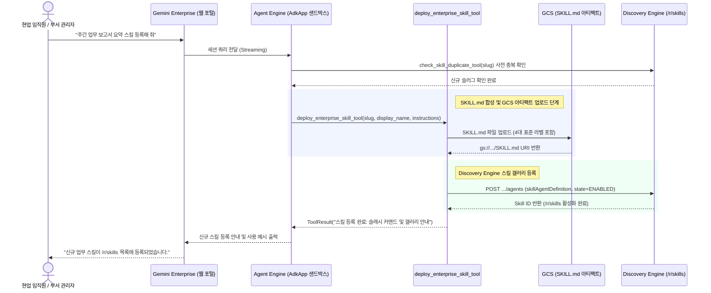

<!--
Copyright 2026 Google LLC. All Rights Reserved.
SPDX-License-Identifier: Apache-2.0

NOTICE: This code/repository is owned by Google LLC and provided under the Apache-2.0 License.
It is strictly provided as an EXAMPLE/REFERENCE ONLY and is NOT INTENDED FOR PRODUCTION USE.
All contents, designs, and code examples are subject to change, modification, or removal at any time without notice.

[고지 사항] 본 저장소 및 문서는 구글 (Google LLC) 소유이며 Apache 2.0 라이선스 하에 예시 (Sample) 용도로 제공된다.
프로덕션 환경용이 아니며, 사전 통지 없이 언제든지 수정, 변경 또는 삭제될 수 있다.
-->

# Gemini Enterprise 자율형 사내 스킬 팩토리 기술 상세 설계서 (TDD)

본 문서는 사내 제미나이 엔터프라이즈 앱(Gemini Enterprise app) 환경에서 맞춤 업무 스킬(`SKILL.md`)을 대화형으로 생성하고, GE App 스킬 갤러리(`/r/skills`)에 `skillAgentDefinition` 규격으로 자동 프로비저닝하기 위한 시스템 아키텍처, 기술 상세 설계 및 검증 계획을 정의한다.

---

## 1. 시스템 아키텍처 및 런타임 상호작용 시퀀스

본 도구의 런타임 제어 및 데이터 상호작용 흐름은 아래 시퀀스 다이어그램과 같다. 현업 임직원 또는 부서 관리자가 GE App 대화창에서 업무 스킬 생성을 요청하면, 에이전트 엔진(Agent Engine) 런타임이 슬러그 중복 검증 후 `SKILL.md` 지침과 `skillAgentDefinition` 페이로드를 합성하여 GCS 스테이징 버킷 및 디스커버리 엔진(Discovery Engine) 스킬 갤러리(`/r/skills`)에 즉시 등록한다.

---

## 2. 요구 사항 추적성 매핑 (Traceability Matrix)

| 비즈니스 요구 사항 (BRD) | 기능적 기술 요구 사항 (FR) | 비기능적 기술 요구 사항 (NFR) | 구현 파일 및 모듈 |
| :--- | :--- | :--- | :--- |
| **BR-01** (대화형 노코드 스킬 생성) | **FR-01** (대화형 스킬 선택 및 지침 합성) | **NFR-01** (무의존성 및 단일 파이썬 실행) | `diagnose.py` |
| **BR-02** (24종 엔터프라이즈 스킬 카탈로그) | **FR-02** (7대 도메인 24종 엔터프라이즈 스킬 칩 내장) | **NFR-02** (초경량 패키징 원칙) | `catalog.yaml`, `diagnose.py` |
| **BR-03** (표준 SKILL.md 및 skillAgentDefinition 컴파일) | **FR-03** (`SKILL.md` 및 GCS URI 아티팩트 조립) | **NFR-03** (가명 마스킹 및 결정론적 가상 실행) | `diagnose.py` 스캐폴더 모듈 |
| **BR-04** (생성 후 공유 범위 선택) | **FR-04** (`PRIVATE` / `ALL_USERS` 스코프 분기) | **NFR-02**, **NFR-03** | `diagnose.py` 배포 도구 |
| **BR-05** (GE App 스킬 갤러리 원클릭 등록) | **FR-05** (Discovery Engine 스킬 등록 및 리포트) | **NFR-01**, **NFR-03** | `diagnose.py`, `report.md` |
| **BR-06** (표준 리소스 라벨링) | **FR-05** (표준 라벨링 주입 및 리포트) | **NFR-04** (4대 표준 라벨링 준수) | `diagnose.py` |
| **BR-07** (선언적 카탈로그 레시피 및 3계층 케밥 케이스) | **FR-06** (선언적 레시피 로더), **FR-07** (3계층 케밥 케이스 슬러그 검증) | **NFR-01**, **NFR-02** | `catalog.yaml`, `diagnose.py` |
| **BR-08** (사내 폐쇄 환경 및 에어갭 회복탄력성) | **FR-06** (4단계 캐스케이드 탐색 및 타임아웃 방어) | **NFR-05** (에어갭 오프라인 격리 실행 보장) | `diagnose.py` 카탈로그 로더 |
| **BR-09** (사전 슬러그/ID 전용 중복 방지 및 스코핑) | **FR-08** (사전 슬러그/ID 전용 중복 점검 인터셉터) | **NFR-03** (가명 마스킹 및 결정론적 가상 실행) | `diagnose.py` 중복 검증 도구 |

---

## 3. 기능 기술 요구 사항 명세 (Functional Requirements)

### FR-01: 대화형 스킬 선택, 자유 프롬프팅 및 `SKILL.md` 지침 자동 합성
- 터미널 로컬 보조 실행(`--scaffold`, `--interactive`) 시 대화형 번호 선택기를 통해 24종 카탈로그 중 원하는 스킬을 선택할 수 있도록 지원한다.
- 카탈로그에 없는 업무의 경우 자연어 자유 프롬프팅(`--prompt "..."` 또는 대화형 `0`번 선택)을 통해 사용자가 입력한 요구 사항을 표준 `SKILL.md` 및 `skillAgentDefinition` 페이로드로 자동 도출한다.
- 입력 파라미터 명세와 트리거 설명(Description)을 모델이 자연어 대화에서 혼동하지 않도록 명확히 구조화한다.

### FR-02: 7대 도메인 24종 엔터프라이즈 업무 스킬 카탈로그 내장
- 사내 실무 환경에서 활용도가 높은 핵심 업무 도메인별 스킬 프리셋 24종을 내장한다:
  1. **전자결재 및 품의 (Approval)**:
     - `approval-draft-create`: 전자결재 기안문 초안 작성
     - `approval-status-check`: 결재선 진행 상태 미결함 조회
     - `approval-proxy-delegate`: 전결 부재 시 대결자 지정
  2. **법인카드 및 경비 정산 (Expense)**:
     - `corp-card-reconcile`: 법인카드 영수증 내역 자동 대조
     - `overtime-transport-claim`: 야근 교통비 식대 정산 신청
     - `biz-entertain-preapprove`: 접대비 사전 품의서 제출
     - `tax-invoice-verify`: 홈택스 전자세금계산서 진위 확인
  3. **근태 및 주 52시간 관리 (HR)**:
     - `hr-vacation-apply`: 연차 반차 경조휴가 신청
     - `work-hours-monitor`: 주 52시간 잔여 근무 시간 조회
     - `corp-directory-search`: 사내 조직도 직급 사번 호칭 검색
     - `welfare-point-check`: 사내 복지포인트 잔액 사용 조회
  4. **총무 및 시설 자산 관리 (Facilities)**:
     - `room-booking-reserve`: 사내 회의실 화상 장비 예약
     - `corp-car-dispatch`: 업무용 법인 차량 배차 신청
     - `it-asset-request`: 업무용 PC 모니터 전산 비품 신청
     - `sw-license-grant`: 사내 소프트웨어 라이선스 신청
  5. **기획 보고 및 문서 작성 (Planning & Docs)**:
     - `weekly-report-draft`: 주간 업무 보고서 자동 요약 및 초안 작성
     - `meeting-notes-summarize`: 회의록 핵심 결정 사항 및 실행 과제 정리
     - `proposal-outline-build`: 사내 신규 과제 기획안 목차 및 초안 구성
  6. **업무 협업 및 워크스페이스 (Collaboration)**:
     - `slack-notice-broadcast`: 사내 메신저 공지 긴급 알림 배포
     - `sheets-voc-append`: 사내 VOC 개선 제안 행 추가
     - `drive-template-find`: 사내 표준 계약서 위임장 양식 검색
  7. **영업 및 거래처 관리 (Partner)**:
     - `biz-reg-validate`: 국세청 사업자등록 휴폐업 상태 조회
     - `bank-account-verify`: 거래처 법인 예금주 실명 확인
     - `crm-lead-register`: 신규 거래처 영업 미팅 일지 등록

### FR-03: `SKILL.md` 아티팩트 생성 및 `skillAgentDefinition` 페이로드 조립
- 스킬 생성 시 Markdown 기반 `SKILL.md` 본문(YAML 프론트매터 + 실행 지침 + 필수 입력 안내)을 합성하여 GCS 버킷에 업로드한다.
- Discovery Engine API 호출 시 `skillAgentDefinition` 필드에 GCS `SKILL.md` 경로를 바인딩하는 표준 JSON 페이로드를 생성한다.

### FR-04: 생성 후 공유 범위(`PRIVATE` / `ALL_USERS`) 설정 지원
- 사용자가 요청하는 공유 범위(`sharingConfig.scope`)에 따라 개인 테스트용(`PRIVATE`) 또는 전사 공유용(`ALL_USERS`)으로 구분하여 등록한다.
- 기본 배포 상태는 즉시 호출 가능한 `ENABLED`로 설정한다.

### FR-05: Gemini Enterprise app 스킬 갤러리 배포 및 마크다운 리포트 생성
- 배포 완료 시 Agent Engine URI, GE App 갤러리 경로(`/r/skills`, `/r/agents`), 내장 도구 4종 목록, 추천 프롬프트를 포함한 `report.md`를 자동으로 생성 및 덮어쓴다.
- 로컬 스캐폴딩 보조 모드(`--scaffold`) 실행 시에는 선택된 스킬의 `SKILL.md` 내용 및 `skillAgentDefinition` 페이로드 요약 보고서를 생성한다.

### FR-06: `catalog.yaml` 선언적 레시피 로더 및 4단계 캐스케이드 탐색
- 스킬 템플릿을 코드 내부 하드코딩에만 의존하지 않고, 선언적 `catalog.yaml` 파일로부터 동적 로드하는 파서를 제공한다.
- 탐색 캐스케이드 우선순위:
  1. CLI 인자: `--catalog <PATH|URL>`
  2. 환경 변수: `SKILL_CATALOG_PATH`
  3. 로컬 파일: 모듈 루트의 `catalog.yaml` (기본 경로)
  4. 인코드 시드: 로컬 파일 부재 시 비상용 기본 시드 딕셔너리 폴백
- 원격 HTTP/HTTPS URL 입력 시 소켓 연결 및 읽기 타임아웃을 2.0초로 엄격히 제한하여 외부망 차단 환경에서도 프로세스 멈춤(Hang) 없이 즉시 로컬 파일로 폴백한다.

### FR-07: 3계층 케밥 케이스 슬러그 규격 검증 및 슬래시 커맨드 매핑
- 모든 스킬 ID(슬러그)는 3계층 영문 소문자 케밥 케이스(`[domain]-[task]-[action]`, 정규식: `^[a-z0-9]+-[a-z0-9]+-[a-z0-9]+$`) 형식을 엄격히 준수한다.
- Gemini Enterprise app 대화창의 슬래시 커맨드(`/approval-draft-create`) 및 호출 멘션(`@approval-draft-create`)에 즉시 연동될 수 있도록 카탈로그 엔트리별 슬래시 커맨드 및 트리거 메타데이터를 자동 주입한다.

### FR-08: 사전 슬러그/ID 전용 중복 점검(Pre-flight Duplicate Check) 인터셉터 및 네임스페이스 스코핑
- 신규 스킬 프로비저닝 전 기존 배포 목록을 스캔하여 동일한 시스템 고유 슬러그(`slug`, 3계층 케밥 케이스 ID) 일치 여부를 사전 점검한다.
- 자연어 명칭의 유사도는 차단하지 않고 허용하며, 고유 식별자인 영문 슬러그(ID)가 정확히 일치할 때만 중복으로 판정한다.
- 클라우드 대화형 런타임(GE App) 0단계 사전 검증 도구(`check_skill_duplicate_tool(slug: str)`):
  - 사용자가 특정 스킬 생성을 요청하면 인터뷰를 시작하기 전에 해당 스킬의 고유 슬러그를 도출해 Discovery Engine API를 선제 호출하여 기등록 스킬 목록의 슬러그 태그(`[Slug: ...]`) 및 명칭을 스캔한다.
  - 기등록 슬러그 발견 시 1~3단계 기획 인터뷰를 진행하지 않고, 즉시 첫 턴에서 사내 스킬 갤러리(`/r/skills`) 링크와 함께 이미 등록되어 활성화되어 있음을 알리고 기존 스킬 사용 또는 지침 업데이트 여부를 안내한다.
  - 신규 슬러그일 때만 1단계 인터뷰로 진입하여 대화 낭비를 최소화한다.

---

## 4. 비기능 기술 요구 사항 명세 (Non-Functional Requirements)

### NFR-01: 순수 파이썬 단일 실행 원칙
- 쉘 래퍼 없이 `python diagnose.py` 단일 명령으로 팩토리 에이전트 배포 및 로컬 진단을 완결한다.
- 크로스 플랫폼(Linux, macOS, Windows) 호환성을 지원한다.

### NFR-02: 초경량 패키징 원칙
- 7대 도메인 24종 스킬 템플릿을 경량화하여 전체 프로젝트 파일 크기를 최소화한다.

### NFR-03: 결정론적 가상 실행(`--dry-run`) 및 사내 식별 정보 마스킹
- `--dry-run` 모드 실행 시 실제 GCP API 호출 없이도 결정론적 페이로드 합성과 검증을 메모리 상에서 신속하게 수행한다.
- 가상 실행 시 사내 프로젝트 ID나 실제 환경 정보의 유출을 방지하기 위해 가명(`sample-project-id`, `sample-ge-app-id`)을 적용한다.

### NFR-04: 사내 거버넌스 4대 필수 표준 라벨링 준수
- 자원 추적성과 비용 배분을 위해 생성되는 Agent Engine 및 관련 리소스에 4대 표준 라벨(`managed-by=google-cloud-0-to-1`, `scenario=gemini-enterprise-factory-skill`, `env=sample`, `created-by=customer-engineer`)을 필수로 주입한다.

### NFR-05: 에어갭(Air-gapped) 오프라인 완전 격리 실행 지원
- 외부 인터넷 또는 외부망 아웃바운드가 차단된 환경에서도 로컬 `catalog.yaml` 및 내장 시드만으로 외부 의존성 없이 정상 구동 및 검증이 완료되어야 한다.
