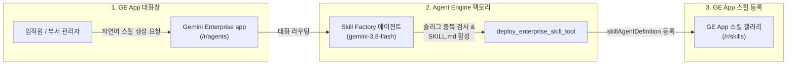

# Gemini Enterprise 사내 스킬 팩토리 배포 보고서 (gemini-enterprise-factory-skill)

- **배포 일시**: 2026-11-10 01:49:21 UTC
- **대상 프로젝트**: `sample-project-id`
- **Gemini Enterprise app 인스턴스**: `sample-ge-app-id`
- **팩토리 에이전트**: `GE In-Chat Skill Factory (사내 스킬 팩토리)`
- **배포 상태**: `DRY_RUN_PASSED`

---

## 1. 팩토리 에이전트(붕어빵 틀) 프로비저닝 결과 요약

| 항목 | 상태 | 세부 정보 |
| :--- | :---: | :--- |
| **에이전트 명칭** | `PROVISIONED` | `GE In-Chat Skill Factory (사내 스킬 팩토리)` |
| **호스팅 런타임** | `Agent Engine` | `projects/sample-project-id/locations/us-central1/reasoningEngines/simulated-skill-factory-engine` |
| **추론 파운데이션 모델** | `gemini-3.8-flash` | 위치: `global` (샌드박스 안정성 보장) |
| **내장 실행 도구** | `4종 완비` | `check_skill_duplicate_tool`, `deploy_enterprise_skill_tool`, `list_enterprise_skills_tool`, `get_preset_skills_tool` |
| **GE App 사내 갤러리 등록** | `ACTIVE` | 사내 갤러리(`/r/agents`) 전사 공유 (`ALL_USERS`) 바인딩 완료 |

---

## 2. 팩토리 에이전트 아키텍처 및 스킬 제작 흐름

본 솔루션은 임직원이 복잡한 규격을 직접 작성하지 않고, GE App 채팅창에서 자연어 대화만으로 업무 스킬(`SKILL.md`)을 제작하여 `/r/skills`에 즉시 등록할 수 있도록 지원하는 **사내 스킬 팩토리(붕어빵 틀)**다:



---

## 3. 사내 실무자 활용 가이드 (스킬 생성 및 즉시 호출)

사내 임직원은 배포된 스킬 팩토리 에이전트와 대화하여 다음과 같이 업무 스킬을 즉시 찍어낼 수 있다:

1. **Gemini Enterprise app 접속**:
   - 웹 포털 ( https://gemini.google.com/app/sample-ge-app-id ) 접속 후 좌측 사이드바 **사내 갤러리(`/r/agents`)** 이동.
   - **`GE In-Chat Skill Factory (사내 스킬 팩토리)`** 선택.

2. **자연어 붕어빵 생성 예시 프롬프트**:
   - *"주간 업무 보고서 자동 요약 스킬 생성해서 내 GE App Skills에 등록해 줘"*
   - *"회의록 핵심 결정 사항 정리 스킬 만들어 줘"*
   - *"전자결재 기안문 초안 작성 스킬 생성 및 전사 공유해 줘"*
   - *"현재 사내에 등록된 스킬 목록 조회해 줘"*

3. **팩토리 에이전트 자율 동작**:
   - 스킬 팩토리 에이전트가 슬러그 ID 중복을 사전 확인한 뒤 `SKILL.md` 지침을 구성하고,
   - 내장된 `deploy_enterprise_skill_tool`을 호출하여 GE App **`/r/skills`** 목록에 즉시 등록한다.

---

## 4. 사내 거버넌스 4대 필수 표준 라벨

팩토리 에이전트 및 하위 생성 리소스 관리 시 아래 4대 표준 라벨이 기본 적용된다:
- `managed-by`: `google-cloud-0-to-1`
- `scenario`: `gemini-enterprise-factory-skill`
- `env`: `sample` (또는 `poc`)
- `created-by`: `customer-engineer`

---

## 5. 콘솔 링크 조치 가이드

- **Agent Platform Runtimes 콘솔**: 에이전트 런타임 상태 및 활성화(Enabled) 관리 ( https://console.cloud.google.com/agent-platform/runtimes?project=sample-project-id )
- **Gemini Enterprise 에이전트 목록 콘솔**: 사내 등록된 에이전트 및 스킬 관리 ( https://console.cloud.google.com/gemini-enterprise/locations/global/engines/sample-ge-app-id/agentic/agents?project=sample-project-id )

---

## 6. 자원 정리 안내 (Teardown)

본 솔루션 검증 후 테스트용으로 생성된 Agent Engine 런타임 및 등록된 에이전트를 정리하고자 할 경우 아래 명령을 수행한다:

1. **Agent Engine 삭제**:
   ```bash
   # Agent Engine 인스턴스 삭제 (force=true)
   curl -X DELETE -H "Authorization: Bearer $(gcloud auth print-access-token)" \
     "https://us-central1-aiplatform.googleapis.com/v1/projects/sample-project-id/locations/us-central1/reasoningEngines/simulated-skill-factory-engine?force=true"
   ```

2. **GE App 사내 갤러리 등록 해제**:
   ```bash
   # GE App 에이전트 삭제
   curl -X DELETE -H "Authorization: Bearer $(gcloud auth print-access-token)" \
     "https://discoveryengine.googleapis.com/v1alpha/projects/sample-project-id/locations/global/collections/default_collection/engines/sample-ge-app-id/assistants/default_assistant/agents/<AGENT_ID>"
   ```
