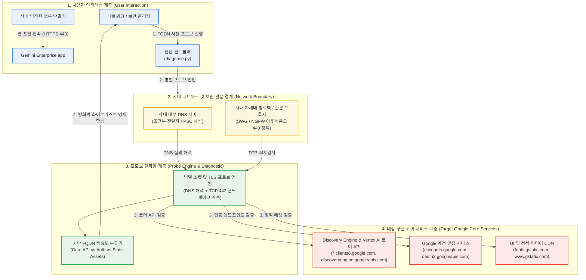

<!--
Copyright 2026 Google LLC. All Rights Reserved.
SPDX-License-Identifier: Apache-2.0

NOTICE: This code/repository is owned by Google LLC and provided under the Apache-2.0 License.
It is strictly provided as an EXAMPLE/REFERENCE ONLY and is NOT INTENDED FOR PRODUCTION USE.
All contents, designs, and code examples are subject to change, modification, or removal at any time without notice.

[고지 사항] 본 저장소 및 문서는 구글 (Google LLC) 소유이며 Apache 2.0 라이선스 하에 예시 (Sample) 용도로 제공된다.
프로덕션 환경용이 아니며, 사전 통지 없이 언제든지 수정, 변경 또는 삭제될 수 있다.
-->

> [!IMPORTANT]
> **구글 (Google LLC) 참조용 샘플 고지 사항**:
> 본 프로젝트의 모든 소스 코드와 문서는 Google LLC의 소유이며, Apache-2.0 라이선스에 따라 오직 **참조용 샘플 (Sample / Reference Only)** 목적으로만 제공된다. 프로덕션 환경에 그대로 사용할 수 없으며, 사전 통지 없이 언제든 내용이 수정, 변경 또는 삭제될 수 있다.

# 제미나이 엔터프라이즈(Gemini Enterprise) 사내망 방화벽 FQDN 연결 진단기 (`gemini-enterprise-fqdn-checker`)

사내망 보안 정책상 와일드카드 도메인 등록이 불가한 환경에서 Gemini Enterprise App 정상 구동에 필요한 필수 코어 API, 인증, 정적 에셋 FQDN의 아웃바운드 443 및 DNS 연결성을 1분 만에 일괄 진단하고 방화벽 허용 명세를 자동 생성하는 도구다. (As of 2026-10-17)

---

## 1. 발생 증상 및 진단 대상 체크리스트

사내 또는 고객사 환경에서 아래 증상이 발생한다면 즉시 진단 대상이다:
- [ ] 사내 보안 방화벽 규정상 와일드카드 도메인(`*.googleapis.com`, `*.gstatic.com`) 일괄 허용이 전면 금지되어 있다.
- [ ] 사내 PC 또는 VDI 환경에서 Gemini Enterprise App 접속 시 흰 화면(Blank Page)만 표시되거나 폰트와 스타일이 깨진다.
- [ ] 텍스트 질의는 일부 동작하나 Deep Research 실행, 멀티모달 이미지 생성 및 UI 렌더링 시 통신 에러가 발생한다. (원인: `discoveryengine.clients6.google.com` 차단)
- [ ] Google Cloud 계정 인증(`accounts.google.com`, `auth.cloud.google.com`) 단계에서 세션이 만료되거나 무한 리다이렉트가 발생한다.
- [ ] Private Service Connect(PSC) 내부망을 구성했으나 일부 필수 공개 FQDN에 대한 외부 DNS 해독 및 TCP 443 아웃바운드가 누락되어 있다.


### 1.1 도구의 본질 및 비즈니스 해결 과제 (What & Why)
- **대상 사용자 (Target)**: 기업 네트워크 보안팀, 방화벽 관리자, 사내 관문 프록시(SWG) 운영자 및 인프라 엔지니어
- **해결하는 핵심 문제 (Core Pain Points)**:
  1. 사내망 보안 규정상 와일드카드 도메인(`*.google.com`) 등록이 엄격히 불허되어 개별 FQDN 목록이 필수적인 문제
  2. Gemini Enterprise 구동에 필요한 인증, 코어 API, 정적 에셋, 스트리밍 엔드포인트 중 일부가 누락되어 웹 대화창이 멈추는 장애
  3. 보안팀 방화벽 승인 요청 시 필요한 아웃바운드 443 포트 대상 FQDN 전수 목록을 수작업으로 파악하느라 일정이 지연되는 현상
- **본 솔루션의 해결 방식 (Solution)**:
  - Gemini Enterprise 정상 구동에 필수적인 20대 핵심 코어 API, 계정 인증, 정적 CDN 에셋의 DNS 해석 및 아웃바운드 443(TLS) 연결성을 1분 만에 일괄 진단하고 보안팀 제출용 방화벽 허용 명세를 자동 생성한다.

### 1.2 최종 산출물 3종 세트 미리보기 (Deliverables & Visual Preview)
본 도구를 실행(`python diagnose.py`)하면 다음 3가지 구체적인 엔터프라이즈 자산이 생성된다:

| 산출물 구분 | 산출물 형태 및 명칭 | 주요 포함 내용 및 실무 활용 방안 |
| :--- | :--- | :--- |
| **① 터미널 콘솔 요약** | Visual CLI Table | 20개 FQDN별 카테고리, DNS 해석 IP, 443 TLS 핸드셰이크 성공 여부, RTT 지연시간 및 연결성 판정 표 |
| **② 정규 진단 보고서** | 마크다운 파일 (`report.md`) | 사내망 네트워크 통신 적합성 보고서, 차단된 FQDN 목록, 방화벽 정책 등록용 정형 표 및 SWG 프록시 허용 명세서 |
| **③ 후속 조치 및 배포 자산** | Actionable Asset Specs | • **보안팀 제출용 방화벽 허용 FQDN 명세**: 복붙 가능한 20대 공식 FQDN 목록<br/>• **사내 관문 프록시(SWG) 룰셋 규격**: 와일드카드 없이 개별 도메인을 등록하는 프록시 정책<br/>• **네트워크 연결성 모니터링 스크립트**: 주기적으로 사내망 연결성을 검증하는 자동 헬스체크 도구 |

---

## 2. 빠른 시작 (Quickstart)

> [!TIP]
> Cloud Shell 접속 환경 구성 및 저장소 클론(`git clone`) 방법은 루트의 [메인 README](../../README.md)를 참고한다.

### 1) 모의 데이터 가상 실행 (Dry-Run)
GCP API 호출 없이 내장된 가상 인프라 데이터로 정상 동작 여부를 즉시 검증한다:
```bash
python diagnose.py --dry-run
```

**터미널 진단 출력 미리보기:**
```text
Gemini Enterprise 필수 FQDN 사내망 연결성 진단 시작
--> 가상 실행 모드 (--dry-run) 활성화: 모의 방화벽 차단 시나리오를 분석한다.
=========================================================================================================
카테고리             FQDN                                       DNS    TLS/443  지연(ms)     결과        
---------------------------------------------------------------------------------------------------------
Core API         discoveryengine.googleapis.com             OK     OK       32.5       [정상]      
Core API         global-discoveryengine.googleapis.com      OK     OK       32.5       [정상]      
Core API         us-discoveryengine.googleapis.com          OK     OK       32.5       [정상]      
Core API         eu-discoveryengine.googleapis.com          OK     OK       32.5       [정상]      
Core API         content-discoveryengine.googleapis.com     OK     OK       32.5       [정상]
```


### 2) 사내 환경 대화형 설정 (Config Wizard, 선택 사항)
사내 활성 프로젝트 및 환경 설정을 대화형으로 탐색하여 `.env`에 자동 저장한다:
```bash
python diagnose.py --config
```


### 3) 실제 사내 인프라 실시간 진단
```bash
python diagnose.py
```
> [!NOTE]
> 앞서 `python diagnose.py --config`로 환경 설정을 저장했거나 gcloud 활성 설정을 그대로 활용할 경우 별도의 `.env` 생성 없이 즉시 실행할 수 있다. (환경 변수를 텍스트 에디터로 직접 수동 편집하고자 할 때만 `cp -n .env.example .env` 실행 후 수정)

---

## 3. 솔루션 아키텍처 및 런타임 토폴로지

본 도구는 사내망 폐쇄 보안 환경에서 Gemini Enterprise App 연결성을 4계층으로 분석하고 차단 FQDN을 실시간 진단한다:



---
## 4. 조치 가이드 및 권장 설정

### 1) 최우선 조치 대상 코어 FQDN
- `discoveryengine.googleapis.com` (기본 API 엔드포인트)
- `discoveryengine.clients6.google.com` (**핵심**: UI 렌더링, Deep Research 및 동적 에셋 통신 필수 엔드포인트)
- `global-discoveryengine.googleapis.com`
- `content-discoveryengine.googleapis.com`
- `vertexaisearch.cloud.google.com`

### 2) 사용자 인증 및 세션 FQDN
- `accounts.google.com`
- `apis.google.com`
- `auth.cloud.google.com`
- `reauth.cloud.google.com`

### 3) UI 정적 자산 및 이미지 FQDN
- `www.gstatic.com`
- `ssl.gstatic.com`
- `fonts.gstatic.com`
- `lh3.googleusercontent.com` ~ `lh6.googleusercontent.com`

### 4) Cloud Next Generation Firewall 아웃바운드 허용 예시 (FQDN 규칙)
```bash
gcloud compute firewall-rules create allow-gemini-enterprise-egress \
    --direction=EGRESS \
    --priority=1000 \
    --network=default \
    --action=ALLOW \
    --rules=tcp:443 \
    --destination-ranges=0.0.0.0/0
```

---
## 5. 사전 준비 사항 (필요 IAM 권한)

본 도구를 실행하려면 최소 아래의 IAM 권한이 필요하다:

- **실행 환경**: 사내망, 온프레미스 사내 PC, VDI, Compute Engine VM 또는 Cloud Shell
- **아웃바운드 포트**: TCP Port 443 (HTTPS)
- **IAM 권한**: 로컬 네트워크 및 도메인 소켓 테스트이므로 GCP IAM 권한이 없어도 진단 가능하다. (GCP 방화벽 정책 생성 시 `roles/compute.securityAdmin` 필요)

---

## 6. 기술적 배경 및 아키텍처 원리 (Deep Dive)

### 관련 상세 설계 및 요구 사항 명세
- [비즈니스 요구 사항 명세서 (BRD)](docs/BRD.md): 비즈니스 배경, 성공 지표 및 요구 사항(BR-01~) 명세
- [기술 상세 설계서 (TDD)](docs/TDD.md): 시스템 아키텍처, 기능(FR-01~) 및 비기능(NFR-01~) 설계 명세

방화벽 규칙 및 관련 클라우드 인프라 리소스 생성 시 4대 표준 라벨을 반드시 적용한다:
- `managed-by`: `google-cloud-0-to-1`
- `scenario`: `gemini-enterprise-fqdn-checker`
- `env`: `sample` (또는 `poc`)
- `created-by`: `customer-engineer`

---
## 7. 리소스 정리 (Teardown) 안내

본 도구는 클라우드 자원을 생성하지 않는 네트워크 소켓 진단 유틸리티다. 진단 과정에서 발생하는 추가 과금이나 자원 잔류가 없다.
