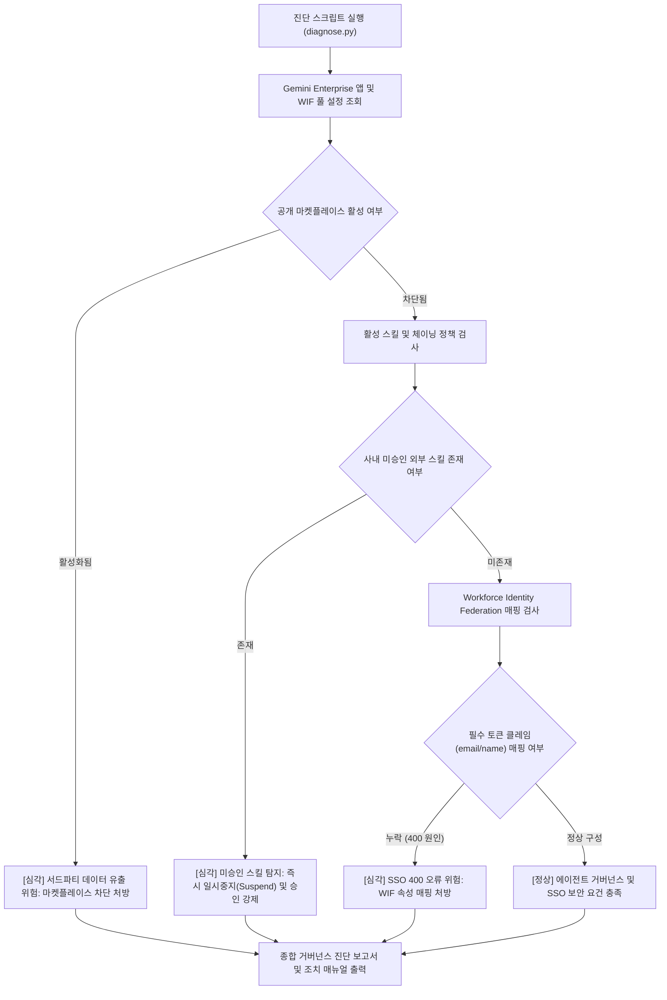

<!--
Copyright 2026 Google LLC. All Rights Reserved.
SPDX-License-Identifier: Apache-2.0

NOTICE: This code/repository is owned by Google LLC and provided under the Apache-2.0 License.
It is strictly provided as an EXAMPLE/REFERENCE ONLY and is NOT INTENDED FOR PRODUCTION USE.
All contents, designs, and code examples are subject to change, modification, or removal at any time without notice.

[고지 사항] 본 저장소 및 문서는 구글 (Google LLC) 소유이며 Apache 2.0 라이선스 하에 예시 (Sample) 용도로 제공된다.
프로덕션 환경용이 아니며, 사전 통지 없이 언제든지 수정, 변경 또는 삭제될 수 있다.
-->

> [!IMPORTANT]
> **구글 (Google LLC) 참조용 샘플 고지 사항**:
> 본 프로젝트의 모든 소스 코드와 문서는 Google LLC의 소유이며, Apache-2.0 라이선스에 따라 오직 **참조용 샘플 (Sample / Reference Only)** 목적으로만 제공된다. 프로덕션 환경에 그대로 사용할 수 없으며, 사전 통지 없이 언제든 내용이 수정, 변경 또는 삭제될 수 있다.

# 제미나이 엔터프라이즈(Gemini Enterprise) 에이전트 마켓플레이스 차단 및 사내 거버넌스 진단기 (`gemini-enterprise-governance-guard`)

제미나이 엔터프라이즈 환경에서 외부 공개 에이전트 마켓플레이스 접근 차단, 사내 승인 커스텀 에이전트 강제 정책, 미승인 스킬 체이닝 위험 및 Microsoft Entra ID(Workforce Identity Federation) SSO 400 인증 오류를 1분 만에 자동 진단하고 복구 처방을 제공하는 도구다. (As of 2026-10-17)

---

## 1. 발생 증상 및 진단 대상 체크리스트

사내 또는 고객사 환경에서 아래 증상이 발생한다면 즉시 진단 대상이다:
- [ ] 전사 임직원에게 Gemini Enterprise 라이선스를 배포한 후, 사용자가 외부 공개 마켓플레이스 에이전트에 무분별하게 접근하여 사내 기밀 데이터를 전송할 위험이 발생한다.
- [ ] 관리자가 마켓플레이스 구매/조달 담당자 메일을 지정하지 않은 상태에서 사용자가 에이전트 승인 요청을 보내 혼선이 빚어지거나 승인 없이 임의 활성화된다.
- [ ] 일반 사용자가 에이전트 플로우에서 검증되지 않은 외부 서드파티 스킬을 임의로 연결하여 워크플로우를 생성하지 못하도록 차단해야 한다.
- [ ] Microsoft Entra ID와 Google Cloud Workforce Identity Federation(WIF)을 연동하여 SSO 로그인 시 클레임 속성 매핑 누락으로 인해 HTTP 400 Bad Request 에러가 발생한다.

---

## 2. 빠른 시작 (Quickstart)

### 1) 모의 데이터 가상 실행 (Dry-Run)
GCP API 호출 없이 내장된 가상 인프라 데이터로 정상 동작 여부를 즉시 검증한다:
```bash
python diagnose.py --dry-run
```

**터미널 진단 출력 미리보기:**
```text
Gemini Enterprise 에이전트 거버넌스 및 SSO 상태 진단 시작 (프로젝트: sample-project-id, 앱: default-enterprise-agent-app)
--> 가상 실행 모드 (--dry-run) 활성화: 사전 시뮬레이션 거버넌스 및 WIF 데이터를 분석한다.
=========================================================================================================
Gemini Enterprise 애플리케이션 거버넌스 진단 리포트 (default-enterprise-agent-app)
=========================================================================================================
거버넌스 점검 범주                       상태           진단 내용
---------------------------------------------------------------------------------------------------------
에이전트 마켓플레이스 통제                   CRITICAL     공개 에이전트 마켓플레이스 접근이 허용되어 임직원이 검증되지 않은 서드파티 에이전트에 사내 데이터를 전송할 위험 존재
사내 스킬 거버넌스                       CRITICAL     사내 미검증 외부 스킬/에이전트(third-party-web-scraper-skill, public-pdf-converter-agent)가 활성화되어 워크플로우에 결합 가능함
Workforce Identity SSO 인증        CRITICAL     WIF 풀 속성 매핑에 필수 클레임(attribute.user_email, attribute.display_name)이 누락되어 Entra ID 로그인 시 HTTP 400 오류 발생
```

### 2) 실제 사내 인프라 실시간 진단
```bash
cp .env.example .env
python diagnose.py
```
> [!NOTE]
> `.env` 설정값을 비워두면 gcloud 활성 설정 및 사내 리소스를 자동으로 감지하여 진단한다.

---

## 3. 진단 및 해결 흐름



---
## 4. 조치 가이드 및 권장 설정

### 1. 마켓플레이스 조달 요청 비활성화 및 승인 절차 유지
Gemini Enterprise 콘솔 -> [에이전트] -> [조달 및 통합 요청] 화면에서 구매팀 담당자 이메일을 비워두거나, 사내 승인된 Agent Registry만 노출되도록 앱 정책을 고정한다.

### 2. 미승인 외부 스킬 일시중지(Suspend)
```bash
# Gemini Enterprise 관리 콘솔 [스킬(Skills)] 목록에서 미승인 외부 스킬을 선택하고 'Suspend' 처리
```

### 3. Entra ID WIF 풀 속성 매핑 보완 (400 오류 해결)
```bash
gcloud iam workforce-pools providers update-oidc [PROVIDER_ID] \
    --workforce-pool=[POOL_ID] \
    --location=global \
    --attribute-mapping="google.subject=assertion.sub,attribute.user_email=assertion.email,attribute.display_name=assertion.name"
```

---
## 5. 사전 준비 사항 (필요 IAM 권한)

본 도구를 실행하려면 최소 아래의 IAM 권한이 필요하다:

- `roles/discoveryengine.viewer` (Gemini Enterprise 앱 설정 조회)
- `roles/iam.workforcePoolViewer` (Workforce Identity Federation 풀 조회)

---

## 6. 기술적 배경 및 아키텍처 원리 (Deep Dive)

Workforce Identity 풀 공급업체 및 관련 클라우드 인프라 리소스 생성 시 4대 표준 라벨을 반드시 적용한다:
- `managed-by`: `google-cloud-0-to-1`
- `scenario`: `gemini-enterprise-governance-guard`
- `env`: `sample` (또는 `poc`)
- `created-by`: `customer-engineer`

---
## 7. 리소스 정리 (Teardown) 안내

본 도구는 읽기 전용 진단 스크립트이므로 자체적으로 리소스를 생성하지 않는다. 테스트 목적으로 생성한 Workforce Identity 풀이나 공급업체 설정은 다음 명령어로 삭제한다:
```bash
gcloud iam workforce-pools delete [WORKFORCE_POOL_ID] --location=global --quiet
```
