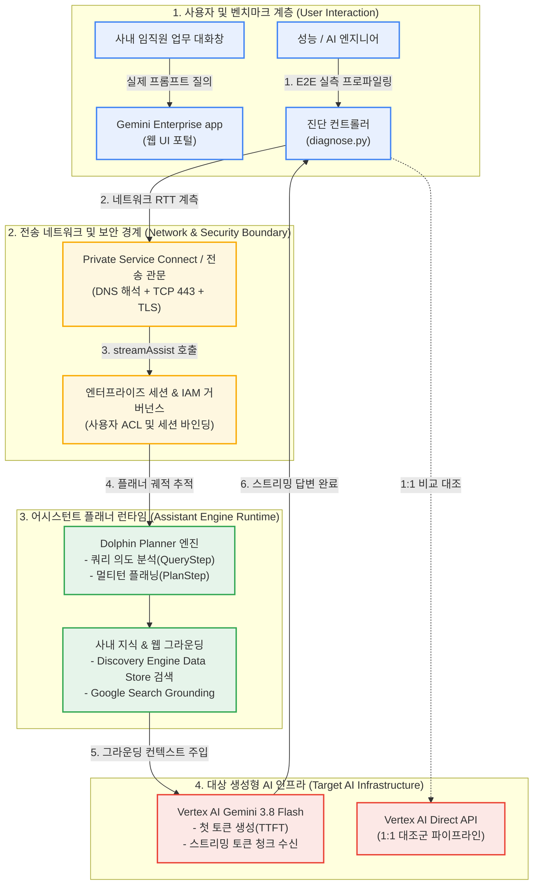

<!--
Copyright 2026 Google LLC. All Rights Reserved.
SPDX-License-Identifier: Apache-2.0

NOTICE: This code/repository is owned by Google LLC and provided under the Apache-2.0 License.
It is strictly provided as an EXAMPLE/REFERENCE ONLY and is NOT INTENDED FOR PRODUCTION USE.
All contents, designs, and code examples are subject to change, modification, or removal at any time without notice.

[고지 사항] 본 저장소 및 문서는 구글 (Google LLC) 소유이며 Apache 2.0 라이선스 하에 예시 (Sample) 용도로 제공된다.
프로덕션 환경용이 아니며, 사전 통지 없이 언제든지 수정, 변경 또는 삭제될 수 있다.
-->

> [!IMPORTANT]
> **구글 (Google LLC) 참조용 샘플 고지 사항**:
> 본 프로젝트의 모든 소스 코드와 문서는 Google LLC의 소유이며, Apache-2.0 라이선스에 따라 오직 **참조용 샘플 (Sample / Reference Only)** 목적으로만 제공된다. 프로덕션 환경에 그대로 사용할 수 없으며, 사전 통지 없이 언제든 내용이 수정, 변경 또는 삭제될 수 있다.

# 제미나이 엔터프라이즈(GE app) vs 버텍스 AI(Vertex AI) 지연 시간 및 플래너 궤적 분석기 (`gemini-enterprise-latency-profiler`)

사내 엔터프라이즈 GE app(Gemini Enterprise app)의 공식 `streamAssist` 스트리밍 대화 엔드포인트와 버텍스 AI(Vertex AI) 순수 제미나이(Gemini) 파운데이션 모델의 `streamGenerateContent` 엔드포인트를 실측하여, 체감 초기 응답 지연(TTFT), 전체 E2E 완료 시간, 내부 플래너 궤적(Planner Steps), RAG 검색 및 거버넌스 오버헤드(Delta)를 정밀 계측하고 워터폴(Waterfall) 차트 및 궤적 리포트를 제공하는 실무 진단 도구다. (As of 2026-10-26)

---

## 1. 발생 증상 및 진단 대상 체크리스트

사내 또는 고객사 환경에서 아래 증상이 발생한다면 즉시 진단 대상이다:
- [ ] 사내 엔터프라이즈 GE app 대화창(웹 UI)의 초기 응답 속도(TTFT)가 순수 Gemini API 호출 대비 지연되는 근본 원인을 정밀 분석하고 입증해야 하는 경우
- [ ] 지연 시간의 원인이 모델 자체의 추론 지연인지, 사내 데이터스토어/웹 그라운딩 검색 및 어시스턴트 플래닝(Dolphin Planner) 오버헤드인지 객관적 궤적으로 규명해야 하는 경우
- [ ] 첫 번째 스트리밍 토큰 도달 시간(체감 TTFT)과 전체 답변 스트리밍 완료 시간을 분리 측정하여 UI/UX 렌더링 병목을 진단해야 하는 경우
- [ ] 사내 GE app의 내부 실행 단계(QueryStep, PlanStep, Search, Model Generation)별 소요 시간 타임라인을 정밀 추적(Trace)해야 하는 경우
- [ ] 온프레미스 전용선, VPC-SC, Private Service Connect(PSC) 등 사내 프라이빗 네트워크 경로의 TCP/TLS 핸드셰이크 오버헤드를 실측하고자 하는 경우


### 1.1 도구의 본질 및 비즈니스 해결 과제 (What & Why)
- **대상 사용자 (Target)**: AI 애플리케이션 개발자, 성능 엔지니어, SRE 팀 및 엔터프라이즈 AI 아키텍트
- **해결하는 핵심 문제 (Core Pain Points)**:
  1. Gemini Enterprise 웹 대화창이나 커스텀 에이전트의 답변 생성이 느릴 때, 정확히 어느 구간에서 지연이 발생하는지 알 수 없는 문제
  2. 네트워크 전송, 보안 가드레일(Model Armor), 검색 컨텍스트 증강(Grounding), 순수 LLM 추론 시간의 비중을 분리하지 못하는 병목
  3. 직접 호출(Vertex AI SDK) 대비 Gemini Enterprise app의 플래너(Planner) 단계 오버헤드를 정량적으로 실측하지 못하는 현상
- **본 솔루션의 해결 방식 (Solution)**:
  - 실제 실시간 스트리밍 질의를 수행하여 전송 네트워크(DNS, TCP, TLS), 보안 가드레일, 검색 그라운딩, 순수 LLM 추론(TTFT, 토큰 생성 속도) 구간별 소요 시간을 밀리초(ms) 단위로 분해 계측하고 워터폴 차트와 최적화 권고안을 제시한다.

### 1.2 최종 산출물 3종 세트 미리보기 (Deliverables & Visual Preview)
본 도구를 실행(`python diagnose.py`)하면 다음 3가지 구체적인 엔터프라이즈 자산이 생성된다:

| 산출물 구분 | 산출물 형태 및 명칭 | 주요 포함 내용 및 실무 활용 방안 |
| :--- | :--- | :--- |
| **① 터미널 콘솔 요약** | Visual CLI Table | 구간별 소요 시간(ms), 백분율 비중(%), TTFT(첫 토큰 지연), 토큰/초 처리 속도 및 워터폴 ASCII 차트 |
| **② 정규 진단 보고서** | 마크다운 파일 (`report.md`) | E2E 지연 시간 분해 분석서, 구간별 성능 병목 원인 진단, Direct API vs GE App 비교표 및 최적화 처방전 |
| **③ 후속 조치 및 배포 자산** | Actionable Asset Specs | • **구간별 병목 개선 권고안**: DNS 캐싱, TCP Keepalive, Grounding 청크 튜닝 및 모델 선택 가이드<br/>• **스트리밍 최적화 클라이언트 코드**: TTFT를 극대화하는 `streamAssist` / `streamGenerateContent` 모듈<br/>• **레이턴시 SLO 모니터링 알림 정책**: 3초 이상 지연 발생 시 관리자 알림을 트리거하는 메트릭 |

---

## 2. 빠른 시작 (Quickstart)

> [!TIP]
> Cloud Shell 접속 환경 구성 및 저장소 클론(`git clone`) 방법은 루트의 [메인 README](../../README.md)를 참고한다.

### 1) 모의 데이터 가상 실행 (Dry-Run)
GCP API 호출 없이 내장된 가상 인프라 데이터로 정상 동작 여부를 즉시 검증한다:
```bash
python diagnose.py --dry-run
```

**터미널 진단 출력 미리보기:**
```text
[1] Gemini Enterprise App (streamAssist) 완결형 엔터프라이즈 구간별 지연 시간 (총 소요: 15,364.7 ms)
------------------------------------------------------------------------------------------------
구간 ID    | 계층           | 소요 시간 (비중)           | 워터폴 차트
------------------------------------------------------------------------------------------------
HOP-01   | 전송 계층        |   112.5 ms ( 0.7%)   | [                                    ] 네트워크 전송 (DNS, TCP, TLS)
HOP-02   | 엔터프라이즈       |  6520.4 ms (42.4%)   | [===============                     ] GE App 플래너 분석 및 사내 RAG / 그라운딩 검색
HOP-03   | 모델 추론        |  2244.0 ms (14.6%)   | [=====                               ] 거버넌스 가드레일 통과 및 첫 토큰 생성 (TTFT)
HOP-04   | 토큰 생성        |  6487.8 ms (42.2%)   | [===============                     ] 스트리밍 텍스트 전송 및 추천 질문 합성
------------------------------------------------------------------------------------------------

[2] 엔드유저 초기 응답 지연(TTFT) 및 완결 E2E 소요 시간 1:1 대조군 분석:
================================================================================================
계측 지표                      | GE App (StreamAssist)  | Vertex AI Gemini     | 오버헤드 (Delta)
------------------------------------------------------------------------------------------------
첫 청크 도달 (체감 TTFT)          |     8876.9 ms          |     3149.5 ms        |    +5727.4 ms
전체 E2E 소요 시간 (Total)       |    15364.7 ms          |     3344.5 ms        |   +12020.2 ms
스트리밍 전송 시간                 |     6487.8 ms          |      195.0 ms        |    +6292.8 ms
================================================================================================

[3] GE App 내부 플래너 실행 궤적 상세 타임라인 (총 6단계):
------------------------------------------------------------------------------------------------
단계     | 유형         | 경과 시간        | 구간 델타        | 수행 내용 및 미리보기
------------------------------------------------------------------------------------------------
1      | QueryStep  |      0.0 ms  |      0.0 ms  | 사내 보안 규정 요약 및 주요 수칙 3가지를 알려줘.
2      | PlanStep   |   1933.4 ms  |   1933.4 ms  | Formulating retrieval query for security g
3      | PlanStep   |   3773.2 ms  |   1839.8 ms  | Processing retrieved documents from enterp
4      | PlanStep   |   6626.2 ms  |   2853.0 ms  | Structuring answer with security grounding
5      | PlanStep   |   8876.9 ms  |   2250.7 ms  | 안녕하세요! 사내 자산과 중요 정보를 안전하게 보호하기 위한...
6      | PlanStep   |  15364.7 ms  |   6487.8 ms  | 추천 질문: [오늘 해야 할 일 확인], [최근 수신 이메일 요약] 등
------------------------------------------------------------------------------------------------
```


### 2) 사내 환경 대화형 설정 (Config Wizard, 선택 사항)
사내 활성 프로젝트 및 환경 설정을 대화형으로 탐색하여 `.env`에 자동 저장한다:
```bash
python diagnose.py --config
```


### 3) 실제 사내 인프라 실시간 진단
```bash
python diagnose.py
```
> [!NOTE]
> 앞서 `python diagnose.py --config`로 환경 설정을 저장했거나 gcloud 활성 설정을 그대로 활용할 경우 별도의 `.env` 생성 없이 즉시 실행할 수 있다. (환경 변수를 텍스트 에디터로 직접 수동 편집하고자 할 때만 `cp -n .env.example .env` 실행 후 수정)

---

## 3. 솔루션 아키텍처 및 런타임 토폴로지

본 도구는 엔터프라이즈 생성형 AI 호출 파이프라인의 전 구간 레이턴시를 4계층으로 분해하여 실측한다:



---
## 4. 조치 가이드 및 권장 설정

1. **사내 데이터스토어 인덱스 캐싱 및 청크 최적화**:
   - 데이터스토어 벡터 검색 시간이 2초를 초과하는 경우, 문서 청크 크기를 500자 내외로 재조정하고 메타데이터 필터링 인덱스를 추가하여 검색 레이턴시를 단축한다.

2. **불필요한 웹 그라운딩 선택적 제어**:
   - 사내 전용 인트라넷 질의의 경우 외부 Google Search Grounding을 비활성화하여 불필요한 외부 웹 크롤링/파싱 지연(약 2~3초)을 제거한다.

3. **엔드유저 체감 지연(Perceived Latency) UX 완화**:
   - GE App은 첫 토큰이 나오기 전까지 플래닝 및 검색을 수행하므로, 프론트엔드 UI 대화창에 첫 청크 수신 전 "사내 규정 및 문서를 검색하고 있습니다..." 상태 인디케이터를 능동적으로 표시하도록 설정한다.

4. **엔드투엔드 네트워크 RTT 최적화**:
   - 사내 클라이언트와 구글 백본망 간의 통신 구간을 최적화하기 위해 Private Service Connect(PSC) 엔드포인트를 구축하여 퍼블릭 인터넷 경유에 따른 패킷 지연을 방어한다.

---
### GCP 리소스 생성 시 4대 필수 표준 라벨링 준수
- 사내 거버넌스 및 자원 식별, 비용 추적을 위해 관련 클라우드 리소스 생성 시 4대 표준 라벨을 필수로 주입한다:
  - `managed-by`: `google-cloud-0-to-1`
  - `scenario`: `gemini-enterprise-latency-profiler`
  - `env`: `sample`
  - `created-by`: `customer-engineer`
- gcloud CLI 예시: `--labels=managed-by=google-cloud-0-to-1,scenario=gemini-enterprise-latency-profiler,env=sample,created-by=customer-engineer`

---

## 5. 사전 준비 사항 (필요 IAM 권한)

본 도구를 실행하려면 최소 아래의 IAM 권한이 필요하다:

| 권한 역할 | 역할 명칭 | 필요 사유 |
| :--- | :--- | :--- |
| `roles/discoveryengine.editor` (또는 뷰어) | Discovery Engine 관리자/뷰어 | GE App `streamAssist` 호출 및 엔진/어시스턴트 상태 조회 |
| `roles/aiplatform.user` | Vertex AI 사용자 | 1:1 대조군 Vertex AI Gemini 스트리밍 API 호출 및 TTFT 실측 |
| `roles/monitoring.viewer` | 모니터링 뷰어 | 엔드포인트 지연 메트릭 조회 |

---

## 6. 기술적 배경 및 아키텍처 원리 (Deep Dive)

### 관련 상세 설계 및 요구 사항 명세
- [비즈니스 요구 사항 명세서 (BRD)](docs/BRD.md): 비즈니스 배경, 성공 지표 및 요구 사항(BR-01~) 명세
- [기술 상세 설계서 (TDD)](docs/TDD.md): 시스템 아키텍처, 기능(FR-01~) 및 비기능(NFR-01~) 설계 명세

### 실무 실측 인사이트: 순수 Gemini API vs GE App 대화창
- **순수 버텍스 AI(Vertex AI) API**: 프롬프트 수신 즉시 LLM 추론을 개시하므로 **약 3초 내외**에 첫 스트리밍 토큰이 화면에 표시된다.
- **Gemini Enterprise app**: 사용자의 질문 의도를 분석하고, 사내 데이터스토어와 웹 검색을 수행하며, 사내 IAM 권한 및 출처 각주를 검증하는 어시스턴트 플래너(Dolphin Planner)가 동기식으로 선행 구동된다. 이로 인해 첫 토큰 수신까지 **약 8~9초**가 소요되는 것은 결함이 아니라 **엔터프라이즈 신뢰 및 환각 방지를 위한 필수 거버넌스 비용**이다.

---
## 7. 리소스 정리 (Teardown) 안내

본 도구는 지연 시간 측정용 단발성 API 호출만 수행하므로 영구 인프라 자원을 생성하지 않는다.
테스트 과정에서 발급된 임시 인증 토큰은 세션 종료 시 자동으로 만료된다.
