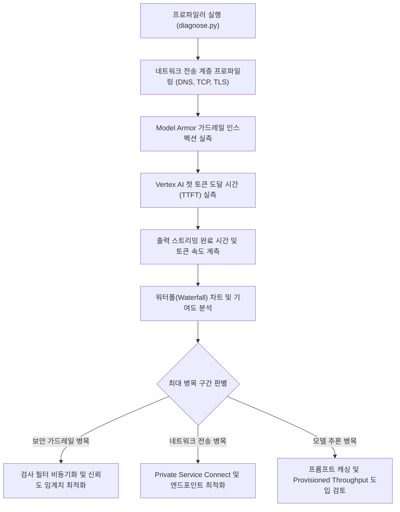

<!--
Copyright 2026 Google LLC. All Rights Reserved.
SPDX-License-Identifier: Apache-2.0

NOTICE: This code/repository is owned by Google LLC and provided under the Apache-2.0 License.
It is strictly provided as an EXAMPLE/REFERENCE ONLY and is NOT INTENDED FOR PRODUCTION USE.
All contents, designs, and code examples are subject to change, modification, or removal at any time without notice.

[고지 사항] 본 저장소 및 문서는 구글 (Google LLC) 소유이며 Apache 2.0 라이선스 하에 예시 (Sample) 용도로 제공된다.
프로덕션 환경용이 아니며, 사전 통지 없이 언제든지 수정, 변경 또는 삭제될 수 있다.
-->

> [!IMPORTANT]
> **구글 (Google LLC) 참조용 샘플 고지 사항**:
> 본 프로젝트의 모든 소스 코드와 문서는 Google LLC의 소유이며, Apache-2.0 라이선스에 따라 오직 **참조용 샘플 (Sample / Reference Only)** 목적으로만 제공된다. 프로덕션 환경에 그대로 사용할 수 없으며, 사전 통지 없이 언제든 내용이 수정, 변경 또는 삭제될 수 있다.

# 제미나이 엔터프라이즈(Gemini Enterprise) 파이프라인 구간별 지연 시간 분석기 (`gemini-enterprise-latency-profiler`)

엔터프라이즈 생성형 AI 파이프라인에서 발생하는 체감 지연 시간(Latency)의 원인을 전송 네트워크(DNS, TCP, TLS), 보안 가드레일(Model Armor, Sensitive Data Protection), 컨텍스트 증강(Search Grounding), 순수 LLM 추론(TTFT, 토큰 생성 속도) 구간별로 분해 계측하여 워터폴(Waterfall) 차트 및 병목 최적화 권고안을 제공하는 실측 진단 도구다. (As of 2026-10-17)

---

## 1. 발생 증상 및 진단 대상 체크리스트

사내 또는 고객사 환경에서 아래 증상이 발생한다면 즉시 진단 대상이다:
- [ ] 사내 엔터프라이즈 제미나이 앱이나 버텍스 AI(Vertex AI) 기반 서비스가 일반 컨슈머 웹앱(`gemini.google.com`) 대비 지연 시간이 발생하는 원인을 정밀 분석하고 개선하고자 하는 경우
- [ ] 지연 시간의 원인이 모델 자체의 추론 속도 문제인지, 보안 가드레일(Model Armor)의 동기 검사 오버헤드인지 객관적인 데이터로 입증해야 하는 경우
- [ ] 구글 검색 그라운딩(Search Grounding) 또는 사내 지식 검색(RAG) 도입으로 인해 추가되는 지연 시간을 구간별(Hop-by-hop)로 정량화해야 하는 경우
- [ ] 첫 번째 토큰 도달 시간(TTFT: Time To First Token)과 출력 스트리밍 전송 속도(TPS)를 분리 측정하여 UI/UX 렌더링 병목을 진단해야 하는 경우
- [ ] 온프레미스 전용선, VPC-SC, Private Service Connect(PSC) 등 사내 프라이빗 네트워크 경로의 TCP/TLS 핸드셰이크 오버헤드를 실측하고자 하는 경우

---

## 2. 빠른 시작 (Quickstart)

> [!TIP]
> Cloud Shell 접속 환경 구성 및 저장소 클론(`git clone`) 방법은 루트의 [메인 README](../../README.md)를 참고한다.

### 1) 모의 데이터 가상 실행 (Dry-Run)
GCP API 호출 없이 내장된 가상 인프라 데이터로 정상 동작 여부를 즉시 검증한다:
```bash
python diagnose.py --dry-run
```

**터미널 진단 출력 미리보기:**
```text
신뢰 스택 세부 진단 및 권고안:
============================================================================================
* HOP-01 [네트워크 전송 (DNS, TCP, TLS)] - 138.5 ms (7.9%)
  - 원인 분석: 클라이언트 단말에서 asia-northeast3 엔드포인트까지의 네트워크 악수 및 TLS 협상 시간
  - 최적화안: VPC 내부 Private Service Connect (PSC) 전용선 경유로 RTT를 단축하거나 글로벌 애니캐스트 활용 권장
* HOP-02 [Model Armor 보안 가드레일] - 562.0 ms (32.0%)
  - 원인 분석: 프롬프트 인젝션, 탈옥, Sensitive Data Protection (SDP) 민감 정보 실시간 인그레스 스캔 오버헤드
  - 최적화안: 모든 필터를 동기 실행하지 않고 필요도가 낮은 규칙의 비동기 감사 분리 또는 필터 신뢰도 임계치 튜닝 필요
* HOP-03 [구글 검색 그라운딩 (Grounding)] - 325.4 ms (18.6%)
  - 원인 분석: 실시간 구글 검색 쿼리 실행, 결과 파싱, 인라인 컨텍스트 주입에 소요된 추가 지연 시간
```

### 2) 실제 사내 인프라 실시간 진단
```bash
cp .env.example .env
python diagnose.py
```
> [!NOTE]
> `.env` 설정값을 비워두면 gcloud 활성 설정 및 사내 리소스를 자동으로 감지하여 진단한다.

---

## 3. 진단 및 해결 흐름



---
## 4. 조치 가이드 및 권장 설정

1. **Model Armor 가드레일 지연 완화**:
   - 실시간 인스펙션 오버헤드가 과도할 경우, 불필요하게 높은 민감도 설정을 튜닝하거나 응답 검사(Egress Filtering)를 스트리밍 후처리 미들웨어에서 비동기 감사로 전환한다.

2. **순수 추론 시간 단축 (Prompt Caching 및 PT 도입)**:
   - 반복되는 시스템 지침이나 사내 가이드라인 문서가 긴 경우, Vertex AI 프롬프트 캐싱(Context Caching)을 적용하여 첫 토큰 지연(TTFT)을 최대 80% 절감한다.
   - 프로덕션 환경의 예측 가능한 베이스로드 확보를 위해 Provisioned Throughput(PT)을 도입하여 멀티 테넌트 큐잉 지연을 제거한다.

3. **엔드투엔드 네트워크 RTT 최적화**:
   - 사내 클라이언트와 구글 백본망 간의 통신 구간을 최적화하기 위해 Private Service Connect(PSC) 엔드포인트를 구축하여 퍼블릭 인터넷 경유에 따른 패킷 지연을 방어한다.

---
## 5. 사전 준비 사항 (필요 IAM 권한)

본 도구를 실행하려면 최소 아래의 IAM 권한이 필요하다:

본 도구 구동을 위해 필요한 최소 IAM 권한은 다음과 같다.

| 권한 역할 | 역할 명칭 | 필요 사유 |
| :--- | :--- | :--- |
| `roles/aiplatform.user` | Vertex AI 사용자 | Vertex AI Gemini 스트리밍 API 호출 및 TTFT 실측 |
| `roles/modelarmor.admin` (또는 뷰어) | Model Armor 관리자 | Model Armor 검사 엔드포인트 호출 및 필터링 지연 계측 |
| `roles/monitoring.viewer` | 모니터링 뷰어 | 엔드포인트 지연 메트릭 조회 |

---

## 6. 기술적 배경 및 아키텍처 원리 (Deep Dive)

### 관련 상세 설계 및 요구 사항 명세
- [비즈니스 요구 사항 명세서 (BRD)](docs/BRD.md): 비즈니스 배경, 성공 지표 및 요구 사항(BR-01~) 명세
- [기술 상세 설계서 (TDD)](docs/TDD.md): 시스템 아키텍처, 기능(FR-01~) 및 비기능(NFR-01~) 설계 명세

```text
============================================================================================
 Vertex AI Gemini API vs Gemini Enterprise App (Gemini Enterprise app) 완결형 파이프라인 지연 시간 비교 리포트
 프로젝트: example-corp | 리전: asia-northeast3 | 모델: gemini-3.8-flash
 테스트 프롬프트: "사내 정보보안 가이드라인의 핵심 원칙을 알려줘."
 ※ 참고: Gemini Enterprise app은 웹 UI 접근이 아닌 Discovery Engine 엔드포인트 직접 호출과
         Model Armor 가드레일 체인을 완결 결합하여 사내 엔터프라이즈 RAG 파이프라인을 모사함.
============================================================================================

[1] Gemini Enterprise App (Gemini Enterprise app) 완결형 파이프라인 구간별 지연 시간 (총 소요: 4,785.4 ms)
--------------------------------------------------------------------------------------------
구간 ID    | 계층           | 소요 시간 (비중)           | 워터폴 차트
--------------------------------------------------------------------------------------------
HOP-01   | 전송 계층        |    61.8 ms ( 1.3%)   | [                                    ] 네트워크 전송 (DNS, TCP, TLS)
HOP-02   | 보안 통제        |   654.4 ms (13.7%)   | [=====                               ] Model Armor 프롬프트 가드레일 (인그레스 스캔)
HOP-03   | 엔터프라이즈       |  2181.8 ms (45.6%)   | [================                    ] GE 사내 데이터스토어 검색 및 ACL 인덱스 서빙
HOP-04   | 모델 추론        |  1265.5 ms (26.4%)   | [=========                           ] RAG 그라운딩 기반 LLM 답변 요약 및 생성
HOP-05   | 보안 통제        |   621.9 ms (13.0%)   | [====                                ] Model Armor 응답 검사 (이그레스 민감정보 SDP 스캔)
--------------------------------------------------------------------------------------------

[2] 엔드유저 초기 응답 지연(TTFT) 및 완결 E2E 소요 시간 비교 분석:
============================================================================================
  * Vertex AI Gemini API 첫 토큰 수신 (TTFT) :    720.5 ms (스트리밍 즉시 수신)
  * Vertex AI Gemini API 전체 응답 완료 시간  :   1840.2 ms
  * Gemini Enterprise App 완결 E2E 소요 시간  :   4785.4 ms (보안 가드레일 + 사내 RAG)
--------------------------------------------------------------------------------------------
  * 1) 첫 토큰 수신 시점 차이 : Gemini Enterprise app 파이프라인에서 약 6.6배 추가 시간 소요
       (선행 조건: Model Armor 인스펙션 및 사내 인덱스 검색 완료 후 토큰 생성 착수)
  * 2) 전체 E2E 완료 시간 차이 : Gemini Enterprise app 파이프라인에서 약 2.6배 소요 (+2945.2 ms)
============================================================================================
```

---
## 7. 리소스 정리 (Teardown) 안내

본 도구는 지연 시간 측정용 단발성 API 호출만 수행하므로 영구 인프라 자원을 생성하지 않는다.
테스트 과정에서 발급된 임시 인증 토큰은 세션 종료 시 자동으로 만료된다.
