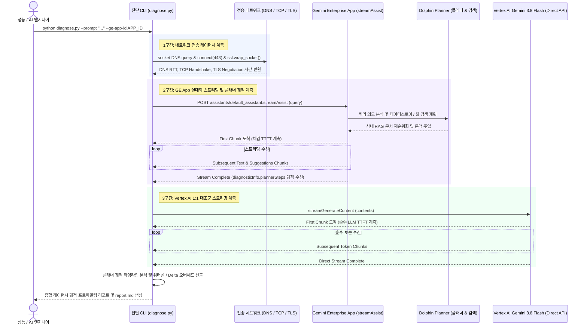

<!--
Copyright 2026 Google LLC. All Rights Reserved.
SPDX-License-Identifier: Apache-2.0

NOTICE: This code/repository is owned by Google LLC and provided under the Apache-2.0 License.
It is strictly provided as an EXAMPLE/REFERENCE ONLY and is NOT INTENDED FOR PRODUCTION USE.
All contents, designs, and code examples are subject to change, modification, or removal at any time without notice.

[고지 사항] 본 저장소 및 문서는 구글 (Google LLC) 소유이며 Apache 2.0 라이선스 하에 예시 (Sample) 용도로 제공된다.
프로덕션 환경용이 아니며, 사전 통지 없이 언제든지 수정, 변경 또는 삭제될 수 있다.
-->

# 기술 상세 설계서 (TDD): 제미나이 엔터프라이즈(GE app) vs 버텍스 AI(Vertex AI) 지연 시간 및 플래너 궤적 분석기 (`gemini-enterprise-latency-profiler`)

## 1. 시스템 아키텍처 및 런타임 상호작용 시퀀스

본 도구의 런타임 제어 및 데이터 상호작용 흐름은 아래 시퀀스 다이어그램과 같다. 엔지니어가 프로파일링 명령을 실행하면 네트워크 전송(DNS/TCP/TLS), GE App `streamAssist` 공식 스트리밍 호출, 내부 플래너 궤적(Query/Plan Steps) 파싱, 그리고 Vertex AI 순수 파운데이션 모델 스트리밍 대조군을 순차 계측하고 워터폴 차트와 궤적 리포트를 합성한다.

---

## 2. 요구 사항 추적성 매핑 (Traceability Matrix)

| 비즈니스 요구 사항 (BRD) | 기능적 기술 요구 사항 (FR) | 비기능적 기술 요구 사항 (NFR) | 구현 파일 및 모듈 |
| :--- | :--- | :--- | :--- |
| **BR-01** (GE App 실대화 스트리밍 E2E 실측) | **FR-01** (streamAssist 스트리밍 E2E 실측) | **NFR-01** (최소 IAM 권한 준수) | `diagnose.py` |
| **BR-02** (어시스턴트 플래너 실행 궤적 추출) | **FR-02** (플래너 타임라인 궤적 파싱) | **NFR-02** (비대화형 환경 호환성) | `diagnose.py` |
| **BR-03** (Vertex AI Gemini 순수 API 1:1 대조) | **FR-03** (순수 모델 스트리밍 대조군 분석) | **NFR-03** (민감 정보 비식별화) | `diagnose.py` |
| **BR-04** (가상 실행 스모크 테스트 지원) | **FR-04** (가상 실행 스모크 테스트 모드) | **NFR-02** (비대화형 환경 호환성) | `diagnose.py` |
| **BR-05** (사내 거버넌스 4대 필수 라벨링 준수) | **FR-05** (사내 거버넌스 4대 필수 표준 라벨링) | **NFR-04** (표준 리소스 라벨링) | `diagnose.py`, `report.md` |

---

## 3. 기능적 기술 요구 사항 (Functional Requirements)

| 요구 사항 ID | 연관 BR | 기술 요구 사항 명칭 | 구현 상세 및 검증 기준 |
| :--- | :--- | :--- | :--- |
| **FR-01** | **BR-01** | **streamAssist 스트리밍 E2E 실측** | GE App 공식 `streamAssist` 엔드포인트를 호출하여 첫 바이트/청크 도달 시간(TTFT)과 전체 완료 시간을 정밀 계측한다. |
| **FR-02** | **BR-02** | **플래너 타임라인 궤적 파싱** | `diagnosticInfo.plannerSteps`의 `createTime` 타임스탬프를 해석하여 QueryStep 및 각 PlanStep의 소요 시간(ms)과 수행 내용을 표로 구성한다. |
| **FR-03** | **BR-03** | **순수 모델 스트리밍 대조군 분석** | 동일 프롬프트를 Vertex AI `streamGenerateContent`로 호출하여 TTFT 및 Total 소요 시간의 격차(엔터프라이즈 Delta)를 산출한다. |
| **FR-04** | **BR-04** | **가상 실행(`--dry-run`) 스모크 테스트 모드** | `--dry-run` 플래그 입력 시 외부 구글 클라우드 API 호출을 우회하고 내장된 표준 6단계 플래너 궤적 데이터를 기반으로 전체 리포트를 1초 내에 출력한다. |
| **FR-05** | **BR-05** | **사내 거버넌스 4대 필수 표준 라벨링 주입** | 지연 시간 프로파일링 및 엔드포인트 테스트 리소스 생성 시 4대 표준 라벨(`managed-by`, `scenario`, `env`, `created-by`)을 필수로 주입한다. |

---

## 4. 비기능적 기술 요구 사항 (Non-Functional Requirements)

| 요구 사항 ID | 요구 사항 명칭 | 상세 기준 |
| :--- | :--- | :--- |
| **NFR-01** | **최소 IAM 권한 준수** | 진단에 필요한 최소 권한(`roles/discoveryengine.editor` 또는 뷰어, `roles/aiplatform.user`, `roles/monitoring.viewer`)만을 요구한다. |
| **NFR-02** | **비대화형 환경 호환성 (CI/CD Ready)** | `sys.stdin.isatty()` 검증을 통해 백그라운드 태스크나 CI/CD 파이프라인 실행 시 입력 대기(Hang) 없이 안전하게 기본 후보를 채택한다. |
| **NFR-03** | **민감 정보 비식별화 및 보안 규약** | 소스 코드 및 문서 내에 실제 프로젝트 ID나 개인 식별 정보(PII)를 하드코딩하지 않으며, 모든 외부 참조 링크는 Bare URL 괄호 병기 원칙을 준수한다. |
| **NFR-04** | **사내 거버넌스 4대 필수 표준 라벨링 준수** | 사내 거버넌스, FinOps 비용 배분 및 자원 추적성을 위해 모든 생성 매니페스트 및 리소스에 4대 표준 라벨을 필수로 주입한다. |
