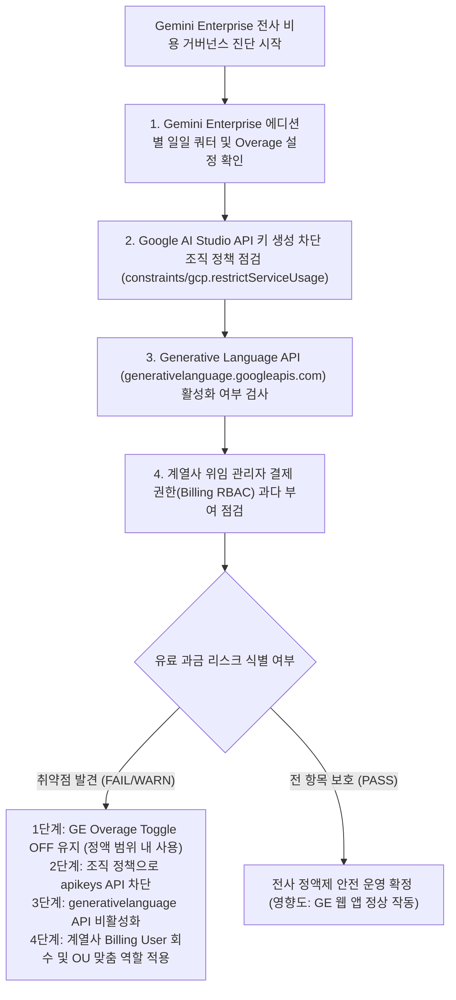

<!--
Copyright 2026 Google LLC. All Rights Reserved.
SPDX-License-Identifier: Apache-2.0

NOTICE: This code/repository is owned by Google LLC and provided under the Apache-2.0 License.
It is strictly provided as an EXAMPLE/REFERENCE ONLY and is NOT INTENDED FOR PRODUCTION USE.
All contents, designs, and code examples are subject to change, modification, or removal at any time without notice.

[고지 사항] 본 저장소 및 문서는 구글 (Google LLC) 소유이며 Apache 2.0 라이선스 하에 예시 (Sample) 용도로 제공된다.
프로덕션 환경용이 아니며, 사전 통지 없이 언제든지 수정, 변경 또는 삭제될 수 있다.
-->

> [!IMPORTANT]
> **구글 (Google LLC) 참조용 샘플 고지 사항**:
> 본 프로젝트의 모든 소스 코드와 문서는 Google LLC의 소유이며, Apache-2.0 라이선스에 따라 오직 **참조용 샘플 (Sample / Reference Only)** 목적으로만 제공된다. 프로덕션 환경에 그대로 사용할 수 없으며, 사전 통지 없이 언제든 내용이 수정, 변경 또는 삭제될 수 있다.

# 제미나이 엔터프라이즈(Gemini Enterprise) 추가 과금 방어 및 비인가 API 호출 차단 가드 (`gemini-enterprise-overage-guard`)

제미나이 엔터프라이즈 전사 도입 환경에서 라이선스 일일 풀링 쿼터 초과 쓰로틀링(업무 중단) 위험뿐만 아니라, 임직원이 공식 계정으로 Google AI Studio 등에 접근하여 회사 결제 계정(클라우드 빌링(Cloud Billing))으로 API 키를 발급하거나 유료 API를 호출하는 섀도우 과금 누수를 체계적으로 차단하고, 계열사 중간 관리자 권한 거버넌스(RBAC)를 진단, 처방하는 종합 비용 가드레일 도구다. (As of 2026-10-17)

---

## 1. 발생 증상 및 진단 대상 체크리스트

사내 또는 고객사 환경에서 아래 증상이 발생한다면 즉시 진단 대상이다:
엔터프라이즈 환경에서 전사 임직원에게 공식 계정을 배포할 때 다음과 같은 3대 비용 누수 및 업무 중단 리스크가 발생한다: 1. **Gemini Enterprise 자체 일일 풀링 쿼터 소진 및 쓰로틀링**: 2. **Google AI Studio를 통한 비의도적 유료 API 호출 (가장 큰 위험 경로)**: 3. **계열사 IT 관리자의 결제 권한 남용 및 거버넌스 부재**:
- [ ] 오버리지 빌링이 비활성화(OFF)된 경우, 피크 시간대 일일 쿼터가 소진되면 당일 자정까지 전사 AI 질의가 일시 차단되는 업무 장애 발생.
- [ ] 반대로 오버리지 토글을 켰을 때(ON) 월 지출 상한선(Spend Cap)이 없으면 통제 불능의 초과 비용(Runaway Cost) 청구 위험.
- [ ] 일반 임직원이 Google AI Studio에 회사 공식 계정으로 로그인한 뒤, 회사 Cloud Billing이 연결된 GCP 프로젝트를 선택하여 API 키(`AIzaSy...`)를 발급하고 `generativelanguage.googleapis.com`을 호출하면 종량제(Pay-as-you-go)로 전사 결제 계정에 비용이 청구됨.
- [ ] 계열사 중간 관리자에게 `roles/billing.admin` 또는 `roles/billing.user` 권한이 부여될 경우, 승인되지 않은 유료 프로젝트를 임의로 생성하거나 결제 계정에 연결하여 통제되지 않는 인프라 비용을 발생시킴.

---

## 2. 빠른 시작 (Quickstart)

> [!TIP]
> Cloud Shell 접속 환경 구성 및 저장소 클론(`git clone`) 방법은 루트의 [메인 README](../../README.md)를 참고한다.

### 0) 사내 환경 대화형 설정 (Config Wizard, 선택 사항)
사내 활성 프로젝트 및 환경 설정을 대화형으로 탐색하여 `.env`에 자동 저장한다:
```bash
python diagnose.py --config
```

### 1) 모의 데이터 가상 실행 (Dry-Run)
GCP API 호출 없이 내장된 가상 인프라 데이터로 정상 동작 여부를 즉시 검증한다:
```bash
python diagnose.py --dry-run
```

**터미널 진단 출력 미리보기:**
```text
권장 월간 지출 상한(Cap): $1,000.00
예산 알림 임계치        : 80%
----------------------------------------------------------------------------------------
[1. 엔터프라이즈 에디션별 오버리지 및 일일 쿼터 현황]
* Gemini Enterprise Plus
  - 오버리지 빌링 설정: ON (활성화)
  - 일일 쿼터 소진율  : 78.5%
  - 진단 판정         : [OVERAGE_RUNAWAY_RISK]
  - 세부 분석         : 오버리지 빌링이 활성화되어 있어 쿼터 소진 후에도 업무는 지속되나, Spend Cap 부재 시 통제되지 않은 초과 토큰 비용이 발생할 수 있다.
* Gemini Enterprise Standard
```

### 2) 실제 사내 인프라 실시간 진단
```bash
python diagnose.py
```
> [!NOTE]
> 앞서 `python diagnose.py --config`로 환경 설정을 저장했거나 gcloud 활성 설정을 그대로 활용할 경우 별도의 `.env` 생성 없이 즉시 실행할 수 있다. (환경 변수를 텍스트 에디터로 직접 수동 편집하고자 할 때만 `cp -n .env.example .env` 실행 후 수정)

---

## 3. 진단 및 해결 흐름



---
## 4. 조치 가이드 및 권장 설정

### 1단계: Gemini Enterprise 관리 콘솔 내 Overage 차단 (필수)
- Gemini Enterprise Admin Console > 구독 및 라이선스(Subscriptions/Licenses) > Overage Settings에서 **Toggle OFF** 상태를 유지한다.
- **결과**: 일일 쿼터를 모두 소진하더라도 당일 추가 질의만 일시 제한되며 추가 요금이 청구되지 않는다.

### 2단계: 조직 정책 기반 Google AI Studio API 키 발급 차단 (필수)
일반 사용자가 Google AI Studio에서 회사 결제 계정 프로젝트를 선택해 API 키를 발급하지 못하도록 차단한다:
```bash
gcloud resource-manager org-policies enable-enforce constraints/gcp.restrictServiceUsage --project=[PROJECT_ID]
```

### 3단계: Generative Language API 비활성화 및 제한 (권장)
Google AI Studio 백엔드 API 호출 경로 자체를 비활성화한다:
```bash
gcloud services disable generativelanguage.googleapis.com --project=[PROJECT_ID] --force
```

### 4단계: 계열사 IT 관리자 결제 권한(Billing RBAC) 회수 및 거버넌스 확립
- 계열사 관리자에게 최고 관리자(Super Admin) 권한 부여를 엄격히 금지한다.
- Cloud Identity 관리자 콘솔에서 계열사 조직 단위(OU)에 한정된 맞춤 역할(사용자/그룹 관리)만 부여한다.
- 구글 클라우드 콘솔에서 `roles/billing.admin` 및 `roles/billing.user` 권한을 회수하고, 사전 프로비저닝된 프로젝트 내 `roles/viewer`만 선별 부여한다.

### 차단 정책 적용 후 기존 업무 영향도 평가
- **Gemini Enterprise 웹 앱 (Chat / Search)**: 영향 없음 (자체 관리형 테넌트 및 버텍스 AI(Vertex AI) 엔드포인트를 사용하므로 정상 동작)
- **NotebookLM Enterprise**: 영향 없음 (Enterprise 테넌트 격리 영역 내 구동)
- **Antigravity (Google OAuth 로그인)**: 영향 없음 (사용자 라이선스 기반 인증)
- **Antigravity (구글 클라우드 프로젝트 종량제 모드)**: 차단됨 (의도된 통제 목적에 정확히 부합)

---
## 5. 사전 준비 사항 (필요 IAM 권한)

본 도구를 실행하려면 최소 아래의 IAM 권한이 필요하다:

본 도구를 실행하고 결제 지표 및 보안 정책을 진단하기 위해 다음 권한이 필요하다:

- `roles/billing.viewer`: Cloud Billing 계정 지출 한도 및 예산 설정 조회
- `roles/orgpolicy.policyViewer`: 조직 정책(`constraints/gcp.restrictServiceUsage`) 설정 조회
- `roles/serviceusage.serviceUsageViewer`: 프로젝트 API 활성화 상태 조회
- `roles/monitoring.viewer`: 일일 풀링 쿼터 사용률 지표 조회

---

## 6. 기술적 배경 및 아키텍처 원리 (Deep Dive)

### 관련 상세 설계 및 요구 사항 명세
- [비즈니스 요구 사항 명세서 (BRD)](docs/BRD.md): 비즈니스 배경, 성공 지표 및 요구 사항(BR-01~) 명세
- [기술 상세 설계서 (TDD)](docs/TDD.md): 시스템 아키텍처, 기능(FR-01~) 및 비기능(NFR-01~) 설계 명세

Cloud Billing 예산 알림, 조직 정책 태그 및 관련 클라우드 인프라 리소스 생성 시 4대 표준 라벨을 반드시 적용한다:
- `managed-by`: `google-cloud-0-to-1`
- `scenario`: `gemini-enterprise-overage-guard`
- `env`: `sample` (또는 `poc`)
- `created-by`: `customer-engineer`

---
## 7. 리소스 정리 (Teardown) 안내

본 도구는 순수 진단 및 모니터링 도구이므로 별도의 클라우드 인프라 자원을 생성하지 않는다.
테스트 목적으로 생성한 Cloud Billing 임시 예산(Budgets)을 삭제하려면 결제 콘솔의 예산 목록에서 해당 항목을 삭제한다.
