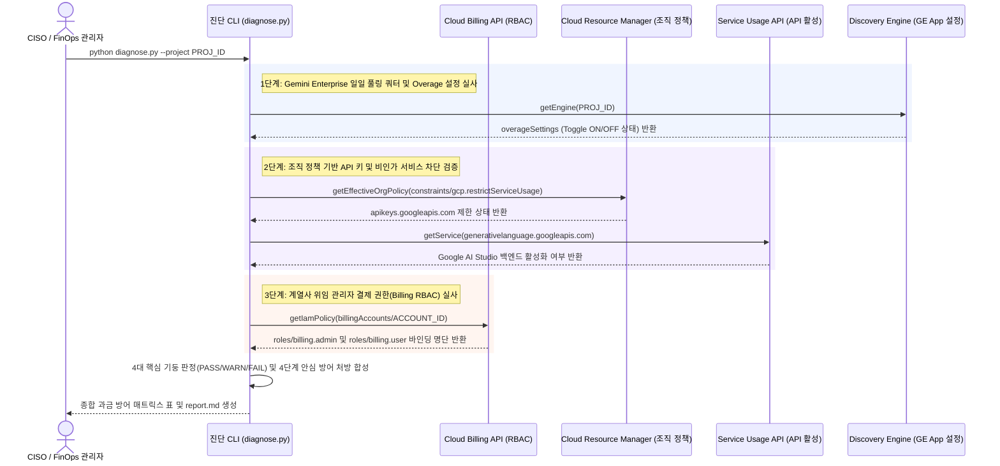

<!--
Copyright 2026 Google LLC. All Rights Reserved.
SPDX-License-Identifier: Apache-2.0

NOTICE: This code/repository is owned by Google LLC and provided under the Apache-2.0 License.
It is strictly provided as an EXAMPLE/REFERENCE ONLY and is NOT INTENDED FOR PRODUCTION USE.
All contents, designs, and code examples are subject to change, modification, or removal at any time without notice.

[고지 사항] 본 저장소 및 문서는 구글 (Google LLC) 소유이며 Apache 2.0 라이선스 하에 예시 (Sample) 용도로 제공된다.
프로덕션 환경용이 아니며, 사전 통지 없이 언제든지 수정, 변경 또는 삭제될 수 있다.
-->

# 기술 상세 설계서 (TDD): 제미나이 엔터프라이즈(Gemini Enterprise) 추가 과금 방어 및 비인가 API 호출 차단 가드 (`gemini-enterprise-overage-guard`)

## 1. 시스템 아키텍처 및 런타임 상호작용 시퀀스

본 도구의 런타임 제어 및 데이터 상호작용 흐름은 아래 시퀀스 다이어그램과 같다. FinOps 담당자 또는 CISO가 진단 명령을 실행하면 Cloud Billing IAM, 조직 정책(`restrictServiceUsage`), Generative Language API 활성 여부를 실시간 교차 검증하여 섀도우 과금 리스크를 판정하고 4단계 안심 방어 처방을 도출한다.

---

## 2. 요구 사항 추적성 매핑 (Traceability Matrix)

| 비즈니스 요구 사항 (BRD) | 기능적 기술 요구 사항 (FR) | 비기능적 기술 요구 사항 (NFR) | 구현 파일 및 모듈 |
| :--- | :--- | :--- | :--- |
| **BR-01** (GE Overage 및 일일 쿼터 분석) | **FR-01** (Gemini Enterprise Overage 및 일일 쿼터 분석) | **NFR-02** (크로스 플랫폼 단일 실행) | `diagnose.py` |
| **BR-02** (Google AI Studio API 키 발급 차단) | **FR-02** (Google AI Studio API 키 발급 차단 점검) | **NFR-01** (최소 IAM 권한 준수) | `diagnose.py` |
| **BR-03** (Generative Language API 비활성화) | **FR-03** (Generative Language API 비활성화 점검) | **NFR-01** (최소 IAM 권한 준수) | `diagnose.py` |
| **BR-04** (계열사 Billing RBAC 권한 통제) | **FR-04** (계열사 IT 관리자 결제 권한 검증) | **NFR-03** (민감 정보 비식별화) | `diagnose.py` |
| **BR-05** (사내 거버넌스 4대 필수 라벨링 준수) | **FR-05** (사내 거버넌스 4대 필수 표준 라벨링 주입) | **NFR-04** (표준 리소스 라벨링) | `diagnose.py`, `report.md` |

---

## 3. 기능적 기술 요구 사항 (Functional Requirements)

| 요구 사항 ID | 연관 BR | 기술 요구 사항 명칭 | 구현 상세 및 검증 기준 |
| :--- | :--- | :--- | :--- |
| **FR-01** | **BR-01** | **Gemini Enterprise Overage 및 일일 쿼터 분석** | 에디션별 일일 풀링 쿼터 소진율을 평가하고, Toggle OFF 유지 여부를 진단하여 `PASS`/`WARN`/`FAIL` 등급을 산출한다. |
| **FR-02** | **BR-02** | **Google AI Studio API 키 발급 차단 점검** | 프로젝트 및 조직 단위 조직 정책(`constraints/gcp.restrictServiceUsage`)에서 `apikeys.googleapis.com` 차단 여부를 검증한다. |
| **FR-03** | **BR-03** | **Generative Language API 비활성화 점검** | 계열사 프로젝트 내 `generativelanguage.googleapis.com` 활성화 상태를 점검하여 즉시 비활성화 명령어를 처방한다. |
| **FR-04** | **BR-04** | **계열사 IT 관리자 결제 권한(Billing RBAC) 검증** | IAM 정책에서 `roles/billing.admin` 및 `roles/billing.user` 과다 부여 여부를 탐지하고 Cloud Identity OU 맞춤 역할을 처방한다. |
| **FR-05** | **BR-05** | **사내 거버넌스 4대 필수 표준 라벨링 주입** | Cloud Billing 예산 알림, 조직 정책 태그 및 클라우드 리소스 생성 시 4대 표준 라벨(`managed-by`, `scenario`, `env`, `created-by`)을 필수로 주입한다. |

---

## 4. 비기능적 기술 요구 사항 (Non-Functional Requirements)

| 요구 사항 ID | 요구 사항 명칭 | 상세 기준 |
| :--- | :--- | :--- |
| **NFR-01** | **최소 IAM 권한 준수** | 진단에 필요한 최소 권한(`roles/billing.viewer, roles/orgpolicy.policyViewer, roles/serviceusage.serviceUsageViewer, roles/monitoring.viewer`)만을 요구한다. |
| **NFR-02** | **크로스 플랫폼 순수 파이썬 단일 실행** | 쉘 래퍼 종속성 없이 `python diagnose.py` 직접 실행 체계로 동작하며 `report.md`를 자동 갱신한다. |
| **NFR-03** | **민감 정보 비식별화 및 가명화** | 가상 실행(`--dry-run`) 모드에서 사내 실환경 프로젝트 노출을 방지하기 위해 `sample-project-id` 가명을 강제 적용한다. |
| **NFR-04** | **사내 거버넌스 4대 필수 표준 라벨링 준수** | 사내 거버넌스, FinOps 비용 배분 및 자원 추적성을 위해 모든 생성 매니페스트 및 리소스에 4대 표준 라벨을 필수로 주입한다. |
