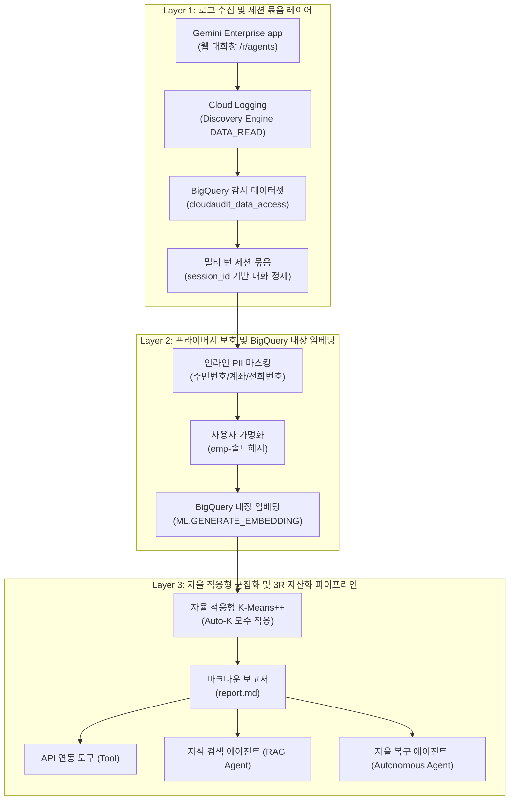

<!--
Copyright 2026 Google LLC. All Rights Reserved.
SPDX-License-Identifier: Apache-2.0

NOTICE: This code/repository is owned by Google LLC and provided under the Apache-2.0 License.
It is strictly provided as an EXAMPLE/REFERENCE ONLY and is NOT INTENDED FOR PRODUCTION USE.
All contents, designs, and code examples are subject to change, modification, or removal at any time without notice.

[고지 사항] 본 저장소 및 문서는 구글 (Google LLC) 소유이며 Apache 2.0 라이선스 하에 예시 (Sample) 용도로 제공된다.
프로덕션 환경용이 아니며, 사전 통지 없이 언제든지 수정, 변경 또는 삭제될 수 있다.
-->

> [!IMPORTANT]
> **구글 (Google LLC) 참조용 샘플 고지 사항**:
> 본 프로젝트의 모든 소스 코드와 문서는 Google LLC의 소유이며, Apache-2.0 라이선스에 따라 오직 **참조용 샘플 (Sample / Reference Only)** 목적으로만 제공된다. 프로덕션 환경에 그대로 사용할 수 없으며, 사전 통지 없이 언제든 내용이 수정, 변경 또는 삭제될 수 있다.

# Gemini Enterprise 프롬프트 마이너 (gemini-enterprise-prompt-miner)

제미나이 엔터프라이즈 앱(Gemini Enterprise app)에 누적된 사용자 질의(Prompt) 로그를 빅쿼리(BigQuery)에서 수집하고, 인라인 PII 마스킹과 멀티 턴 대화 세션 묶음 정제를 거쳐 빅쿼리 내장 임베딩(`ML.GENERATE_EMBEDDING`) 및 자율 적응형(Auto-K) 군집화를 통해 임직원의 실제 3R(반복성 Repetitive, 규칙성 Rule-based, 검색 집약성 Retrieval-heavy) 마이크로 업무를 발굴하고 사내 API 도구(`Tool`) 및 검색/자율 에이전트(`RAG / Autonomous Agent`) 전환 파이프라인을 100% 자동 도출하는 엔터프라이즈 실무 도구다. (As of 2026-10-29)

---

## 1. 발생 증상 및 진단 대상 체크리스트

사내 엔터프라이즈 생성형 AI 거버넌스 및 전사 확산 과정에서 다음과 같은 요구가 있을 때 본 솔루션을 활용한다:
- [ ] **임직원 프라이버시 보호 및 PII 마스킹**: 질의 로그에 포함된 주민등록번호, 계좌번호, 휴대전화번호, 이메일, IP 등 민감 정보의 안전한 인라인 마스킹 및 임직원 식별 정보 비식별화(Pseudonymization)가 필수적일 때
- [ ] **멀티 턴 대화 세션의 단일 업무 단위 묶음 분석**: 2~3턴 이상 이어지는 후속 질문이 단편적으로 쪼개져 오라우팅되는 문제를 방지하고, 세션 전체 워크플로우 컨텍스트를 하나로 묶어 고정밀 군집화를 수행하고자 할 때
- [ ] **빅쿼리(BigQuery) 단일 임베딩 표준 (옵션 파편화 제거)**: 복잡한 외부 SDK나 파편화된 옵션 없이, 데이터가 저장된 빅쿼리 내장 `ML.GENERATE_EMBEDDING` 하나로 안전하고 일관된 임베딩 파이프라인을 완결하고자 할 때
- [ ] **상투적 5대 대분류 탈피 및 실질적 자산화 파이프라인 발굴**: 누구나 상상 가능한 5개 대분류(CS, HR, IT 등)를 넘어, 수십 개의 구체적인 마이크로 업무를 자율 적응형(Auto-K)으로 발굴하여 즉시 구현 가능한 스킬 및 에이전트 전환 목록을 극대화하고자 할 때
- [ ] **현장 실습 프롬프트 원천 확보**: 사내 워크숍이나 핸즈온 세션에서 참가자들에게 배포할 실무 맞춤형 프롬프트 예시를 실제 사내 데이터로부터 추출하고자 할 때

---

## 2. 빠른 시작 (Quickstart)

> [!TIP]
> Cloud Shell 접속 환경 구성 및 저장소 클론(`git clone`) 방법은 루트의 [메인 README](../../README.md)를 참고한다.

### 0) 사내 환경 대화형 설정 (Config Wizard, 선택 사항)
사내 활성 프로젝트 및 환경 설정을 대화형으로 탐색하여 `.env`에 자동 저장한다:
```bash
python diagnose.py --config
```

### 1) 모의 데이터 가상 실행 (Dry-Run)
GCP API 호출 없이 내장된 가상 인프라 및 49종(24개 세션)의 이커머스 실제 업무 질의 데이터셋으로 정상 동작 여부를 즉시 검증한다:
```bash
python diagnose.py --dry-run
```

**터미널 진단 출력 미리보기:**
```text
============================================================================
  Gemini Enterprise 프롬프트 마이너 (3R 마이크로 업무 및 자산화 분석기)
  - 대상 프로젝트 : sample-project-id
  - BigQuery 리전: asia-northeast3
  - 도출 군집 수  : auto (Auto-K 모수 적응형)
  - PII 마스킹    : 활성화 (주민번호, 계좌, 전화번호 등)
  - 멀티 턴 묶음  : 활성화 (세션 워크플로우 단위)
============================================================================
[*] 모의 데이터셋 로드 완료: 총 49건의 실제 질의 샘플

[*] 세션 정제 완료: 49개 원시 질의 -> 24개 대화 세션 (세션당 평균 2.0턴)
[*] 프라이버시 보호: 인라인 PII 4건 마스킹 완료 {'계좌번호': 1, '휴대전화번호': 1, 'IPv4주소': 1, '이메일주소': 1}
[*] 분석 해상도 산정: 최적 마이크로 업무 군집 수 K=12 결정 (상투적 대분류 탈피)

[*] BigQuery 내장 임베딩(ML.GENERATE_EMBEDDING) 생성 중 (총 24개 세션)...
  - 임베딩 벡터 생성 완료.

[*] K-Means++ 클러스터링 알고리즘 실행 중 (K=12)...

============================================================================
  [사내 3R 업무 자동화 발굴 종합 요약] 총 12대 마이크로 파이프라인
============================================================================
  - API 연동 도구 (Tool / Extension) : 6건 (기간계 DB/API 직결)
  - 지식 검색 에이전트 (RAG Agent)   : 4건 (사내 규정/온보딩 비서)
  - 자율 복구 에이전트 (Autonomous)  : 2건 (트랜잭션 자율 복구)
  - 실질 자산화 전환율: 100.0% (12/12 과제 전환 완료)
----------------------------------------------------------------------------
순위  | 마이크로 업무 군집 명칭              | 세션(질의)    | 추천 자산
----------------------------------------------------------------------------
1   | 기획전 및 주말 타임딜 쿠폰 예산 소진 모니터  | 3세션(6건) | 검색 에이전트
2   | 셀러 정산 대금 지연 조회 및 미지급 내역 확  | 3세션(7건) | API 도구
3   | 법인카드 경비 처리 및 해외 출장 여비 정산   | 2세션(4건) | 검색 에이전트
4   | 간편결제 타임아웃 롤백 및 결제 승인 실패 보  | 2세션(4건) | 자율 에이전트
5   | 신규 입사자 VPN 접속 및 개발 계정 연동   | 2세션(4건) | 검색 에이전트
6   | 결제 승인 후 주문서 미생성 건 복구 및 정합  | 2세션(4건) | 자율 에이전트
7   | 스테이징 BigQuery 데이터셋 접근 및 임  | 2세션(4건) | API 도구
8   | 도서산간 및 단순 변심 반품 택배비 환불 규정  | 2세션(4건) | 검색 에이전트
9   | 셀러 정산 대금 지연 조회 및 미지급 내역 확  | 2세션(4건) | API 도구
10  | 휴면 고객 복귀 알림톡 및 개인화 푸시 스케줄  | 2세션(4건) | API 도구
11  | 파손 배송 접수 고객 선환불 및 택배사 클레임  | 1세션(2건) | API 도구
12  | 파손 배송 접수 고객 선환불 및 택배사 클레임  | 1세션(2건) | API 도구
============================================================================

[성공] 마크다운 진단 보고서가 저장되었습니다: report.md
```

### 2) 실제 사내 인프라 실시간 진단
```bash
python diagnose.py
```
> [!NOTE]
> BigQuery 감사 테이블(`gemini_logging.cloudaudit_googleapis_com_data_access`)에서 최근 30일 로그를 세션 단위로 조회하여 BigQuery 내장 임베딩을 생성한다. 로컬 JSONL 파일이 있는 경우 `--input prompts.jsonl` 옵션으로 즉시 분석할 수 있다.

---

## 3. 솔루션 아키텍처 및 처리 흐름



---

## 4. 조치 가이드 및 권장 설정

### 1) Cloud Logging -> BigQuery 감사 로그 싱크 설정
Gemini Enterprise app의 사용자 대화 및 검색 질의를 BigQuery로 자동 적재하기 위해 로그 싱크를 생성한다:
```bash
gcloud logging sinks create gemini-audit-sink \
  bigquery.googleapis.com/projects/${PROJECT_ID}/datasets/gemini_logging \
  --log-filter='logName:"logs/cloudaudit.googleapis.com%2Fdata_access" AND protoPayload.serviceName="discoveryengine.googleapis.com"' \
  --project=${PROJECT_ID}
```

### 2) BigQuery 한국어 임베딩 원격 모델 DDL 등록
BigQuery 내장 SQL에서 한국어 전용 임베딩 모델을 호출하기 위해 Vertex AI 원격 모델을 등록한다:
```sql
-- 1. Vertex AI 외부 연결 생성
CREATE OR REPLACE CONNECTION `asia-northeast3.vertex-ai-conn`
OPTIONS (type = 'CLOUD_RESOURCE');

-- 2. text-multilingual-embedding-002 원격 모델 생성
CREATE OR REPLACE MODEL `gemini_logging.text_multilingual_embedding_002`
REMOTE WITH CONNECTION `asia-northeast3.vertex-ai-conn`
OPTIONS (
  ENDPOINT = 'text-multilingual-embedding-002'
);
```

### 3) 사내 거버넌스 4대 필수 표준 라벨링
BigQuery 데이터세트 및 관련 리소스 생성 시 4대 표준 라벨을 반드시 적용한다:
- `managed-by`: `google-cloud-0-to-1`
- `scenario`: `gemini-enterprise-prompt-miner`
- `env`: `sample` (또는 `poc`)
- `created-by`: `customer-engineer`

---

## 5. 사전 준비 사항 (필요 IAM 권한)

| 역할 (Role) | 역할 ID | 부여 사유 |
| :--- | :--- | :--- |
| **BigQuery Job 사용자** | `roles/bigquery.jobUser` | BigQuery SQL 쿼리 및 내장 임베딩 함수 실행 권한 |
| **BigQuery 데이터 뷰어** | `roles/bigquery.dataViewer` | 프롬프트 감사 로그 테이블 읽기 권한 |
| **Vertex AI 사용자** | `roles/aiplatform.user` | 원격 임베딩 모델 호출 권한 (사내 원격 모델 사용 시) |
| **서비스 사용량 소비자** | `roles/serviceusage.serviceUsageConsumer` | BigQuery 및 Vertex AI 프로젝트 API 할당량 소비 권한 |

---

## 6. 기술적 배경 및 아키텍처 원리 (Deep Dive)

### 1) 한국어 특화 임베딩 모델 (`text-multilingual-embedding-002`)
* **한국어 언어학적 특성 보존**: 영어 중심 모델(`text-embedding-005`)과 달리, 구글 클라우드 공식 GA 다국어 임베딩 모델인 `text-multilingual-embedding-002`는 한국어의 복잡한 교착어 형태소 결합, 종결 어미 변형, 사내 이커머스/도메인 전문 어휘를 의미 손실 없이 포착한다.
* **SQL 네이티브 실행**: 복잡한 클라이언트 SDK 의존성 없이 빅쿼리 `ML.GENERATE_EMBEDDING` 단일 함수로 대량의 텍스트를 초당 수만 건 단위로 신속하게 벡터화한다.

### 2) 벡터 차원 최적화 트레이드오프: 512차원 스위트 스폿 (MRL)
Matryoshka 표현 학습(Matryoshka Representation Learning, MRL)을 활용한 벡터 차원 축소 시, 군집화 성능과 계산 비용 간의 트레이드오프가 존재한다:
* **저차원(128~256차원)의 한계 (과도한 응집, Over-cohesion)**:
  - 심한 정보 압축 손실로 인해 서로 다른 도메인 질의(예: '정산 문의' vs '결제 장애 복구') 간의 각도가 좁아져, 상이한 업무들이 소수의 거대 덩어리(Blob)로 뭉개지는 현상이 발생한다.
* **고차원(768 풀 차원)의 한계 (과도한 분산, Over-dispersion)**:
  - 고차원 유클리드 공간의 '차원의 저주(Curse of Dimensionality)'로 인해 질의들이 의미 공간 전체에 균등하게 흩어져 유의미한 군집을 형성하지 못하고 노이즈로 흩어진다.
* **스위트 스폿 (512차원)**:
  - 512차원은 군집 간 분리도(Separation)와 군집 내 응집도(Cohesion)를 균형 있게 만족하여, 사내 마이크로 업무를 10~30개 단위로 가장 정밀하게 분화해내는 엔터프라이즈 최적 차원이다.

### 3) 멀티 턴 세션 묶음 및 인라인 PII 살균 엔진
* **세션 워크플로우 보존**: 사용자의 2~3턴 후속 질의가 문맥 없이 쪼개져 잡음 군집으로 왜곡되는 현상을 차단하기 위해, `session_id`를 기준으로 단일 대화 스레드를 하나의 업무 컨텍스트로 병합한 후 임베딩을 수행한다.
* **인라인 무손실 PII 살균**: 주민등록번호, 계좌번호, 휴대전화번호, 이메일, 신용카드, IP 주소를 인라인 정규식 엔진으로 실시간 마스킹하고 사용자 계정을 가명(`emp-xxxx`) 처리하여 개인정보보호 컴플라이언스를 완벽히 준수한다.

---

## 7. 리소스 정리 (Teardown) 안내

본 도구는 상주 인프라 비용이 발생하지 않는 일회성 진단 실행기다.
더 이상 분석 보고서가 필요하지 않을 경우 로컬 산출물만 정리한다:
```bash
rm -f report.md prompts.jsonl
```
