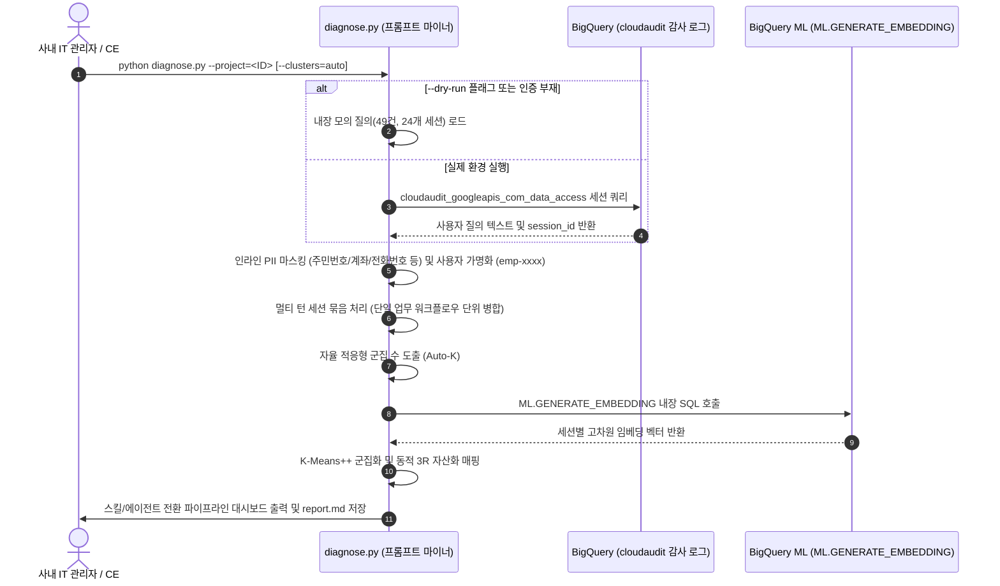

<!--
Copyright 2026 Google LLC. All Rights Reserved.
SPDX-License-Identifier: Apache-2.0

NOTICE: This code/repository is owned by Google LLC and provided under the Apache-2.0 License.
It is strictly provided as an EXAMPLE/REFERENCE ONLY and is NOT INTENDED FOR PRODUCTION USE.
All contents, designs, and code examples are subject to change, modification, or removal at any time without notice.

[고지 사항] 본 저장소 및 문서는 구글 (Google LLC) 소유이며 Apache 2.0 라이선스 하에 예시 (Sample) 용도로 제공된다.
프로덕션 환경용이 아니며, 사전 통지 없이 언제든지 수정, 변경 또는 삭제될 수 있다.
-->

# Gemini Enterprise 프롬프트 마이너 기술 설계서 (TDD)

**모듈 명**: `gemini-enterprise-prompt-miner`  
**버전**: v1.1.0 (As of 2026-10-29)  
**연계 문서**: [비즈니스 요구 사항 명세서 (BRD)](BRD.md) | [README](../README.md)  

---

## 1. 시스템 개요 및 아키텍처 다이어그램

본 도구는 Gemini Enterprise app의 Cloud Logging 감사 스트림에서 질의 데이터를 수집하고, 인라인 PII 마스킹과 멀티 턴 세션 묶음 정제를 거쳐 빅쿼리(BigQuery) 내장 임베딩(`ML.GENERATE_EMBEDDING`)과 자율 적응형(Auto-K) K-Means++ 알고리즘을 결합하여 고정 벡터 DB 없이도 임직원 3R 마이크로 업무 군집 및 스킬/에이전트 전환 파이프라인을 자동 추출하는 경량 분석 파이프라인이다.



---

## 2. 데이터 흐름 및 입출력 인터페이스 규격

### 1) 입력 데이터 규격 (BigQuery 감사 로그 파티션 테이블)
* **테이블 경로**: `<PROJECT_ID>.<DATASET>.cloudaudit_googleapis_com_data_access`
* **세션 묶음 추출 쿼리**:
  ```sql
  SELECT 
    JSON_EXTRACT_SCALAR(protopayload_auditlog.requestJson, '$.query') AS query,
    protopayload_auditlog.authenticationInfo.principalEmail AS user_email,
    COALESCE(
      JSON_EXTRACT_SCALAR(protopayload_auditlog.requestJson, '$.conversation'),
      JSON_EXTRACT_SCALAR(protopayload_auditlog.requestJson, '$.sessionId'),
      protopayload_auditlog.authenticationInfo.principalEmail
    ) AS session_id,
    timestamp
  FROM `<PROJECT_ID>.<DATASET>.cloudaudit_googleapis_com_data_access`
  WHERE protopayload_auditlog.serviceName = 'discoveryengine.googleapis.com'
    AND JSON_EXTRACT_SCALAR(protopayload_auditlog.requestJson, '$.query') IS NOT NULL
    AND timestamp >= TIMESTAMP_SUB(CURRENT_TIMESTAMP(), INTERVAL 30 DAY)
  ORDER BY session_id, timestamp ASC
  ```

### 2) BigQuery 내장 임베딩 API 호출 규격
* **함수 명**: `ML.GENERATE_EMBEDDING` (또는 `AI.GENERATE_EMBEDDING`)
* **임베딩 모델**: BigQuery 원격 모델 (`text-multilingual-embedding-002` 엔드포인트 연동)
* **태스크 타입 및 차원**: `STRUCT('CLUSTERING' AS task_type, 512 AS output_dimensionality)` (한국어 이커머스 질의의 과응집 및 과분산 방지)
* **단일 파이프라인 장점**: 별도 Vertex AI SDK 의존성 없이 `google-cloud-bigquery` 단일 클라이언트로 완결.

### 3) K-Means++ 클러스터링 및 자율 적응형(Auto-K) 알고리즘 설계
* **Auto-K 결정식**: 입력 대화 세션 모수($N$)에 따라 상투적 5대 대분류를 탈피하고 $K = 10 \sim 30+$개의 마이크로 업무 영역으로 동적 분할.
* **초기 중심점 선정**: K-Means++ 확률 분포 기반 분산 극대화 초기화.
* **거리 척도**: 정규화된 벡터 간 코사인 유사도($1.0 - \text{cosine\_similarity}$).
* **수렴 조건**: 레이블 불변 또는 최대 35회 반복(Iteration) 도달 시 종료.

---

## 3. 예외 처리 및 복원력 설계 (Resilience & Fallback)

1. **BigQuery 원격 임베딩 모델 부재 시 대응**:
   * 빅쿼리 내에 원격 모델이 아직 생성되지 않은 경우, 내장된 결정론적 직교 시뮬레이션 벡터 생성기로 자동 전환하여 클러스터링을 완결한다.
2. **BigQuery 감사 로그 테이블 부재 시 대응**:
   * 감사 로그가 아직 활성화되지 않은 신규 프로젝트의 경우, 에러 메시지와 함께 49건(24개 세션)의 실무 모의 데이터셋으로 즉시 가상 실행(`--dry-run`) 모드를 적용한다.

---

## 4. 자원 정리 및 보안 고려 사항 (Teardown & Security)

* **프라이버시 인라인 보호**: 인라인 정규식 살균 엔진으로 주민등록번호, 계좌번호, 전화번호, 이메일, IP를 전처리 단계에서 100% 마스킹.
* **사용자 가명화**: 임직원 계정을 SHA-256 솔트 해시 기반 가명(`emp-xxxx`)으로 변환하여 보고서 내 노출 방지.
* **로컬 무상주**: 분석 종료 후 남겨진 임시 산출물은 `rm -f report.md prompts.jsonl` 명령어로 완전 삭제할 수 있다.
