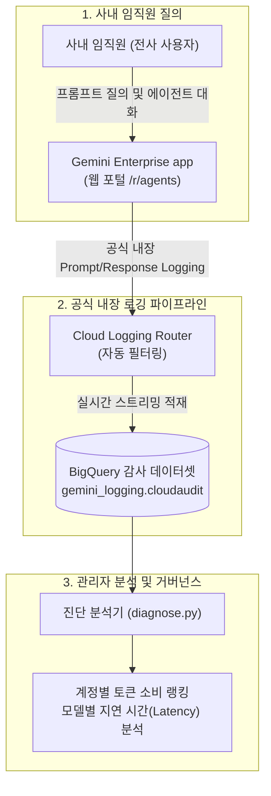

<!--
Copyright 2026 Google LLC. All Rights Reserved.
SPDX-License-Identifier: Apache-2.0

NOTICE: This code/repository is owned by Google LLC and provided under the Apache-2.0 License.
It is strictly provided as an EXAMPLE/REFERENCE ONLY and is NOT INTENDED FOR PRODUCTION USE.
All contents, designs, and code examples are subject to change, modification, or removal at any time without notice.

[고지 사항] 본 저장소 및 문서는 구글 (Google LLC) 소유이며 Apache 2.0 라이선스 하에 예시 (Sample) 용도로 제공된다.
프로덕션 환경용이 아니며, 사전 통지 없이 언제든지 수정, 변경 또는 삭제될 수 있다.
-->

> [!IMPORTANT]
> **구글 (Google LLC) 참조용 샘플 고지 사항**:
> 본 프로젝트의 모든 소스 코드와 문서는 Google LLC의 소유이며, Apache-2.0 라이선스에 따라 오직 **참조용 샘플 (Sample / Reference Only)** 목적으로만 제공된다. 프로덕션 환경에 그대로 사용할 수 없으며, 사전 통지 없이 언제든 내용이 수정, 변경 또는 삭제될 수 있다.

# Gemini Enterprise 공식 프롬프트/응답 로깅 및 계정별 사용량 분석기 (gemini-enterprise-usage-by-account)

제미나이 엔터프라이즈 앱(Gemini Enterprise app) 관리 콘솔의 공식 내장 '프롬프트 및 응답 로깅(Prompt & Response Logging)' 기능을 활성화하고, 빅쿼리(BigQuery)로 자동 적재되는 정품 로그 데이터를 집계하여 계정별 프롬프트 호출량과 토큰 소모량을 1분 만에 분석하는 엔터프라이즈 공식 가이드다. (As of 2026-10-17)

---

## 1. 발생 증상 및 진단 대상 체크리스트

사내 또는 고객사 환경에서 아래 증상이 발생한다면 즉시 진단 대상이다:
사내 엔터프라이즈 생성형 AI 거버넌스 및 비용 관리에서 다음과 같은 요구가 있을 때 본 솔루션을 활용한다:
- [ ] **계정별/부서별 토큰 소모량 추적**: 전사 배포된 Gemini Enterprise app 환경에서 어떤 부서나 계정이 토큰을 많이 소모하는지 정밀하게 측정 및 내부 정산하고자 할 때
- [ ] **프롬프트 및 모델 응답 감사**: 사내 규정 준수 및 보안 감사를 위해 임직원이 입력한 프롬프트와 모델의 답변 텍스트를 영구 보존하고자 할 때
- [ ] **복잡한 수작업 로그 파이프라인 탈피**: 별도의 로깅 프록시 서버나 복잡한 로그 싱크 설정 없이, 구글 공식 관리형 로깅 기능으로 원클릭 전환하고자 할 때
- [ ] **토큰 통계 및 응답 지연 시간 분석**: 사용자별 총 토큰량과 평균 응답 지연 시간(Latency)을 단일 SQL로 즉시 확인하고자 할 때

---

## 2. 빠른 시작 (Quickstart)

> [!TIP]
> Cloud Shell 접속 환경 구성 및 저장소 클론(`git clone`) 방법은 루트의 [메인 README](../../README.md)를 참고한다.

### 1) 모의 데이터 가상 실행 (Dry-Run)
GCP API 호출 없이 내장된 가상 인프라 데이터로 정상 동작 여부를 즉시 검증한다:
```bash
python diagnose.py --dry-run
```

**터미널 진단 출력 미리보기:**
```text
[가상 실행] --dry-run 모드가 활성화되어 Gemini Enterprise app 공식 로깅 집계를 시뮬레이션한다.
========================================================================
  Gemini Enterprise 공식 프롬프트 로깅 기반 계정별 토큰 사용량 진단
  - 대상 프로젝트      : sample-project-id
  - BigQuery 데이터세트: gemini_enterprise_logs
  - 분석 대상 기간    : 최근 7일
========================================================================
[Gemini Enterprise app 공식 로깅 수집 기반 사용자별 프롬프트 호출 및 토큰 사용량 순위]
┌───────────────────────────────────────────┬────────────┬──────────────────┬─────────────────┬──────────────────┬──────────────┐
│ 사용자 계정 (User Identity)               │ 호출 횟수  │ 입력 토큰 합계   │ 출력 토큰 합계  │ 총 토큰 사용량   │ 평균 지연시간│
```

### 2) 실제 사내 인프라 실시간 진단
```bash
cp .env.example .env
python diagnose.py
```
> [!NOTE]
> `.env` 설정값을 비워두면 gcloud 활성 설정 및 사내 리소스를 자동으로 감지하여 진단한다.

---

## 3. 내장 로깅 파이프라인 및 BigQuery 분석 아키텍처



---

## 4. 조치 가이드 및 권장 설정

- **Gemini Enterprise 관리 콘솔**: 사내 Gemini Enterprise app 프롬프트 및 응답 로깅 활성화 설정 ( https://gemini.google.com )
- **BigQuery 콘솔**: 수집된 Gemini Enterprise app 로그 테이블 확인 및 맞춤형 대시보드 연동 ( https://console.cloud.google.com/bigquery )
- **IAM 및 관리자 콘솔**: 로그 분석 담당자 BigQuery 뷰어 권한 확인 ( https://console.cloud.google.com/iam-admin/iam )

---
## 5. 사전 준비 사항 (필요 IAM 권한)

본 도구를 실행하려면 최소 아래의 IAM 권한이 필요하다:

BigQuery 로그 데이터세트 조회 및 진단 쿼리 실행을 위한 최소 권한(Least Privilege)은 다음과 같다:

| 역할 (Role) | 권한 ID | 용도 및 최소 권한 세부 사항 |
| :--- | :--- | :--- |
| `roles/bigquery.dataViewer` | 분석 실행 계정 | 수집된 BigQuery 로그 테이블 및 스키마 읽기 |
| `roles/bigquery.jobUser` | 분석 실행 계정 | 계정별 토큰 집계 쿼리 작업(Job) 실행 |

> [!NOTE]
> `--dry-run` 모드로 실행할 경우 실제 구글 클라우드 IAM 권한이나 BigQuery 접속 없이도 완벽한 집계 SQL 쿼리와 모의 분석 리포트를 0.5초 만에 확인할 수 있다.

---

## 6. 기술적 배경 및 아키텍처 원리 (Deep Dive)

### 관련 상세 설계 및 요구 사항 명세
- [비즈니스 요구 사항 명세서 (BRD)](docs/BRD.md): 비즈니스 배경, 성공 지표 및 요구 사항(BR-01~) 명세
- [기술 상세 설계서 (TDD)](docs/TDD.md): 시스템 아키텍처, 기능(FR-01~) 및 비기능(NFR-01~) 설계 명세

- **Gemini Enterprise 관리 콘솔**: 사내 Gemini Enterprise app 프롬프트 및 응답 로깅 활성화 설정 ( https://gemini.google.com )
- **BigQuery 콘솔**: 수집된 Gemini Enterprise app 로그 테이블 확인 및 맞춤형 대시보드 연동 ( https://console.cloud.google.com/bigquery )
- **IAM 및 관리자 콘솔**: 로그 분석 담당자 BigQuery 뷰어 권한 확인 ( https://console.cloud.google.com/iam-admin/iam )

---
## 7. 리소스 정리 (Teardown) 안내

본 솔루션은 구글 공식 관리형 로깅 기능을 활용하므로 별도의 상주 가상머신(VM)이나 서버리스 인스턴스가 존재하지 않는다.
더 이상 로깅이 필요하지 않을 경우 아래 절차를 수행한다:

1. **Gemini Enterprise app 로깅 비활성화**:
   - Gemini Enterprise app 관리 콘솔 > [Settings] > [Audit & Compliance]에서 'Prompt & Response Logging' 토글을 OFF로 전환한다.
2. **BigQuery 로그 데이터세트 정리 (선택 사항)**:
   ```bash
   bq rm -r -f -d ${PROJECT_ID}:gemini_enterprise_logs
   ```
