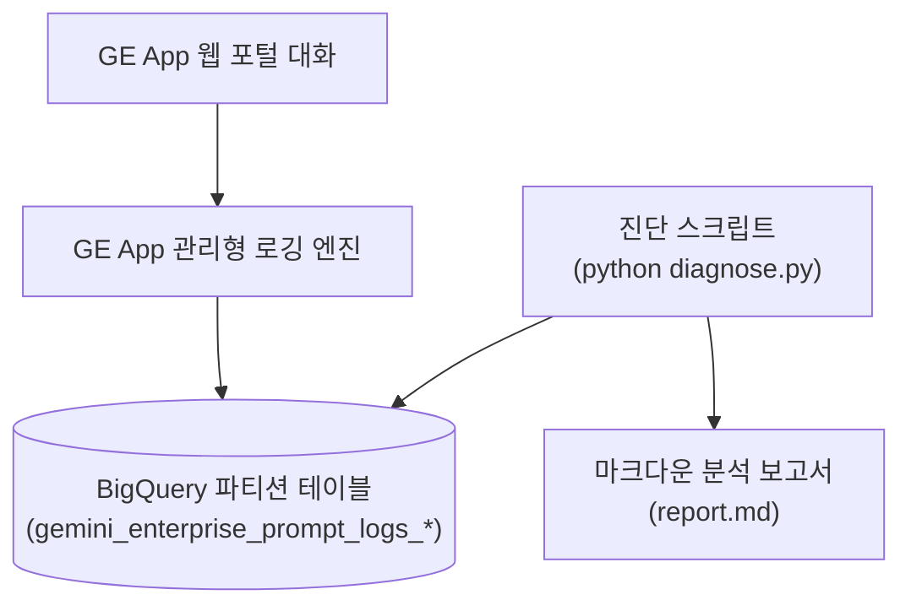

<!--
Copyright 2026 Google LLC. All Rights Reserved.
SPDX-License-Identifier: Apache-2.0

NOTICE: This code/repository is owned by Google LLC and provided under the Apache-2.0 License.
It is strictly provided as an EXAMPLE/REFERENCE ONLY and is NOT INTENDED FOR PRODUCTION USE.
All contents, designs, and code examples are subject to change, modification, or removal at any time without notice.

[고지 사항] 본 저장소 및 문서는 구글 (Google LLC) 소유이며 Apache 2.0 라이선스 하에 예시 (Sample) 용도로 제공된다.
프로덕션 환경용이 아니며, 사전 통지 없이 언제든지 수정, 변경 또는 삭제될 수 있다.
-->

# Gemini Enterprise 공식 프롬프트/응답 로깅 및 계정별 사용량 분석기 기술 상세 설계서 (TDD)

본 문서는 사내 제미나이 엔터프라이즈 앱(Gemini Enterprise app, 이하 GE app) 공식 내장 로깅 데이터를 빅쿼리(BigQuery)에서 집계 분석하기 위한 시스템 아키텍처, 기술 상세 설계, 인터페이스 명세 및 검증 계획을 정의한다.

---

## 1. 시스템 아키텍처 및 처리 흐름

본 도구는 GE App 관리형 엔진이 BigQuery로 스트리밍 적재한 테이블을 순수 파이썬 단일 스크립트(`diagnose.py`)로 분석 및 리포팅하는 아키텍처다.

---

## 2. 요구 사항 추적성 매핑 (Traceability Matrix)

| 비즈니스 요구 사항 (BRD) | 기능적 기술 요구 사항 (FR) | 비기능적 기술 요구 사항 (NFR) | 구현 파일 및 모듈 |
| :--- | :--- | :--- | :--- |
| **BR-01** (공식 로깅 활성화) | **FR-01** (공식 로깅 콘솔 안내) | **NFR-01** (단일 파이썬 무의존성 실행) | `diagnose.py`, `README.md` |
| **BR-02** (계정별 토큰 집계) | **FR-02** (BigQuery 표준 집계 SQL) | **NFR-02** (초경량 단일 파일 완결성) | `diagnose.py` |
| **BR-03** (가상 실행 검증) | **FR-03** (결정론적 가상 실행 모드) | **NFR-03** (사내 식별 정보 마스킹) | `diagnose.py` |
| **BR-04** (최소 권한 및 무중단) | **FR-04** (IAM 권한 진단 및 리포트) | **NFR-01**, **NFR-03** | `diagnose.py`, `report.md` |

---

## 3. 기능 기술 요구 사항 명세 (Functional Requirements)

### FR-01: GE App 공식 내장 로깅 설정 안내
- GE App 관리 콘솔(`Settings > Audit & Compliance`)에서 BigQuery 직접 내보내기를 활성화하는 4단계 절차를 문서 및 리포트에 안내한다.

### FR-02: BigQuery 공식 집계 SQL 생성 및 실행
- 사용자 계정(`user_email`), 요청 수, 입력 토큰, 출력 토큰, 총 토큰, 평균 지연시간을 일자별 파티션 필터(`_TABLE_SUFFIX`)를 적용하여 1분 내에 산출하는 최적화된 SQL을 제공한다.

### FR-03: 결정론적 가상 실행(--dry-run) 스모크 테스트
- `--dry-run` 플래그 입력 시 실제 BigQuery 호출 없이 내장된 가상 데이터를 기반으로 전체 분석 테이블 및 SQL을 0.5초 이내에 출력한다.
- 가상 실행 시 사내 프로젝트 ID를 가명(`sample-project-id`)으로 철저히 마스킹한다.

### FR-04: 표준 마크다운 리포트 자동 생성 및 덮어쓰기
- 진단 실행 결과를 바탕으로 사내 공유 및 복습용 `report.md`를 표준 규격으로 자동 생성 및 갱신한다.

---

## 4. 비기능 기술 요구 사항 명세 (Non-Functional Requirements)

### NFR-01: 무의존성 및 순수 파이썬 단일 실행 원칙
- 외부 쉘 스크립트 없이 `python diagnose.py` 직접 실행만으로 완결한다.

### NFR-02: 최소 IAM 권한 준수
- 분석에 필요한 최소 권한(`roles/bigquery.dataViewer`, `roles/bigquery.jobUser`)만을 요구한다.

### NFR-03: 사내 식별 정보 비식별화
- 코드 및 리포트에 실제 사내 프로젝트 ID나 개인정보가 노출되지 않도록 가명 처리를 철저히 준수한다.
