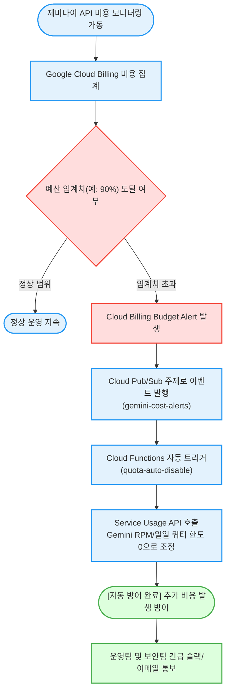

<!--
Copyright 2026 Google LLC. All Rights Reserved.
SPDX-License-Identifier: Apache-2.0

NOTICE: This code/repository is owned by Google LLC and provided under the Apache-2.0 License.
It is strictly provided as an EXAMPLE/REFERENCE ONLY and is NOT INTENDED FOR PRODUCTION USE.
All contents, designs, and code examples are subject to change, modification, or removal at any time without notice.

[고지 사항] 본 저장소 및 문서는 구글 (Google LLC) 소유이며 Apache 2.0 라이선스 하에 예시 (Sample) 용도로 제공된다.
프로덕션 환경용이 아니며, 사전 통지 없이 언제든지 수정, 변경 또는 삭제될 수 있다.
-->

> [!IMPORTANT]
> **구글 (Google LLC) 참조용 샘플 고지 사항**:
> 본 프로젝트의 모든 소스 코드와 문서는 Google LLC의 소유이며, Apache-2.0 라이선스에 따라 오직 **참조용 샘플 (Sample / Reference Only)** 목적으로만 제공된다. 프로덕션 환경에 그대로 사용할 수 없으며, 사전 통지 없이 언제든 내용이 수정, 변경 또는 삭제될 수 있다.

# 제미나이(Gemini) API 비용 및 쿼터 임계치 실시간 경보 자동화 진단기 (`gemini-quota-cost-alert`)

제미나이(Gemini) API 비용 급증 및 예산 임계치 도달 시, 클라우드 펍/섭(Cloud Pub/Sub)과 클라우드 펑션스(Cloud Functions)를 연동하여 **실시간 경보를 전송하고 API 쿼터 한도를 자동으로 0으로 차단하는 안전 아키텍처**를 검증 및 시뮬레이션하는 도구다. (As of 2026-10-17)

---

## 1. 발생 증상 및 진단 대상 체크리스트

사내 또는 고객사 환경에서 아래 증상이 발생한다면 즉시 진단 대상이다:
- [ ] **비용 급증 방어**: 비인가 호출이나 잘못 작성된 루프 코드로 인해 예산 상한을 초과했을 때 자동으로 서비스를 일시 차단하고자 할 때
- [ ] **실시간 예산 알림 연동**: 단순 이메일 알림을 넘어 Pub/Sub 메시징 큐로 실시간 예산 초과 이벤트를 수신하여 사내 슬랙이나 모니터링 시스템과 연동하고자 할 때
- [ ] **사전 파이프라인 모의 검증**: 실제 과금이나 서비스 중단 없이 예산 초과 이벤트 페이로드와 차단 로직이 정상 작동하는지 가상 시뮬레이션으로 테스트하고자 할 때

---

## 2. 빠른 시작 (Quickstart)

### 1) 모의 데이터 가상 실행 (Dry-Run)
GCP API 호출 없이 내장된 가상 인프라 데이터로 정상 동작 여부를 즉시 검증한다:
```bash
python diagnose.py --dry-run
```

**터미널 진단 출력 미리보기:**
```text
========================================================================
[진단 시작] 제미나이(Gemini) API 실시간 비용 및 할당량 경보 아키텍처 점검
  - 프로젝트 ID: sample-project-id
  - Pub/Sub 주제: gemini-cost-alerts
  - 예산 규칙명: gemini-budget-alert
========================================================================
[데모 실행] --dry-run 가상 실행 모드가 활성화되었다.
========================================================================
[표준 처방] 비용 초과 시 자동 할당량(Quota) 차단 Cloud Functions 가이드
========================================================================
```

### 2) 실제 사내 인프라 실시간 진단
```bash
cp .env.example .env
python diagnose.py
```
> [!NOTE]
> `.env` 설정값을 비워두면 gcloud 활성 설정 및 사내 리소스를 자동으로 감지하여 진단한다.

---

## 3. 진단 및 해결 흐름



---
## 4. 조치 가이드 및 권장 설정

- **Cloud Billing 콘솔**: ( https://console.cloud.google.com/billing )
- **Cloud Pub/Sub 콘솔**: ( https://console.cloud.google.com/cloudpubsub )
- **Cloud Functions 콘솔**: ( https://console.cloud.google.com/functions )
- **Cloud Billing 예산 및 지출 한도 알림 생성**: ( https://docs.cloud.google.com/billing/docs/how-to/budgets )
- **Cloud Billing Pub/Sub 예산 알림 연동 가이드**: ( https://docs.cloud.google.com/billing/docs/how-to/notify )

---
## 5. 사전 준비 사항 (필요 IAM 권한)

본 도구를 실행하려면 최소 아래의 IAM 권한이 필요하다:

실제 리소스를 배포하거나 설정을 점검할 때 필요한 역할(Role) 목록이다:

| 역할 (Role) | 권한 ID | 용도 |
| : | : | : |
| **클라우드 빌링 관리자 (또는 뷰어)** | `roles/billing.costsManager` 또는 `roles/billing.viewer` | 결제 예산 규칙 확인 및 생성 |
| **클라우드 펍/섭 관리자** | `roles/pubsub.admin` | 알림 전달용 Cloud Pub/Sub 주제 생성 및 메시지 테스트 |
| **클라우드 펑션스 개발자** | `roles/cloudfunctions.developer` | 자동 차단 Cloud Functions 배포 |

> [!NOTE]
> `--dry-run` 모드로 실행할 경우 실제 클라우드 리소스 생성이나 IAM 권한 없이도 파이프라인 구조와 페이로드 스키마를 즉시 확인할 수 있다.

---

## 6. 기술적 배경 및 아키텍처 원리 (Deep Dive)

스크립트가 완료되면 아래와 같이 **파이프라인 설계 가이드 및 모의 이벤트 페이로드**가 출력된다:

```text
========================================================================
[진단 시작] 제미나이(Gemini) API 실시간 비용 및 할당량 경보 아키텍처 점검
  - 프로젝트 ID: my-prod-project
  - Pub/Sub 주제: gemini-cost-alerts
  - 예산 규칙명: gemini-budget-alert
========================================================================

[표준 처방] 비용 초과 시 자동 할당량(Quota) 차단 Cloud Functions 가이드
...

========================================================================
[시뮬레이션] 가상 예산 초과 이벤트 페이로드 생성
========================================================================
{
  "billingAccountId": "012345-6789AB-CDEF01",
  "budgetDisplayName": "gemini-budget-alert",
  "costAmount": 120.0,
  "costIntervalStart": "2026-06-01T00:00:00Z",
  "budgetAmount": 100.0,
  "alertThresholdExceeded": 1.2,
  "currencyCode": "USD"
}
------------------------------------------------------------------------

[자원 정리 안내 (Teardown Guide)]
테스트 완료 후 요금 발생 및 불필요한 자원 잔존을 방지하기 위해 아래 명령어로 삭제한다:
  1. Pub/Sub 주제 삭제: gcloud pubsub topics delete gemini-cost-alerts --project=my-prod-project
  2. Cloud Functions 삭제: gcloud functions delete quota-auto-disable --region=asia-northeast3
  3. 예산 규칙 삭제: GCP 결제 콘솔 ( https://console.cloud.google.com/billing ) '예산 및 알림' 메뉴에서 'gemini-budget-alert' 삭제
========================================================================
```

---
## 7. 리소스 정리 (Teardown) 안내

실습 및 테스트가 끝난 후 불필요한 과금과 리소스 누수를 방지하기 위해 생성한 자원을 아래 순서로 반드시 정리한다:

```bash
# 1. Pub/Sub 알림 주제 삭제
gcloud pubsub topics delete gemini-cost-alerts --project=YOUR_PROJECT_ID

# 2. Cloud Functions 자동 차단 함수 삭제
gcloud functions delete quota-auto-disable --region=asia-northeast3 --project=YOUR_PROJECT_ID

# 3. 결제 예산 규칙 정리
# GCP 결제 콘솔 ( https://console.cloud.google.com/billing ) 에 접속하여 '예산 및 알림' 메뉴에서 생성한 예산 규칙을 삭제한다.
```
