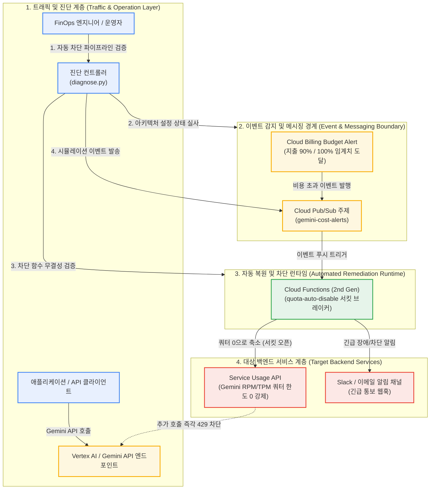

<!--
Copyright 2026 Google LLC. All Rights Reserved.
SPDX-License-Identifier: Apache-2.0

NOTICE: This code/repository is owned by Google LLC and provided under the Apache-2.0 License.
It is strictly provided as an EXAMPLE/REFERENCE ONLY and is NOT INTENDED FOR PRODUCTION USE.
All contents, designs, and code examples are subject to change, modification, or removal at any time without notice.

[고지 사항] 본 저장소 및 문서는 구글 (Google LLC) 소유이며 Apache 2.0 라이선스 하에 예시 (Sample) 용도로 제공된다.
프로덕션 환경용이 아니며, 사전 통지 없이 언제든지 수정, 변경 또는 삭제될 수 있다.
-->

> [!IMPORTANT]
> **구글 (Google LLC) 참조용 샘플 고지 사항**:
> 본 프로젝트의 모든 소스 코드와 문서는 Google LLC의 소유이며, Apache-2.0 라이선스에 따라 오직 **참조용 샘플 (Sample / Reference Only)** 목적으로만 제공된다. 프로덕션 환경에 그대로 사용할 수 없으며, 사전 통지 없이 언제든 내용이 수정, 변경 또는 삭제될 수 있다.

# 제미나이(Gemini) API 비용 및 쿼터 임계치 실시간 경보 자동화 진단기 (`gemini-quota-cost-alert`)

제미나이(Gemini) API 비용 급증 및 예산 임계치 도달 시, 클라우드 펍/섭(Cloud Pub/Sub)과 클라우드 펑션스(Cloud Functions)를 연동하여 **실시간 경보를 전송하고 API 쿼터 한도를 자동으로 0으로 차단하는 안전 아키텍처**를 검증 및 시뮬레이션하는 도구다. (As of 2026-10-17)

---

## 1. 발생 증상 및 진단 대상 체크리스트

사내 또는 고객사 환경에서 아래 증상이 발생한다면 즉시 진단 대상이다:
- [ ] **비용 급증 방어**: 비인가 호출이나 잘못 작성된 루프 코드로 인해 예산 상한을 초과했을 때 자동으로 서비스를 일시 차단하고자 할 때
- [ ] **실시간 예산 알림 연동**: 단순 이메일 알림을 넘어 Pub/Sub 메시징 큐로 실시간 예산 초과 이벤트를 수신하여 사내 슬랙이나 모니터링 시스템과 연동하고자 할 때
- [ ] **사전 파이프라인 모의 검증**: 실제 과금이나 서비스 중단 없이 예산 초과 이벤트 페이로드와 차단 로직이 정상 작동하는지 가상 시뮬레이션으로 테스트하고자 할 때


### 1.1 도구의 본질 및 비즈니스 해결 과제 (What & Why)
- **대상 사용자 (Target)**: 클라우드 FinOps 리드, 인프라 운영팀, 결제 계정 관리자 및 SRE 엔지니어
- **해결하는 핵심 문제 (Core Pain Points)**:
  1. 개발자의 코드 버그나 악의적인 호출 폭증으로 인해 수 시간 만에 수천만 원의 Gemini API 비용이 폭증하는 사고 위험
  2. GCP 예산 알림이 이메일로만 발송되어 야간이나 주말에 담당자가 확인하지 못해 골든타임을 놓치는 문제
  3. 예산 초과 시 수동 개입 없이 자동으로 API 호출을 차단하는 안전 아키텍처(Circuit Breaker)의 부재
- **본 솔루션의 해결 방식 (Solution)**:
  - Cloud Billing 예산 알림과 Cloud Pub/Sub, Cloud Functions 2세대를 결합하여, 예산 임계치(90% 또는 100%) 도달 시 실시간 알림을 발송하고 Service Usage API를 통해 Gemini API 쿼터를 자동으로 0으로 차단하는 안전망을 검증 및 시뮬레이션한다.

### 1.2 최종 산출물 3종 세트 미리보기 (Deliverables & Visual Preview)
본 도구를 실행(`python diagnose.py`)하면 다음 3가지 구체적인 엔터프라이즈 자산이 생성된다:

| 산출물 구분 | 산출물 형태 및 명칭 | 주요 포함 내용 및 실무 활용 방안 |
| :--- | :--- | :--- |
| **① 터미널 콘솔 요약** | Visual CLI Table | 프로젝트 결제 계정 연동 상태, Pub/Sub 토픽 및 Cloud Functions 배포 명세, 가상 예산 초과 이벤트 검증 결과 |
| **② 정규 진단 보고서** | 마크다운 파일 (`report.md`) | 비용 폭증 자동 차단 아키텍처 설계서, Cloud Functions 2세대 자동 차단 파이썬 코드, 배포 CLI 명령어 및 Teardown 가이드 |
| **③ 후속 조치 및 배포 자산** | Actionable Asset Specs | • **자동 차단 파이썬 핸들러 (`main.py`)**: 쿼터를 0으로 즉시 조정하는 서버리스 함수 소스 코드<br/>• **Cloud Functions 2세대 배포 스크립트**: Pub/Sub 트리거 및 4대 필수 라벨이 주입된 gcloud 명령<br/>• **예산 알림 Pub/Sub 연동 가이드**: Cloud Billing 콘솔에서 웹훅 알림을 구성하는 정형 절차서 |

---

## 2. 빠른 시작 (Quickstart)

> [!TIP]
> Cloud Shell 접속 환경 구성 및 저장소 클론(`git clone`) 방법은 루트의 [메인 README](../../README.md)를 참고한다.

### 1) 모의 데이터 가상 실행 (Dry-Run)
GCP API 호출 없이 내장된 가상 인프라 데이터로 정상 동작 여부를 즉시 검증한다:
```bash
python diagnose.py --dry-run
```

**터미널 진단 출력 미리보기:**
```text
========================================================================
[진단 시작] 제미나이(Gemini) API 실시간 비용 및 할당량 경보 아키텍처 점검
  - 프로젝트 ID: sample-project-id
  - Pub/Sub 주제: gemini-cost-alerts
  - 예산 규칙명: gemini-budget-alert
========================================================================
[데모 실행] --dry-run 가상 실행 모드가 활성화되었다.
========================================================================
[표준 처방] 비용 초과 시 자동 할당량(Quota) 차단 Cloud Functions 가이드
========================================================================
```


### 2) 사내 환경 대화형 설정 (Config Wizard, 선택 사항)
사내 활성 프로젝트 및 환경 설정을 대화형으로 탐색하여 `.env`에 자동 저장한다:
```bash
python diagnose.py --config
```


### 3) 실제 사내 인프라 실시간 진단
```bash
python diagnose.py
```
> [!NOTE]
> 앞서 `python diagnose.py --config`로 환경 설정을 저장했거나 gcloud 활성 설정을 그대로 활용할 경우 별도의 `.env` 생성 없이 즉시 실행할 수 있다. (환경 변수를 텍스트 에디터로 직접 수동 편집하고자 할 때만 `cp -n .env.example .env` 실행 후 수정)

---

## 3. 솔루션 아키텍처 및 런타임 토폴로지

본 도구는 Cloud Billing 예산 임계치 도달 시 Pub/Sub과 Cloud Functions를 통해 Gemini API 쿼터를 자동으로 0으로 차단하는 4계층 서킷 브레이커 토폴로지를 제공한다:



---
## 4. 조치 가이드 및 권장 설정

- **Cloud Billing 콘솔**: ( https://console.cloud.google.com/billing )
- **Cloud Pub/Sub 콘솔**: ( https://console.cloud.google.com/cloudpubsub )
- **Cloud Functions 콘솔**: ( https://console.cloud.google.com/functions )
- **Cloud Billing 예산 및 지출 한도 알림 생성**: ( https://docs.cloud.google.com/billing/docs/how-to/budgets )
- **Cloud Billing Pub/Sub 예산 알림 연동 가이드**: ( https://docs.cloud.google.com/billing/docs/how-to/notify )

---
## 5. 사전 준비 사항 (필요 IAM 권한)

본 도구를 실행하려면 최소 아래의 IAM 권한이 필요하다:

실제 리소스를 배포하거나 설정을 점검할 때 필요한 역할(Role) 목록이다:

| 역할 (Role) | 권한 ID | 용도 |
| :--- | :--- | :--- |
| **클라우드 빌링 관리자 (또는 뷰어)** | `roles/billing.costsManager` 또는 `roles/billing.viewer` | 결제 예산 규칙 확인 및 생성 |
| **클라우드 펍/섭 관리자** | `roles/pubsub.admin` | 알림 전달용 Cloud Pub/Sub 주제 생성 및 메시지 테스트 |
| **클라우드 펑션스 개발자** | `roles/cloudfunctions.developer` | 자동 차단 Cloud Functions 배포 |

> [!NOTE]
> `--dry-run` 모드로 실행할 경우 실제 클라우드 리소스 생성이나 IAM 권한 없이도 파이프라인 구조와 페이로드 스키마를 즉시 확인할 수 있다.

---

## 6. 기술적 배경 및 아키텍처 원리 (Deep Dive)

### 관련 상세 설계 및 요구 사항 명세
- [비즈니스 요구 사항 명세서 (BRD)](docs/BRD.md): 비즈니스 배경, 성공 지표 및 요구 사항(BR-01~) 명세
- [기술 상세 설계서 (TDD)](docs/TDD.md): 시스템 아키텍처, 기능(FR-01~) 및 비기능(NFR-01~) 설계 명세

스크립트가 완료되면 아래와 같이 **파이프라인 설계 가이드 및 모의 이벤트 페이로드**가 출력된다:

```text
========================================================================
[진단 시작] 제미나이(Gemini) API 실시간 비용 및 할당량 경보 아키텍처 점검
  - 프로젝트 ID: my-prod-project
  - Pub/Sub 주제: gemini-cost-alerts
  - 예산 규칙명: gemini-budget-alert
========================================================================

[표준 처방] 비용 초과 시 자동 할당량(Quota) 차단 Cloud Functions 가이드
...

========================================================================
[시뮬레이션] 가상 예산 초과 이벤트 페이로드 생성
========================================================================
{
  "billingAccountId": "012345-6789AB-CDEF01",
  "budgetDisplayName": "gemini-budget-alert",
  "costAmount": 120.0,
  "costIntervalStart": "2026-06-01T00:00:00Z",
  "budgetAmount": 100.0,
  "alertThresholdExceeded": 1.2,
  "currencyCode": "USD"
}
------------------------------------------------------------------------

[자원 정리 안내 (Teardown Guide)]
테스트 완료 후 요금 발생 및 불필요한 자원 잔존을 방지하기 위해 아래 명령어로 삭제한다:
  1. Pub/Sub 주제 삭제: gcloud pubsub topics delete gemini-cost-alerts --project=my-prod-project
  2. Cloud Functions 삭제: gcloud functions delete quota-auto-disable --region=asia-northeast3
  3. 예산 규칙 삭제: GCP 결제 콘솔 ( https://console.cloud.google.com/billing ) '예산 및 알림' 메뉴에서 'gemini-budget-alert' 삭제
========================================================================
```

---
## 7. 리소스 정리 (Teardown) 안내

실습 및 테스트가 끝난 후 불필요한 과금과 리소스 누수를 방지하기 위해 생성한 자원을 아래 순서로 반드시 정리한다:

```bash
# 1. Pub/Sub 알림 주제 삭제
gcloud pubsub topics delete gemini-cost-alerts --project=YOUR_PROJECT_ID

# 2. Cloud Functions 자동 차단 함수 삭제
gcloud functions delete quota-auto-disable --region=asia-northeast3 --project=YOUR_PROJECT_ID

# 3. 결제 예산 규칙 정리
# GCP 결제 콘솔 ( https://console.cloud.google.com/billing ) 에 접속하여 '예산 및 알림' 메뉴에서 생성한 예산 규칙을 삭제한다.
```
