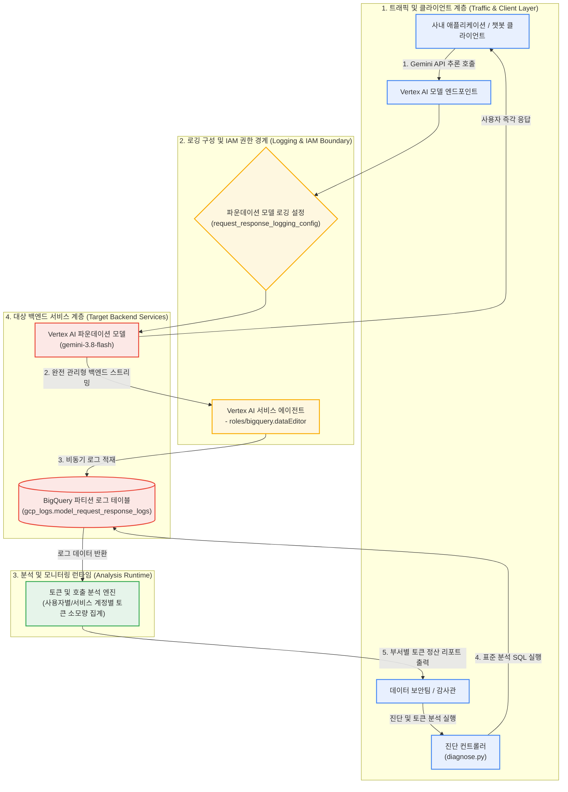

<!--
Copyright 2026 Google LLC. All Rights Reserved.
SPDX-License-Identifier: Apache-2.0

NOTICE: This code/repository is owned by Google LLC and provided under the Apache-2.0 License.
It is strictly provided as an EXAMPLE/REFERENCE ONLY and is NOT INTENDED FOR PRODUCTION USE.
All contents, designs, and code examples are subject to change, modification, or removal at any time without notice.

[고지 사항] 본 저장소 및 문서는 구글 (Google LLC) 소유이며 Apache 2.0 라이선스 하에 예시 (Sample) 용도로 제공된다.
프로덕션 환경용이 아니며, 사전 통지 없이 언제든지 수정, 변경 또는 삭제될 수 있다.
-->

> [!IMPORTANT]
> **구글 (Google LLC) 참조용 샘플 고지 사항**:
> 본 프로젝트의 모든 소스 코드와 문서는 Google LLC의 소유이며, Apache-2.0 라이선스에 따라 오직 **참조용 샘플 (Sample / Reference Only)** 목적으로만 제공된다. 프로덕션 환경에 그대로 사용할 수 없으며, 사전 통지 없이 언제든 내용이 수정, 변경 또는 삭제될 수 있다.

# 제미나이(Gemini) API 요청 및 응답 BigQuery 자동 로깅 (`gemini-request-response-logging`)

별도의 복잡한 엔드포인트 프록시 서버 구축 없이, 제미나이(Gemini) 파운데이션 모델 자체의 설정을 통해 **모든 프롬프트 요청 및 응답 데이터를 빅쿼리(BigQuery)로 자동 내보내고 사용자별 토큰 소비량을 1분 만에 분석**하는 가이드다. (As of 2026-10-17)

---

## 1. 발생 증상 및 진단 대상 체크리스트

사내 또는 고객사 환경에서 아래 증상이 발생한다면 즉시 진단 대상이다:
- [ ] **AI 프롬프트 감사 및 규제 준수**: 엔터프라이즈 환경에서 어떤 사내 사용자가 어떤 질문과 답변을 모델과 주고받았는지 규제 컴플라이언스 차원에서 영구 보관해야 할 때
- [ ] **부서별/사용자별 토큰 과금 분필**: 전체 프로젝트 비용 청구서로는 확인하기 어려운 사용자 계정 및 API 키 단위의 상세 입력/출력 토큰 소모량을 BigQuery SQL로 정확히 정산하고자 할 때
- [ ] **프록시 없는 무중단 로깅**: 애플리케이션 코드를 크게 변경하거나 별도의 로깅 미들웨어 서버를 운영하지 않고 GCP 관리형 파이프라인으로 처리하고자 할 때

---

## 2. 빠른 시작 (Quickstart)

> [!TIP]
> Cloud Shell 접속 환경 구성 및 저장소 클론(`git clone`) 방법은 루트의 [메인 README](../../README.md)를 참고한다.

### 0) 사내 환경 대화형 설정 (Config Wizard, 선택 사항)
사내 활성 프로젝트 및 환경 설정을 대화형으로 탐색하여 `.env`에 자동 저장한다:
```bash
python diagnose.py --config
```

### 1) 모의 데이터 가상 실행 (Dry-Run)
GCP API 호출 없이 내장된 가상 인프라 데이터로 정상 동작 여부를 즉시 검증한다:
```bash
python diagnose.py --dry-run
```

**터미널 진단 출력 미리보기:**
```text
[데모 실행] --dry-run 모드가 활성화되어 가상 BigQuery 로깅 분석을 시뮬레이션한다.
========================================================================
[시뮬레이션] BigQuery 자동 로깅 및 토큰 사용량 집계 리포트
  - 대상 프로젝트: sample-project-id
  - BigQuery 대상 데이터세트: gcp_logs
========================================================================
[가상 쿼리 실행 결과: 사용자/서비스 계정별 토큰 소모량]
┌───────────────────────────────────────────┬────────────┬──────────────────┬─────────────────┬────────────────┐
│ 사용자 계정 (Principal Email)            │ 호출 횟수  │ 입력 토큰 (Prompt)│ 출력 토큰 (Cand)│ 총 토큰 (Total)│
├───────────────────────────────────────────┼────────────┼──────────────────┼─────────────────┼────────────────┤
```

### 2) 실제 사내 인프라 실시간 진단
```bash
python diagnose.py
```
> [!NOTE]
> 앞서 `python diagnose.py --config`로 환경 설정을 저장했거나 gcloud 활성 설정을 그대로 활용할 경우 별도의 `.env` 생성 없이 즉시 실행할 수 있다. (환경 변수를 텍스트 에디터로 직접 수동 편집하고자 할 때만 `cp -n .env.example .env` 실행 후 수정)

---

## 3. 솔루션 아키텍처 및 런타임 토폴로지

본 도구는 별도 프록시 없이 파운데이션 모델 자체 설정을 통해 BigQuery로 요청/응답을 스트리밍 내보내는 4계층 토폴로지를 제공한다:



---
## 4. 조치 가이드 및 권장 설정

- **BigQuery 콘솔**: ( https://console.cloud.google.com/bigquery )
- **Vertex AI 콘솔**: ( https://console.cloud.google.com/vertex-ai )
- **Vertex AI 요청 및 응답 로깅 공식 가이드**: ( https://cloud.google.com/vertex-ai/generative-ai/docs/multimodal/request-response-logging )

---
## 5. 사전 준비 사항 (필요 IAM 권한)

본 도구를 실행하려면 최소 아래의 IAM 권한이 필요하다:

BigQuery 데이터세트 생성 및 제미나이 모델 호출을 위한 IAM 권한 목록이다:

| 역할 (Role) | 권한 ID | 용도 |
| :--- | :--- | :--- |
| **빅쿼리 데이터 편집자 (권장)** | `roles/bigquery.dataEditor` | 로그 저장용 데이터세트 및 테이블 생성 |
| **버텍스 AI 사용자** | `roles/aiplatform.user` | 제미나이 모델 호출 및 로깅 파라미터 설정 |

---

## 6. 기술적 배경 및 아키텍처 원리 (Deep Dive)

### 관련 상세 설계 및 요구 사항 명세
- [비즈니스 요구 사항 명세서 (BRD)](docs/BRD.md): 비즈니스 배경, 성공 지표 및 요구 사항(BR-01~) 명세
- [기술 상세 설계서 (TDD)](docs/TDD.md): 시스템 아키텍처, 기능(FR-01~) 및 비기능(NFR-01~) 설계 명세

스크립트가 완료되면 아래와 같이 **사용자별 토큰 집계 결과와 실행 가능한 표준 SQL 쿼리**가 출력된다:

```text
========================================================================
[시뮬레이션] BigQuery 자동 로깅 및 토큰 사용량 집계 리포트
  - 대상 프로젝트: my-enterprise-project
  - BigQuery 대상 데이터세트: gcp_logs
========================================================================

[가상 쿼리 실행 결과: 사용자/서비스 계정별 토큰 소모량]
┌───────────────────────────────────────────┬────────────┬──────────────────┬─────────────────┬────────────────┐
│ 사용자 계정 (Principal Email)            │ 호출 횟수  │ 입력 토큰 (Prompt)│ 출력 토큰 (Cand)│ 총 토큰 (Total)│
├───────────────────────────────────────────┼────────────┼──────────────────┼─────────────────┼────────────────┤
│ data-analyst@example.com                  │ 1,240회    │ 12,450,000       │ 1,820,000       │ 14,270,000     │
│ sa-prod-worker@project.iam.gserviceaccount│ 3,890회    │  5,210,000       │ 4,110,000       │  9,320,000     │
│ dev-engineer@example.com                  │   450회    │    920,000       │   180,000       │  1,100,000     │
└───────────────────────────────────────────┴────────────┴──────────────────┴─────────────────┴────────────────┘

------------------------------------------------------------------------
[BigQuery 토큰 분석 표준 SQL 쿼리문]
SELECT 
    JSON_VALUE(full_request, '$.labels.user_email') AS user_email,
    COUNT(1) AS call_count,
    SUM(SAFE_CAST(JSON_VALUE(full_response, '$.usageMetadata.promptTokenCount') AS INT64)) AS total_prompt_tokens,
    SUM(SAFE_CAST(JSON_VALUE(full_response, '$.usageMetadata.candidatesTokenCount') AS INT64)) AS total_candidate_tokens,
    SUM(SAFE_CAST(JSON_VALUE(full_response, '$.usageMetadata.totalTokenCount') AS INT64)) AS total_tokens
FROM `my-enterprise-project.gcp_logs.model_request_response_logs`
WHERE logging_time >= TIMESTAMP_SUB(CURRENT_TIMESTAMP(), INTERVAL 7 DAY)
GROUP BY user_email
ORDER BY total_tokens DESC;
```

---
## 7. 리소스 정리 (Teardown) 안내

테스트 및 실습 완료 후 불필요한 BigQuery 스토리지 과금을 방지하기 위해 데이터세트를 삭제한다:

```bash
bq rm -r -f -d YOUR_PROJECT_ID:gcp_logs
```
