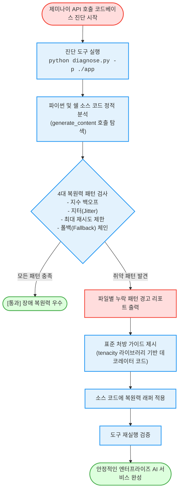

<!--
Copyright 2026 Google LLC. All Rights Reserved.
SPDX-License-Identifier: Apache-2.0

NOTICE: This code/repository is owned by Google LLC and provided under the Apache-2.0 License.
It is strictly provided as an EXAMPLE/REFERENCE ONLY and is NOT INTENDED FOR PRODUCTION USE.
All contents, designs, and code examples are subject to change, modification, or removal at any time without notice.

[고지 사항] 본 저장소 및 문서는 구글 (Google LLC) 소유이며 Apache 2.0 라이선스 하에 예시 (Sample) 용도로 제공된다.
프로덕션 환경용이 아니며, 사전 통지 없이 언제든지 수정, 변경 또는 삭제될 수 있다.
-->

> [!IMPORTANT]
> **구글 (Google LLC) 참조용 샘플 고지 사항**:
> 본 프로젝트의 모든 소스 코드와 문서는 Google LLC의 소유이며, Apache-2.0 라이선스에 따라 오직 **참조용 샘플 (Sample / Reference Only)** 목적으로만 제공된다. 프로덕션 환경에 그대로 사용할 수 없으며, 사전 통지 없이 언제든 내용이 수정, 변경 또는 삭제될 수 있다.

# 제미나이(Gemini) API 복원력 패턴 자가 진단 (`gemini-resilience-checker`)

제미나이(Gemini) API 호출 소스 코드에서 429 과부하 에러와 일시적 네트워크 장애를 방어하기 위한 **지수 백오프, 지터(무작위 대기), 최대 재시도 제약, 폴백 모델 체인 구비 여부를 1분 만에 정적 진단**하고 표준 처방 코드를 제시하는 도구다. (As of 2026-10-17)

---

## 1. 발생 증상 및 진단 대상 체크리스트

사내 또는 고객사 환경에서 아래 증상이 발생한다면 즉시 진단 대상이다:
- [ ] **간헐적 429 (Resource Exhausted) 장애**: 트래픽이 몰릴 때 재시도 로직이 없거나 단순 재시도로 인해 서비스 중단이 발생하는 경우
- [ ] **폭풍 재시도(Thundering Herd) 현상**: 대기 시간 무작위화(Jitter) 없이 고정 간격으로 재시도하여 백엔드 모델 서버에 추가 부하를 주는 경우
- [ ] **무한 루프로 인한 지연 및 비용 누수**: 재시도 횟수 제한(Max Retries)이 없어 일시 장애가 영구 행(Hang) 또는 과다 호출로 이어지는 경우
- [ ] **주 모델 장애 시 서비스 중단**: Gemini 3.8 Pro 등 주력 모델 지연 또는 쿼터 소진 시 Gemini 3.8 Flash 등으로 자동 우회하는 폴백 로직이 누락된 경우

---

## 2. 빠른 시작 (Quickstart)

### 1) 모의 데이터 가상 실행 (Dry-Run)
GCP API 호출 없이 내장된 가상 인프라 데이터로 정상 동작 여부를 즉시 검증한다:
```bash
python diagnose.py --dry-run
```

**터미널 진단 출력 미리보기:**
```text
[데모 실행] --dry-run 모드가 활성화되어 가상 분석 결과를 시뮬레이션한다.
========================================================================
[진단 결과] 제미나이(Gemini) API 호출 복원력(Resilience) 진단 리포트
========================================================================
진단된 API 호출 소스 파일: 2건
[파일: app/services/llm_client.py]
  - 지수 백오프 및 재시도: [경고] 누락
  - 지터 무작위 대기 제어: [경고] 누락
  - 최대 재시도 횟수 제한: [경고] 누락
  - 폴백 모델 예외 체인  : [권장] 미적용
```

### 2) 실제 사내 인프라 실시간 진단
```bash
cp .env.example .env
python diagnose.py
```
> [!NOTE]
> `.env` 설정값을 비워두면 gcloud 활성 설정 및 사내 리소스를 자동으로 감지하여 진단한다.

---

## 3. 진단 및 해결 흐름



---
## 4. 조치 가이드 및 권장 설정

- **Service Health 콘솔**: ( https://console.cloud.google.com/servicehealth )
- **Vertex AI 콘솔**: ( https://console.cloud.google.com/vertex-ai )
- **클라우드 인시던트 핸들링 모범 사례 가이드**: ( https://cloud.google.com/blog/topics/developers-practitioners/cloud-reliability-incident-handling-best-practices )
- **구글 클라우드 Service Health 공식 개요**: ( https://cloud.google.com/service-health/docs/overview )

---
## 5. 사전 준비 사항 (필요 IAM 권한)

본 도구를 실행하려면 최소 아래의 IAM 권한이 필요하다:

이 도구는 소스 코드 파일을 정적으로 분석하는 도구로, 별도의 클라우드 인프라 자원을 생성하거나 변경하지 않는다.

| 권한 항목 | 요구 조건 | 비고 |
| : | : | : |
| **GCP IAM 권한** | 필요 없음 | 순수 로컬 또는 Cloud Shell 환경 정적 진단 도구 |
| **로컬 환경 권한** | 소스 코드 읽기 권한 | 스캔 대상 프로젝트 디렉터리 접근 권한 |

---

## 6. 기술적 배경 및 아키텍처 원리 (Deep Dive)

스크립트가 완료되면 아래와 같이 **각 파일별로 어떤 복원력 패턴이 누락되었는지** 명확히 출력된다:

```text
========================================================================
[진단 결과] 제미나이(Gemini) API 호출 복원력(Resilience) 진단 리포트
========================================================================

진단된 API 호출 소스 파일: 2건

[파일: app/services/llm_client.py]
  - 지수 백오프 및 재시도: [경고] 누락
  - 지터 무작위 대기 제어: [경고] 누락
  - 최대 재시도 횟수 제한: [경고] 누락
  - 폴백 모델 예외 체인  : [권장] 미적용
------------------------------------------------------------------------
[파일: batch_worker.py]
  - 지수 백오프 및 재시도: 통과
  - 지터 무작위 대기 제어: [경고] 누락
  - 최대 재시도 횟수 제한: 통과
  - 폴백 모델 예외 체인  : [권장] 미적용
------------------------------------------------------------------------

========================================================================
[추천 표준 처방 가이드 - 파이썬 tenacity 라이브러리 연동]
========================================================================
...
```

---
## 7. 리소스 정리 (Teardown) 안내

이 도구는 소스 코드 정적 분석기이므로 클라우드 상에 생성된 리소스가 없으며, 별도의 자원 정리 작업이 필요하지 않다.
