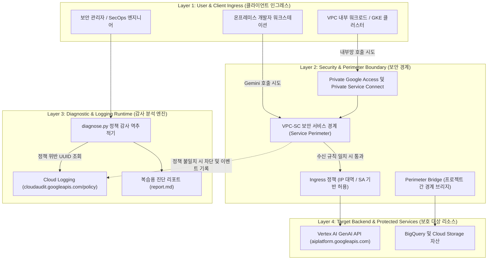

<!--
Copyright 2026 Google LLC. All Rights Reserved.
SPDX-License-Identifier: Apache-2.0

NOTICE: This code/repository is owned by Google LLC and provided under the Apache-2.0 License.
It is strictly provided as an EXAMPLE/REFERENCE ONLY and is NOT INTENDED FOR PRODUCTION USE.
All contents, designs, and code examples are subject to change, modification, or removal at any time without notice.

[고지 사항] 본 저장소 및 문서는 구글 (Google LLC) 소유이며 Apache 2.0 라이선스 하에 예시 (Sample) 용도로 제공된다.
프로덕션 환경용이 아니며, 사전 통지 없이 언제든지 수정, 변경 또는 삭제될 수 있다.
-->

> [!IMPORTANT]
> **구글 (Google LLC) 참조용 샘플 고지 사항**:
> 본 프로젝트의 모든 소스 코드와 문서는 Google LLC의 소유이며, Apache-2.0 라이선스에 따라 오직 **참조용 샘플 (Sample / Reference Only)** 목적으로만 제공된다. 프로덕션 환경에 그대로 사용할 수 없으며, 사전 통지 없이 언제든 내용이 수정, 변경 또는 삭제될 수 있다.

# 제미나이(Gemini) VPC Service Controls 차단 감사 추적 및 처방 (`gemini-vpc-sc-denial-resolver`)

제미나이(Gemini) 및 버텍스 AI(Vertex AI) API 호출 시 발생하는 VPC 서비스 컨트롤(VPC Service Controls, VPC-SC) 보안 경계 차단(Perimeter Denial) 에러를 감사 로그에서 역추적하고 **거부 사유 코드별 근본 원인 분석 및 네트워크 수신 허용 규칙을 1분 만에 처방**하는 도구다. (As of 2026-10-17)

---

## 1. 발생 증상 및 진단 대상 체크리스트

사내 또는 고객사 환경에서 아래 증상이 발생한다면 즉시 진단 대상이다:
- [ ] **VPC-SC 경계 차단 장애**: 온프레미스 사설망, 하이브리드 클라우드 또는 특정 서브넷에서 Gemini 호출 시 알 수 없는 보안 정책 거부(Denial)가 발생할 때
- [ ] **거부 원인 규명 곤란**: 일반적인 클라이언트 에러 메시지만으로는 수신 규칙(Ingress Rule) 누락인지, 상이한 경계 분리인지 판단하기 어려울 때
- [ ] **VPC-SC 감사 추적 및 즉각 해결**: Cloud Logging의 보안 정책 감사 로그(`cloudaudit.googleapis.com/policy`)를 역추적하여 고유 거부 ID(UUID)와 원인별 해결책을 즉시 확보하고자 할 때


### 1.1 도구의 본질 및 비즈니스 해결 과제 (What & Why)
- **대상 사용자 (Target)**: 클라우드 보안 엔지니어, 네트워크 아키텍트, VPC-SC 운영자 및 인프라 보안팀
- **해결하는 핵심 문제 (Core Pain Points)**:
  1. Gemini 및 Vertex AI API 호출 시 발생하는 VPC Service Controls 보안 경계 차단(Perimeter Denial) 에러의 난해한 에러 메시지
  2. 수많은 감사 로그 속에서 정확한 차단 사유(네트워크 불일치, 서비스 계정 미등록, 소스 IP 차단 등)를 수작업으로 역추적하는 데 소요되는 시간
  3. 보안 경계 수정을 위해 보안팀에 요청할 정확한 인그레스/이그레스 규칙 명세를 도출하지 못해 프로젝트가 중단되는 문제
- **본 솔루션의 해결 방식 (Solution)**:
  - Cloud Audit Logs에서 최근 7일간의 VPC-SC 위반 로그를 정밀 파싱하여 거부 사유 코드별(SERVICE_PERIMETER_VIOLATION) 근본 원인을 규명하고, 즉시 복구 가능한 네트워크 수신 허용 규칙(Ingress Rules) 명세를 자동 산출한다.

### 1.2 최종 산출물 3종 세트 미리보기 (Deliverables & Visual Preview)
본 도구를 실행(`python diagnose.py`)하면 다음 3가지 구체적인 엔터프라이즈 자산이 생성된다:

| 산출물 구분 | 산출물 형태 및 명칭 | 주요 포함 내용 및 실무 활용 방안 |
| :--- | :--- | :--- |
| **① 터미널 콘솔 요약** | Visual CLI Table | 차단 시각, 주체 계정, 대상 서비스, 거부 사유 코드, 보안 경계 이름 및 네트워크 차단 요약 표 |
| **② 정규 진단 보고서** | 마크다운 파일 (`report.md`) | VPC-SC 차단 이벤트 전수 역추적 보고서, 거부 사유별 기술적 원인 분석, 보안팀 제출용 수신 규칙 YAML 및 적용 가이드 |
| **③ 후속 조치 및 배포 자산** | Actionable Asset Specs | • **VPC-SC 인그레스 규칙 YAML**: 차단된 주체와 네트워크를 선별 허용하는 정밀 수신 정책<br/>• **gcloud 액세스 정책 업데이트 명령어**: 보안 경계에 정책을 즉시 반영하는 CLI 명령어<br/>• **사내 승인 네트워크 대역 검증 가이드**: 온프렘 및 사내 VPC 서브넷 대조 명세서 |

---

## 2. 빠른 시작 (Quickstart)

> [!TIP]
> Cloud Shell 접속 환경 구성 및 저장소 클론(`git clone`) 방법은 루트의 [메인 README](../../README.md)를 참고한다.

### 1) 모의 데이터 가상 실행 (Dry-Run)
GCP API 호출 없이 내장된 가상 인프라 데이터로 정상 동작 여부를 즉시 검증한다:
```bash
python diagnose.py --dry-run
```

**터미널 진단 출력 미리보기:**
```text
[진단 결과] 제미나이(Gemini) VPC Service Controls 경계 차단 진단 리포트
  - 대상 프로젝트: sample-project-id
  - 조회 기간: 최근 7일
========================================================================
발견된 VPC-SC 경계 거부 사례: 2건
[거부 사례 #1]
  - 호출 주체 계정: developer-workstation@company.com
  - 대상 서비스   : aiplatform.googleapis.com
  - 호출 메서드   : google.cloud.aiplatform.v1beta1.PredictionService.GenerateContent
  - 거부 사유 코드: NO_MATCHING_INGRESS_POLICY
```


### 2) 사내 환경 대화형 설정 (Config Wizard, 선택 사항)
사내 활성 프로젝트 및 환경 설정을 대화형으로 탐색하여 `.env`에 자동 저장한다:
```bash
python diagnose.py --config
```


### 3) 실제 사내 인프라 실시간 진단
```bash
python diagnose.py
```
> [!NOTE]
> 앞서 `python diagnose.py --config`로 환경 설정을 저장했거나 gcloud 활성 설정을 그대로 활용할 경우 별도의 `.env` 생성 없이 즉시 실행할 수 있다. (환경 변수를 텍스트 에디터로 직접 수동 편집하고자 할 때만 `cp -n .env.example .env` 실행 후 수정)

---

## 3. 솔루션 아키텍처 및 처리 흐름



---
## 4. 조치 가이드 및 권장 설정

- **VPC-SC 문제 해결사 콘솔**: ( https://console.cloud.google.com/security/vpc-service-controls/troubleshooter )
- **서비스 경계 관리 콘솔**: ( https://console.cloud.google.com/security/vpc-service-controls )
- **VPC Service Controls 문제 해결 공식 가이드**: ( https://cloud.google.com/vpc-service-controls/docs/troubleshooting )
- **VPC Service Controls 수신 및 송신 규칙 공식 가이드**: ( https://cloud.google.com/vpc-service-controls/docs/ingress-egress-rules )

---
### GCP 리소스 생성 시 4대 필수 표준 라벨링 준수
- 사내 거버넌스 및 자원 식별, 비용 추적을 위해 관련 클라우드 리소스 생성 시 4대 표준 라벨을 필수로 주입한다:
  - `managed-by`: `google-cloud-0-to-1`
  - `scenario`: `gemini-vpc-sc-denial-resolver`
  - `env`: `sample`
  - `created-by`: `customer-engineer`
- gcloud CLI 예시: `--labels=managed-by=google-cloud-0-to-1,scenario=gemini-vpc-sc-denial-resolver,env=sample,created-by=customer-engineer`

---

## 5. 사전 준비 사항 (필요 IAM 권한)

본 도구를 실행하려면 최소 아래의 IAM 권한이 필요하다:

Cloud Logging 감사 로그를 조회하기 위해 필요한 IAM 역할이다:

| 역할 (Role) | 권한 ID | 용도 |
| :--- | :--- | :--- |
| **클라우드 로깅 뷰어 (권장)** | `roles/logging.viewer` | Cloud Logging 정책 감사 로그 읽기 |
| **보안 뷰어 (선택)** | `roles/iam.securityViewer` | 보안 정책 및 거부 감사 로그 통합 조회 |

> [!NOTE]
> `--dry-run` 모드로 실행할 경우 GCP IAM 권한 없이도 가상 거부 사례와 사유별 표준 처방을 즉시 확인할 수 있다.

---

## 6. 기술적 배경 및 아키텍처 원리 (Deep Dive)

### 관련 상세 설계 및 요구 사항 명세
- [비즈니스 요구 사항 명세서 (BRD)](docs/BRD.md): 비즈니스 배경, 성공 지표 및 요구 사항(BR-01~) 명세
- [기술 상세 설계서 (TDD)](docs/TDD.md): 시스템 아키텍처, 기능(FR-01~) 및 비기능(NFR-01~) 설계 명세

스크립트가 완료되면 아래와 같이 **거부된 계정, 서비스, 메서드, 고유 거부 ID 및 처방**이 출력된다:

```text
========================================================================
[진단 결과] 제미나이(Gemini) VPC Service Controls 경계 차단 진단 리포트
  - 대상 프로젝트: my-secured-project
  - 조회 기간: 최근 7일
========================================================================

발견된 VPC-SC 경계 거부 사례: 2건

[거부 사례 #1]
  - 호출 주체 계정: developer-workstation@company.com
  - 대상 서비스   : aiplatform.googleapis.com
  - 호출 메서드   : google.cloud.aiplatform.v1beta1.PredictionService.GenerateContent
  - 거부 사유 코드: NO_MATCHING_INGRESS_POLICY
  - 고유 거부 ID  : vpc-sc-denial-8f2a1b9c-4d3e-41a2-98bc-abcdef012345
  [권장 처방 및 복구 가이드]
    - 원인 분석 및 해결책: API 호출자가 신뢰할 수 없는 공용 IP 대역 또는 미지정 사설 서브넷에서 접근했다. VPC-SC 수신(Ingress) 규칙에 호출자의 IP 서브넷 대역 또는 서비스 계정을 명시적으로 허용해야 한다.
    - VPC-SC 문제 해결사 콘솔 ( https://console.cloud.google.com/security/vpc-service-controls/troubleshooter )
    - 서비스 경계 관리 콘솔 ( https://console.cloud.google.com/security/vpc-service-controls )
------------------------------------------------------------------------
```

---
## 7. 리소스 정리 (Teardown) 안내

본 도구는 순수 감사 로그 조회 도구이며 클라우드 상에 영구 자원을 생성하지 않으므로 별도의 자원 정리 작업이 필요하지 않다.
