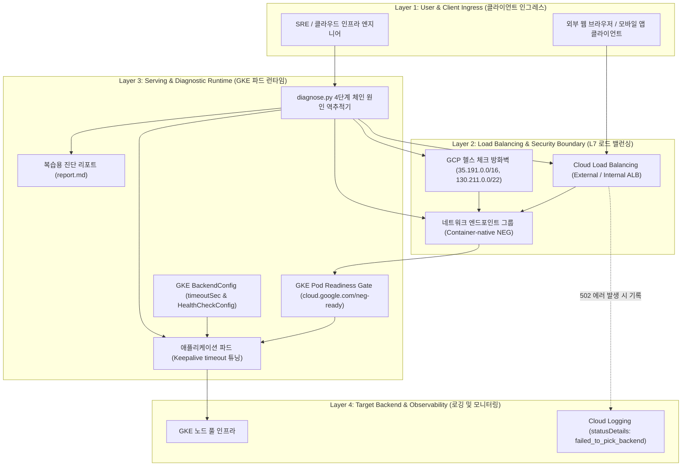

<!--
Copyright 2026 Google LLC. All Rights Reserved.
SPDX-License-Identifier: Apache-2.0

NOTICE: This code/repository is owned by Google LLC and provided under the Apache-2.0 License.
It is strictly provided as an EXAMPLE/REFERENCE ONLY and is NOT INTENDED FOR PRODUCTION USE.
All contents, designs, and code examples are subject to change, modification, or removal at any time without notice.

[고지 사항] 본 저장소 및 문서는 구글 (Google LLC) 소유이며 Apache 2.0 라이선스 하에 예시 (Sample) 용도로 제공된다.
프로덕션 환경용이 아니며, 사전 통지 없이 언제든지 수정, 변경 또는 삭제될 수 있다.
-->

> [!IMPORTANT]
> **구글 (Google LLC) 참조용 샘플 고지 사항**:
> 본 프로젝트의 모든 소스 코드와 문서는 Google LLC의 소유이며, Apache-2.0 라이선스에 따라 오직 **참조용 샘플 (Sample / Reference Only)** 목적으로만 제공된다. 프로덕션 환경에 그대로 사용할 수 없으며, 사전 통지 없이 언제든 내용이 수정, 변경 또는 삭제될 수 있다.

# GKE Ingress 및 Gateway 502 Bad Gateway 원인 체인 역추적기 (`gke-ingress-502-resolver`)

GKE 클러스터의 파드가 정상 기동 중임에도 외부 또는 내부 HTTP(S) 로드 밸런서에서 간헐적 또는 전면적으로 반환되는 502 Bad Gateway 오류의 4대 원인(헬스 체크 방화벽 차단, 프로브 경로 불일치, NEG Pod Readiness Gate 미충족, Keepalive 타임아웃 역전)을 1분 만에 교차 진단하고 복구 YAML 및 방화벽 명령을 도출하는 도구다. (As of 2026-10-17)

---

## 1. 발생 증상 및 진단 대상 체크리스트

사내 또는 고객사 환경에서 아래 증상이 발생한다면 즉시 진단 대상이다:
- [ ] 쿠버네티스 파드가 `Running` 및 `Ready` 상태임에도 사용자가 브라우저나 API 클라이언트 접속 시 `502 Bad Gateway` 또는 `failed_to_pick_backend` 오류를 마주하는 경우
- [ ] 애플리케이션 로그에는 아무런 오류가 없는데 구글 클라우드 로드 밸런서(External/Internal Application Load Balancer)에서 간헐적인 502 응답이 기록되는 경우
- [ ] 신규 파드 롤아웃(Deployment 배포) 직후 수 초에서 수 분 동안 트래픽이 유실되고 502 에러가 치솟는 현상을 방지하려는 경우
- [ ] GCP 헬스 체크 프로브 대역(`35.191.0.0/16`, `130.211.0.0/22`)의 인그레스 방화벽 차단 여부를 점검하려는 경우
- [ ] 백엔드 웹 서버(Node.js, Express, Tomcat, Gunicorn, Nginx)의 유휴 커넥션 Keepalive 타임아웃과 GCP 로드 밸런서의 백엔드 타임아웃 간 역전 현상을 교차 검증하려는 경우


### 1.1 도구의 본질 및 비즈니스 해결 과제 (What & Why)
- **대상 사용자 (Target)**: 쿠버네티스 엔지니어, GKE 인프라 운영자, SRE/DevOps 팀 및 마이크로서비스 아키텍트
- **해결하는 핵심 문제 (Core Pain Points)**:
  1. GKE 파드는 정상 Running 상태임에도 외부/내부 HTTP(S) 로드 밸런서에서 간헐적 또는 전면적으로 502 Bad Gateway를 반환하는 문제
  2. 로드 밸런서 헬스 체크 방화벽 차단, 백엔드 프로브 경로 불일치, NEG Readiness Gate 미충족, Keepalive 타임아웃 역전 등 복합 원인 규명의 난해함
  3. GKE와 GCP Cloud Load Balancing 간의 비동기 상태 불일치로 인해 배포 직후 트래픽이 유실되는 장애
- **본 솔루션의 해결 방식 (Solution)**:
  - GKE 클러스터와 Cloud Load Balancing 간의 4계층 상호작용 체인을 교차 진단하여 502 Bad Gateway의 4대 근본 원인을 1분 만에 규명하고, 복구용 `BackendConfig` YAML 및 방화벽 허용 명령어를 자동 도출한다.

### 1.2 최종 산출물 3종 세트 미리보기 (Deliverables & Visual Preview)
본 도구를 실행(`python diagnose.py`)하면 다음 3가지 구체적인 엔터프라이즈 자산이 생성된다:

| 산출물 구분 | 산출물 형태 및 명칭 | 주요 포함 내용 및 실무 활용 방안 |
| :--- | :--- | :--- |
| **① 터미널 콘솔 요약** | Visual CLI Table | 헬스 체크 방화벽, 프로브 경로 정합성, NEG Readiness 상태, Keepalive 타임아웃 4대 영역별 판정 표 |
| **② 정규 진단 보고서** | 마크다운 파일 (`report.md`) | 502 오류 체인 정밀 역추적 보고서, 원인별 기술 메커니즘 분석, BackendConfig 및 방화벽 즉시 조치 YAML |
| **③ 후속 조치 및 배포 자산** | Actionable Asset Specs | • **GKE BackendConfig 복구 매니페스트**: 헬스 체크 경로와 타임아웃을 정상 동기화하는 k8s YAML<br/>• **GCP 로드 밸런서 헬스 체크 방화벽 명령어**: 구글 프로브 IP 대역을 허용하는 gcloud 명령<br/>• **웹 프레임워크 Keepalive 튜닝 가이드**: LB 타임아웃보다 길게 설정하는 Nginx/Node.js/Python 설정 |

---

## 2. 빠른 시작 (Quickstart)

> [!TIP]
> Cloud Shell 접속 환경 구성 및 저장소 클론(`git clone`) 방법은 루트의 [메인 README](../../README.md)를 참고한다.

### 1) 모의 데이터 가상 실행 (Dry-Run)
GCP API 호출 없이 내장된 가상 인프라 데이터로 정상 동작 여부를 즉시 검증한다:
```bash
python diagnose.py --dry-run
```

**터미널 진단 출력 미리보기:**
```text
[2] 4단계 체인 심층 진단 결과: [CRITICAL]
  [1] [CRITICAL] GCP 헬스 체크 프로브 대역 방화벽 규칙 누락 (FIREWALL_PROBE_BLOCKED)
      - 상세 원인: 구글 클라우드 로드 밸런서 헬스 체크 프로브 대역(35.191.0.0/16, 130.211.0.0/22)에서 GKE 노드/파드로 들어오는 인그레스 트래픽이 차단되어 모든 백엔드가 Unhealthy로 판정됨.
  [2] [CRITICAL] 헬스 체크 요청 경로 불일치 (HEALTH_CHECK_PATH_MISMATCH)
      - 상세 원인: 파드 Readiness Probe 경로('/healthz')와 GCP 로드 밸런서 헬스 체크 경로('/')가 일치하지 않음. 기본 루트('/') 경로가 HTTP 200 이외의 응답(404 Not Found 또는 302 Redirect)을 반환하여 파드가 정상 기동 중임에도 로드 밸런서 헬스 체크가 실패함.
  [3] [WARNING] Pod Readiness Gate 미주입 (NEG_READINESS_GATE_MISSING)
      - 상세 원인: 파드 배포 시 'cloud.google.com/neg-ready' Readiness Gate가 선언되지 않음. 신규 파드 롤아웃 시 컨테이너가 뜨자마자 트래픽이 유입되어 NEG 엔드포인트 등록 완료 전 502 에러 발생 위험.
  [4] [WARNING] 백엔드 Keepalive 타임아웃 역전 장애 (KEEPALIVE_TIMEOUT_INVERSION)
      - 상세 원인: 백엔드 웹 애플리케이션의 Keepalive 타임아웃(5초)이 로드 밸런서 백엔드 서비스 타임아웃(30초)보다 짧거나 같음. 유휴 커넥션을 백엔드가 먼저 TCP FIN/RST로 끊어버려 클라이언트 요청 도중 간헐적 502 발생.
[3] 단계별 즉시 복구 가이드 및 맞춤형 YAML:
```


### 2) 사내 환경 대화형 설정 (Config Wizard, 선택 사항)
사내 활성 프로젝트 및 환경 설정을 대화형으로 탐색하여 `.env`에 자동 저장한다:
```bash
python diagnose.py --config
```


### 3) 실제 사내 인프라 실시간 진단
```bash
python diagnose.py
```
> [!NOTE]
> 앞서 `python diagnose.py --config`로 환경 설정을 저장했거나 gcloud 활성 설정을 그대로 활용할 경우 별도의 `.env` 생성 없이 즉시 실행할 수 있다. (환경 변수를 텍스트 에디터로 직접 수동 편집하고자 할 때만 `cp -n .env.example .env` 실행 후 수정)

---

## 3. 솔루션 아키텍처 및 처리 흐름



---
## 4. 조치 가이드 및 권장 설정

### 1. 헬스 체크 허용 방화벽 규칙 배포
```bash
gcloud compute firewall-rules create allow-gcp-health-checks \
  --network=default \
  --action=ALLOW \
  --direction=INGRESS \
  --source-ranges=35.191.0.0/16,130.211.0.0/22 \
  --rules=tcp:80,tcp:443,tcp:8080
```

### 2. BackendConfig 커스텀 매니페스트 적용 (`backend-config.yaml`)
파드의 실제 헬스 체크 경로와 타임아웃을 로드 밸런서에 동기화한다:
```yaml
apiVersion: cloud.google.com/v1
kind: BackendConfig
metadata:
  name: web-backend-config
  namespace: default
spec:
  timeoutSec: 30
  healthCheck:
    type: HTTP
    requestPath: /healthz
    port: 8080
```

서비스에 애노테이션 바인딩:
```bash
kubectl annotate service [SERVICE_NAME] \
  cloud.google.com/backend-config='{"default": "web-backend-config"}' --overwrite
```

### 3. 백엔드 애플리케이션 Keepalive 타임아웃 상향
로드 밸런서 타임아웃(30초)보다 최소 5초 이상 길게 유지한다 (35초 이상 권장):
- **Node.js**:
  ```javascript
  const server = app.listen(port);
  server.keepAliveTimeout = 35000;
  server.headersTimeout = 40000;
  ```
- **Nginx (`nginx.conf`)**:
  ```nginx
  keepalive_timeout 35s;
  ```

### 4. 관련 공식 기술 문서
- GKE Ingress 문제 해결 및 502 오류 원인 ( https://cloud.google.com/kubernetes-engine/docs/troubleshooting#502_bad_gateway )
- 컨테이너 네이티브 로드 밸런싱(NEG) 가이드 ( https://cloud.google.com/kubernetes-engine/docs/how-to/container-native-load-balancing )
- GKE BackendConfig 구성 참조 ( https://cloud.google.com/kubernetes-engine/docs/concepts/backendconfig )

---
### GCP 리소스 생성 시 4대 필수 표준 라벨링 준수
- 사내 거버넌스 및 자원 식별, 비용 추적을 위해 관련 클라우드 리소스 생성 시 4대 표준 라벨을 필수로 주입한다:
  - `managed-by`: `google-cloud-0-to-1`
  - `scenario`: `gke-ingress-502-resolver`
  - `env`: `sample`
  - `created-by`: `customer-engineer`
- gcloud CLI 예시: `--labels=managed-by=google-cloud-0-to-1,scenario=gke-ingress-502-resolver,env=sample,created-by=customer-engineer`

---

## 5. 사전 준비 사항 (필요 IAM 권한)

본 도구를 실행하려면 최소 아래의 IAM 권한이 필요하다:

본 도구를 실행하려면 최소 아래의 IAM 권한이 필요하다:

| 서비스 | 필요 역할 (Role) | 최소 IAM 권한 |
| :--- | :--- | :--- |
| `구글 쿠버네티스 엔진(GKE)` | `roles/container.viewer` | `container.clusters.get`, `container.clusters.list` |
| `컴퓨트 엔진(Compute Engine)` | `roles/compute.networkViewer` | `compute.firewalls.list`, `compute.backendServices.get` |

---

## 6. 기술적 배경 및 아키텍처 원리 (Deep Dive)

### 관련 상세 설계 및 요구 사항 명세
- [비즈니스 요구 사항 명세서 (BRD)](docs/BRD.md): 비즈니스 배경, 성공 지표 및 요구 사항(BR-01~) 명세
- [기술 상세 설계서 (TDD)](docs/TDD.md): 시스템 아키텍처, 기능(FR-01~) 및 비기능(NFR-01~) 설계 명세

구글 클라우드 로드 밸런서와 GKE 파드 간 통신에서 발생하는 502 오류는 대부분 다음 4가지 설정 불일치에서 기인한다:

1. **GCP 헬스 체크 프로브 대역 방화벽 차단 (FIREWALL_PROBE_BLOCKED)**:
   - GCP 로드 밸런서의 상태 확인 프록시는 `35.191.0.0/16` 및 `130.211.0.0/22` IP 대역에서 각 노드나 파드로 상태 확인 패킷을 보낸다.
   - 이 대역에서 들어오는 인그레스 트래픽이 VPC 방화벽에서 허용되지 않으면 모든 백엔드가 Unhealthy로 처리되어 트래픽 유입 즉시 502가 반환된다.

2. **헬스 체크 요청 경로 불일치 (HEALTH_CHECK_PATH_MISMATCH)**:
   - 파드 명세의 `readinessProbe` 경로는 `/healthz`로 구현되어 정상 동작하지만, GKE Ingress 기본 로드 밸런서 헬스 체크 경로는 별도 지정이 없으면 `/`로 설정된다.
   - 만약 애플리케이션의 루트(`/`) 경로가 404 Not Found나 인증 리다이렉트(302)를 반환하면, 쿠버네티스 파드는 정상(Running)이지만 GCP 로드 밸런서는 백엔드를 비정상으로 판정한다.

3. **NEG Pod Readiness Gate 미충족 (NEG_READINESS_GATE_MISSING)**:
   - 컨테이너-네이티브 로드 밸런싱(NEG) 환경에서 파드가 생성될 때, 컨테이너 Readiness Probe만 통과하고 GCP 로드 밸런서 엔드포인트 등록이 완료되기 전에 트래픽이 유입되면 502가 발생한다.
   - `cloud.google.com/neg-ready` Readiness Gate가 선언되어 있어야 GCP 로드 밸런서의 상태 확인이 완료될 때까지 엔드포인트 트래픽 투입이 안전하게 지연된다.

4. **백엔드 Keepalive 타임아웃 역전 (KEEPALIVE_TIMEOUT_INVERSION)**:
   - GCP 로드 밸런서 백엔드 서비스의 기본 유휴 타임아웃은 30초(최대 600초)다.
   - 백엔드 웹 서버(Node.js 기본 5초, Tomcat 기본 20초 등)의 Keepalive 타임아웃이 로드 밸런서보다 짧으면, 유휴 상태의 TCP 연결을 백엔드가 먼저 TCP FIN/RST로 일방 종료한다.
   - 이때 클라이언트의 신규 요청이 해당 유휴 커넥션으로 들어오면 로드 밸런서가 백엔드로부터 즉시 RST를 수신하여 브라우저에 502 오류를 반환한다.

---
## 7. 리소스 정리 (Teardown) 안내

본 진단 도구는 읽기 전용(Read-Only) 명령어로 작동하므로 별도의 클라우드 인프라 자원을 생성하지 않는다. 로컬 임시 설정 파일만 정리하면 된다:
```bash
rm -f .env
```
