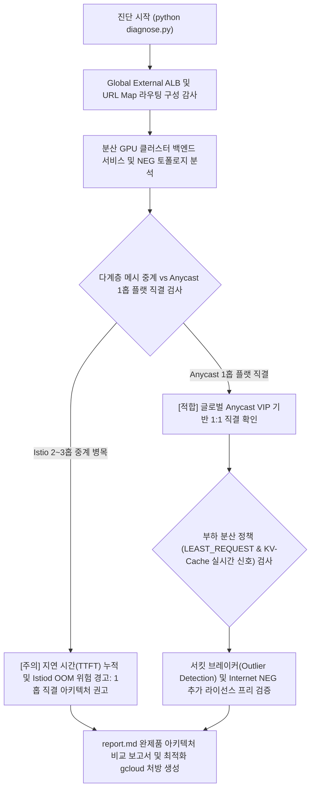

<!--
Copyright 2026 Google LLC. All Rights Reserved.
SPDX-License-Identifier: Apache-2.0

NOTICE: This code/repository is owned by Google LLC and provided under the Apache-2.0 License.
It is strictly provided as an EXAMPLE/REFERENCE ONLY and is NOT INTENDED FOR PRODUCTION USE.
All contents, designs, and code examples are subject to change, modification, or removal at any time without notice.

[고지 사항] 본 저장소 및 문서는 구글 (Google LLC) 소유이며 Apache 2.0 라이선스 하에 예시 (Sample) 용도로 제공된다.
프로덕션 환경용이 아니며, 사전 통지 없이 언제든지 수정, 변경 또는 삭제될 수 있다.
-->

> [!IMPORTANT]
> **구글 (Google LLC) 참조용 샘플 고지 사항**:
> 본 프로젝트의 모든 소스 코드와 문서는 Google LLC의 소유이며, Apache-2.0 라이선스에 따라 오직 **참조용 샘플 (Sample / Reference Only)** 목적으로만 제공된다. 프로덕션 환경에 그대로 사용할 수 없으며, 사전 통지 없이 언제든 내용이 수정, 변경 또는 삭제될 수 있다.

# Multi-Cluster GKE Inference Gateway 라우팅 및 L7 제어 평면 진단기 (`gke-multi-cluster-inference-gateway`)

대규모 AI/LLM 서빙 환경에서 GPU/TPU 공급 부족으로 여러 리전과 멀티 클라우드에 분산된 수십 개 쿠버네티스 클러스터 운영 시, 기존 계층형 Istio 풀 메시(Full-mesh) 중계로 인한 지연 시간(TTFT) 증가와 GKE Fleet 라이선스 비용 누수를 진단하고, Global External ALB 및 Hybrid/Internet NEG 기반의 1홉 플랫 직결 L7 제어 평면 상태를 1분 만에 점검 및 처방하는 아키텍처 진단 도구다. (As of 2026-10-17)

---

## 1. 발생 증상 및 진단 대상 체크리스트

사내 또는 고객사 환경에서 아래 증상이 발생한다면 즉시 진단 대상이다:
- [ ] 단일 리전/단일 클러스터 내 GPU 재고 부족으로 인해 여러 리전의 GKE 클러스터 및 타 클라우드(EKS, AKS 등)에 걸쳐 다수의 분산 클러스터를 운영하고 있을 때
- [ ] 단순 라운드로빈 로드 밸런서로 인해 특정 클러스터의 VRAM / KV-cache 메모리 고갈(40%+ 포화) 시 동적 오버플로 분배가 이루어지지 않고 인퍼런스 지연이 급증할 때
- [ ] 다계층 Istio 서비스 메시 중계 구조(허브 클러스터 $\rightarrow$ 중간 프록시 $\rightarrow$ 백엔드 파드)로 인해 헤어피닝 지연 시간(TTFT)이 증가하고 불필요한 크로스 리전 Egress 비용이 발생할 때
- [ ] 멀티 클러스터 제어를 위해 GKE Enterprise에 타 클라우드 GPU 워커 노드를 등록할 경우 발생하는 vCPU 관리 라이선스 과금을 회피하고 싶을 때 ( https://cloud.google.com/anthos/pricing )
- [ ] 특정 GPU 클러스터 장애 시 전체 시스템으로 장애가 전파되지 않도록 글로벌 Anycast VIP 기반 1:1 플랫 직결 및 서킷 브레이커(이상치 탐지)를 신속하게 검증하고 싶을 때

---

## 2. 빠른 시작 (Quickstart)

### 1) 모의 데이터 가상 실행 (Dry-Run)
GCP API 호출 없이 내장된 가상 인프라 데이터로 정상 동작 여부를 즉시 검증한다:
```bash
python diagnose.py --dry-run
```

**터미널 진단 출력 미리보기:**
```text
종합 진단 결과      : 총 8개 항목 중 PASS: 6건, WARN: 2건, FAIL: 0건
--------------------------------------------------------------------------------------------------------
[항목별 기술적 통제 및 아키텍처 점검 현황]
--------------------------------------------------------------------------------------------------------
ID       | 분류             | 상태       | 점검 항목 및 실측 증적
--------------------------------------------------------------------------------------------------------
CHK-01   | 제어 평면 구조       | [PASS]   | 다계층 메시 중계 배제 및 Anycast 1홉 직결 아키텍처
         * 상세 설명   : 최상위 라우팅 허브를 거치는 다계층 프록시 중계 없이 Global External ALB에서 개별 클러스터 백엔드로 1홉 플랫 직결되는가?
         * 실측 증적   : Global External ALB URL Map(ai-inference-gw)에서 분산 클러스터 백엔드 서비스로 Anycast 1홉 플랫 직결 확인
         * 권장 조치   : 추가 조치 불필요 (현재 아키텍처 양호)
```

### 2) 실제 사내 인프라 실시간 진단
```bash
cp .env.example .env
python diagnose.py
```
> [!NOTE]
> `.env` 설정값을 비워두면 gcloud 활성 설정 및 사내 리소스를 자동으로 감지하여 진단한다.

---

## 3. 진단 및 해결 흐름



---
## 4. 조치 가이드 및 권장 설정

- **Cloud Load Balancing 콘솔**: ( https://console.cloud.google.com/net-services/loadbalancing )
- **GKE 클러스터 콘솔**: ( https://console.cloud.google.com/kubernetes )
- **GKE Multi-Cluster Inference Gateway 공식 가이드**: ( https://docs.cloud.google.com/kubernetes-engine/docs/concepts/about-multi-cluster-inference-gateway )
- **Google Cloud Anthos / GKE Enterprise 요금 안내**: ( https://cloud.google.com/anthos/pricing )

---
## 5. 사전 준비 사항 (필요 IAM 권한)

본 도구를 실행하려면 최소 아래의 IAM 권한이 필요하다:

### (1) 필수 API 활성화 (실측 감사 시)
```bash
gcloud services enable compute.googleapis.com container.googleapis.com
```

### (2) 진단 실행 계정 최소 IAM 권한
- `roles/compute.viewer` (로드 밸런서, URL Map, 백엔드 서비스 및 NEG 조회 권한)

---

## 6. 기술적 배경 및 아키텍처 원리 (Deep Dive)

### 관련 상세 설계 및 요구 사항 명세
- [비즈니스 요구 사항 명세서 (BRD)](docs/BRD.md): 비즈니스 배경, 성공 지표 및 요구 사항(BR-01~) 명세
- [기술 상세 설계서 (TDD)](docs/TDD.md): 시스템 아키텍처, 기능(FR-01~) 및 비기능(NFR-01~) 설계 명세

진단 완료 시 As-Is(다계층 메시) 대비 To-Be(Anycast 1홉 직결) 아키텍처 비교표와 즉시 실행 가능한 `gcloud` 최적화 명령어가 포함된 완제품 [report.md](report.md)가 자동 생성(덮어쓰기)된다.

---
## 7. 리소스 정리 (Teardown) 안내

본 도구는 읽기 전용 진단 스크립트로 클라우드 리소스를 생성하거나 변경하지 않으므로 별도의 자원 정리가 필요하지 않다.
