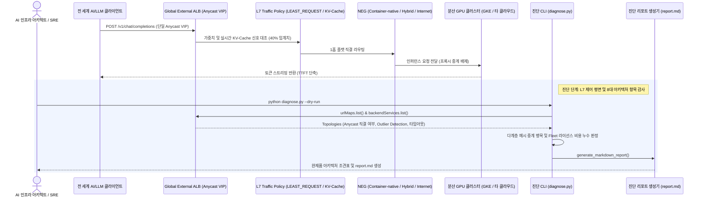

<!--
Copyright 2026 Google LLC. All Rights Reserved.
SPDX-License-Identifier: Apache-2.0

NOTICE: This code/repository is owned by Google LLC and provided under the Apache-2.0 License.
It is strictly provided as an EXAMPLE/REFERENCE ONLY and is NOT INTENDED FOR PRODUCTION USE.
All contents, designs, and code examples are subject to change, modification, or removal at any time without notice.

[고지 사항] 본 저장소 및 문서는 구글 (Google LLC) 소유이며 Apache 2.0 라이선스 하에 예시 (Sample) 용도로 제공된다.
프로덕션 환경용이 아니며, 사전 통지 없이 언제든지 수정, 변경 또는 삭제될 수 있다.
-->

# 기술 상세 설계서 (TDD): Multi-Cluster GKE Inference Gateway 라우팅 진단기 (`gke-multi-cluster-inference-gateway`)

## 1. 시스템 아키텍처 및 런타임 상호작용 시퀀스

본 도구의 런타임 제어 및 데이터 상호작용 흐름은 아래 시퀀스 다이어그램과 같다. 다계층 Istio 서비스 메시 중계 병목을 진단하고, 글로벌 Anycast VIP 기반 Global External ALB와 Hybrid/Internet NEG를 활용한 1홉 플랫 직결 L7 제어 평면 상태를 점검하여 복구 명령어를 처방한다.

---

## 2. 요구 사항 추적성 매핑 (Traceability Matrix)

| 비즈니스 요구 사항 (BRD) | 기능적 기술 요구 사항 (FR) | 비기능적 기술 요구 사항 (NFR) | 구현 파일 및 모듈 |
| :--- | :--- | :--- | :--- |
| **BR-01** (멀티 클러스터 라우팅 토폴로지 자동 진단) | **FR-01** (글로벌 L7 로드 밸런서 및 URL Map 라우팅 감사) | **NFR-01** (최소 IAM 권한 준수) | `diagnose.py` (`audit_alb_and_url_maps`) |
| **BR-02** (GPU 인퍼런스 가중치 및 부하 분산 점검) | **FR-02, FR-03** (백엔드 서비스, KV-Cache, 서킷 브레이커 감사) | **NFR-01** (최소 IAM 권한 준수) | `diagnose.py` (`audit_backend_services`) |
| **BR-03** (지연 시간 단축 및 라이선스 비용 소명) | **FR-05** (원클릭 완제품 리포트 및 복구 처방 생성) | **NFR-02** (가상 실행 모드) | `diagnose.py` (`generate_markdown_report`), `report.md` |
| **BR-04** (CISO 및 아키텍트용 완제품 리포트 생성) | **FR-05** (원클릭 완제품 리포트 및 복구 처방 생성) | **NFR-04** (리포트 절대 경로 저장 보장) | `diagnose.py` (`generate_markdown_report`), `report.md` |
| **BR-05** (공식 3대 제약 준수 및 우회 처방) | **FR-06** (공식 3대 제약 조건 감사) | **NFR-03** (크로스 플랫폼 단일 실행) | `diagnose.py` (`audit_official_constraints`) |
| **BR-06** (사내 거버넌스 4대 필수 라벨링 준수) | **FR-07** (사내 거버넌스 4대 필수 라벨링 적용) | **NFR-03** (보안 규약 준수) | `README.md`, `diagnose.py` |

---

## 3. 기능 요구 사항 (Functional Requirements)

### FR-01: 글로벌 L7 로드 밸런서 및 URL Map 라우팅 규칙 감사
- `gcloud compute url-maps list` 및 `describe`를 통해 분산 GPU 클러스터 대상 라우팅 정책(RouteRules / PathMatchers)을 감사한다.
- 가중치 기반 라우팅(Weight-based Split) 설정 여부 및 가중치 합계(100% 일치성)를 검증한다.

### FR-02: 백엔드 서비스 및 로드 밸런싱 알고리즘 검사
- 각 GPU 백엔드 서비스의 `localityLbPolicy`가 `LEAST_REQUEST`(최소 활성 요청 기반 동적 분배)로 구성되었는지 점검한다.
- 긴 컨텍스트 및 에이전트 워크로드의 VRAM 고갈을 방지하기 위해 GKE Inference Gateway의 실시간 KV-cache 사용률 신호(임계치 40% 도달 시 건강한 타 리전 클러스터로 자동 넘침/Spillover) 연동 여부를 점검한다.
- 긴 스트리밍 LLM 추론 연결을 지원하기 위한 백엔드 타임아웃(`timeoutSec` >= 600초) 설정 여부를 확인한다.

### FR-03: 서킷 브레이커 및 이상치 탐지(Outlier Detection) 감사
- 특정 GPU 클러스터의 연속 에러(5xx) 또는 지연 발생 시 트래픽을 즉시 안전한 타 클러스터로 넘기는 서킷 브레이커 및 이상치 탐지 정책 구성 여부를 점검한다.

### FR-04: 하이브리드 / 인터넷 NEG(Network Endpoint Group) 구성 무결성 검증
- 타 클라우드(EKS, 온프레미스 GPU 팜 등) 엔드포인트를 GKE Fleet 라이선스 비용 없이 Anycast VIP로 직결 수용하기 위한 Hybrid/Internet NEG 상태를 점검한다.

### FR-05: 원클릭 완제품 리포트(report.md) 및 복구 처방 생성
- 아키텍처 전환 전/후 지연 시간(TTFT) 및 라이선스 비용 비교 조견표를 포함한 표준 마크다운 리포트(`report.md`)와 실행 가능한 `gcloud` 최적화 명령어를 자동 생성한다.

### FR-06: 공식 3대 제약 조건 감사 (Same VPC, 50 NEG Limit, Model Armor)
- 동일 VPC 요건(`CHK-06`), 백엔드 서비스당 최대 50개 NEG 제한(`CHK-07`), Model Armor 미지원에 따른 Cloud Armor WAF 보완책(`CHK-08`)을 정밀 감사한다.

### FR-07: 사내 거버넌스 4대 필수 라벨링 적용
- GKE 클러스터 및 Global ALB 백엔드 서비스 생성 시 `managed-by=google-cloud-0-to-1`, `scenario=gke-multi-cluster-inference-gateway`, `env=sample`, `created-by=customer-engineer` 라벨을 필수로 주입한다.

---

## 3. 비기능 요구 사항 (Non-Functional Requirements)

### NFR-01: 최소 IAM 권한 준수
- 본 도구는 읽기 전용 인프라 진단 도구로서 `roles/compute.viewer` 권한만 요구한다.

### NFR-02: 가상 실행 모드 (--dry-run)
- 실제 GCP 호출 없이도 17개 분산 클러스터를 가정한 모의 실행 환경에서 1초 만에 완제품 분석 리포트를 생성할 수 있어야 한다.

### NFR-03: 크로스 플랫폼 단일 실행
- 쉘 래퍼 없이 `python diagnose.py` 명령만으로 Linux, macOS, Cloud Shell 환경에서 완결 동작한다.

### NFR-04: 리포트 절대 경로 저장 보장
- `report.md` 저장 시 스크립트 실행 작업 디렉터리(`cwd`)와 무관하게 스크립트 파일이 위치한 디렉터리의 절대 경로를 기준으로 저장하여 파일 유실을 방지한다.
