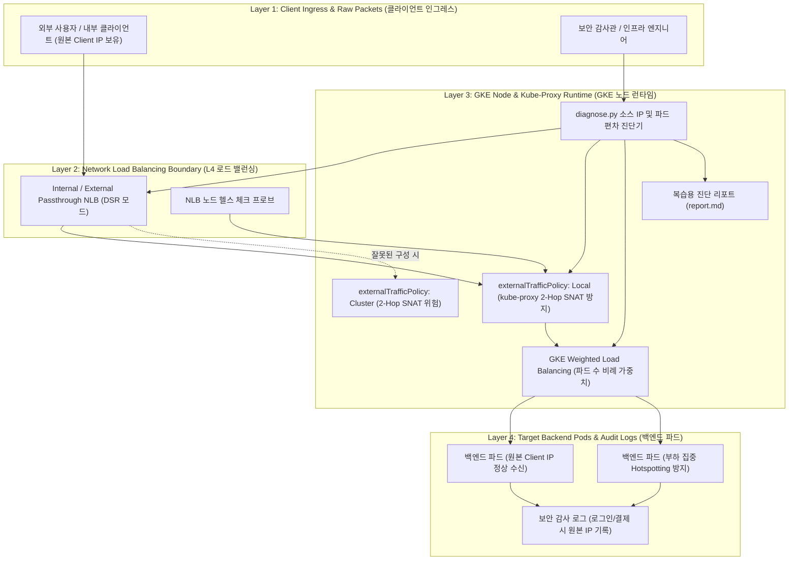

<!--
Copyright 2026 Google LLC. All Rights Reserved.
SPDX-License-Identifier: Apache-2.0

NOTICE: This code/repository is owned by Google LLC and provided under the Apache-2.0 License.
It is strictly provided as an EXAMPLE/REFERENCE ONLY and is NOT INTENDED FOR PRODUCTION USE.
All contents, designs, and code examples are subject to change, modification, or removal at any time without notice.

[고지 사항] 본 저장소 및 문서는 구글 (Google LLC) 소유이며 Apache 2.0 라이선스 하에 예시 (Sample) 용도로 제공된다.
프로덕션 환경용이 아니며, 사전 통지 없이 언제든지 수정, 변경 또는 삭제될 수 있다.
-->

> [!IMPORTANT]
> **구글 (Google LLC) 참조용 샘플 고지 사항**:
> 본 프로젝트의 모든 소스 코드와 문서는 Google LLC의 소유이며, Apache-2.0 라이선스에 따라 오직 **참조용 샘플 (Sample / Reference Only)** 목적으로만 제공된다. 프로덕션 환경에 그대로 사용할 수 없으며, 사전 통지 없이 언제든 내용이 수정, 변경 또는 삭제될 수 있다.

# GKE 소스 IP(Client IP) 보존 및 SNAT/부하 불균형 진단기 (`gke-source-ip-snat-guard`)

GKE 환경에서 Internal/External Passthrough NLB를 경유하여 인입되는 트래픽의 출발지 IP(Client IP) 유실(kube-proxy 2-Hop SNAT) 현상과 externalTrafficPolicy: Local 전환 시 발생하는 파드 부하 불균등(Pod Hotspotting) 위험을 1분 만에 자동 진단하고 최적 k8s 매니페스트를 처방하는 도구다. (As of 2026-10-17)

---

## 1. 발생 증상 및 진단 대상 체크리스트

사내 또는 고객사 환경에서 아래 증상이 발생한다면 즉시 진단 대상이다:
- [ ] AWS EKS에서 GKE로 애플리케이션을 이전한 후, 동일한 인그레스(Kong, Nginx 등) 구성임에도 백엔드 Pod 로그에 클라이언트 실제 IP 대신 노드 내부 IP가 간헐적으로 기록된다.
- [ ] 개인 정보 보호법 및 금융 보안 컴플라이언스상 로그인 접속자 IP 추적이 필수적인 환경에서 원본 Client IP가 유실되어 보안 감사 결함이 발생한다.
- [ ] `externalTrafficPolicy: Cluster` 상태에서 파드가 없는 노드로 패킷이 유입된 후 2-Hop 전달 과정에서 kube-proxy SNAT(Source Network Address Translation)가 발생한다.
- [ ] Client IP 보존을 위해 `externalTrafficPolicy: Local`로 변경했으나, 노드별 파드 수가 불균등하여 특정 파드로 트래픽이 쏠리는 심각한 부하 불균형(Pod Hotspotting)이 발생한다.
- [ ] GKE Weighted Load Balancing 애너테이션 부재로 인해 파드가 없는 노드로 유입된 트래픽의 헬스체크 실패 및 드롭 현상이 일어난다.


### 1.1 도구의 본질 및 비즈니스 해결 과제 (What & Why)
- **대상 사용자 (Target)**: GKE 클러스터 어드민, 보안 감사관, 네트워크 엔지니어 및 백엔드 개발자
- **해결하는 핵심 문제 (Core Pain Points)**:
  1. Passthrough NLB를 경유하여 파드로 인입되는 트래픽의 실제 클라이언트 IP가 kube-proxy의 2-Hop SNAT으로 인해 노드 IP로 변조/유실되는 문제
  2. 출발지 IP 유실로 인해 보안 감사업무(감사 로그, 차단 정책, FSI 규제)와 지리적 접근 제어가 마비되는 현상
  3. **`externalTrafficPolicy**: `externalTrafficPolicy: Local` 설정 시 발생하는 파드 간 트래픽 부하 불균등(Pod Hotspotting) 및 드롭 위험
- **본 솔루션의 해결 방식 (Solution)**:
  - GKE 서비스 매니페스트와 NLB 구성을 분석하여 kube-proxy 2-Hop SNAT 위험과 부하 불균등 위험을 교차 진단하고, 클라이언트 원본 IP를 온전히 보존하면서 트래픽을 균등 분산하는 최적 k8s 서비스 매니페스트를 처방한다.

### 1.2 최종 산출물 3종 세트 미리보기 (Deliverables & Visual Preview)
본 도구를 실행(`python diagnose.py`)하면 다음 3가지 구체적인 엔터프라이즈 자산이 생성된다:

| 산출물 구분 | 산출물 형태 및 명칭 | 주요 포함 내용 및 실무 활용 방안 |
| :--- | :--- | :--- |
| **① 터미널 콘솔 요약** | Visual CLI Table | 서비스별 NLB 유형, externalTrafficPolicy 모드, 노드당 파드 분포, SNAT 유실 위험 및 핫스팟 판정 표 |
| **② 정규 진단 보고서** | 마크다운 파일 (`report.md`) | Client IP 보존 아키텍처 진단서, 2-Hop SNAT 메커니즘 분석, 패치용 k8s 서비스 매니페스트 및 보안 감사 가이드 |
| **③ 후속 조치 및 배포 자산** | Actionable Asset Specs | • **Client IP 보존 k8s 매니페스트**: `externalTrafficPolicy: Local`이 적용된 최적 서비스 YAML<br/>• **파드 안티-어피니티(Anti-affinity) 템플릿**: 노드별 파드 부하 불균등을 방지하는 배포 매니페스트<br/>• **GKE 감사 로깅 검증 쿼리**: 보존된 출발지 IP가 Cloud Logging에 정상 기록되는지 확인하는 SQL |

---

## 2. 빠른 시작 (Quickstart)

> [!TIP]
> Cloud Shell 접속 환경 구성 및 저장소 클론(`git clone`) 방법은 루트의 [메인 README](../../README.md)를 참고한다.

### 1) 모의 데이터 가상 실행 (Dry-Run)
GCP API 호출 없이 내장된 가상 인프라 데이터로 정상 동작 여부를 즉시 검증한다:
```bash
python diagnose.py --dry-run
```

**터미널 진단 출력 미리보기:**
```text
GKE 소스 IP(Client IP) 보존 및 SNAT 상태 진단 시작 (프로젝트: sample-project-id, 클러스터: prod-core-cluster)
--> 가상 실행 모드 (--dry-run) 활성화: 사전 시뮬레이션 클러스터 및 인그레스 데이터를 분석한다.
=========================================================================================================
네임스페이스/서비스                         LB 유형                    extPolicy    노드/파드          심각도       
---------------------------------------------------------------------------------------------------------
ingress-gateway/kong-proxy-internal Internal Passthrough NLB Cluster      3노드/2파드        CRITICAL  
ingress-nginx/nginx-ingress-external External Passthrough NLB Local        3노드/4파드        WARNING   
billing/payment-api-service        Internal Passthrough NLB Local        3노드/6파드        HEALTHY   
=========================================================================================================
[발견된 주요 네트워크 결함 및 권고 조치]
```


### 2) 사내 환경 대화형 설정 (Config Wizard, 선택 사항)
사내 활성 프로젝트 및 환경 설정을 대화형으로 탐색하여 `.env`에 자동 저장한다:
```bash
python diagnose.py --config
```


### 3) 실제 사내 인프라 실시간 진단
```bash
python diagnose.py
```
> [!NOTE]
> 앞서 `python diagnose.py --config`로 환경 설정을 저장했거나 gcloud 활성 설정을 그대로 활용할 경우 별도의 `.env` 생성 없이 즉시 실행할 수 있다. (환경 변수를 텍스트 에디터로 직접 수동 편집하고자 할 때만 `cp -n .env.example .env` 실행 후 수정)

---

## 3. 솔루션 아키텍처 및 처리 흐름



---
## 4. 조치 가이드 및 권장 설정

- GKE 내부 부하 분산기 소스 IP 보존 가이드 ( https://docs.cloud.google.com/kubernetes-engine/docs/how-to/internal-load-balancing )
- GKE 가중치 로드 밸런싱 구성 안내 ( https://docs.cloud.google.com/kubernetes-engine/docs/how-to/load-balance-ingress )
- Kubernetes Service 소스 IP 보존 개념 ( https://kubernetes.io/docs/tutorials/services/source-ip/ )

### 1. externalTrafficPolicy: Local 전환 및 패치
```bash
kubectl patch svc [SERVICE_NAME] -n [NAMESPACE] -p '{"spec":{"externalTrafficPolicy":"Local"}}'
```

### 2. GKE Weighted Load Balancing(Subsetting) 활성화
```yaml
apiVersion: v1
kind: Service
metadata:
  name: [SERVICE_NAME]
  namespace: [NAMESPACE]
  annotations:
    networking.gke.io/load-balancer-type: "Internal"
    networking.gke.io/weighted-load-balancing: "true"
spec:
  type: LoadBalancer
  externalTrafficPolicy: Local
  internalTrafficPolicy: Local
```

### 3. Ingress Controller 파드 균등 배치를 위한 토폴로지 제약(TopologySpreadConstraints)
```yaml
spec:
  topologySpreadConstraints:
  - maxSkew: 1
    topologyKey: "kubernetes.io/hostname"
    whenUnsatisfiable: DoNotSchedule
    labelSelector:
      matchLabels:
        app.kubernetes.io/name: ingress-gateway
```

---
## 5. 사전 준비 사항 (필요 IAM 권한)

본 도구를 실행하려면 최소 아래의 IAM 권한이 필요하다:

- `roles/container.viewer` (GKE 클러스터 및 워크로드 읽기 권한)
- 세부 권한:
  - `container.services.get`
  - `container.services.list`
  - `container.pods.list`

---

## 6. 기술적 배경 및 아키텍처 원리 (Deep Dive)

### 관련 상세 설계 및 요구 사항 명세
- [비즈니스 요구 사항 명세서 (BRD)](docs/BRD.md): 비즈니스 배경, 성공 지표 및 요구 사항(BR-01~) 명세
- [기술 상세 설계서 (TDD)](docs/TDD.md): 시스템 아키텍처, 기능(FR-01~) 및 비기능(NFR-01~) 설계 명세

GKE 클러스터, LoadBalancer 서비스 및 연관 인프라 자원 배포 시 4대 표준 라벨을 반드시 적용한다:
- `managed-by`: `google-cloud-0-to-1`
- `scenario`: `gke-source-ip-snat-guard`
- `env`: `sample` (또는 `poc`)
- `created-by`: `customer-engineer`

---
## 7. 리소스 정리 (Teardown) 안내

본 도구는 읽기 전용 진단 스크립트이므로 자체적으로 리소스를 생성하거나 과금을 유발하지 않는다. 테스트 목적으로 생성한 LoadBalancer 서비스가 있다면 다음 명령어로 삭제한다:
```bash
kubectl delete svc [TEST_SERVICE_NAME] -n [NAMESPACE]
```
