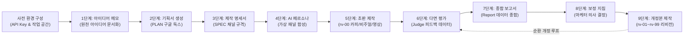

<!--
Copyright 2026 Google LLC. All Rights Reserved.
SPDX-License-Identifier: Apache-2.0

NOTICE: This code/repository is owned by Google LLC and provided under the Apache-2.0 License.
It is strictly provided as an EXAMPLE/REFERENCE ONLY and is NOT INTENDED FOR PRODUCTION USE.
All contents, designs, and code examples are subject to change, modification, or removal at any time without notice.

[고지 사항] 본 저장소 및 문서는 구글 (Google LLC) 소유이며 Apache 2.0 라이선스 하에 예시 (Sample) 용도로 제공된다.
프로덕션 환경용이 아니며, 사전 통지 없이 언제든지 수정, 변경 또는 삭제될 수 있다.
-->

> [!IMPORTANT]
> **구글 (Google LLC) 참조용 샘플 고지 사항**:
> 본 프로젝트의 모든 소스 코드와 문서는 Google LLC의 소유이며, Apache-2.0 라이선스에 따라 오직 **참조용 샘플 (Sample / Reference Only)** 목적으로만 제공된다. 프로덕션 환경에 그대로 사용할 수 없으며, 사전 통지 없이 언제든 내용이 수정, 변경 또는 삭제될 수 있다.

# 구글 워크스페이스(Google Workspace) 마케팅 콘텐츠 파이프라인 (`gws-marketing-content-pipeline`)

서버 인프라 구축이나 로컬 개발 환경 설정 없이, Google AI Studio API Key 1회 등록만으로 구글 드라이브(Google Drive)와 구글 시트(Google Sheets) 환경에서 마케팅 캠페인 기획, 멀티 채널 콘텐츠 생성 및 AI 페르소나 다면 평가를 실행하는 워크스페이스 자동화 파이프라인이다. (As of 2026-10-15)

**Audience**: `#Marketer`, `#Developer`  
**Concern**: `#Productivity`, `#Resilience`  
**Service**: `#GeminiAPI`, `#Workspace`

---

## 튜토리얼 개요 및 목표

본 가이드는 클라우드 인프라 승인이나 별도 개발 도구 설치 없이, 마케터가 일상적으로 사용하는 구글 드라이브(Google Drive)와 구글 시트(Google Sheets) 환경 안에서 생성형 AI 기반 마케팅 콘텐츠 파이프라인을 직접 구축하고 운영하는 실무 튜토리얼이다.

본 가이드를 따라 진행하면 다음 과업을 마케터가 자가 완결적으로 수행할 수 있다:
- 구글 드라이브 캠페인 폴더에 서버리스 마케팅 자동화 작업 공간 구축
- 아이디어 메모 한 줄로부터 캠페인 기획서(PLAN) 및 채널별 제작 명세서(SPEC) 자동 도출
- 타깃 AI 페르소나 가상 패널 합성 및 멀티 채널 콘텐츠(카피라이팅, 배너/포스터/SNS 이미지, 모바일 숏폼 영상) 초판(rv-00) 제작
- 가상 소비자 패널 다면 평가 분석 및 마케터 보정 지침 기반 개정본(rv-01 ~ rv-99) 순환 도출

---

## 처리 흐름도 (Activity Diagram)



---

## 사전 환경 구성 (Setup Guide)

### 1단계: 구글 드라이브 캠페인 폴더 및 구글 시트 생성

1. 구글 드라이브 ( https://drive.google.com )에 접속하여 이번 캠페인 이름으로 새 폴더를 생성한다. (예: `2026 가을 오텀 브리즈 캠페인`, `autumn-campaign-2026` 등 자유롭게 명명).
   - 폴더의 고유 ID로 영구 바인딩되므로 추후 폴더 이름을 변경해도 정상 추적된다.
2. 생성한 폴더 안으로 이동하여 빈 구글 시트(Google Sheets) 문서를 새로 생성한다.
3. 구글 시트 상단 메뉴에서 `확장 프로그램` > `Apps Script`를 클릭하여 스크립트 편집기를 연다.

### 2단계: 부트스트랩 스크립트 및 매니페스트 등록

1. Apps Script 기본 편집창(`Code.gs`)의 기존 코드를 모두 지우고 본 저장소의 [bootstrap.js](bootstrap.js) 내용을 복사하여 붙여넣는다.
2. 좌측 메뉴의 `프로젝트 설정 (톱니바퀴 아이콘)`을 클릭하고 `편집기에서 "appsscript.json" 매니페스트 파일 표시`를 체크한다.
3. 다시 좌측 메뉴 상단의 `편집기 (<> 아이콘)`를 클릭한 뒤, 파일 목록에 나타난 `appsscript.json`을 선택하고 기존 내용을 지운 후 본 저장소의 [appsscript.json](appsscript.json) 내용을 붙여넣는다.
4. 상단 메뉴의 `디스크 아이콘 (프로젝트 저장)`을 클릭하여 저장한다.

### 3단계: 최초 권한 승인 및 제어 패널(사이드바) 기동

1. 구글 시트 브라우저 탭으로 돌아와 페이지를 새로고침(F5)한다.
2. 잠시 후 상단 메뉴에 `[마케팅 콘텐츠 파이프라인]` 메뉴가 생성되면 클릭 후 `제어 패널 열기`를 선택한다.
3. 최초 1회 실행 시 구글 계정 권한 승인 창이 나타난다:
   - `권한 필요(Authorization Required)` 대화상자에서 `계속(Continue)`을 클릭한다.
   - 파이프라인을 구동할 본인의 구글 계정을 선택한다.
   - `Google에서 확인하지 않은 앱(Google hasn't verified this app)` 경고 화면이 나타나면 좌측 하단의 `고급(Advanced)` 링크를 클릭한 후, `...으로 이동(안전하지 않음)(Go to ... (unsafe))`을 클릭한다.
   - 구글 드라이브, 구글 독스, 구글 폼, 구글 시트 등의 접근 권한 요청 화면에서 `모두 선택(Select all)` 체크박스를 활성화하고 하단의 `계속(Continue)` 또는 `허용(Allow)`을 클릭한다.
4. 권한 승인이 완료되면 구글 시트 우측에 마케팅 콘텐츠 파이프라인 제어 패널(사이드바)이 열린다.

### 4단계: Gemini API Key 등록 및 연결 검증

1. Google AI Studio ( https://aistudio.google.com/app/apikey )에서 구글 계정으로 Gemini API Key를 발급받는다.
   - 기본 무료 발급 키는 멀티모달 콘텐츠 생성 시 토큰이나 할당량(Quota)이 충분하지 않을 수 있으므로, 안정적인 연속 실행을 위해서는 AI Studio 콘솔에서 종량제(Pay-as-you-go) 결제 연결을 권장한다.
2. 사이드바 상단 온보딩 카드의 `[지금 API Key 등록하기]`를 누르고 복사한 API Key를 입력한 뒤 `[저장 및 검증]`을 클릭한다.
3. 상단 배지에 `API Key: 등록됨` 상태가 표시되는지 확인한다.

---

## 파이프라인 실행 가이드 (Execution Guide)

사이드바 하단의 10단계 로드맵 버튼을 순서대로 클릭하거나, 중단 AI 코파일럿 대화창에 `지금 뭐 해야 돼?`를 입력하여 단계별 작업을 수행한다.

파이프라인이 생성한 모든 문서(`PLAN`, `SPEC`, 프롬프트, 보정 지침 등)는 마케터가 구글 드라이브에서 직접 열어 수작업으로 수정할 수 있으며, 후속 단계는 마케터가 편집한 최신 내용을 실시간으로 자동 반영하여 동작한다.

### 0단계: 작업 공간 구축 (Workspace Setup)
- 사이드바에서 `[0단계: 작업 공간 구축]` 버튼을 클릭한다.
- 구글 드라이브 캠페인 폴더 내에 `prompts/`, `input/`, `output/` 디렉터리와 9대 프롬프트 구글 독스, AI 페르소나 마스터 패널, 고객 피드백 설문 구글 폼이 자동 생성된다.

### 1단계: 캠페인 아이디어 메모 작성 (Idea Memo)
- `[1단계: 아이디어 메모]` 버튼을 클릭하고 펼쳐지는 입력 상자에 이번 캠페인의 핵심 아이디어를 작성한 뒤 저장한다 (저장 시 캠페인 폴더 직속에 `[아이디어 메모]` 구글 독스가 신규 생성된다).
- (수작업 편집 반영) 생성된 `[아이디어 메모]` 구글 독스를 직접 열어 상세 내용을 자유롭게 편집할 수도 있으며, 2단계(기획서 생성)에 수정 내용이 즉시 반영된다.

### 2단계: 캠페인 기획서(PLAN) 생성 (Campaign Plan)
- `[2단계: 기획서(PLAN) 생성]` 버튼을 클릭한다.
- AI가 아이디어 메모를 분석하여 타깃 분석, 핵심 메시지, 채널 전략이 구조화된 `PLAN` 구글 독스를 자동 도출한다.
- (수작업 편집 반영) 생성된 `PLAN` 문서를 직접 열어 타깃 전략이나 핵심 메시지를 수정하면, 3단계(제작 명세서 생성)에 수정 내용이 즉시 반영된다.

### 3단계: 콘텐츠 제작 명세서(SPEC) 생성 (Creative Spec)
- `[3단계: 제작 명세서(SPEC) 생성]` 버튼을 클릭한다.
- 기획서 규격에 맞추어 채널별 카피 규격, 비주얼 프롬프트 가이드, 모바일 숏폼 영상 콘티가 포함된 `SPEC` 구글 독스가 생성된다.
- (수작업 편집 반영) 생성된 `SPEC` 문서를 직접 열어 채널별 카피 규격, 비주얼 스타일, 영상 연출 콘티를 수정하면, 4단계(페르소나 패널) 및 5단계(초판 제작)에 수정 내용이 반영된다. 특히 스펙서에 자연어로 "영상 제작 제외", "특정 이미지 종횡비 지정" 등을 기술하면 5단계 미디어 파일 생성 시 해당 지침이 반영되어 불필요한 영상이나 이미지를 건너뛰고 선별 제작한다.

### 4단계: 맞춤 AI 페르소나 패널 구성 (Persona Synthesis)
- `[4단계: 맞춤 AI 페르소나 패널]` 버튼을 클릭한다.
- AI가 제작 명세서의 타깃 오디언스를 분석하여 연령, 직업, 라이프스타일, 소비 성향이 정의된 가상 소비자 패널(`ai_personas.json`)을 자동 합성한다.
- (수작업 편집 반영) 필요 시 `ai_personas.json` 파일을 직접 열어 특정 페르소나의 성향이나 관점을 수정할 수 있으며, 6단계(다면 평가)에 수정된 내용이 그대로 적용된다.

### 5단계: 초판(rv-00) 멀티 채널 콘텐츠 일괄 제작 (Initial Content)
- `[5단계: 초판 콘텐츠 제작]` 버튼을 클릭한다.
- `output/rv-00/` 폴더에 마케터 명세서(SPEC) 지침에 따라 선별된 멀티 채널 콘텐츠 에셋이 자동 생성된다:
  - `campaign_content` (구글 독스: 최상단 [SPEC 반영 미디어 산출물 현황] 요약 표, 채널별 카피라이팅 및 숏폼 영상 콘티 수록)
  - `media_specs.json` (스펙서 자연어 지침을 파싱한 실제 제작 미디어 명세 정형 데이터)
  - `00_sns_1x1.png` (정사각형 1:1 SNS 피드 이미지)
  - `00_poster_9x16.png` (세로형 9:16 매장 포스터 이미지)
  - `00_banner_16x9.png` (가로형 16:9 웹 배너 이미지)
  - `00_shorts.mp4` (세로형 9:16 모바일 숏폼 영상, 스펙서에서 제외 요청 시 미제작)

### 6단계: AI 페르소나 다면 평가 실행 (Judge Evaluation)
- `[6단계: AI 페르소나 다면 평가]` 버튼을 클릭한다.
- 합성된 AI 가상 패널이 초판 콘텐츠를 다면 평가하여 정량 평점, 정성 VoC, 채널별 선호도가 담긴 구조화된 피드백 데이터셋(`ai_persona_feedbacks.json`)을 도출한다.

### 7단계: 피드백 종합 분석 보고서 생성 (Feedback Summary)
- `[7단계: 피드백 종합 분석 보고서]` 버튼을 클릭한다.
- 수집된 가상 페르소나 평가 결과와 고객 설문 응답을 종합 분석하여 강점, 약점, 채널별 개선 우선순위를 요약한 단일 구글 독스(`feedback_summary`)가 생성된다.

### 8단계: 마케터 보정 지침 확정 (Marketer Directive)
- `[8단계: 마케터 보정 지침]` 버튼을 클릭한다.
- 종합 보고서를 검토한 후 마케터의 최종 의사 결정 코멘트(예: "20대 여성 타깃에 맞추어 카피 톤을 더 친근하게 다듬고, 인스타그램 배너의 제품 강조 컷 확대")를 입력 상자에 작성하고 확정한다.
- (수작업 편집 반영) 사이드바 입력 상자 대신 구글 드라이브 내 `마케터 보정 지침` 구글 독스를 직접 열어 상세 지침을 작성해도 9단계(개정본 제작)에 반영된다.

### 9단계: 피드백 반영 개정본(rv-01 ~ rv-99) 순환 생성 (Feedback Revision)
- `[9단계: 피드백 반영 개정본]` 버튼을 클릭한다.
- 마케터의 보정 지침을 최우선 반영하여 개정된 차기 리비전(`output/rv-01/`) 카피라이팅, 비주얼 이미지 3종, 숏폼 영상이 새롭게 제작된다.
- 필요 시 6단계(다면 평가)부터 9단계(개정본 제작)까지의 평가 및 보정 순환 루프를 반복하여 최대 `rv-99`까지 리비전을 누적 생성하며 콘텐츠 완성도를 점진적으로 극대화할 수 있다.

---

## 디렉터리 구조

초기화 완료 시 마케터의 구글 드라이브 캠페인 폴더 내에 자동 구성되는 구조는 다음과 같다:

```text
My Drive/
└── [캠페인 폴더]/ (예: 2026 가을 오텀 브리즈 캠페인)
    ├── [마케팅 콘텐츠 컨트롤 타워] 2026 가을 오텀 브리즈 캠페인 (구글 시트: 실행 내역 및 VoC 집계)
    ├── [아이디어 메모] (구글 독스: 1단계 실행 시 생성되는 마케터 원천 아이디어 작성 문서)
    ├── 고객 피드백 설문 (구글 폼: 고객 VoC 접수용 설문지)
    ├── ai_personas.json (타깃 AI 페르소나 패널 데이터)
    ├── PLAN (구글 독스: 마케팅 캠페인 기획서)
    ├── SPEC (구글 독스: 멀티 채널 콘텐츠 제작 명세서)
    ├── prompts/ (마케터 직접 편집 가능한 9대 프롬프트 구글 독스)
    ├── input/ (피드백 데이터셋: fb-01, fb-02 ... fb-99)
    │   └── fb-01/
    │       ├── feedback_summary (구글 독스: 종합 분석 보고서)
    │       ├── 마케터 보정 지침 (구글 독스: 마케터 최종 의사 결정 문서)
    │       └── ai_persona_feedbacks.json (AI 페르소나 다면 평가 데이터셋)
    └── output/ (리비전별 콘텐츠: rv-00, rv-01 ... rv-99)
        └── rv-00/
            ├── campaign_content (구글 독스: 미디어 현황 요약 표, 카피라이팅 및 숏폼 콘티)
            ├── media_specs.json (명세서 파싱 미디어 제작 스펙 메타데이터)
            ├── 00_banner_16x9.png (가로 배너 16:9)
            ├── 00_poster_9x16.png (세로 포스터 9:16)
            ├── 00_sns_1x1.png (SNS 피드 1:1)
            └── 00_shorts.mp4 (세로 9:16 모바일 숏폼 영상, 제외 시 미제작)
```

---

## 자원 정리 안내 (Teardown)

- **숏폼 영상 권장 규격**: 브라우저 런타임 제약(6분 타임아웃, 30MB 페이로드)에 따라 15초~30초 이내의 숏폼 동영상을 권장한다. 1분 이상의 장문 인터뷰나 대용량 고화질 영상 처리가 필요한 엔터프라이즈 환경에서는 Google Cloud 환경(Vertex AI, Cloud Run)으로의 이관 컨설팅을 권장한다.
- **자원 정리 안내**: 본 솔루션은 상시 가상 머신(VM)이나 전용 데이터베이스 등 상시 인프라 리소스를 생성하지 않는다. 실습 종료 후 구글 드라이브에서 해당 캠페인 폴더 1개만 휴지통으로 이동하여 비우면 모든 데이터가 정리된다.
