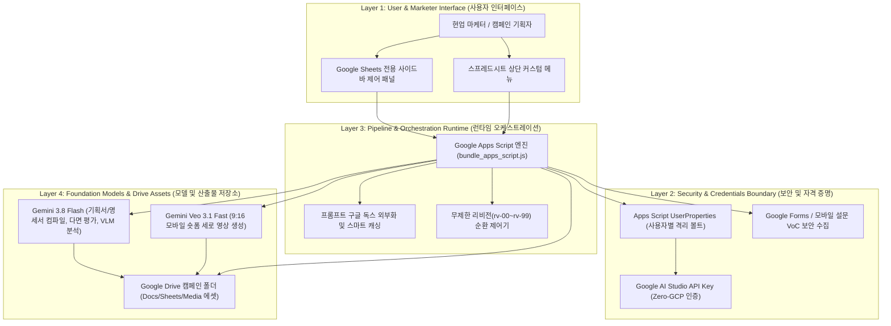

<!--
Copyright 2026 Google LLC. All Rights Reserved.
SPDX-License-Identifier: Apache-2.0

NOTICE: This code/repository is owned by Google LLC and provided under the Apache-2.0 License.
It is strictly provided as an EXAMPLE/REFERENCE ONLY and is NOT INTENDED FOR PRODUCTION USE.
All contents, designs, and code examples are subject to change, modification, or removal at any time without notice.

[고지 사항] 본 저장소 및 문서는 구글 (Google LLC) 소유이며 Apache 2.0 라이선스 하에 예시 (Sample) 용도로 제공된다.
프로덕션 환경용이 아니며, 사전 통지 없이 언제든지 수정, 변경 또는 삭제될 수 있다.
-->

> [!IMPORTANT]
> **구글 (Google LLC) 참조용 샘플 고지 사항**:
> 본 프로젝트의 모든 소스 코드와 문서는 Google LLC의 소유이며, Apache-2.0 라이선스에 따라 오직 **참조용 샘플 (Sample / Reference Only)** 목적으로만 제공된다. 프로덕션 환경에 그대로 사용할 수 없으며, 사전 통지 없이 언제든 내용이 수정, 변경 또는 삭제될 수 있다.

# 구글 워크스페이스(Google Workspace) 마케팅 콘텐츠 파이프라인 (`gws-marketing-content-pipeline`)

서버 인프라 구축이나 로컬 개발 환경 설정 없이, Google AI Studio API Key 1회 등록만으로 구글 드라이브(Google Drive)와 구글 시트(Google Sheets) 환경에서 마케팅 캠페인 기획, 멀티 채널 콘텐츠 생성 및 AI 페르소나 다면 평가를 실행하는 워크스페이스 자동화 파이프라인이다. (As of 2026-10-17)

---

## 1. 발생 증상 및 진단 대상 체크리스트

사내 또는 고객사 환경에서 아래 증상이 발생한다면 즉시 진단 대상이다:
본 가이드는 클라우드 인프라 승인이나 별도 개발 도구 설치 없이, 마케터가 일상적으로 사용하는 구글 드라이브(Google Drive)와 구글 시트(Google Sheets) 환경 안에서 생성형 AI 기반 마케팅 콘텐츠 파이프라인을 직접 구축하고 운영하는 실무 튜토리얼이다. 본 가이드를 따라 진행하면 다음 과업을 마케터가 자가 완결적으로 수행할 수 있다:
- [ ] 구글 드라이브 캠페인 폴더에 서버리스 마케팅 자동화 작업 공간 구축
- [ ] 아이디어 메모 한 줄로부터 캠페인 기획서(PLAN) 및 채널별 제작 명세서(SPEC) 자동 도출
- [ ] 타깃 AI 페르소나 가상 패널 합성 및 멀티 채널 콘텐츠(카피라이팅, 배너/포스터/SNS 이미지, 모바일 숏폼 영상) 초판(rv-00) 제작
- [ ] 가상 소비자 패널 다면 평가 분석 및 마케터 보정 지침 기반 개정본(rv-01 ~ rv-99) 순환 도출

---

## 2. 빠른 시작 (Quickstart)

> [!TIP]
> Cloud Shell 접속 환경 구성 및 저장소 클론(`git clone`) 방법은 루트의 [메인 README](../../README.md)를 참고한다.

### 1) 구글 드라이브 작업 공간 설정
구글 드라이브에 캠페인 전용 폴더를 생성하고 Google AI Studio API 키를 등록한다.

**파이프라인 실행 현황 미리보기:**
```text
[Campaign Pipeline State]
- Workspace Directory : My Drive/Marketing Campaigns/2026-Q4-Launch
- Phase 1 (PLAN)      : [COMPLETED] 캠페인 기획서 생성 (cymbal-q4-plan.gdoc)
- Phase 2 (SPEC)      : [COMPLETED] 채널별 제작 명세서 도출 (social, mobile, email)
- Phase 3 (Content)   : [COMPLETED] 초판(rv-00) 카피라이팅 및 숏폼 비디오 프롬프트 생성
- Phase 4 (Feedback)  : [IN_PROGRESS] 가상 소비자 페르소나 패널 5인 다면 평가 진행 중
```

---

## 3. 솔루션 아키텍처 및 처리 흐름



---
## 4. 조치 가이드 및 권장 설정

- **Google Drive 콘솔**: ( https://drive.google.com )
- **Google AI Studio API Key 발급 콘솔**: ( https://aistudio.google.com/app/apikey )
- **Google Cloud 콘솔**: ( https://console.cloud.google.com )

---
## 5. 사전 준비 사항 (필요 IAM 권한)

본 도구를 실행하려면 최소 아래의 IAM 권한이 필요하다:

### 1단계: 구글 드라이브 캠페인 폴더 및 구글 시트 생성

1. 구글 드라이브 ( https://drive.google.com )에 접속하여 이번 캠페인 이름으로 새 폴더를 생성한다. (예: `2026 가을 오텀 브리즈 캠페인`, `autumn-campaign-2026` 등 자유롭게 명명).
   - 폴더의 고유 ID로 영구 바인딩되므로 추후 폴더 이름을 변경해도 정상 추적된다.
2. 생성한 폴더 안으로 이동하여 빈 구글 시트(Google Sheets) 문서를 새로 생성한다.
3. 구글 시트 상단 메뉴에서 `확장 프로그램` > `Apps Script`를 클릭하여 스크립트 편집기를 연다.

### 2단계: 부트스트랩 스크립트 및 매니페스트 등록

1. Apps Script 기본 편집창(`Code.gs`)의 기존 코드를 모두 지우고 본 저장소의 [bootstrap.js](bootstrap.js) 내용을 복사하여 붙여넣는다.
2. 좌측 메뉴의 `프로젝트 설정 (톱니바퀴 아이콘)`을 클릭하고 `편집기에서 "appsscript.json" 매니페스트 파일 표시`를 체크한다.
3. 다시 좌측 메뉴 상단의 `편집기 (<> 아이콘)`를 클릭한 뒤, 파일 목록에 나타난 `appsscript.json`을 선택하고 기존 내용을 지운 후 본 저장소의 [appsscript.json](appsscript.json) 내용을 붙여넣는다.
4. 상단 메뉴의 `디스크 아이콘 (프로젝트 저장)`을 클릭하여 저장한다.

### 3단계: 최초 권한 승인 및 제어 패널(사이드바) 기동

> [!NOTE]
> **보안 경고 관련 사전 안내 (100% 안전)**:
> 최초 1회 권한 승인 시 `Google에서 확인하지 않은 앱(Google hasn't verified this app)` 경고 화면이 나타나는 것은, 본인이 방금 생성한 사내 전용 Apps Script가 Google의 외부 공개 마켓플레이스 심사를 거치지 않았기 때문에 표시되는 정상적인 Google 보안 확인 절차입니다. 외부로 데이터가 유출되지 않는 사내 본인 계정 스크립트이므로 안심하고 `고급(Advanced)` > `...으로 이동(안전하지 않음)`을 클릭하여 계속 진행한다.

1. 구글 시트 브라우저 탭으로 돌아와 페이지를 새로고침(F5)한다.
2. 잠시 후 상단 메뉴에 `[마케팅 콘텐츠 파이프라인]` 메뉴가 생성되면 클릭 후 `제어 패널 열기`를 선택한다.
3. 최초 1회 실행 시 구글 계정 권한 승인 창이 나타난다:
   - `권한 필요(Authorization Required)` 대화상자에서 `계속(Continue)`을 클릭한다.
   - 파이프라인을 구동할 본인의 구글 계정을 선택한다.
   - `Google에서 확인하지 않은 앱(Google hasn't verified this app)` 경고 화면이 나타나면 좌측 하단의 `고급(Advanced)` 링크를 클릭한 후, `...으로 이동(안전하지 않음)(Go to ... (unsafe))`을 클릭한다.
   - 구글 드라이브, 구글 독스, 구글 폼, 구글 시트 등의 접근 권한 요청 화면에서 `모두 선택(Select all)` 체크박스를 활성화하고 하단의 `계속(Continue)` 또는 `허용(Allow)`을 클릭한다.
4. 권한 승인이 완료되면 구글 시트 우측에 마케팅 콘텐츠 파이프라인 제어 패널(사이드바)이 열린다.

### 4단계: Gemini API Key 등록 및 연결 검증

1. Google AI Studio ( https://aistudio.google.com/app/apikey )에서 구글 계정으로 Gemini API Key를 발급받는다.
   - 기본 무료 발급 키는 멀티모달 콘텐츠 생성 시 토큰이나 할당량(Quota)이 충분하지 않을 수 있으므로, 안정적인 연속 실행을 위해서는 AI Studio 콘솔에서 종량제(Pay-as-you-go) 결제 연결을 권장한다.
2. 사이드바 상단 온보딩 카드의 `[지금 API Key 등록하기]`를 누르고 복사한 API Key를 입력한 뒤 `[저장 및 검증]`을 클릭한다.
3. 상단 배지에 `API Key: 등록됨` 상태가 표시되는지 확인한다.

---

## 6. 기술적 배경 및 아키텍처 원리 (Deep Dive)

### 관련 상세 설계 및 요구 사항 명세
- [비즈니스 요구 사항 명세서 (BRD)](docs/BRD.md): 비즈니스 배경, 성공 지표 및 요구 사항(BR-01~) 명세
- [기술 상세 설계서 (TDD)](docs/TDD.md): 시스템 아키텍처, 기능(FR-01~) 및 비기능(NFR-01~) 설계 명세

본 솔루션은 Google Workspace 상에서 실행되나, 연관된 GCP 프로젝트 리소스(Cloud Storage 버킷, Vertex AI 엔드포인트 등) 연동 또는 확장 시 4대 표준 라벨을 반드시 적용한다:
- `managed-by`: `google-cloud-0-to-1`
- `scenario`: `gws-marketing-content-pipeline`
- `env`: `sample` (또는 `poc`)
- `created-by`: `customer-engineer`

---
## 7. 리소스 정리 (Teardown) 안내

- **숏폼 영상 권장 규격**: 브라우저 런타임 제약(6분 타임아웃, 30MB 페이로드)에 따라 15초~30초 이내의 숏폼 동영상을 권장한다. 1분 이상의 장문 인터뷰나 대용량 고화질 영상 처리가 필요한 엔터프라이즈 환경에서는 Google Cloud 환경(Vertex AI, Cloud Run)으로의 이관 컨설팅을 권장한다.
- **자원 정리 안내**: 본 솔루션은 상시 가상 머신(VM)이나 전용 데이터베이스 등 상시 인프라 리소스를 생성하지 않는다. 실습 종료 후 구글 드라이브에서 해당 캠페인 폴더 1개만 휴지통으로 이동하여 비우면 모든 데이터가 정리된다.
