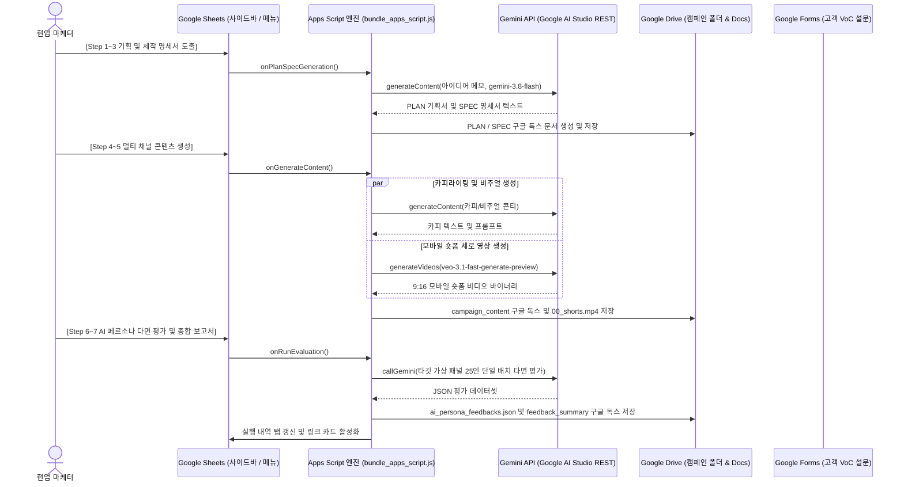

<!--
Copyright 2026 Google LLC. All Rights Reserved.
SPDX-License-Identifier: Apache-2.0

NOTICE: This code/repository is owned by Google LLC and provided under the Apache-2.0 License.
It is strictly provided as an EXAMPLE/REFERENCE ONLY and is NOT INTENDED FOR PRODUCTION USE.
All contents, designs, and code examples are subject to change, modification, or removal at any time without notice.

[고지 사항] 본 저장소 및 문서는 구글 (Google LLC) 소유이며 Apache 2.0 라이선스 하에 예시 (Sample) 용도로 제공된다.
프로덕션 환경용이 아니며, 사전 통지 없이 언제든지 수정, 변경 또는 삭제될 수 있다.
-->

# 기술 상세 설계서 (TDD): 구글 워크스페이스 마케팅 콘텐츠 파이프라인 (`gws-marketing-content-pipeline`)

## 1. 시스템 아키텍처 및 런타임 상호작용 시퀀스

본 솔루션은 Google Cloud 프로젝트 및 로컬 파이썬 런타임 환경에 의존하지 않는 서버리스 웹 네이티브(Web-Native) Zero-GCP 아키텍처로 설계되었다. 사용자의 Google Sheets에 바인딩된 Apps Script 엔진을 컨트롤 타워로 삼아, Google Drive, Google Docs, Google Forms 및 Google AI Studio API Key 기반 Gemini REST API를 유기적으로 조율한다.



---

## 2. 요구 사항 추적성 매핑 (Traceability Matrix)

| 비즈니스 요구 사항 (BRD) | 기능적 기술 요구 사항 (FR) | 구현 모듈 및 함수 |
| :--- | :--- | :--- |
| **BR-01** (Zero-GCP 인프라 자율성) | **FR-01** (Zero-GCP 런타임 및 API Key 인증) | `Code_Gemini.js`, `Code_Config.js` |
| **BR-02** (명세 주도 기획 및 생성) | **FR-03, FR-04** (PLAN/SPEC 도출 및 멀티 채널 콘텐츠 생성) | `Code_Content.js`, `Code_Prompts.js` |
| **BR-03** (타깃 AI 페르소나 합성) | **FR-05** (타깃 페르소나 패널 맞춤 합성) | `Code_Feedback.js` (`seedDefaultPersonas`) |
| **BR-04** (Google Forms 및 QR 연동) | **FR-06** (Google Forms 자동 생성 및 QR 바인딩) | `Code_Workspace.js` (`createFeedbackForm`) |
| **BR-05** (HITL 마케터 콘텐츠 보정) | **FR-08** (인간 참여형 직접 검토 및 반자율 보정) | `Code_Content.js` (`generateRevisionContent`) |
| **BR-06** (실시간 실행 내역 기록) | **FR-09** (실시간 실행 내역 Plain Sheet 기록) | `Code_Utils.js` (`recordStepResultToSheet`) |
| **BR-07** (AI 페르소나 다면 평가) | **FR-07** (페르소나 다면 평가 및 VLM 비디오 VoC 도출) | `Code_Feedback.js` (`generatePersonaFeedbacks`) |
| **BR-08** (VLM 시각 분석 및 수작업 스캔) | **FR-10** (고객 제출 이미지 VLM 시각 분석) | `Code_Feedback.js` (`analyzeImageFeedbackWithVlm`) |
| **BR-09** (99차 무제한 리비전 루프) | **FR-11, FR-12** (다이나믹 N차 탐지 및 사이드바 안내) | `Code_Sidebar.js`, `Code_Menu.js` |
| **BR-10** (로컬 모듈러 테스트 수이트) | **FR-13** (개발자 사전 검증용 로컬 테스트 러너) | `test_pipeline.py`, `tests/` |
| **BR-11** (프롬프트 구글 독스 외부화) | **FR-14** (9대 프롬프트 독스 시딩 및 스마트 캐싱) | `Code_Prompts.js` |
| **BR-12** (실사용 액션 중심 메뉴) | **FR-15** (액션 중심 메뉴 및 선결 가드레일) | `Code_Menu.js`, `Code_Sidebar.js` |
| **BR-13** (올인원 세팅 엔진) | **FR-16** (작업 공간, 페르소나 및 구글 폼 올인원 세팅) | `Code_Workspace.js` (`initCampaignWorkspace`) |

---

## 3. 핵심 구성 요소 및 연동 체계
1. **Google Apps Script 런타임**:
   - 구글 시트 상단 액션 중심 커스텀 메뉴 (`[마케팅 콘텐츠 파이프라인]`) 및 사이드바 제어 패널 통합 제공
   - 도메인별 책임 분리 기반 9대 코어 모듈(`Code_Config.js`, `Code_Content.js`, `Code_Feedback.js`, `Code_Gemini.js`, `Code_Menu.js`, `Code_Prompts.js`, `Code_Sidebar.js`, `Code_Utils.js`, `Code_Workspace.js`) 및 마케터 원클릭 배포용 단일 번들(`bundle_apps_script.js`), 경량 무수정 부트스트랩(`bootstrap.js`), 로컬 고속 사전 검증기 지원
2. **Google AI Studio API Key 기반 Gemini REST 엔드포인트 직접 연동 (태스크별 최적 모델 선정, As of 2026-10-15)**:
   - Google Cloud 콘솔 프로젝트 및 결제 계정 등록 없이, 개인 구글 계정으로 Google AI Studio에서 발급받은 API Key(`?key=...`)를 통해 `generativelanguage.googleapis.com` 엔드포인트를 직접 호출 (Zero-GCP Dependency)
   - 취득된 API Key는 Apps Script `UserProperties`에 사용자별로 안전하게 격리 보관되며, 미등록 시 대화상자 프롬프트를 통해 1회 입력받아 자동 영구 유지
   - 단일 모델에 의존하지 않고 각 작업의 속도, 처리 용량, 비용 효율성을 고려하여 검증된 모델을 취사선택하여 연동
   - `gemini-3.8-flash`: 빠른 응답 속도와 긴 컨텍스트 처리를 위한 아이디어 구체화, PLAN 기획서 및 SPEC 명세서 컴파일, AI 페르소나 다면 평가 및 VLM 비디오 VoC 심층 분석, 복합 피드백 기반 1차(rv-01), 2차(rv-02) 콘텐츠 심층 보정
   - `gemini-nano-banana-2.1`: 16:9 가로 배너, 9:16 모바일 포스터, 1:1 정방형 SNS 피드 이미지 규격에 최적화된 고효율 비주얼 소재 생성 (보조: `gemini-3.1-flash-image`, `imagen-4.0-generate-001`)
   - `veo-3.1-fast-generate-preview`: 브라우저 타임아웃을 방어하며 9:16 모바일 숏폼 영상(shorts) 콘티 기반 세로 비디오 소재를 생성하는 고속 모델 (보조: `veo-3.1-generate-preview`)
   - `text-multilingual-embedding-002`: 한국어 및 다국어 특화 텍스트 임베딩 모델로, 128차원 MRL(Matryoshka Representation Learning) 축소 차원을 적용하여 페르소나로부터 도출된 세부 의견 포인트를 고속 임베딩
3. **외부 경량 시각화 및 데이터 REST API**:
   - QuickChart REST API (`https://quickchart.io/qr`): Google Forms 모바일 설문 접속용 QR 코드 이미지를 실시간 렌더링하여 구글 시트 및 폼에 자동 바인딩
   - Hugging Face Datasets Server REST API (`https://datasets-server.huggingface.co/rows`): 공개 데이터셋으로부터 타깃 인구통계 페르소나 데이터 직접 인출 및 표준 정규화
4. **마케터 제어 인터페이스**:
   - 구글 시트 내 `실행 내역` 탭: 거추장스러운 장식 없이 1행 기본 헤더와 2행부터 순수 텍스트 행으로 한 줄씩 담백하게 누적되는 미니멀한 구글 시트 본연의 실행 내역 및 산출물 하이퍼링크 실시간 기록
   - 사이드바(Sidebar) 제어 패널: 상단 중복 타이틀을 제거하고 헤더 패딩을 축소하여 핵심 제어 기능 가독성을 극대화하며, 캠페인 폴더 내 기존 자산(`PLAN`, `SPEC`, `campaign_content`, 구글 폼 등)을 유연하게 감지하여 링크 카드 즉시 활성화 및 하단 `[실행 내역 열기]` 원클릭 시트 전환 제공
   - 인간 참여형(Human-in-the-loop) 마케팅 콘텐츠 보정 루프: 피드백 종합 요약서(`feedback_summary`) 구글 독스를 브라우저에서 직접 수정하고 개정본을 반자율 도출하는 대화형 워크플로우 지원

---

## 2. 기능적 기술 요구 사항 (Functional Requirements)

| 요구 사항 ID | 연관 BR | 기술 요구 사항 명칭 | 구현 상세 및 검증 기준 |
| :--- | :--- | :--- | :--- |
| **FR-01** | **BR-01** | **Zero-GCP 런타임 및 Google AI Studio API Key 인증** | Google Cloud 프로젝트 생성이나 결제 카드 등록 없이, 개인 구글 계정으로 발급받은 Google AI Studio API Key(`?key=...`)를 Apps Script `UserProperties`에 1회 등록하여 엔드포인트를 호출함으로써 비개발자 마케터의 진입 장벽을 낮추고 Zero-GCP 자율 구동을 지원한다. |
| **FR-02** | **BR-01, BR-03, BR-11, BR-13, BR-17** | **구글 드라이브 작업 폴더, 루트 페르소나 및 9대 프롬프트 독스 자동 시딩** | 초기화(0단계) 실행 시 마케터가 생성한 캠페인 루트 폴더 내에 `prompts/`, `input/`, `output/` 트리를 생성하고, 타깃 페르소나(`ai_personas.json`), 9대 프롬프트 구글 독스 및 고객 피드백 설문 폼을 자동 시딩한다. 원천 아이디어 메모는 0단계에서 자동 생성하지 않고 마케터가 1단계 실행 시 생성되도록 역할을 분리한다. |
| **FR-03** | **BR-02** | **명세 주도 기획서(PLAN) 및 콘텐츠 제작 명세서(SPEC) 자동 도출** | [Step 2 기획서 생성] 실행 시 1단계에서 등록된 [아이디어 메모] 구글 독스(또는 인라인 입력 아이디어)를 분석하여 캠페인 배경, 타깃 USP, 채널 전략이 구조화된 PLAN 구글 독스를 자동 도출하고, 이어 3단계에서 SPEC 명세서로 변환하여 확정한다. 마케터가 문서를 수정한 내용은 후속 단계에 반영된다. |
| **FR-04** | **BR-02** | **멀티 채널 마케팅 콘텐츠(카피, 이미지, 세로 숏폼 영상) 자동 생성** | [생성] 메뉴 실행 시 기획서(PLAN)와 콘텐츠 제작 명세서(SPEC)에 따라 광고 카피 및 숏폼 영상 연출 콘티가 통합된 구글 독스(`campaign_content`), 3개 종횡비 이미지(`00_banner_16x9.png`, `00_poster_9x16.png`, `00_sns_1x1.png`), 그리고 Gemini Veo 3.1 Fast 비디오 생성 API를 호출하여 생성한 세로 9:16 모바일 숏폼 실제 영상(`00_shorts.mp4`)을 콘텐츠 폴더에 자동 생성한다. |
| **FR-05** | **BR-03** | **타깃 AI 페르소나 패널 맞춤 합성 및 동적 갱신** | 제작 명세서(SPEC) 도출 시 타깃 오디언스 섹션을 기반으로 `03_persona_synthesis` 프롬프트를 통해 타깃 페르소나 패널(`id, name, age, gender, category, occupation, perspective`)을 온디맨드로 자동 합성하며, 커스텀 메뉴를 통한 수기 재설정 및 Hugging Face 데이터셋 연동 정규화를 지원한다. |
| **FR-06** | **BR-04, BR-13** | **Google Forms 자동 생성 및 모바일 QR 코드 바인딩 (초기화 올인원 연동)** | 초기화 실행 시 설문 문항(정량 평점, 정성 피드백, 미디어 파일 업로드)을 포함한 Google Forms를 동적 생성하고, Google Sheets 내 응답 탭 연결 및 QuickChart API 기반 모바일 접속용 QR 코드를 스프레드시트와 폼에 자동 바인딩한다. |
| **FR-07** | **BR-04, BR-07** | **AI 페르소나 다면 평가 데이터셋(JSON) 생성 및 Gemini VLM 비디오 VoC 종합 요약서 도출** | Step 6에서 '열린 피드백(Open-ended Feedback)' 원칙에 따라 기본 마스터 가상 패널(25인 규격) 및 맞춤 타깃 가상 패널 전원 대상 단일 배치(Single Batch) 1회 완결 호출(`callGemini(..., 8192, true)`)을 통해 풍부한 다중 세부 의견 포인트를 도출하여 구조화된 피드백 데이터셋(`ai_persona_feedbacks.json`)을 생성한다. `responseMimeType: "application/json"` 모드 및 잘린 JSON 배열 복원기(`repairTruncatedJsonArray`)를 통해 안전한 파싱을 보장하고, 모델 응답에서 누락된 페르소나가 발생할 경우 사내 마스터 프로필 기반으로 보완(Reconciliation)을 수행하며, Gemini 응답 오류, 객체 래핑 파싱, 또는 빈 배열(`[]`) 비정상 파일 감지 시 기본 마스터 페르소나 기반 결정론적 데이터셋으로 즉시 자가 치유(Self-Healing) 자동 복구한다. 이어 Step 7에서 실제 업로드된 동영상 VLM 분석(미제출 시 정직하게 미제출 명시 및 소설 배제), 이미지 VLM 분석, 수작업 자료를 종합하여 피드백 종합 분석 보고서(`feedback_summary`) 구글 독스를 자동 생성한다. |
| **FR-08** | **BR-05** | **인간 참여형(HITL) 마케터 직접 검토 및 반자율 마케팅 콘텐츠 보정** | 마케터가 `feedback_summary` 구글 독스 하단의 마케터 보정 지침 섹션을 직접 수정하거나 사이드바 8단계 인라인 상자(`directiveInlineBox`)에서 수기 코멘트를 직접 입력하면, `input/fb-xx/마케터 보정 지침` 구글 독스에 자동 저장 및 동기화하고 차기 리비전(rv-01, rv-02 등)에서 해당 지침을 최우선 반영하여 카피, 비주얼 이미지 3종, 숏폼 콘티 및 Gemini Veo 숏폼 비디오를 완결 보정한다. |
| **FR-09** | **BR-06, BR-18** | **실시간 실행 내역(Plain Sheet Style) 기록 및 하이퍼링크 갱신** | 매 단계 완료 시 Google Sheets의 `실행 내역` 탭에 거추장스러운 서식(남색 배너, 셀 병합, 테두리선) 없이 1행 기본 헤더(1행 고정, 엷은 회색 `#f1f3f4` 배경, 헤더 전체 가운데 정렬 및 바텀 얼라인, 라인 랩 줄 바꿈)와 2행부터 순수 텍스트 행(1열 실행 단계 좌측 정렬)으로 진행 상태, 소요 시간(단위 없는 초 단위 순수 숫자), 소모 토큰(단위 없는 순수 숫자), 산출물 하이퍼링크 및 상세 내역을 실시간 기록하며, 칼럼 너비를 A(100px), B(50px), C(250px), D(150px), E(50px), F(100px), G(400px)로 설정하여 컴팩트한 시각적 밀도를 확보한다 (`initDashboardSheet`, `applyDashboardColumnWidths`, `recordStepResultToSheet`). |
| **FR-10** | **BR-08** | **고객 제출 이미지 VLM 시각 분석 및 수작업 피드백 자료 스캔 엔진** | 25MB 이하 이미지의 Base64 인코딩 및 Gemini VLM 시각 분석(`analyzeImageFeedbackWithVlm`)을 수행하고, `input/{targetRound}/` 폴더 내 시스템 예약 파일을 제외한 모든 파일(이미지, 동영상, Google Docs, 텍스트 메모)의 동적 스캔 및 구조화 데이터 추출(`scanManualFeedbackFiles`)을 지원한다. |
| **FR-11** | **BR-09** | **다이나믹 N차 회차 탐지 및 99차 무제한 피드백 루프** | Google Drive 폴더 트리를 실시간 스캔하여 최신 회차 번호를 파악(`detectLatestFeedbackRoundNum`, `detectLatestRevisionRoundNum`)하되, 리비전 폴더 내에 실제 산출물 파일이 1개 이상 존재하는지 검증하여 미생성 시 `-1`을 반환함으로써 미완료와 완료 상태를 구분하고, 개정본(rv-01 등) 제작 완료 시 다음 차수 다면 평가(fb-02 등)로 정확하게 상태 머신을 전이하며, 사용자 대화형 UI를 통해 기본값 자동 채택 또는 1~99 범위 내 수기 입력을 처리하여 무제한 리비전 파이프라인 순환을 지원한다. |
| **FR-12** | **BR-09** | **화면 가림 모달 팝업 공해 배제 및 정돈된 사이드바 상태 안내 체계** | 사용자 집중을 방해하는 시트 중앙 모달 다이얼로그 및 토스트 팝업을 전면 배제하고, 사이드바 헤더의 동적 상태 뱃지(`getPipelineStatus`), AI 코파일럿 대화 버블 및 실행 내역 시트를 통해 파이프라인 진행 상태를 안정적이고 깔끔하게 안내한다. |
| **FR-13** | **BR-10** | **개발자 사전 검증용 로컬 모듈러 테스트 수이트** | 마케터 배포 번들(`bundle_apps_script.js`)의 경량성을 보존하기 위해 브라우저 런타임에서 테스트 코드를 전면 배제하고, 개발자가 로컬 터미널에서 `tests/` 패키지(시나리오, 에지케이스, 라이브 API)와 통합 러너 `python3 test_pipeline.py --all`로 신속하게 전수 검증할 수 있는 모듈러 테스트 수이트를 제공한다. |
| **FR-14** | **BR-11** | **마케터 직접 편집 가능한 9대 프롬프트 구글 독스 외부화 및 스마트 캐싱 엔진** | 9대 핵심 프롬프트(기획, 명세, 페르소나 합성, 생성, 다면 평가, VLM 미디어 분석, 종합 보고, 보정, 비주얼)를 `prompts/` 폴더 내 구글 독스로 자동 시딩하여 마케터가 브라우저에서 직접 편집할 수 있도록 하고, Apps Script 실행 시 `CacheService`를 적용하여 고속 스마트 캐싱을 보장한다. |
| **FR-15** | **BR-12** | **실사용 솔루션 액션 중심 메뉴 및 선결 가드레일 체계** | 워크숍용 순차 단계를 탈피하여 초기화, 설정, 기획, 생성, 평가, 보고서, 보정 메뉴를 순서 없이 자유롭게 호출할 수 있도록 하고, 필수 선결 산출물(기획서 누락, 초판 콘텐츠 누락, 다면 평가 데이터 누락 등)이 없을 때 시트 가림 모달 없이 사이드바 알림 카드 및 AI 코파일럿 대화창으로 선행 작업을 즉시 안내하는 비차단 가드레일을 제공한다. |
| **FR-16** | **BR-13** | **캠페인 작업 공간, 페르소나 및 구글 폼 올인원 세팅 엔진** | 초기화(0단계: 작업 공간 구축) 실행 시 필수 폴더 트리(`prompts/`, `input/`, `output/`)와 타깃 AI 페르소나 패널(`ai_personas.json`), 9대 프롬프트 구글 독스를 캠페인 폴더에 구성하고, 고객 VoC 설문 폼(Google Forms) 생성, 스프레드시트 응답 탭 연결 및 모바일 QR 코드 바인딩을 완결한다. 마케터 원천 아이디어 메모는 0단계에서 자동 생성하지 않고 1단계(아이디어 메모 작성) 실행 시 생성되도록 역할을 분리한다. |
| **FR-17** | **BR-14** | **GitHub Raw 기반 9대 프롬프트 실시간 인출 및 온디맨드 페르소나 합성 엔진** | 초기화(`initCampaignWorkspace`, `seedDefaultPrompts`) 실행 시 GitHub 퍼블릭 저장소의 Raw 엔드포인트를 호출하여 `prompts/*.md` 마크다운 파일 9종을 실시간 인출하여 구글 독스로 자동 시딩하고, 제작 명세서(SPEC)로부터 타깃 페르소나를 온디맨드로 자동 합성하여 `data/` 정적 폴더 의존성을 제거한다. |
| **FR-18** | **BR-14** | **경량 자동 갱신 부트스트랩 로더 (Dynamic Bootstrap Loader)** | 사용자가 Google Sheets Apps Script 편집기에 경량 `bootstrap.js`만 붙여넣으면, 간접 eval 및 90KB 청크 캐싱(`CacheService`) 기반 프록시 디스패처를 통해 GitHub 최신 번들 엔진을 실시간 자동 로드하여 구동함으로써 이후 기능 추가나 패치 시에도 사용자 측의 수동 코드 재배포 소요를 줄인다. |
| **FR-19** | **BR-15** | **폴더 우선 시작 UX (Folder-First UX) 및 고유 폴더 ID 영구 바인딩 엔진** | 마케터가 생성한 폴더 내에 위치한 구글 시트의 부모 폴더를 자동 감지(`getCampaignFolder`)하고, `ScriptProperties`에 구글 드라이브 고유 폴더 ID(`folder.getId()`)를 영구 바인딩하여 사후 폴더명이 변경되더라도 끊김 없이 동일한 캠페인 폴더를 지속 추적한다. |
| **FR-20** | **BR-16** | **영문 폴더명 원형 보존 및 한글 폴더명 슬러그 자동 변환 엔진 (`generateCampaignSlug`)** | 마케터가 명명한 폴더명이 영문일 경우 원형 그대로 슬러그로 채택하고, 한글 폴더명인 경우 마케팅 및 시즌 키워드를 정밀 분석하여 표준화된 영문 슬러그(예: `cp-2026-autumn-breeze`)로 안전하게 변환한다. |
| **FR-21** | **BR-17** | **스마트 자산 무손실 보존 및 결측 리소스 핀포인트 복구 엔진** | 작업 공간 초기화(`initCampaignWorkspace`) 실행 시 기존 기획서(`PLAN`), 제작 명세서(`SPEC`), 페르소나(`ai_personas.json`), 콘텐츠(`campaign_content`), 고객 설문 폼 등 기존 자산이 존재할 경우 덮어쓰거나 삭제하지 않고 보존하며, 오직 누락된 필수 디렉터리(`prompts/`, `input/`, `output/`)와 9대 프롬프트만 핀포인트 복구한다. |
| **FR-22** | **BR-18, BR-19** | **사이드바 3단 섹션 레이아웃 (Agent-first Architecture)** | 마케터의 대화 중심 작업 흐름을 위해 사이드바 화면을 3단 구조로 구현한다: 1섹션 최상단 상태 알림(캠페인 및 API Key 배지, 작업 실행 시에만 회전 스피너와 실시간 경과 시간 N초가 나타나는 스마트 인디케이터 Status Bar, 불필요한 고정 게이지/단계 박스 완전 제거 및 평면화), 2섹션 중단 AI 코파일럿 대화창(Gemini 3.8 Flash, 스크롤 없는 빠른 질의응답 및 액션 칩), 3섹션 하단 파이프라인 로드맵(0단계 버튼을 1~9단계와 동일한 플랫 버튼 및 인라인 박스 `setupInlineBox` 아코디언 스타일로 통일하여 시각적 두께 불일치 해소, 7단계 명칭을 '피드백 종합 분석 보고서 생성'으로 일관화, 상하 패딩 5px, 메뉴 간 세로 간격 1px 밀착 컴팩트 플랫 레이아웃, 0~9단계 10대 실행 버튼 및 아코디언 접기). |
| **FR-23** | **BR-19** | **사이드바 온보딩 가이드 배너 및 인라인 입력 엔진** | 사이드바 상단에 API Key 미등록 시 등록 유도 배너 및 초기화 유도 배너를 동적으로 표시하고, 마스킹 인풋 패널(`apiKeyInlineBox`), 1단계 아이디어 인라인 상자(`ideaInlineBox`), 8단계 마케터 보정 지침 인라인 상자(`directiveInlineBox`)를 통해 화면 중앙 모달 팝업 없이 사이드바 내에서 완결형 인라인 입력 및 실행을 지원한다. |
| **FR-24** | **BR-19** | **실시간 경과 타이머, 회전 스피너 및 스마트 인디케이터** | 장시간 작업 실행 시 불안감 해소를 위해 CSS 회전 스피너와 1초 단위 실시간 경과 시간 카운트업 타이머(`startTimer`, `stopTimer`)를 제공하고, 작업 완료 시 상태 표시줄 및 AI 코파일럿 대화창에 총 소요 시간과 완결 메시지, 구글 독스 추가 수정 안내 및 바로가기 링크를 직관적으로 표시하며, 평소에는 화면을 가리지 않도록 플랫하게 자동 숨김 처리된다. |
| **FR-25** | **BR-20** | **'도구에 도구를 묻다' AI 코파일럿 대화창 및 실시간 드라이브 스캔 엔진 (`askPipelineAssistant`)** | 사이드바 내에 Gemini 기반 상시 AI 대화창을 구현하여 마케터의 자연어 질의 및 지시를 `askPipelineAssistant` 서버 함수로 전달하고, 캐시를 우회한 구글 드라이브 실시간 전수 스캔(`getPipelineStatus(true)`) 및 유연한 자산 탐지 로직을 통해 실제 폴더 상태를 투명하게 브리핑하며, 해당 함수를 1클릭 실행하는 동적 액션 칩(버튼) 및 단일 '지금 뭐 해야 돼?' 빠른 추천 칩을 렌더링한다. 특히 코파일럿 대화는 경어(존댓말)를 일절 배제하고 동료 엔지니어 페어 프로그래밍 관점의 친근하고 전문적인 구어체(반말 대화체: `~야`, `~해`, `~했어`, `~하자`, `~볼게`, `~하면 돼`)로 Gemini 프롬프트 지침 및 30여 개 룰 기반 폴백 답변, 웰컴 메시지까지 일관되게 적용한다. |
| **FR-26** | **BR-21** | **자연어 SPEC 기반 미디어 스펙 지능형 컴파일 및 독스 보고서 엔진 (`compileMediaSpecFromDocs`)** | 마케터의 `SPEC` 독스 및 보정 지침 텍스트로부터 비디오 제작 여부(`includeVideo`)와 이미지 종횡비(`16:9`, `9:16`, `1:1`)를 Gemini 3.8 Flash 및 결정론적 룰 기반으로 분석하여 정형 미디어 스펙(`media_specs.json`)을 자동 컴파일하고, `campaign_content` 독스 최상단에 `[제작 명세서(SPEC) 반영 미디어 산출물 현황]` 헤더 표를 수록하며, `generateAndSaveVisualAssets` 및 `inspectRevisionFolder`에서 해당 스펙에 따른 선별 생성과 정확한 완성도 판정을 보장한다. |
| **FR-27** | **BR-22** | **사내 거버넌스 4대 필수 라벨링 적용** | 연관 GCP 프로젝트 및 클라우드 리소스 연동 시 `managed-by=google-cloud-0-to-1`, `scenario=gws-marketing-content-pipeline`, `env=sample`, `created-by=customer-engineer` 라벨을 필수로 주입한다. |

---

## 3. 비기능적 기술 요구 사항 (Non-Functional Requirements)

| 요구 사항 ID | 요구 사항 명칭 | 상세 기준 |
| :--- | :--- | :--- |
| **NFR-01** | **브라우저 실행 성능 및 타임아웃 방어** | Apps Script의 단일 실행 시간 제약(6분)을 초과하지 않도록 전체 파이프라인을 10개 독립 메뉴 단계(Step 0~Step 9)로 분할하고, 이미지 및 텍스트 생성 API 호출 시 실패 재시도 지수 백오프 로직을 적용한다. |
| **NFR-02** | **보안 및 자격 증명 안전성** | 사용자 API Key는 클라이언트 코드에 하드코딩되지 않고 Apps Script의 사용자별 격리 저장소(`PropertiesService.getUserProperties()`)에 안전하게 보관되며, Google Cloud 콘솔이나 프로젝트 결제 정보 노출 위험을 원천 방어한다. |
| **NFR-03** | **한글 맞춤법 복합어 띄어쓰기 및 문서 표준 준수** | 모든 생성 문서(PLAN, SPEC, 피드백 보고서, 카피라이팅)와 코드 주석은 한글 맞춤법 복합 명사 띄어쓰기 규정을 철저히 준수하고, 일체의 이모지 및 중간 점을 배제한다. |
| **NFR-04** | **자원 격리 및 원클릭 무잔재 정리 (Teardown)** | 모든 산출물은 마케터가 생성한 단일 캠페인 루트 폴더 내에 격리 생성되어, 테스트 완료 후 해당 폴더 1개만 휴지통으로 이동하면 무잔재 정리가 가능해야 한다. |
| **NFR-05** | **비디오 처리 제약 방어 및 Google Cloud 엔터프라이즈 확장 경로** | Apps Script의 단일 실행 시간 제한(6분) 및 `UrlFetchApp`의 페이로드 제한(최대 50MB, Base64 직렬화 시 실질 35MB)을 고려하여 브라우저 내에서는 15~30초 이내(30MB 이하) 숏폼 영상으로 크기를 사전 검증하고 초과 시 즉시 안내 예외를 반환한다. 1분 이상의 장문 인터뷰나 대용량 고해상도 영상을 다루어야 하는 엔터프라이즈 환경에서는 Google Cloud 환경으로의 이관을 위해 Google Cloud에 연락하여 전문 컨설팅을 받도록 안내한다. |
| **NFR-06** | **AI 코파일럿 대화 톤앤매너 일관성** | 사용자 대화창의 Gemini 코파일럿 응답 및 룰 기반 폴백 안내는 경어가 없는 친근하고 전문적인 구어체(반말 대화체)를 일관되게 유지하여 비개발자 마케터의 심리적 거리감을 해소하고 동료 페어 프로그래밍 몰입도를 극대화한다. |
| **NFR-07** | **리포트 절대 경로 저장 보장** | 로컬 테스트 러너 및 진단 스크립트 실행 시 산출물 저장 경로는 스크립트 파일이 위치한 디렉터리의 절대 경로를 기준으로 저장하여 파일 유실을 방지한다. |

---

## 4. 개발자 사전 검증: 로컬 에뮬레이션 및 모듈러 테스트 러너 명세 (test_pipeline.py)

마케터 배포용 Apps Script 코드(`bundle_apps_script.js`)의 경량성을 보존하기 위해, 브라우저 런타임에는 일체의 무거운 테스트 코드를 포함하지 않는다. 대신 개발자가 깃 푸시(Git Push)를 집행하기 전 로컬 환경에서 마케터 업무 흐름 E2E 시나리오, LLM 비정형 사족 방어 파서 단위 테스트, 그리고 Google AI Studio 라이브 API 직접 프로브를 포함한 통합 테스트 수이트(`test_pipeline.py` 및 `tests/`)를 제공하여 신속하게 전수 검증할 수 있도록 지원한다.

### 4대 핵심 테스트 영역 및 모듈 구조

1. **마케터 E2E 업무 흐름 및 에셋 보존 시나리오 검증 (`tests/test_scenario.py`)**:
   - `test_step1_and_step2_plan_and_spec_separation`: 기획서(PLAN)와 제작 명세서(SPEC) 2단계 분리 도출 검증
   - `test_step3_persona_auto_synthesis`: 제작 명세서(SPEC)의 타깃 오디언스 기반 맞춤 AI 페르소나 자동 합성 검증
   - `test_step4_initial_content_generation`: SPEC 규격 기반 초판 콘텐츠(rv-00) 세트 생성 검증
   - `test_step5_marketer_directive_preservation`: 피드백 보고서와 독립된 마케터 보정 지침서의 영구 보존 검증
   - `test_step6_smart_fill_missing_assets`: 동일 리비전 내 미완성 파일 고속 보충 vs 기존 에셋 무손실 보존 분기 검증
2. **LLM 비정형 사족 JSON 파싱 및 런타임 가드레일 검증 (`tests/test_edge_cases.py`)**:
   - `test_clean_json_array`: 순수 JSON 배열의 무결성 검증
   - `test_conversational_chatter_prefix_and_suffix`: 앞뒤 대화형 사족 문구가 포함된 응답의 경계 슬라이싱 검증
   - `test_corrupted_json_fallback`: 완전히 깨진 비정형 텍스트 유입 시 안전한 기본값(fallback) 반환 검증
   - `test_markdown_codeblock_wrapped`: 마크다운 백틱(```json) 감싸임 안전 파싱 검증
   - `test_artifact_link_round_tagging`, `test_copilot_deterministic_fallback_rules`, `test_dashboard_numeric_sanitization_rules`, `test_feedback_cluster_points_self_healing`, `test_first_feedback_round_auto_detection`, `test_korean_spacing_in_code_and_docs`, `test_persona_evaluation_links_json_dataset`, `test_persona_feedback_dataset_structure`: 총 12개 엣지 케이스 단위 검증
3. **Apps Script 코어 9대 모듈 기능별 단위 테스트 (`tests/test_gas_units.js`)**:
   - Node.js/V8 런타임 환경에서 `gas_mock.js` 기반 Google Apps Script 글로벌 객체(`SpreadsheetApp`, `DriveApp`, `PropertiesService`, `CacheService`, `UrlFetchApp` 등)를 모킹하여 코어 9대 모듈 단위 검증
   - `Code_Utils.js` JSON 파싱 및 컬럼 너비/실행 내역 서식 검증 (11개 항목)
   - `Code_Sidebar.js` 상태 머신, N차 순환 루프(rv-01 -> fb-02) 전이 및 결정론적 룰 폴백 검증 (7개 항목)
   - `Code_Menu.js` 메뉴 핸들러 매핑 스코프 무결성 검증 (1개 항목)
   - `Code_Utils.js` 슬러그 자동 생성 검증 (1개 항목)
   - 번들 파일(`bundle_apps_script.js`, `bootstrap.js`) SyntaxError 제로 검증 (2개 항목)
   - 미디어 제작 스펙 자연어 동적 컴파일 및 독스 보고서 헤더 검증 (4개 항목, 총 26개 테스트)
4. **Google AI Studio API Key 라이브 엔드포인트 연동 검증 (`tests/test_live_api.py`)**:
   - `probe_live_gemini_text`: 실제 `gemini-3.8-flash` 텍스트 생성 엔드포인트 직접 호출 및 응답 검증
   - `probe_live_nano_banana_image`: 실제 `gemini-nano-banana-2.1` 비주얼 이미지 생성 엔드포인트 직접 호출 및 응답 검증

### 로컬 터미널 실행 명령어

```bash
# 전체 종합 검증 (E2E 시나리오 및 LLM 파서 단위 테스트 일괄 실행, 약 0.02초 소요)
python3 test_pipeline.py --all

# 마케터 5단계 E2E 시나리오 및 스마트 에셋 보존 단독 검증
python3 test_pipeline.py --scenario

# LLM 비정형 사족 JSON 파싱 및 가드레일 단독 검증
python3 test_pipeline.py --edge

# Google AI Studio API 키를 사용한 라이브 엔드포인트 직접 연동 검증
python3 test_pipeline.py --live --api-key "AIzaSy..."
```

---

## 5. 향후 확장 및 엔터프라이즈 아키텍처 고려 사항 (Future Architecture Considerations)

- **대규모 비정형 자산 질의 및 컨텍스트 캐싱(Context Caching) 아키텍처**:
  - **현재 구현 상태**: 사이드바 AI 코파일럿(`askPipelineAssistant`)은 파이프라인의 실시간 상태 메타데이터(약 500~800 토큰)를 주입받아 구동되며, 구글 드라이브 스캔 부하를 방지하기 위해 Apps Script의 30초 로컬 사용자 캐시(`CacheService`)와 LLM 장애 시 신속한 응답을 제공하는 결정론적 룰 기반 폴백 엔진(`getDeterministicFallback`)을 적용했다.
  - **대형화 시 고려 사항 (Scale-up Considerations)**:
    - 마케터가 기획서(PLAN), 제작 명세서(SPEC), 타깃 AI 페르소나, 브랜드 가이드라인(톤앤매너, 금지어), 과거 누적 피드백 등 수천~수만 토큰에 달하는 원천 자산의 본문 내용을 코파일럿에게 직접 질의하는 '캠페인 자산 인텔리전스'로 고도화할 때,
    - Gemini API 공식 Context Caching(`POST v1beta/cachedContents`) 또는 버텍스 AI(Vertex AI) Search / Agent Platform RAG 아키텍처 연동을 검토한다.
    - 단, 공식 Context Caching은 유료 결제 계정 연결 필수, 시간당 스토리지 보관료 발생, 마케터의 실시간 문서 편집에 따른 캐시 무효화 및 재생성 수명 주기 오버헤드가 발생하므로, 단기적으로는 Gemini 3.8 Flash의 1M 토큰 윈도우 다이렉트 추론(Zero-GCP Dependency API Key 유지)을 채택하고, 향후 수백 페이지의 브랜드 매뉴얼 등 엔터프라이즈 자산 대형화 시점에 캐싱을 정식 도입한다.
