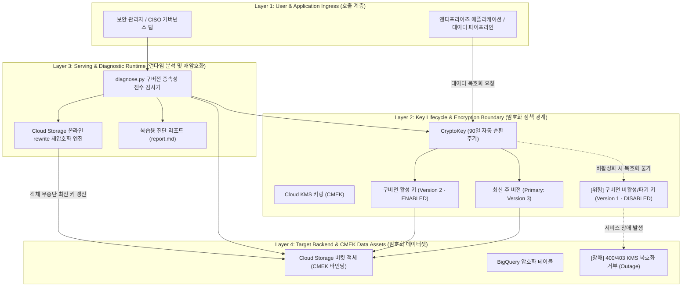

<!--
Copyright 2026 Google LLC. All Rights Reserved.
SPDX-License-Identifier: Apache-2.0

NOTICE: This code/repository is owned by Google LLC and provided under the Apache-2.0 License.
It is strictly provided as an EXAMPLE/REFERENCE ONLY and is NOT INTENDED FOR PRODUCTION USE.
All contents, designs, and code examples are subject to change, modification, or removal at any time without notice.

[고지 사항] 본 저장소 및 문서는 구글 (Google LLC) 소유이며 Apache 2.0 라이선스 하에 예시 (Sample) 용도로 제공된다.
프로덕션 환경용이 아니며, 사전 통지 없이 언제든지 수정, 변경 또는 삭제될 수 있다.
-->

> [!IMPORTANT]
> **구글 (Google LLC) 참조용 샘플 고지 사항**:
> 본 프로젝트의 모든 소스 코드와 문서는 Google LLC의 소유이며, Apache-2.0 라이선스에 따라 오직 **참조용 샘플 (Sample / Reference Only)** 목적으로만 제공된다. 프로덕션 환경에 그대로 사용할 수 없으며, 사전 통지 없이 언제든 내용이 수정, 변경 또는 삭제될 수 있다.

# Cloud KMS CMEK 키 순환 및 구버전 비활성화 장애 예방기 (kms-key-rotation-outage-guard)

클라우드 KMS(Cloud KMS) 암호화 키(CMEK) 자동 순환 후 구버전(CryptoKeyVersion) 키를 비활성화하거나 삭제할 때 클라우드 스토리지(Cloud Storage) 객체 및 영구 데이터의 복호화 실패로 인한 대형 서비스 장애(Outage)를 사전 탐지하고 안전한 데이터 재암호화(Rewrite) 워크플로우를 처방하는 도구다. (As of 2026-10-17)

---

## 1. 발생 증상 및 진단 대상 체크리스트

사내 또는 고객사 환경에서 아래 증상이 발생한다면 즉시 진단 대상이다:
- [ ] Cloud KMS CMEK 키를 90일 주기로 자동 순환(Rotation)하도록 설정한 후 구버전 키를 안전하게 정리하고자 하는 경우
- [ ] 보안 규정 준수를 위해 이전 버전의 키를 비활성화(Disable)하거나 파기 예정(Destroy Scheduled)으로 전환하려 할 때, 해당 키로 암호화된 기존 데이터가 남아 있는지 검증해야 하는 경우
- [ ] 구버전 키가 비활성화되어 `Cloud Storage` 객체 다운로드 또는 `BigQuery` 테이블 조회 시 즉시 400/403 KMS 복호화 거부 장애가 발생하는 사태를 미연에 방지하려는 경우
- [ ] 최신 주 버전(Primary Version) 키로 기존 스토리지 객체들을 온라인 상태에서 무중단 일괄 재암호화(`rewrite`)하는 표준 절차가 필요한 경우


### 1.1 도구의 본질 및 비즈니스 해결 과제 (What & Why)
- **대상 사용자 (Target)**: 클라우드 보안 엔지니어, 스토리지 관리자, CISO 및 데이터 인프라 운영팀
- **해결하는 핵심 문제 (Core Pain Points)**:
  1. Cloud KMS 암호화 키(CMEK) 자동 순환 후 구버전(CryptoKeyVersion) 키를 무심코 비활성화하거나 파기하여 Cloud Storage 객체 복호화 실패 장애 발생
  2. 수년 전 구버전 키로 암호화된 아카이브 데이터나 백업 객체가 여전히 존재하는지 사전에 확인하지 못해 대형 서비스 장애로 이어지는 위험
  3. KMS 키 라이프사이클 관리와 Cloud Storage 버킷의 객체 재암호화(Rewrap) 절차가 체계화되지 않은 문제
- **본 솔루션의 해결 방식 (Solution)**:
  - Cloud KMS 키 링의 버전별 라이프사이클 상태를 점검하고, Cloud Storage 버킷 내 객체들의 암호화 키 버전을 전수 대조하여 구버전 키 비활성화 시 발생할 수 있는 데이터 손실 위험을 1분 만에 사전 차단한다.

### 1.2 최종 산출물 3종 세트 미리보기 (Deliverables & Visual Preview)
본 도구를 실행(`python diagnose.py`)하면 다음 3가지 구체적인 엔터프라이즈 자산이 생성된다:

| 산출물 구분 | 산출물 형태 및 명칭 | 주요 포함 내용 및 실무 활용 방안 |
| :--- | :--- | :--- |
| **① 터미널 콘솔 요약** | Visual CLI Table | KMS 키 버전별 상태(기본/사용중/비활성), 버킷 내 객체별 암호화 키 버전 분포 및 비활성화 안전성 판정 표 |
| **② 정규 진단 보고서** | 마크다운 파일 (`report.md`) | CMEK 키 순환 정합성 보고서, 위험 객체 목록, 객체 재암호화(Rewrap) 스크립트 및 안전한 키 순환 절차서 |
| **③ 후속 조치 및 배포 자산** | Actionable Asset Specs | • **객체 일괄 재암호화 gcloud 명령어**: 구버전 객체를 최신 기본 키로 재암호화하는 스크립트<br/>• **안전한 구버전 키 비활성화 명령어**: 검증 완료 후 구버전을 안전하게 중단하는 gcloud 명령<br/>• **KMS 키 상태 변경 감사 모니터링**: 키 비활성화/파기 시도 시 긴급 알림을 전송하는 정책 |

---

## 2. 빠른 시작 (Quickstart)

> [!TIP]
> Cloud Shell 접속 환경 구성 및 저장소 클론(`git clone`) 방법은 루트의 [메인 README](../../README.md)를 참고한다.

### 1) 모의 데이터 가상 실행 (Dry-Run)
GCP API 호출 없이 내장된 가상 인프라 데이터로 정상 동작 여부를 즉시 검증한다:
```bash
python diagnose.py --dry-run
```

**터미널 진단 출력 미리보기:**
```text
================================================================================
Cloud KMS CMEK 키 순환 및 구버전 비활성화 장애 예방 리포트
진단 모드: 가상 실행 (Dry-run)
대상 프로젝트: sample-project-id
암호화 키 경로: projects/sample-project-id/locations/asia-northeast3/keyRings/prod-keyring/cryptoKeys/customer-data-key
현재 주 버전(Primary): 버전 3
자동 순환 주기: 90일 (7,776,000초)
================================================================================
[1단계] Cloud KMS CryptoKey 버전별 라이프사이클 상태 점검
--------------------------------------------------------------------------------
```


### 2) 사내 환경 대화형 설정 (Config Wizard, 선택 사항)
사내 활성 프로젝트 및 환경 설정을 대화형으로 탐색하여 `.env`에 자동 저장한다:
```bash
python diagnose.py --config
```


### 3) 실제 사내 인프라 실시간 진단
```bash
python diagnose.py
```
> [!NOTE]
> 앞서 `python diagnose.py --config`로 환경 설정을 저장했거나 gcloud 활성 설정을 그대로 활용할 경우 별도의 `.env` 생성 없이 즉시 실행할 수 있다. (환경 변수를 텍스트 에디터로 직접 수동 편집하고자 할 때만 `cp -n .env.example .env` 실행 후 수정)

---

## 3. 솔루션 아키텍처 및 처리 흐름



---
## 4. 조치 가이드 및 권장 설정

1. **파기 예정 키 복구(Restore)**:
   - Cloud KMS ( https://console.cloud.google.com/security/kms ) > 키 링 선택 > 키 선택 > 파기 예정 버전 복구
   - Cloud KMS 키 순환 및 버전 관리 ( https://cloud.google.com/kms/docs/key-rotation )
2. **Cloud Storage 객체 재암호화(Rewrite)**:
   - 이전 버전 키로 암호화된 객체는 Cloud Storage의 온라인 `rewrite` 명령어를 통해 서비스 중단 없이 최신 주 버전(Primary) 키로 다시 암호화할 수 있다.
   - Cloud Storage 고객 관리 암호화 키(CMEK) 관리 ( https://cloud.google.com/storage/docs/encryption/customer-managed-keys )
3. **구버전 키 비활성화 및 안전 폐기**:
   - 버킷 내 모든 객체의 암호화 버전이 최신 주 버전으로 일원화된 것을 확인한 후 구버전을 `DISABLED` 처리하여 보안 정책을 완결한다.

---
## 5. 사전 준비 사항 (필요 IAM 권한)

본 도구를 실행하려면 최소 아래의 IAM 권한이 필요하다:

본 도구를 실행하려면 최소 아래의 IAM 권한이 필요하다:

| 서비스 | 필요 역할(Role) | 최소 IAM 권한 |
| :--- | :--- | :--- |
| `Cloud KMS` | `클라우드 KMS 뷰어(roles/cloudkms.viewer)` | `cloudkms.cryptoKeys.get`, `cloudkms.cryptoKeyVersions.list` |
| `Cloud Storage` | `스토리지 객체 뷰어(roles/storage.objectViewer)` | `storage.buckets.get`, `storage.objects.get`, `storage.objects.list` |

---

## 6. 기술적 배경 및 아키텍처 원리 (Deep Dive)

### 관련 상세 설계 및 요구 사항 명세
- [비즈니스 요구 사항 명세서 (BRD)](docs/BRD.md): 비즈니스 배경, 성공 지표 및 요구 사항(BR-01~) 명세
- [기술 상세 설계서 (TDD)](docs/TDD.md): 시스템 아키텍처, 기능(FR-01~) 및 비기능(NFR-01~) 설계 명세

```text
================================================================================
Cloud KMS CMEK 키 순환 및 구버전 비활성화 장애 예방 리포트
진단 모드: 가상 실행 (Dry-run)
대상 프로젝트: demo-kms-project
암호화 키 경로: projects/demo-kms-project/locations/asia-northeast3/keyRings/prod-keyring/cryptoKeys/customer-data-key
현재 주 버전(Primary): 버전 3
자동 순환 주기: 90일 (7,776,000초)
================================================================================

[1단계] Cloud KMS CryptoKey 버전별 라이프사이클 상태 점검
--------------------------------------------------------------------------------
버전       기본 키       상태                   생성 일자                  위험 등급     
--------------------------------------------------------------------------------
v3       YES (Primary) ENABLED              2026-06-01T09:00:00Z   OK        
v2       NO         ENABLED              2026-03-01T09:00:00Z   WARNING   
v1       NO         DESTROY_SCHEDULED    2025-12-01T09:00:00Z   CRITICAL  
--------------------------------------------------------------------------------

[2단계] Cloud Storage 버킷 내 구버전 키 종속성 및 객체 분포 분석
--------------------------------------------------------------------------------
대상 버킷: gs://demo-kms-customer-archive
점검 객체 총합: 1,250개

암호화 버전           객체 수         비율         위험도       
--------------------------------------------------------------------------------
버전 3            620          49.6%      NONE      
버전 2            480          38.4%      MEDIUM    
버전 1            150          12.0%      CRITICAL  
--------------------------------------------------------------------------------

[3단계] 서비스 장애 방지 긴급 처방 및 데이터 재암호화 가이드
1. [긴급] 파기 예정 또는 비활성화된 구버전 키 즉각 복구 (장애 방어):
   gcloud kms keys versions restore 1 \
     --key=customer-data-key \
     --keyring=prod-keyring \
     --location=asia-northeast3

2. [필수] 구버전 키로 암호화된 객체를 최신 주 버전(Primary)으로 일괄 재암호화(Rewrite):
   # 최신 주 키(v3)로 객체 메타데이터 및 암호화 블록 갱신:
   gcloud storage objects rewrite gs://demo-kms-customer-archive/**

3. [검증] 모든 객체가 최신 주 버전 키로 마이그레이션 완료된 후에만 구버전 비활성화(Disable):
   gcloud kms keys versions disable 1 \
     --key=customer-data-key \
     --keyring=prod-keyring \
     --location=asia-northeast3
================================================================================
```

---
## 7. 리소스 정리 (Teardown) 안내

본 진단 도구는 읽기 전용으로 Cloud KMS 키 메타데이터와 버킷 객체 정보를 조회하므로 별도의 클라우드 인프라 자원을 생성하지 않는다. 실습용으로 생성한 테스트 KMS 키나 버킷이 있다면 불필요한 비용을 방지하기 위해 버킷을 비우고 삭제한다:

```bash
# 테스트 버킷 객체 삭제 및 버킷 제거
gcloud storage rm -r gs://BUCKET_NAME --quiet
```
