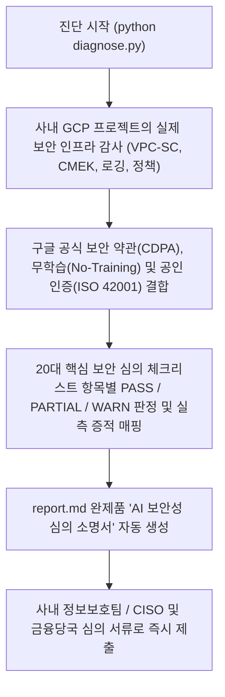

<!--
Copyright 2026 Google LLC. All Rights Reserved.
SPDX-License-Identifier: Apache-2.0

NOTICE: This code/repository is owned by Google LLC and provided under the Apache-2.0 License.
It is strictly provided as an EXAMPLE/REFERENCE ONLY and is NOT INTENDED FOR PRODUCTION USE.
All contents, designs, and code examples are subject to change, modification, or removal at any time without notice.

[고지 사항] 본 저장소 및 문서는 구글 (Google LLC) 소유이며 Apache 2.0 라이선스 하에 예시 (Sample) 용도로 제공된다.
프로덕션 환경용이 아니며, 사전 통지 없이 언제든지 수정, 변경 또는 삭제될 수 있다.
-->

> [!IMPORTANT]
> **구글 (Google LLC) 참조용 샘플 고지 사항**:
> 본 프로젝트의 모든 소스 코드와 문서는 Google LLC의 소유이며, Apache-2.0 라이선스에 따라 오직 **참조용 샘플 (Sample / Reference Only)** 목적으로만 제공된다. 프로덕션 환경에 그대로 사용할 수 없으며, 사전 통지 없이 언제든 내용이 수정, 변경 또는 삭제될 수 있다.

# Gemini & Gemini Enterprise 도입을 위한 한국형 AI 보안성 심의 체크리스트 진단기 (korea-ai-security-checklist)

사내 정보보호팀, CISO 및 금융감독원/금융보안원의 생성형 AI 도입 보안성 심의에 대비하여, 구글의 고객 데이터 비학습(No-Training) 정책, 인적 검토 배제(No Human Review), ISO/IEC 42001 국제 인증 및 사내 GCP 프로젝트의 실제 기술적 통제(VPC-SC, CMEK, Audit Logs) 상태를 실시간 대조하여 20대 핵심 보안 체크리스트 완제품 소명서(`report.md`)를 1분 만에 자동 생성하는 컴플라이언스 진단 도구다. (As of 2026-10-17)

---

## 1. 발생 증상 및 진단 대상 체크리스트

사내 또는 고객사 환경에서 아래 증상이 발생한다면 즉시 진단 대상이다:
- [ ] 사내 업무 혁신을 위해 Gemini API(버텍스 AI(Vertex AI)) 또는 Gemini Enterprise App을 도입하려 하나, 사내 정보보호팀 및 CISO의 보안성 심의 승인 장벽에 부딪혔을 때
- [ ] 보안팀으로부터 수십 개 문항의 엑셀/워드 체크리스트(데이터 재학습 여부, 전송 암호화, 인적 검토, 접근 통제 등)를 수신했으나, 구글 공식 약관과 기술적 증적 작성이 막막할 때
- [ ] 금융감독원/금융보안원 보안성 심의 또는 K-ISMS 심사를 앞두고, 클라우드 프로젝트의 실제 보안 설정(CMEK, Audit Logs, Bucket Lock)을 객관적으로 입증해야 할 때
- [ ] 사내 도입 검토 초기 단계에 승인용 보안 보고서를 신속하게 확보하고자 할 때

---

## 2. 빠른 시작 (Quickstart)

> [!TIP]
> Cloud Shell 접속 환경 구성 및 저장소 클론(`git clone`) 방법은 루트의 [메인 README](../../README.md)를 참고한다.

### 0) 사내 환경 대화형 설정 (Config Wizard, 선택 사항)
사내 활성 프로젝트 및 환경 설정을 대화형으로 탐색하여 `.env`에 자동 저장한다:
```bash
python diagnose.py --config
```

### 1) 모의 데이터 가상 실행 (Dry-Run)
GCP API 호출 없이 내장된 가상 인프라 데이터로 정상 동작 여부를 즉시 검증한다:
```bash
python diagnose.py --dry-run
```

**터미널 진단 출력 미리보기:**
```text
* 본 진단 결과는 report.md 파일에 완제품 'AI 보안성 심의 소명서' 양식으로 자동 생성되었다.
  * 사내 보안팀 또는 금융감독원/금융보안원 보안성 심의 질의서 대응 시 report.md 표를 즉시 활용할 수 있다.
========================================================================================================
[안내] 복습 및 사내 보안팀 제출용 소명서가 생성(덮어쓰기)되었다: /usr/local/google/home/stanleychoi/Projects/google-cloud-0-to-1/samples/korea-ai-security-checklist/report.md
```

### 2) 실제 사내 인프라 실시간 진단
```bash
cp .env.example .env
python diagnose.py
```
> [!NOTE]
> `.env` 설정값을 비워두면 gcloud 활성 설정 및 사내 리소스를 자동으로 감지하여 진단한다.

---

## 3. 진단 및 해결 흐름



---
## 4. 조치 가이드 및 권장 설정

### 1단계: 완제품 소명서 확인 및 사내 제출
실행 즉시 생성된 [report.md](report.md)를 열어 20대 핵심 보안 체크리스트 조견표와 증적 내용을 확인하고, 사내 정보보호팀 또는 규제 심의 신청 서류의 첨부 증적으로 제출한다 (세부 20대 항목 명세 및 법적 근거는 [docs/CHECKLIST.md](docs/CHECKLIST.md) 참조):
- 구글 클라우드 생성형 AI 데이터 거버넌스 및 개인정보 보호 ( https://cloud.google.com/terms/data-processing-addendum )
- Google Cloud 글로벌 컴플라이언스 및 ISO 42001 인증 현황 ( https://cloud.google.com/security/compliance/iso-42001 )

### 2단계: 기술적 미흡(WARN/FAIL) 항목 보완
- **CMEK 미적용 시**: `samples/korea-regulatory-perimeter-guard`의 처방을 참조하여 Cloud KMS 키링을 생성하고 버킷/데이터셋에 바인딩한다.
- **감사 로깅 미흡 시**: `samples/gemini-request-response-logging`을 참조하여 `DATA_READ/WRITE` 로그 및 빅쿼리(BigQuery) 스트리밍 싱크를 활성화한다.
- **조직 정책 미적용 시**: `gcp.resourceLocations` 및 `iam.disableServiceAccountKeyCreation` 정책을 활성화하여 중앙 통제를 강화한다.

---
## 5. 사전 준비 사항 (필요 IAM 권한)

본 도구를 실행하려면 최소 아래의 IAM 권한이 필요하다:

### (1) 필수 API 활성화 (실측 감사 시)
```bash
gcloud services enable compute.googleapis.com logging.googleapis.com cloudresourcemanager.googleapis.com
```

### (2) 진단 실행 계정 최소 IAM 권한

| 역할 (Role) | 설명 |
| :--- | :--- |
| `조직 뷰어(roles/resourcemanager.organizationViewer)` | 사내 조직 정책(`resourceLocations`, `allowedPolicyMemberDomains` 등) 조회 권한 |
| `클라우드 로깅 뷰어(roles/logging.viewer)` | Cloud Audit Logs 데이터 접근 감사 로깅 활성화 상태 조회 권한 |
| `클라우드 KMS 뷰어(roles/cloudkms.viewer)` | 클라우드 KMS(Cloud KMS) 키링 및 CMEK 적용 상태 확인 권한 |

---

## 6. 기술적 배경 및 아키텍처 원리 (Deep Dive)

### 관련 상세 설계 및 요구 사항 명세
- [비즈니스 요구 사항 명세서 (BRD)](docs/BRD.md): 비즈니스 배경, 성공 지표 및 요구 사항(BR-01~) 명세
- [기술 상세 설계서 (TDD)](docs/TDD.md): 시스템 아키텍처, 기능(FR-01~) 및 비기능(NFR-01~) 설계 명세

보안 심의 통제 대상 GCP 리소스(Cloud Storage 버킷, BigQuery 데이터셋, Cloud KMS 키링, Cloud Run 등) 배포 시 4대 표준 라벨을 반드시 적용한다:
- `managed-by`: `google-cloud-0-to-1`
- `scenario`: `korea-ai-security-checklist`
- `env`: `sample` (또는 `poc`)
- `created-by`: `customer-engineer`

---
## 7. 리소스 정리 (Teardown) 안내

본 도구는 순수 읽기 전용 진단 도구이므로 별도의 클라우드 인프라 자원을 생성하지 않으며, 추가 삭제 절차가 필요하지 않다.
